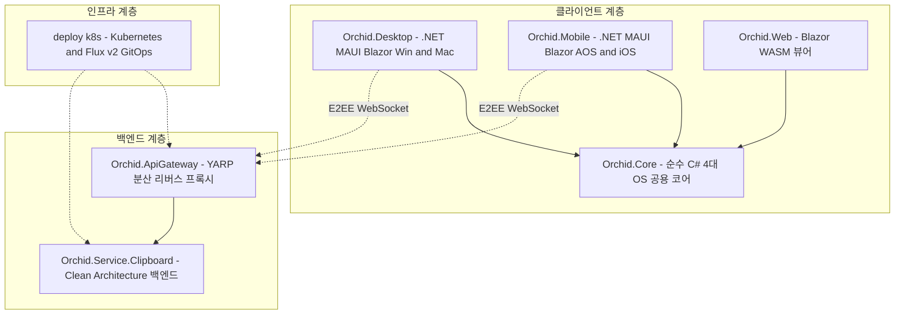

# 🌿 Orchid

> **Universal E2EE Clipboard Synchronization & History Ecosystem**  
> Cross-platform clipboard sharing across **Windows, macOS, Android, and iOS** built with **.NET 9, .NET MAUI, and Clean Architecture**.

[](https://dotnet.microsoft.com/)
[](https://learn.microsoft.com/en-us/dotnet/csharp/)
[](https://dotnet.microsoft.com/apps/maui)
[](LICENSE)

---

## 🌟 Overview

**Orchid**는 단절된 운영체제 생태계(Windows, macOS, Android, iOS) 사이에서 텍스트, 코드, 이미지 클립보드를 **Zero-Knowledge 종단간 암호화(E2EE, AES-256-GCM)**로 실시간 동기화하고 안전하게 보관하는 크로스 플랫폼 풀스택 모노레포 프로젝트입니다.

### 핵심 기능 (Key Highlights)
* 🔒 **Zero-Knowledge E2EE**: 클립보드 데이터는 오직 사용자 기기에서만 암호화 및 복호화되며, 중앙 릴레이 서버조차 내용을 알 수 없음.
* 💻 **Desktop (Win32 & macOS)**: Windows(`AddClipboardFormatListener`) 및 macOS(`NSPasteboard` changeCount) 상시 백그라운드 캡처.
* 📱 **Mobile (Android & iOS)**: Android 접근성 서비스(Accessibility) 자동 캡처 및 iOS 샌드박스를 고려한 공유 시트(Share Sheet) / APNs 수신 파이프라인.
* 🧱 **Universal Client Core**: 4대 OS가 순수 C# 라이브러리(`Orchid.Core`)를 100% 공유하여 도메인 불변식 보호 및 중복 코드 제로화.
* ☸️ **Cloud-Native GitOps**: YARP API 게이트웨이 및 Kubernetes 선언적 Kustomize / Flux v2 배포 매니페스트 내장.

---

## 🏛 Architecture



---

## 📁 Repository Structure

```text
Orchid/
├── deploy/
│   └── k8s/                     # Kubernetes 선언적 매니페스트 (Kustomize, Flux v2)
├── docs/
│   ├── architecture/            # 시스템 아키텍처 및 E2EE 암호화 프로토콜 명세
│   └── planning/                # 기능 및 설계 계획서
├── src/
│   ├── Core/                    # 4대 OS 공용 비즈니스 코어 (순수 C# .NET 9)
│   ├── Desktop/                 # .NET MAUI Blazor Hybrid (Windows / macOS)
│   ├── Mobile/                  # .NET MAUI Blazor Hybrid (Android / iOS)
│   ├── Web/                     # Blazor WebAssembly 클립보드 뷰어 대시보드
│   ├── Service/
│   │   ├── ApiGateway/          # YARP 기반 고성능 리버스 프록시 및 세션 라우팅
│   │   └── Clipboard/           # Clean Architecture E2EE 암호화 릴레이 백엔드
│   └── Shared/
│       └── Contract/            # 공통 DTO 및 E2EE 통신 페이로드 정의
├── Directory.Build.props        # 공통 컴파일러, C# 13, 널러블 설정
├── Directory.Packages.props     # 중앙 집중식 NuGet 패키지 버전 관리 (CPVM)
├── .editorconfig
└── README.md
```

---

## 🛠 Tech Stack

| 영역 | 기술 스택 |
| :--- | :--- |
| **Language & Framework** | C# 13, .NET 9, .NET MAUI, Blazor Hybrid |
| **Desktop & Mobile** | Win32 API, AppKit / Cocoa, Android AccessibilityService, iOS Share Extension |
| **Cryptography** | AES-256-GCM, ECDH (Elliptic-curve Diffie-Hellman), Libsodium |
| **Local Storage** | SQLite-net (암호화 로컬 히스토리 캐시) |
| **Backend & Messaging** | ASP.NET Core, YARP, SignalR / WebSocket, MediatR (CQRS), PostgreSQL |
| **Infrastructure & DevOps** | Kubernetes, Flux v2, Kustomize, GitHub Actions |

---

## 📄 License

This project is proprietary and confidential. All rights reserved. See the [LICENSE](LICENSE) file for details.
