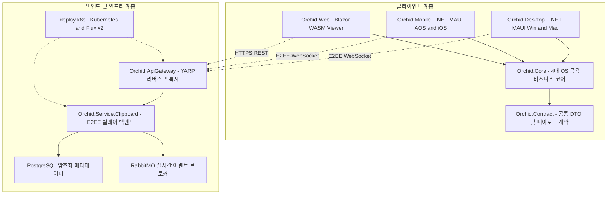
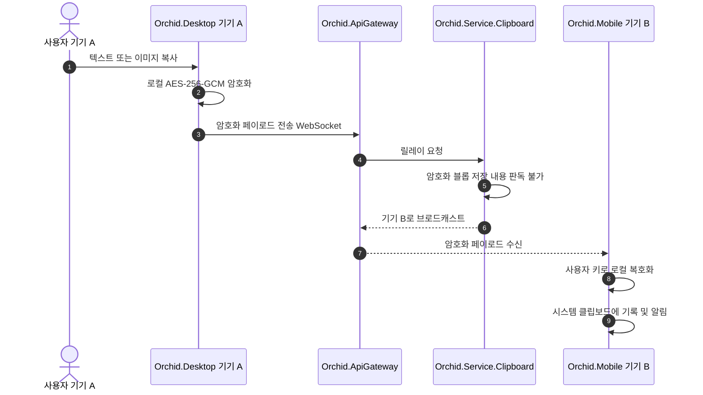

# 🌿 Orchid 시스템 아키텍처 및 설계 구조 명세서

---

## 1. 개요 및 비전

**Orchid**는 단절된 이종 운영체제 생태계(**Windows, macOS, Android, iOS**) 사이에서 텍스트, 코드, 이미지 클립보드 데이터를 **Zero-Knowledge 종단간 암호화(E2EE, AES-256-GCM)**로 실시간 동기화하고 로컬에 안전하게 보관하는 크로스 플랫폼 풀스택 모노레포 시스템입니다.

### 핵심 설계 원칙
1. **Zero-Knowledge E2EE (종단간 암호화)**: 클립보드 내용은 오직 사용자의 기기에서만 암호화 및 복호화되며, 중앙 릴레이 서버는 원문 내용을 알 수 없습니다.
2. **Universal Client Core**: 데스크톱, 모바일, 웹 3대 클라이언트가 순수 C# 도메인 및 암호화 로직(`Orchid.Core`)을 100% 공유합니다.
3. **OS 보안 샌드박스 최적화**: Windows/macOS의 상시 백그라운드 훅, Android 접근성 서비스, iOS의 Share Extension 및 APNs 푸시 연동 등 각 OS별 최적의 네이티브 통로를 구축합니다.
4. **Cloud-Native & GitOps**: YARP API 게이트웨이 및 Kubernetes 선언적 GitOps 배포 파이프라인을 내장합니다.

---

## 2. 전체 시스템 아키텍처 다이어그램

---

## 3. 계층별 상세 설계 구조

### 3.1 클라이언트 계층 (Client Tier)
* **`Orchid.Contract`**: 클라이언트와 서버가 공유하는 직렬화 가능한 불변 Record DTO 및 E2EE 전송 규격.
* **`Orchid.Core`**:
  - 특정 OS UI 프레임워크에 종속되지 않는 순수 C# .NET 9 라이브러리.
  - SQLite 로컬 캐시, AES-256-GCM 암호화/복호화 엔진, 상태 관리 스토어, Refit HTTP/SignalR 클라이언트.
* **`Orchid.Desktop`**:
  - Windows: Win32 `AddClipboardFormatListener` 기반 백그라운드 실시간 감시.
  - macOS: `NSPasteboard` `changeCount` 기반 변경 감시.
  - 시스템 트레이 및 글로벌 단축키 바인딩.
* **`Orchid.Mobile`**:
  - Android: `AccessibilityService`를 통한 포커스 감지 및 백그라운드 자동 복사.
  - iOS: `Share Extension`을 통한 원클릭 수동 전송 및 `APNs` 무음 푸시 기반 수신 쓰기.
* **`Orchid.Web`**:
  - 브라우저 기반 가상화 그리드 클립보드 검색 및 북마크 뷰어.

### 3.2 백엔드 및 인프라 계층 (Backend & Infrastructure Tier)
* **`Orchid.ApiGateway`**:
  - YARP(Yet Another Reverse Proxy) 기반 동적 라우팅 및 WebSocket/SignalR 연결 풀링.
  - Redis 토큰 버킷 기반 분산 Rate Limiting.
* **`Orchid.Service.Clipboard`**:
  - Clean Architecture (Domain - Application - Infrastructure - Api) 구조.
  - CQRS 패턴(MediatR) 기반 암호화 블롭 저장 및 디바이스 간 브로드캐스트.
* **`deploy/k8s`**:
  - Flux v2 선언적 GitOps 배포 매니페스트 및 Kustomize 멀티 환경(Staging/Prod) 구성.

---

## 4. E2EE 암호화 및 동기화 프로토콜 흐름

