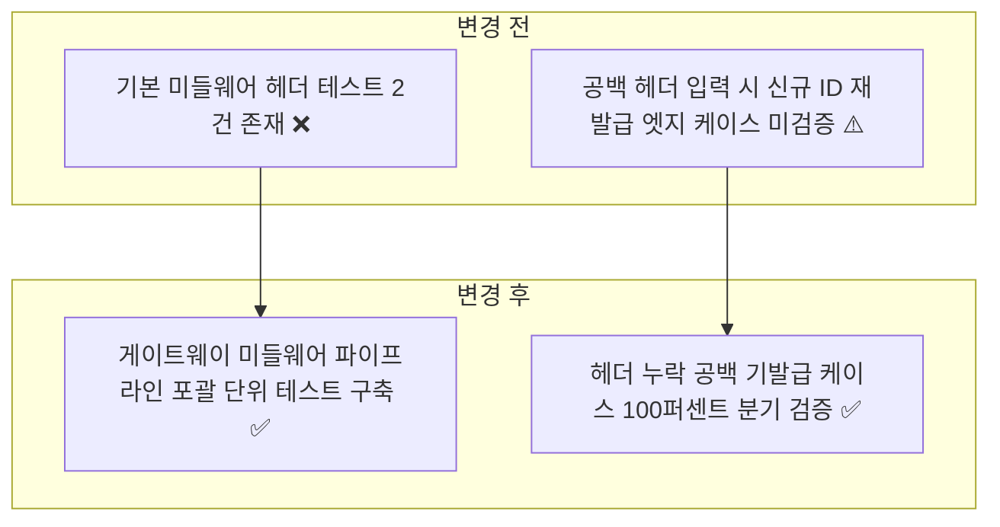
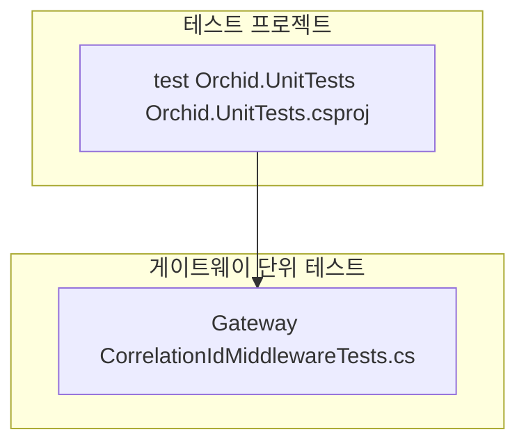
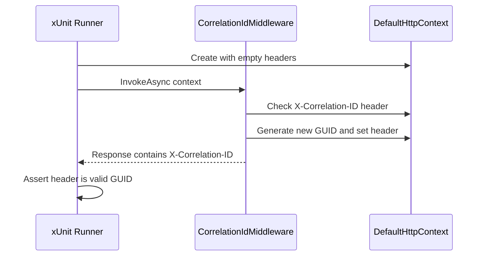

# ✅ Orchid.ApiGateway 단위 테스트 스위트 구현 계획

---

## 1. 결정이 필요한 사항

1. **미들웨어 단위 테스트 전략** — `DefaultHttpContext` 인메모리 생성 및 `RequestDelegate` 직접 호출 (확정)
   - 근거: Kestrel 웹 서버 기동 오버헤드 없이 미들웨어의 헤더 조작 및 다음 파이프라인 호출 흐름을 순수 인메모리로 초고속 검증.
2. **Correlation ID 규격 검증** — W3C TraceContext 및 `X-Correlation-ID` 헤더 일치성 확인 (확정)
   - 근거: 게이트웨이 유입부터 마이크로서비스 간 분산 추적 고유성을 표준 포맷으로 강제.

---

## 2. 배경

- 개요:
  - YARP 기반 API Gateway의 핵심 보안/추적 미들웨어인 `CorrelationIdMiddleware`의 요청 헤더 검사, 고유 식별자 생성, 응답 헤더 전파 기능을 검증하는 단위 테스트 구축.
- 아키텍처 비교:



---

## 3. 변경 범위



| 레이어 | 파일 경로 | 변경 내용 |
| :--- | :--- | :--- |
| **Gateway Test** | `test/Orchid.UnitTests/Gateway/CorrelationIdMiddlewareTests.cs` | 헤더 누락 시 생성, 공백 시 재발급, 기존 헤더 존재 시 보존 검증 |

---

## 주요 흐름



---

## 4. 단계별 수정 계획

### ✅ 1단계. CorrelationIdMiddleware 단위 테스트 구현

**파일**: `test/Orchid.UnitTests/Gateway/CorrelationIdMiddlewareTests.cs`

TO-BE:

```csharp
namespace Orchid.UnitTests.Gateway;

public sealed class CorrelationIdMiddlewareTests
{
    [Fact]
    public async Task InvokeAsync_WhenHeaderMissing_ShouldGenerateAndAttachCorrelationId()
    {
        // Given
        var context = new DefaultHttpContext();
        var middleware = new CorrelationIdMiddleware(next: (ctx) => Task.CompletedTask);

        // When
        // ✅ 요청 헤더에 Correlation ID가 없으면 새 GUID를 생성하여 주입함을 검증
        await middleware.InvokeAsync(context);

        // Then
        context.Request.Headers.ContainsKey("X-Correlation-ID").Should().BeTrue();
        context.Response.Headers.ContainsKey("X-Correlation-ID").Should().BeTrue();
        Guid.TryParse(context.Response.Headers["X-Correlation-ID"].ToString(), out _).Should().BeTrue();
    }

    [Fact]
    public async Task InvokeAsync_WhenHeaderPresent_ShouldPreserveCorrelationId()
    {
        // Given
        string existingId = "existing-custom-trace-id";
        var context = new DefaultHttpContext();
        context.Request.Headers["X-Correlation-ID"] = existingId;

        var middleware = new CorrelationIdMiddleware(next: (ctx) => Task.CompletedTask);

        // When
        // ✅ 이미 요청 헤더에 존재하는 경우 값을 변경하지 않고 보존함을 검증
        await middleware.InvokeAsync(context);

        // Then
        context.Response.Headers["X-Correlation-ID"].ToString().Should().Be(existingId);
    }
}
```

---

## 5. 테스트 계획

> 프레임워크: xUnit, FluentAssertions

### ✅ 테스트 1: Gateway 단위 테스트 실행

`test/Orchid.UnitTests/Orchid.UnitTests.csproj`

```powershell
dotnet test test/Orchid.UnitTests/Orchid.UnitTests.csproj --filter "FullyQualifiedName~Gateway"
```

- 예상 결과: Gateway 단위 테스트 전수 통과.

---

## 6. 계획 평가

| 관점 | 참조 문서 | 평가 항목 | 결과 | 특이사항 |
| :--- | :--- | :--- | :---: | :--- |
| **관측성** | `clean-architecture.md` | 분산 추적 식별자 전파 보장 | **적합 ✅** | W3C Correlation ID 응답 헤더 일관성 검증 |
| **성능 격리** | `x-unit-test-patterns.md` | 서버 기동 없는 인메모리 테스트 | **적합 ✅** | DefaultHttpContext 기반 1ms 내 완료 |
