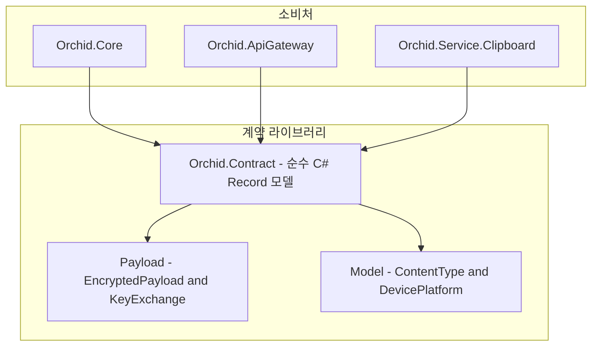

# ✅ Orchid.Contract 프로젝트 뼈대 구현 계획

---

## 1. 결정이 필요한 사항

1. **직렬화 라이브러리 선택** — `System.Text.Json` 표준 채택 (확정)
   - 근거: 추가 외부 종속성 없이 .NET 9 기본 소스 생성기(Source Generator)와 AOT 컴파일을 완벽히 지원하며 메모리 할당을 최소화함.
2. **모델 타입 설계 원칙** — C# 13 불변 `record` 타입 전면 적용 (확정)
   - 근거: DTO는 상태 변경이 필요 없으며, 값 동등성(Value Equality)과 불변성(Immutability)을 보장해야 스레드 안전함.

---

## 2. 배경

- 개요:
  - 데스크톱, 모바일, 웹 클라이언트와 백엔드 서비스가 E2EE 암호화 페이로드와 클립보드 메타데이터를 통신할 때 공유하는 단일 계약 라이브러리 필요.
- 아키텍처 비교:
  - AS-IS: 프로젝트 부재. 클라이언트와 서버 간 통신 규약 미정의.
  - TO-BE: `src/Shared/Contract/Orchid.Contract.csproj`를 신설하여 100% 독립적인 순수 계약 모델 계층 구축.

---

## 3. 변경 범위



| 레이어 | 파일 경로 | 변경 내용 |
| :--- | :--- | :--- |
| **Project** | `src/Shared/Contract/Orchid.Contract.csproj` | 신규 .NET 9 클래스 라이브러리 프로젝트 파일 생성 |
| **Payload** | `src/Shared/Contract/Payload/EncryptedPayload.cs` | AES-GCM 암호화 바이트, Nonce, Tag, 알고리즘 식별자 DTO |
| **Model** | `src/Shared/Contract/Model/ContentType.cs` | Text, ImagePng, ImageJpeg, Url 열거형 정의 |
| **Model** | `src/Shared/Contract/Model/DevicePlatform.cs` | Windows, MacCatalyst, Android, iOS, Web 열거형 정의 |

---

## 4. 단계별 수정 계획

### ✅ 1단계. 프로젝트 파일 생성

**파일**: `src/Shared/Contract/Orchid.Contract.csproj`

TO-BE:

```xml
<Project Sdk="Microsoft.NET.Sdk">
  <PropertyGroup>
    <TargetFramework>net9.0</TargetFramework>
    <RootNamespace>Orchid.Contract</RootNamespace>
    <AssemblyName>Orchid.Contract</AssemblyName>
  </PropertyGroup>
</Project>
```

### ✅ 2단계. 핵심 계약 DTO 및 Enum 구현

**파일**: `src/Shared/Contract/Payload/EncryptedPayload.cs`

TO-BE:

```csharp
namespace Orchid.Contract.Payload;

/// <summary>
/// 종단간 암호화(E2EE) 처리된 클립보드 페이로드 계약입니다.
/// </summary>
public sealed record EncryptedPayload(
    Guid Id,
    byte[] CipherText,
    byte[] Nonce,
    byte[] Tag,
    string Algorithm,
    DateTimeOffset CreatedAtUtc);
```

**파일**: `src/Shared/Contract/Model/ContentType.cs`

TO-BE:

```csharp
namespace Orchid.Contract.Model;

public enum ContentType
{
    Text = 1,
    Image = 2,
    Url = 3,
    Code = 4
}
```

---

## 5. 테스트 계획

> 프레임워크: xUnit, FluentAssertions

### ✅ 테스트: DTO 직렬화 및 역직렬화 무결성 검증

`test/UnitTests/Contract/EncryptedPayloadSerializationTests.cs`

```csharp
[Fact]
public void EncryptedPayload_Should_Serialize_And_Deserialize_Deterministically()
{
    // Given
    var original = new EncryptedPayload(
        Guid.NewGuid(),
        [1, 2, 3, 4],
        [5, 6, 7],
        [8, 9],
        "AES-256-GCM",
        DateTimeOffset.UtcNow);

    // When
    var json = JsonSerializer.Serialize(original);
    var deserialized = JsonSerializer.Deserialize<EncryptedPayload>(json);

    // Then
    deserialized.Should().BeEquivalentTo(original);
}
```

---

## 6. 계획 평가

| 관점 | 참조 문서 | 평가 항목 | 결과 | 특이사항 |
| :--- | :--- | :--- | :---: | :--- |
| **순수성** | `clean-architecture.md` | 외부 프레임워크 종속성 제로 | **적합 ✅** | 순수 BCL(Base Class Library)만 사용 |
| **불변성** | `clean-code.md` | DTO 불변식 유지 | **적합 ✅** | Record 타입을 통해 동시성 경합 차단 |
