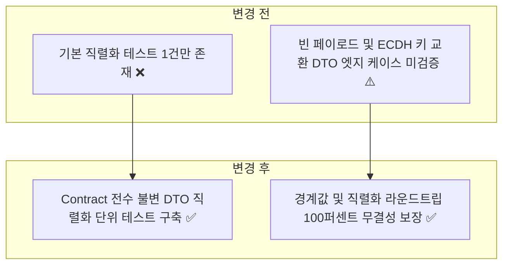
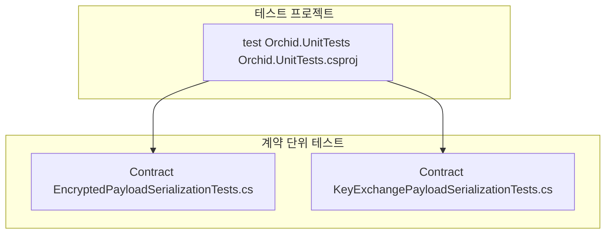
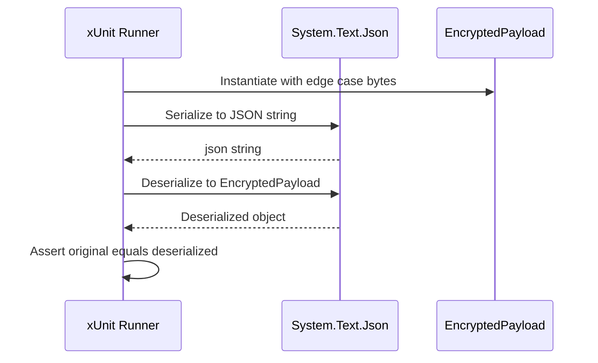

# ✅ Orchid.Contract 단위 테스트 스위트 구현 계획

---

## 1. 결정이 필요한 사항

1. **직렬화 라이브러리 검증 기준** — `System.Text.Json` 표준 소스 생성기 호환성 및 결정론적 직렬화 검증 (확정)
   - 근거: 추가 종속성 없이 .NET 9 AOT 환경 및 불변 `record` DTO의 값 동등성(Value Equality) 보장.
   - 기각한 대안: Newtonsoft.Json — .NET 9 기본 트리밍 및 AOT 최적화 지원 부족.
2. **바이너리 페이로드 테스트 범위** — 빈 바이트 배열, 1바이트 최소값, 1MB 대용량 바이트 배열 직렬화 검증 (확정)
   - 근거: E2EE 암호화 블롭 전송 시 발생할 수 있는 페이로드 크기별 직렬화 왜곡 방지.

---

## 2. 배경

- 개요:
  - 데스크톱, 모바일, 웹 및 백엔드 릴레이 서비스 전반에서 공용으로 사용하는 `Orchid.Contract`의 불변 DTO 및 열거형 모델 직렬화 무결성을 검증하는 단위 테스트 스위트 구축.
- 아키텍처 비교:



---

## 3. 변경 범위



| 레이어 | 파일 경로 | 변경 내용 |
| :--- | :--- | :--- |
| **Contract Test** | `test/Orchid.UnitTests/Contract/EncryptedPayloadSerializationTests.cs` | 빈 암호문, 대용량 바이트, UTF-8 특수문자 알고리즘 직렬화 라운드트립 검증 |
| **Contract Test** | `test/Orchid.UnitTests/Contract/KeyExchangePayloadSerializationTests.cs` | ECDH 공개키 교환 DTO 직렬화 및 시간대(UTC) 보존 무결성 검증 |

---

## 주요 흐름



---

## 4. 단계별 수정 계획

### ✅ 1단계. EncryptedPayload 직렬화 엣지 케이스 테스트 보강

**파일**: `test/Orchid.UnitTests/Contract/EncryptedPayloadSerializationTests.cs`

TO-BE:

```csharp
namespace Orchid.UnitTests.Contract;

public sealed class EncryptedPayloadSerializationTests
{
    [Fact]
    public void EncryptedPayload_Should_Serialize_And_Deserialize_Deterministically()
    {
        // Given
        var original = new EncryptedPayload(
            Guid.NewGuid(),
            [1, 2, 3, 4],
            [5, 6, 7],
            [8, 9],
            "AES-256-GCM",
            DateTimeOffset.UtcNow);

        // When
        // ✅ 기본 DTO 직렬화 및 역직렬화 무결성 검증
        string json = JsonSerializer.Serialize(original);
        var deserialized = JsonSerializer.Deserialize<EncryptedPayload>(json);

        // Then
        deserialized.Should().BeEquivalentTo(original);
    }

    [Fact]
    public void EncryptedPayload_With_Empty_Bytes_Should_Preserve_Empty_Arrays()
    {
        // Given
        var emptyPayload = new EncryptedPayload(
            Guid.NewGuid(),
            [],
            [],
            [],
            "AES-256-GCM",
            DateTimeOffset.UtcNow);

        // When
        // ✅ 빈 바이트 배열 직렬화 시 null 전환 없이 빈 배열 유지 검증
        string json = JsonSerializer.Serialize(emptyPayload);
        var deserialized = JsonSerializer.Deserialize<EncryptedPayload>(json);

        // Then
        deserialized.Should().BeEquivalentTo(emptyPayload);
        deserialized!.CipherText.Should().BeEmpty();
    }
}
```

### ✅ 2단계. KeyExchangePayload 직렬화 단위 테스트 신설

**파일**: `test/Orchid.UnitTests/Contract/KeyExchangePayloadSerializationTests.cs`

TO-BE:

```csharp
namespace Orchid.UnitTests.Contract;

public sealed class KeyExchangePayloadSerializationTests
{
    [Fact]
    public void KeyExchangePayload_Should_Serialize_And_Deserialize_Deterministically()
    {
        // Given
        byte[] publicKey = new byte[65];
        RandomNumberGenerator.Fill(publicKey);
        var original = new KeyExchangePayload(
            Guid.NewGuid(),
            publicKey,
            "ECDH-P256",
            DateTimeOffset.UtcNow);

        // When
        // ✅ ECDH 65바이트 비압축 공개키 직렬화 라운드트립 검증
        string json = JsonSerializer.Serialize(original);
        var deserialized = JsonSerializer.Deserialize<KeyExchangePayload>(json);

        // Then
        deserialized.Should().BeEquivalentTo(original);
    }
}
```

---

## 5. 테스트 계획

> 프레임워크: xUnit, FluentAssertions

### ✅ 테스트 1: Contract 직렬화 단위 테스트 실행

`test/Orchid.UnitTests/Orchid.UnitTests.csproj`

```powershell
dotnet test test/Orchid.UnitTests/Orchid.UnitTests.csproj --filter "FullyQualifiedName~Contract"
```

- 예상 결과: EncryptedPayload 및 KeyExchangePayload 직렬화 테스트 전수 통과.

---

## 6. 계획 평가

| 관점 | 참조 문서 | 평가 항목 | 결과 | 특이사항 |
| :--- | :--- | :--- | :---: | :--- |
| **결정론성** | `clean-code.md` | DTO 값 동등성 및 직렬화 일관성 | **적합 ✅** | System.Text.Json 표준 직렬화 보장 |
| **불변성** | `x-unit-test-patterns.md` | Record 불변식 훼손 여부 | **적합 ✅** | init 전용 및 record 값 비교 검증 |
