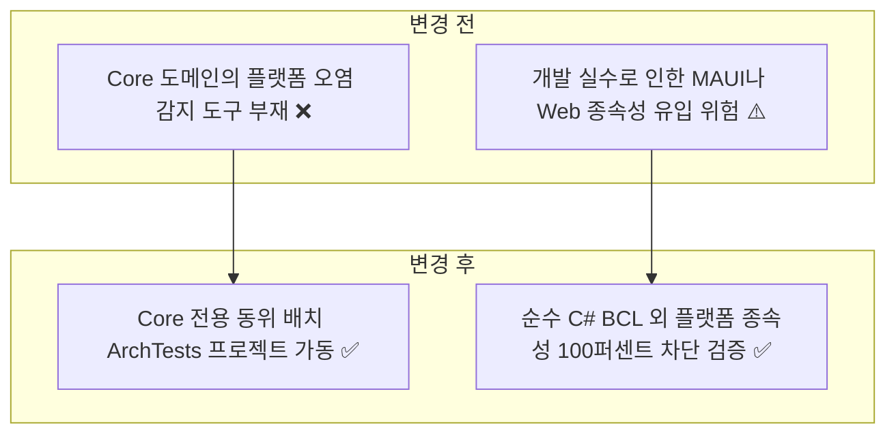
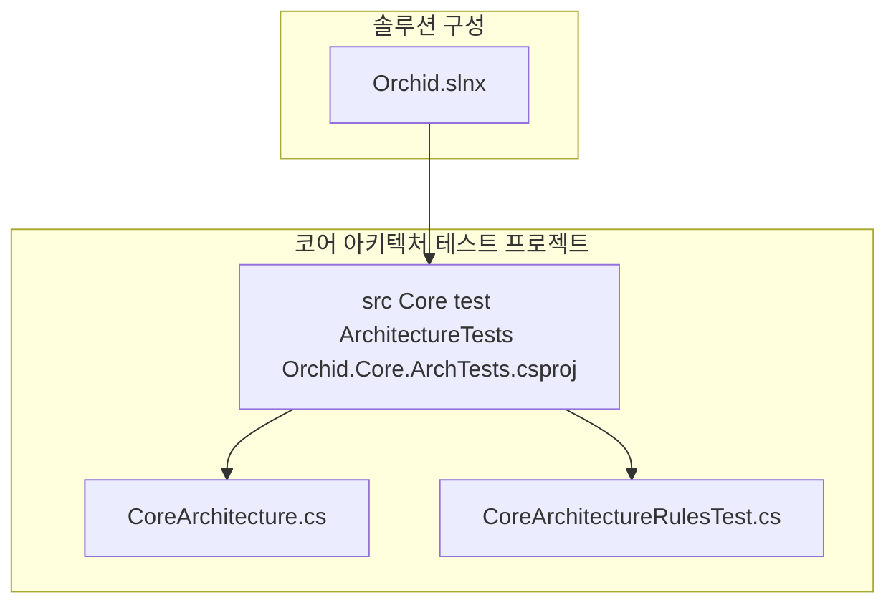
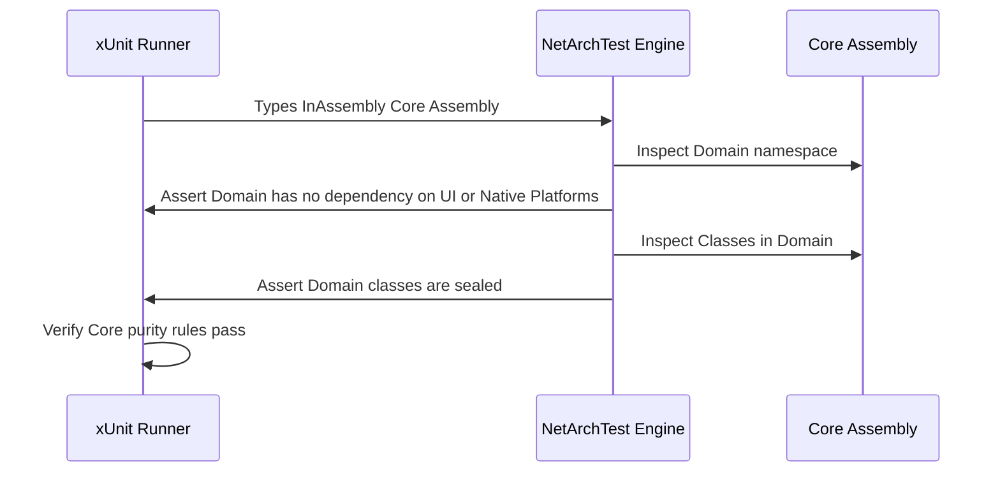

# ✅ Orchid.Core 플랫폼 독립성 및 도메인 순수성 검증 ArchTests 구축 계획

---

## 1. 결정이 필요한 사항

1. **Core 아키텍처 테스트 프로젝트 위치** — `src/Core/test/ArchitectureTests/` 동위 배치 채택 (확정)
   - 근거: 4대 OS 공용 비즈니스 라이브러리인 Core의 순수성을 보존하기 위해, 외부 플랫폼(MAUI/Win32/Android/iOS/Web) 종속성 유입 여부를 Core 경계에서 자체 검증.
2. **도메인 클래스 봉인(Sealed) 규칙 적용** — Core 내 엔티티 및 값 객체의 `sealed` 선언 강제 (확정)
   - 근거: Milan Jovanović의 Rich Domain Model 및 도메인 불변식 보호 원칙(상속으로 인한 불변식 훼손 차단).

---

## 2. 배경

- 개요:
  - 데스크톱, 모바일, 웹 5대 플랫폼이 공용으로 참조하는 `Orchid.Core`가 특정 OS UI나 웹 프레임워크에 오염되지 않도록 NetArchTest 기반 정적 아키텍처 게이트를 구축함.
- 아키텍처 비교:



---

## 3. 변경 범위



| 레이어 | 파일 경로 | 변경 내용 |
| :--- | :--- | :--- |
| **Project** | `src/Core/test/ArchitectureTests/Orchid.Core.ArchTests.csproj` | NetArchTest.Rules 및 xUnit 패키지 참조 프로젝트 신설 |
| **Arch Helper** | `src/Core/test/ArchitectureTests/CoreArchitecture.cs` | Core 어셈블리 및 검증 대상 레이어 정의 헬퍼 |
| **Arch Test** | `src/Core/test/ArchitectureTests/CoreArchitectureRulesTest.cs` | 플랫폼 무의존성 및 도메인 클래스 sealed 봉인 검증 |
| **Solution** | `Orchid.slnx` | Orchid.Core.ArchTests 프로젝트 솔루션 폴더 등록 |

---

## 주요 흐름



---

## 4. 단계별 수정 계획

### ✅ 1단계. Core ArchTests 프로젝트 파일 생성

**파일**: `src/Core/test/ArchitectureTests/Orchid.Core.ArchTests.csproj`

TO-BE:

```xml
<Project Sdk="Microsoft.NET.Sdk">
  <PropertyGroup>
    <TargetFramework>net9.0</TargetFramework>
    <ImplicitUsings>enable</ImplicitUsings>
    <Nullable>enable</Nullable>
    <IsPackable>false</IsPackable>
    <IsTestProject>true</IsTestProject>
  </PropertyGroup>

  <ItemGroup>
    <!-- ✅ NetArchTest.Rules 및 xUnit 라이브러리 참조 -->
    <PackageReference Include="FluentAssertions" Version="7.2.0" />
    <PackageReference Include="Microsoft.NET.Test.Sdk" Version="17.13.0" />
    <PackageReference Include="NetArchTest.Rules" Version="1.3.2" />
    <PackageReference Include="xunit" Version="2.9.3" />
    <PackageReference Include="xunit.runner.visualstudio" Version="3.0.2">
      <IncludeAssets>runtime; build; native; contentfiles; analyzers; buildtransitive</IncludeAssets>
      <PrivateAssets>all</PrivateAssets>
    </PackageReference>
  </ItemGroup>

  <ItemGroup>
    <!-- ✅ 대상 Core 어셈블리 참조 -->
    <ProjectReference Include="..\..\Orchid.Core.csproj" />
  </ItemGroup>
</Project>
```

### ✅ 2단계. Core 아키텍처 헬퍼 클래스 구현

**파일**: `src/Core/test/ArchitectureTests/CoreArchitecture.cs`

TO-BE:

```csharp
// keep: Assembly reflection type
using System.Reflection;

namespace Orchid.Core.ArchTests;

internal static class CoreArchitecture
{
    // ✅ Core 대상 어셈블리 지정
    public static readonly Assembly CoreAssembly = typeof(Domain.Entity.ClipboardItem).Assembly;
    public const string RootNamespace = "Orchid.Core";
}
```

### ✅ 3단계. Core 도메인 순수성 및 클래스 봉인 룰 구현

**파일**: `src/Core/test/ArchitectureTests/CoreArchitectureRulesTest.cs`

TO-BE:

```csharp
// keep: FluentAssertions extension methods
using FluentAssertions;
// keep: NetArchTest fluent rules
using NetArchTest.Rules;
// keep: xUnit Fact attribute
using Xunit;

namespace Orchid.Core.ArchTests;

public sealed class CoreArchitectureRulesTest
{
    [Fact]
    public void Domain_ShouldNotDependOn_PlatformOrUiFrameworks()
    {
        // Given & When
        // ✅ Core 도메인이 플랫폼 UI 및 프레임워크에 오염되지 않음을 강제
        TestResult result = Types.InAssembly(CoreArchitecture.CoreAssembly)
            .That()
            .ResideInNamespace("Orchid.Core.Domain")
            .ShouldNot()
            .HaveDependencyOnAny(
                "Microsoft.AspNetCore",
                "Microsoft.Maui",
                "Orchid.Desktop",
                "Orchid.Mobile",
                "Orchid.Web",
                "Orchid.Service")
            .GetResult();

        // Then
        result.IsSuccessful.Should().BeTrue("Core 도메인은 플랫폼이나 상위 계층에 의존해서는 안 됩니다.");
    }

    [Fact]
    public void DomainEntitiesAndValueObjects_ShouldBeSealed()
    {
        // Given & When
        // ✅ 도메인 불변성 유지를 위해 비추상 엔티티와 값 객체의 sealed 강제
        TestResult result = Types.InAssembly(CoreArchitecture.CoreAssembly)
            .That()
            .ResideInNamespace("Orchid.Core.Domain")
            .And()
            .AreClasses()
            .And()
            .DoNotHaveName("Result")
            .Should()
            .BeSealed()
            .GetResult();

        // Then
        result.IsSuccessful.Should().BeTrue("Core 도메인의 구체 클래스는 상속 오용 방지를 위해 sealed여야 합니다.");
    }
}
```

### ✅ 4단계. 솔루션 파일 Orchid.slnx 등록

**파일**: `Orchid.slnx`

AS-IS:

```xml
  <Folder Name="/src/Core/">
    <Project Path="src/Core/Orchid.Core.csproj" />
  </Folder>
```

TO-BE:

```xml
  <Folder Name="/src/Core/">
    <Project Path="src/Core/Orchid.Core.csproj" />
    <!-- ✅ Core 동위 배치 ArchTests 프로젝트 등록 -->
    <Project Path="src/Core/test/ArchitectureTests/Orchid.Core.ArchTests.csproj" />
  </Folder>
```

---

## 5. 테스트 계획

> 프레임워크: NetArchTest.Rules, xUnit, FluentAssertions

### ✅ 테스트 1: Core 아키텍처 규칙 테스트 실행

`src/Core/test/ArchitectureTests/Orchid.Core.ArchTests.csproj`

```powershell
dotnet test src/Core/test/ArchitectureTests/Orchid.Core.ArchTests.csproj
```

- 예상 결과: 플랫폼 무의존성 및 sealed 봉인 규칙 전수 통과.

---

## 6. 계획 평가

| 관점 | 참조 문서 | 평가 항목 | 결과 | 특이사항 |
| :--- | :--- | :--- | :---: | :--- |
| **플랫폼 독립성** | `clean-architecture.md` | Core의 UI/플랫폼 무의존성 | **적합 ✅** | NetArchTest 기반 OS 오염 차단 |
| **도메인 불변성** | Milan Jovanović | Entity 및 Value Object sealed 강제 | **적합 ✅** | 상속을 통한 불변식 위반 원천 방지 |
