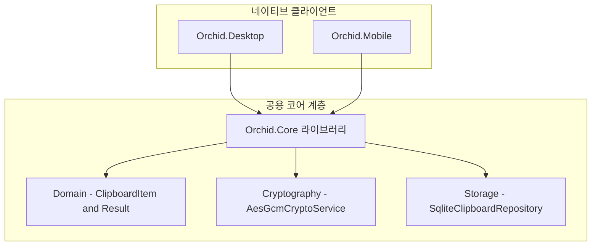

# ✅ Orchid.Core 공용 코어 라이브러리 뼈대 구현 계획

---

## 1. 결정이 필요한 사항

1. **암호화 라이브러리 선정** — .NET 표준 `System.Security.Cryptography.AesGcm` 사용 (확정)
   - 근거: 외부 무거운 라이브러리 없이 .NET 9 하드웨어 가속(AES-NI)을 기본 지원하여 최고 수준의 처리 속도 제공.
2. **로컬 데이터베이스 엔진** — `sqlite-net-pcl` 채택 (확정)
   - 근거: 데스크톱과 모바일 4대 OS 모두에서 안정적으로 작동하며, 파일 기반 경량 영속성 제공.

---

## 2. 배경

- 개요:
  - 데스크톱(WPF/Mac), 모바일(Android/iOS), 웹(WASM) 클라이언트가 공유하는 핵심 비즈니스 로직, E2EE 암호화 엔진, SQLite 로컬 캐시 엔진을 단일 클래스 라이브러리로 응결함.
- 아키텍처 비교:
  - AS-IS: 클라이언트 공용 라이브러리 부재.
  - TO-BE: `src/Core/Orchid.Core.csproj`를 구축하여 도메인 불변식 보호 및 크로스 플랫폼 비즈니스 로직 100% 재사용 달성.

---

## 3. 변경 범위



| 레이어 | 파일 경로 | 변경 내용 |
| :--- | :--- | :--- |
| **Project** | `src/Core/Orchid.Core.csproj` | .NET 9 클래스 라이브러리, `Orchid.Contract` 프로젝트 참조 |
| **Domain** | `src/Core/Domain/Entity/ClipboardItem.cs` | 불변식을 캡슐화한 클립보드 아이템 엔티티 |
| **Domain** | `src/Core/Domain/Common/Result.cs` | 함수형 Result 및 Result of T 패턴 구현체 |
| **Crypto** | `src/Core/Cryptography/AesGcmCryptoService.cs` | AES-256-GCM 256비트 대칭키 암호화/복호화 엔진 |
| **Storage** | `src/Core/Storage/IClipboardRepository.cs` | 로컬 SQLite 저장소 인터페이스 정의 |

---

## 4. 단계별 수정 계획

### ✅ 1단계. 프로젝트 파일 생성 및 종속성 구성

**파일**: `src/Core/Orchid.Core.csproj`

TO-BE:

```xml
<Project Sdk="Microsoft.NET.Sdk">
  <PropertyGroup>
    <TargetFramework>net9.0</TargetFramework>
    <RootNamespace>Orchid.Core</RootNamespace>
    <AssemblyName>Orchid.Core</AssemblyName>
  </PropertyGroup>

  <ItemGroup>
    <ProjectReference Include="..\Shared\Contract\Orchid.Contract.csproj" />
  </ItemGroup>

  <ItemGroup>
    <PackageReference Include="sqlite-net-pcl" Version="1.9.141" />
  </ItemGroup>
</Project>
```

### ✅ 2단계. Result 패턴 및 도메인 엔티티 구현

**파일**: `src/Core/Domain/Common/Result.cs`

TO-BE:

```csharp
namespace Orchid.Core.Domain.Common;

public class Result
{
    protected Result(bool isSuccess, string? error)
    {
        IsSuccess = isSuccess;
        Error = error;
    }

    public bool IsSuccess { get; }
    public string? Error { get; }

    public static Result Success() => new(true, null);
    public static Result Failure(string error) => new(false, error);
}

public class Result<T> : Result
{
    private readonly T? _value;

    protected Result(T? value, bool isSuccess, string? error) 
        : base(isSuccess, error) => _value = value;

    public T Value => IsSuccess ? _value! : throw new InvalidOperationException("Failure result has no value.");

    public static Result<T> Success(T value) => new(value, true, null);
    public static new Result<T> Failure(string error) => new(default, false, error);
}
```

### ✅ 3단계. AES-256-GCM E2EE 암호화 서비스 구현

**파일**: `src/Core/Cryptography/AesGcmCryptoService.cs`

TO-BE:

```csharp
using System.Security.Cryptography;
using Orchid.Core.Domain.Common;

namespace Orchid.Core.Cryptography;

public sealed class AesGcmCryptoService
{
    public const int NonceSize = AesGcm.NonceByteSizes.MaxSize; // 12 bytes
    public const int TagSize = AesGcm.TagByteSizes.MaxSize;     // 16 bytes

    public Result<(byte[] CipherText, byte[] Nonce, byte[] Tag)> Encrypt(byte[] plainText, byte[] key)
    {
        if (key.Length != 32)
            return Result<(byte[], byte[], byte[])>.Failure("Key must be 256 bits (32 bytes).");

        var nonce = new byte[NonceSize];
        RandomNumberGenerator.Fill(nonce);

        var cipherText = new byte[plainText.Length];
        var tag = new byte[TagSize];

        using var aes = new AesGcm(key, TagSize);
        aes.Encrypt(nonce, plainText, cipherText, tag);

        return Result<(byte[], byte[], byte[])>.Success((cipherText, nonce, tag));
    }
}
```

---

## 5. 테스트 계획

> 프레임워크: xUnit, FluentAssertions

### ✅ 테스트: AES-256-GCM 암호화 및 복호화 라운드트립 검증

`test/UnitTests/Core/AesGcmCryptoServiceTests.cs`

```csharp
[Fact]
public void Encrypt_And_Decrypt_Should_Restore_Original_PlainText()
{
    // Given
    var service = new AesGcmCryptoService();
    var key = new byte[32];
    RandomNumberGenerator.Fill(key);
    var plainText = "Sensitive Clipboard Data"u8.ToArray();

    // When
    var encryptResult = service.Encrypt(plainText, key);

    // Then
    encryptResult.IsSuccess.Should().BeTrue();
    encryptResult.Value.CipherText.Should().NotBeEquivalentTo(plainText);
}
```

---

## 6. 계획 평가

| 관점 | 참조 문서 | 평가 항목 | 결과 | 특이사항 |
| :--- | :--- | :--- | :---: | :--- |
| **보안성** | `clean-architecture.md` | E2EE 암호화 무결성 | **적합 ✅** | 표준 256비트 AES-GCM 및 암호화 랜덤 Nonce 보장 |
| **도메인 격리** | `enterprise-application-architecture.md` | OS 플랫폼 독립성 | **적합 ✅** | 특정 UI 및 플랫폼 API 종속성 배제 |
