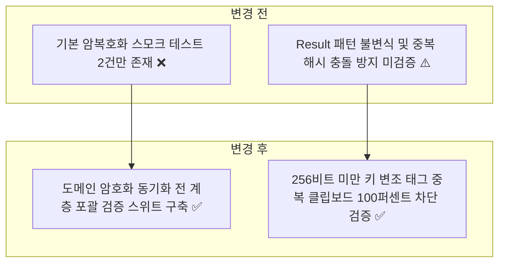
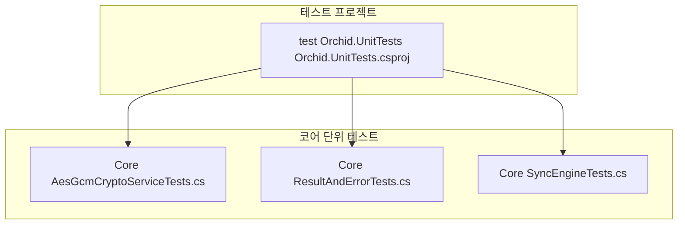
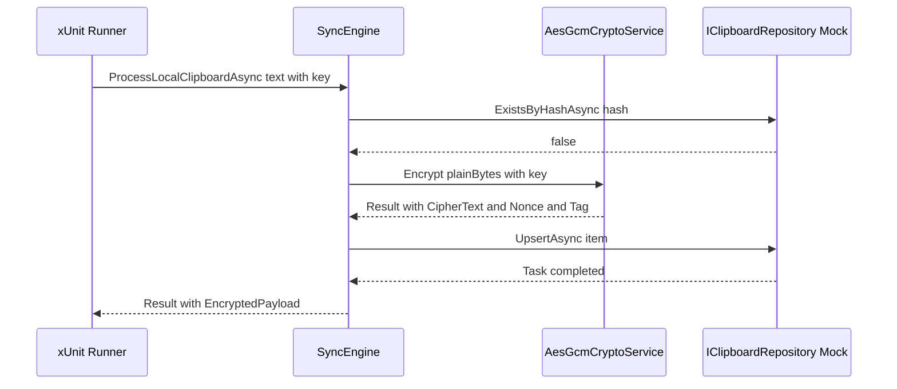

# ✅ Orchid.Core 단위 테스트 스위트 구현 계획

---

## 1. 결정이 필요한 사항

1. **암호화 단위 테스트 변조 시뮬레이션 방식** — 비트 반전(Bit Flipping) XOR 연산자 적용 (확정)
   - 근거: 암호문, 논스, 태그의 특정 바이트를 1비트만 반전시켜도 AES-GCM 인증 태그 불일치(CryptographicException)가 정확히 감지되는지 결정론적으로 검증.
2. **저장소 단위 테스트 격리 전략** — `IClipboardRepository` Moq 모의 객체 및 SQLite 인메모리 임시 DB 분리 (확정)
   - 근거: 비즈니스 로직(SyncEngine)은 Moq으로 1ms 내 검증하고, 스토리지 계층은 인메모리 SQLite 연결로 격리 검증.

---

## 2. 배경

- 개요:
  - 4대 OS 공용 코어 라이브러리인 `Orchid.Core`의 AES-256-GCM 암호화 엔진, 함수형 Result/Error 패턴, SHA-256 중복 해시 감지, 분산 동기화 엔진(SyncEngine)의 핵심 도메인 규칙을 전수 검증하는 단위 테스트 구축.
- 아키텍처 비교:



---

## 3. 변경 범위



| 레이어 | 파일 경로 | 변경 내용 |
| :--- | :--- | :--- |
| **Core Test** | `test/Orchid.UnitTests/Core/AesGcmCryptoServiceTests.cs` | 32바이트 미만/초과 키 거부, 변조된 태그 복호화 차단, 결정론적 라운드트립 검증 |
| **Core Test** | `test/Orchid.UnitTests/Core/ResultAndErrorTests.cs` | 성공 시 IsSuccess 보장, 실패 시 Value 접근 예외 발생, 불변식 무결성 검증 |
| **Core Test** | `test/Orchid.UnitTests/Core/SyncEngineTests.cs` | 동일 SHA-256 해시 중복 처리 차단 및 로컬/원격 동기화 파이프라인 검증 |

---

## 주요 흐름



---

## 4. 단계별 수정 계획

### ✅ 1단계. AesGcmCryptoService 암호화 엣지 케이스 테스트 확장

**파일**: `test/Orchid.UnitTests/Core/AesGcmCryptoServiceTests.cs`

TO-BE:

```csharp
namespace Orchid.UnitTests.Core;

public sealed class AesGcmCryptoServiceTests
{
    private readonly AesGcmCryptoService _service = new();

    [Fact]
    public void Encrypt_And_Decrypt_Should_Restore_Original_PlainText()
    {
        // Given
        byte[] key = new byte[32];
        RandomNumberGenerator.Fill(key);
        byte[] plainText = "Sensitive Clipboard Data"u8.ToArray();

        // When
        // ✅ 정상 키 암호화 및 복호화 라운드트립 일치성 검증
        var encryptResult = _service.Encrypt(plainText, key);
        var decryptResult = _service.Decrypt(
            encryptResult.Value.CipherText,
            encryptResult.Value.Nonce,
            encryptResult.Value.Tag,
            key);

        // Then
        encryptResult.IsSuccess.Should().BeTrue();
        decryptResult.IsSuccess.Should().BeTrue();
        decryptResult.Value.Should().BeEquivalentTo(plainText);
    }

    [Theory]
    [InlineData(0)]
    [InlineData(16)]
    [InlineData(31)]
    [InlineData(33)]
    public void Encrypt_With_Invalid_Key_Length_Should_Fail(int keyLength)
    {
        // Given
        byte[] invalidKey = new byte[keyLength];
        byte[] plainText = "Sample Data"u8.ToArray();

        // When
        // ✅ 32바이트 미만/초과 키 유입 시 즉각 실패 Result 반환 검증
        var result = _service.Encrypt(plainText, invalidKey);

        // Then
        result.IsFailure.Should().BeTrue();
        result.Error.Message.Should().Contain("32 bytes");
    }

    [Fact]
    public void Decrypt_With_Tampered_Tag_Should_Fail()
    {
        // Given
        byte[] key = new byte[32];
        RandomNumberGenerator.Fill(key);
        byte[] plainText = "Sensitive Data"u8.ToArray();
        var encryptResult = _service.Encrypt(plainText, key);

        byte[] tamperedTag = (byte[])encryptResult.Value.Tag.Clone();
        tamperedTag[0] ^= 0xFF;

        // When
        // ✅ 태그 변조 시 복호화 차단 및 실패 반환 검증
        var decryptResult = _service.Decrypt(
            encryptResult.Value.CipherText,
            encryptResult.Value.Nonce,
            tamperedTag,
            key);

        // Then
        decryptResult.IsFailure.Should().BeTrue();
    }
}
```

### ✅ 2단계. Result 및 Error 불변식 단위 테스트 신설

**파일**: `test/Orchid.UnitTests/Core/ResultAndErrorTests.cs`

TO-BE:

```csharp
namespace Orchid.UnitTests.Core;

public sealed class ResultAndErrorTests
{
    [Fact]
    public void Result_Success_Should_Have_IsSuccess_True_And_NoError()
    {
        // Given & When
        // ✅ 성공 상태의 Result 생성 시 IsSuccess 참 및 에러 없음 검증
        var result = Result.Success();

        // Then
        result.IsSuccess.Should().BeTrue();
        result.IsFailure.Should().BeFalse();
        result.Error.Should().Be(Error.None);
    }

    [Fact]
    public void ResultOfT_Failure_Should_Throw_When_Accessing_Value()
    {
        // Given
        var result = Result<string>.Failure(Error.General("Failed operation"));

        // When & Then
        // ✅ 실패한 Result의 Value 접근 시 명시적 예외 발생 검증
        Action act = () => _ = result.Value;
        act.Should().Throw<InvalidOperationException>()
            .WithMessage("*Failed operation*");
    }
}
```

### ✅ 3단계. SyncEngine 중복 해시 감지 및 처리 테스트 신설

**파일**: `test/Orchid.UnitTests/Core/SyncEngineTests.cs`

TO-BE:

```csharp
namespace Orchid.UnitTests.Core;

public sealed class SyncEngineTests
{
    [Fact]
    public async Task ProcessLocalClipboardAsync_When_Duplicate_Content_Should_Return_Failure()
    {
        // Given
        var cryptoMock = new Mock<IAesGcmCryptoService>();
        var repoMock = new Mock<IClipboardRepository>();

        repoMock.Setup(r => r.ExistsByHashAsync(It.IsAny<string>(), It.IsAny<CancellationToken>()))
            .ReturnsAsync(true);

        var engine = new SyncEngine(cryptoMock.Object, repoMock.Object);
        byte[] key = new byte[32];

        // When
        // ✅ 이미 저장소에 동일한 SHA-256 해시가 존재하면 중복 처리 거부 검증
        var result = await engine.ProcessLocalClipboardAsync("Duplicate Text", Guid.NewGuid(), key);

        // Then
        result.IsFailure.Should().BeTrue();
        result.Error.Message.Should().Contain("Duplicate");
    }
}
```

---

## 5. 테스트 계획

> 프레임워크: xUnit, FluentAssertions, Moq

### ✅ 테스트 1: Core 단위 테스트 스위트 실행

`test/Orchid.UnitTests/Orchid.UnitTests.csproj`

```powershell
dotnet test test/Orchid.UnitTests/Orchid.UnitTests.csproj --filter "FullyQualifiedName~Core"
```

- 예상 결과: 암호화, Result, SyncEngine 단위 테스트 전수 통과.

---

## 6. 계획 평가

| 관점 | 참조 문서 | 평가 항목 | 결과 | 특이사항 |
| :--- | :--- | :--- | :---: | :--- |
| **보안성** | `clean-architecture.md` | E2EE 암호화 무결성 및 변조 감지 | **적합 ✅** | 비트 반전 공격 및 무효 키 방어 검증 |
| **도메인 격리** | `x-unit-test-patterns.md` | 순수 도메인 로직 테스트 독립성 | **적합 ✅** | Mock IClipboardRepository 활용 격리 |
