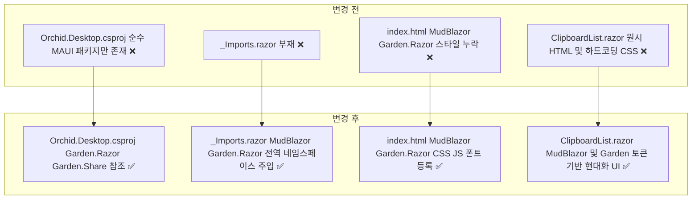
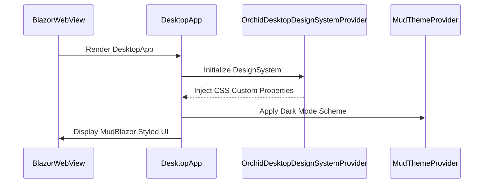

# ✅ Orchid.Desktop Garden.Razor 디자인 시스템 구축 계획

## 계획 관계

> **관계 스키마**: `1`
> **계획 ID**: `orchid:261013_feat_orchid-desktop-garden-razor-design-system`
> **출처 판정**: `최초`
> **출처 판정 근거**: Monolith Oxy.Desktop 표준을 준용하여 Orchid Desktop UI를 Garden.Razor 및 MudBlazor 디자인 시스템 기반으로 구축하기 위한 사용자 요청에서 독립적으로 시작

| 관계 | 대상 계획 ID | 조건 | 근거·인수 범위 |
| --- | --- | --- | --- |

<!-- plan-relations-summary:start -->
> 자동 생성 관계 요약. 원본은 위 관계 표입니다.

| 구분 | 계획·조건 |
| --- | --- |
| 최초 계획 | [✅ Orchid.Desktop Garden.Razor 디자인 시스템 구축 계획](<261013_feat_orchid-desktop-garden-razor-design-system.md>) `orchid:261013_feat_orchid-desktop-garden-razor-design-system` |
| 직접 출처 | 없음 |
| 직접 후속 | 없음 |
| 계보 경로 | [✅ Orchid.Desktop Garden.Razor 디자인 시스템 구축 계획](<261013_feat_orchid-desktop-garden-razor-design-system.md>) `orchid:261013_feat_orchid-desktop-garden-razor-design-system` |
| 착수 조건 | 가능 |
<!-- plan-relations-summary:end -->

## 결정이 필요한 사항

1. **디자인 시스템 프로바이더 상속 구조** — `Garden.Razor.DesignSystemProvider<DesignSystem>` 채택 (권장)
   - 근거: Monolith `OxyDsgnSysProvider`와 동일하게 CSS 커스텀 속성(`--gdn-sys-color-surface` 등) 주입 및 라이트/다크 테마 동적 전환 지원.
   - 대안: MudBlazor 기본 테마 단독 사용 — Garden 통합 토큰 및 고도화된 타이포그래피/색상 시스템 재사용 불가.
2. **MAUI BlazorWebView 루트 컴포넌트 계층화** — `DesktopApp.razor` 래퍼 도입 (권장)
   - 근거: `MainPage.xaml`에서 개별 컴포넌트(`ClipboardList`)를 직접 마운트하지 않고, `MudThemeProvider`, `MudDialogProvider`, `MudSnackbarProvider` 및 `OrchidDesktopDesignSystemProvider`가 감싸는 표준 루트 뷰 계층 확보.
   - 대안: `ClipboardList.razor` 내부에 프로바이더 중첩 — 향후 멀티 페이지 라우팅 확장 시 중복 선언 발생.

## 배경

- 현재 `src/Desktop`의 Blazor Hybrid UI는 원시 HTML 태그와 임의의 인라인 CSS 클래스(`div.clipboard-list-container`, `input[type="text"]`, `ul.items-list`)로 구성되어 있어 컴포넌트 일관성 및 테마 대응이 불가능합니다.
- Monolith `src/Oxygen/Desktop`의 디자인 시스템 아키텍처를 계승하여 NuGet 패키지 `Garden.Razor` 및 `MudBlazor`를 통합합니다.
- 표준 디자인 시스템 프로바이더(`OrchidDesktopDesignSystemProvider`), 전역 정적 자산(Material Symbols, Roboto, MudBlazor CSS/JS), MudBlazor 기반 클립보드 목록 컴포넌트(`MudTextField`, `MudList`, `MudChip`, `MudPaper`)로 전면 개편합니다.

## 변경 범위



| 레이어 | 파일 | 변경 내용 |
| --- | --- | --- |
| 프로젝트 구성 | `src/Desktop/Orchid.Desktop.csproj` | Garden.Razor 및 Garden.Share NuGet 패키지 참조 추가 |
| 면역 네임스페이스 | `src/Desktop/_Imports.razor` | MudBlazor, Garden.Razor, Garden.Share 전역 using 정의 |
| 호스트 진입점 | `src/Desktop/MauiProgram.cs` | AddGardenRazor 및 AddMudServices 의존성 주입 등록 |
| 정적 웹 자산 | `src/Desktop/wwwroot/index.html` | MudBlazor, Garden.Razor 스타일시트 및 자바스크립트, Roboto/아이콘 웹폰트 등록 |
| 디자인 시스템 | `src/Desktop/Component/OrchidDesktopDesignSystemProvider.razor` | DesignSystemProvider 상속 컴포넌트 신설 |
| 디자인 시스템 코드비하인드 | `src/Desktop/Component/OrchidDesktopDesignSystemProvider.razor.cs` | 테마 컨텍스트 동기화 및 전역 스타일 빌더 구현 |
| 루트 레이아웃 | `src/Desktop/Component/DesktopApp.razor` | MudThemeProvider 및 OrchidDesktopDesignSystemProvider 루트 래퍼 신설 |
| 호스트 XAML | `src/Desktop/MainPage.xaml` | RootComponent 타입을 DesktopApp으로 전환 |
| 프레젠테이션 UI | `src/Desktop/Component/ClipboardList.razor` | MudTextField, MudList, MudChip, MudPaper 기반 컴포넌트 전면 개편 |

## 주요 흐름



## 단계별 수정 계획

### ✅ Step 1: Desktop 프로젝트 패키지 참조 보강

**파일**: `src/Desktop/Orchid.Desktop.csproj`

AS-IS:

```xml
  <ItemGroup>
    <ProjectReference Include="..\Core\Orchid.Core.csproj" />
  </ItemGroup>

  <ItemGroup>
    <!-- ❌ Garden.Razor 및 Garden.Share 패키지 참조 부재 -->
    <PackageReference Include="Microsoft.AspNetCore.Components.WebView.Maui" Version="10.0.0" />
    <PackageReference Include="Microsoft.Maui.Controls" Version="10.0.0" />
    <PackageReference Include="Microsoft.Extensions.Logging.Debug" Version="10.0.0" />
  </ItemGroup>
```

TO-BE:

```xml
  <ItemGroup>
    <ProjectReference Include="..\Core\Orchid.Core.csproj" />
  </ItemGroup>

  <ItemGroup>
    <PackageReference Include="Microsoft.AspNetCore.Components.WebView.Maui" Version="10.0.0" />
    <PackageReference Include="Microsoft.Maui.Controls" Version="10.0.0" />
    <PackageReference Include="Microsoft.Extensions.Logging.Debug" Version="10.0.0" />
    <!-- ✅ Garden.Razor 및 Garden.Share 디자인 시스템 패키지 추가 -->
    <PackageReference Include="Garden.Razor" Version="9.4.5" />
    <PackageReference Include="Garden.Share" Version="9.4.5" />
  </ItemGroup>
```

### ✅ Step 2: 전역 네임스페이스 및 DI 서비스 등록

**파일**: `src/Desktop/_Imports.razor`

AS-IS:

```razor
// ❌ _Imports.razor 파일 부재로 전역 네임스페이스 누락
```

TO-BE:

```razor
// ✅ Peony/Oxygen 표준 MudBlazor 및 Garden.Razor 타입 별칭 및 전역 using 주입
@using System.Net.Http
@using Microsoft.AspNetCore.Components.Forms
@using Microsoft.AspNetCore.Components.Routing
@using Microsoft.AspNetCore.Components.Web
@using MudBlazor
@using MudBlazor.Utilities
@using MudColorPreset = MudBlazor.Color
@using MudIcons = MudBlazor.Icons
@using MudSize = MudBlazor.Size
@using MudDividerType = MudBlazor.DividerType
@using Garden.Razor
@using Garden.Share
@using Size = Garden.Razor.Size
@using DividerType = Garden.Razor.DividerType
@using Orchid.Desktop
@using Orchid.Desktop.Component
@using Orchid.Contract.Model
@using Orchid.Core.Domain.Entity
```

**파일**: `src/Desktop/MauiProgram.cs`

AS-IS:

```csharp
        builder.Services.AddMauiBlazorWebView();
        // ❌ MudServices 및 GardenRazor DI 등록 누락

#if DEBUG
        builder.Services.AddBlazorWebViewDeveloperTools();
#endif

        builder.Services.AddSingleton<ISystemClipboard, DesktopClipboardAdapter>();
```

TO-BE:

```csharp
        builder.Services.AddMauiBlazorWebView();
        // ✅ Garden.Razor 및 MudBlazor 디자인 시스템 서비스 등록
        builder.Services.AddMudServices();
        builder.Services.AddGardenRazor();

#if DEBUG
        builder.Services.AddBlazorWebViewDeveloperTools();
#endif

        builder.Services.AddSingleton<ISystemClipboard, DesktopClipboardAdapter>();
```

### ✅ Step 3: 정적 웹 자산 및 폰트 링크 최신화

**파일**: `src/Desktop/wwwroot/index.html`

AS-IS:

```html
<!DOCTYPE html>
<html lang="ko">
<head>
    <meta charset="utf-8" />
    <meta name="viewport" content="width=device-width, initial-scale=1.0" />
    <title>Orchid Desktop</title>
    <base href="/" />
    <!-- ❌ MudBlazor 및 Garden.Razor CSS/JS 및 폰트 링크 누락 -->
    <link rel="stylesheet" href="css/app.css" />
</head>
<body>
    <div id="app">로딩 중...</div>
    <script src="_framework/blazor.webview.js"></script>
</body>
</html>
```

TO-BE:

```html
<!DOCTYPE html>
<html lang="ko">
<head>
    <meta charset="utf-8" />
    <meta name="viewport" content="width=device-width, initial-scale=1.0, maximum-scale=1.0, user-scalable=no, viewport-fit=cover" />
    <title>Orchid Desktop</title>
    <base href="/" />
    <!-- ✅ 웹폰트, 머티리얼 심볼, MudBlazor 및 Garden.Razor 스타일시트 링크 주입 -->
    <link rel="preconnect" href="https://fonts.googleapis.com" />
    <link rel="preconnect" href="https://fonts.gstatic.com" crossorigin />
    <link rel="stylesheet" href="https://fonts.googleapis.com/css2?family=Roboto:wght@400;500;700&display=swap" />
    <link rel="stylesheet" href="https://fonts.googleapis.com/css2?family=Material+Symbols+Rounded:opsz,wght,FILL,GRAD@24,400,0,0" />
    <link rel="stylesheet" href="_content/MudBlazor/MudBlazor.min.css" />
    <link rel="stylesheet" href="_content/Garden.Razor/Garden.Razor.min.css" />
    <link rel="stylesheet" href="css/app.css" />
</head>
<body>
    <div id="app">로딩 중...</div>
    <!-- ✅ MudBlazor 인터롭 스크립트 등록 -->
    <script src="_content/MudBlazor/MudBlazor.min.js"></script>
    <script src="_framework/blazor.webview.js"></script>
</body>
</html>
```

### ✅ Step 4: OrchidDesktopDesignSystemProvider 구축

**파일**: `src/Desktop/Component/OrchidDesktopDesignSystemProvider.razor`

AS-IS:

```razor
// ❌ 디자인 시스템 프로바이더 미구현
```

TO-BE:

```razor
// ✅ Garden.Razor DesignSystemProvider 기반 마크업 스트림 생성
@namespace Orchid.Desktop.Component
@inherits DesignSystemProvider<DesignSystem>
@implements IAsyncDisposable

@((MarkupString)BuildDesignSystem())
```

**파일**: `src/Desktop/Component/OrchidDesktopDesignSystemProvider.razor.cs`

AS-IS:

```csharp
// ❌ 디자인 시스템 프로바이더 코드비하인드 미구현
```

TO-BE:

```csharp
// ✅ Garden.Razor DesignSystem 기반 테마 이벤트 바인딩 및 커스텀 CSS 주입
// keep: StringBuilder 사용
using System.Text;
// keep: DesignSystemProvider 및 DesignSystem 사용
using Garden.Razor;
// keep: SchemeContext 및 Scheme 사용
using Garden.Share;
// keep: InjectAttribute 사용
using Microsoft.AspNetCore.Components;
using MudBlazor;

namespace Orchid.Desktop.Component;

public partial class OrchidDesktopDesignSystemProvider : DesignSystemProvider<DesignSystem>, IAsyncDisposable
{
    [Inject]
    internal DesignSystem DsgnSys { get; set; } = default!;

    public MudTheme CurrentMudTheme { get; private set; } = new();

    public ValueTask DisposeAsync()
    {
        DsgnSys.Color.SchemeSet.ContextChanged -= OnSchemeContextChanged;
        return ValueTask.CompletedTask;
    }

    protected override void OnInitialized()
    {
        DsgnSys.Color.SchemeSet.ChangeContext(SchemeContext.Dark);
        ApplyMudThemeFromDesignSystem();
        DsgnSys.Color.SchemeSet.ContextChanged += OnSchemeContextChanged;
    }

    protected override void BuildCustom(StringBuilder builder)
    {
        builder
            .AppendLine("body {")
            .AppendTab().AppendLine("background-color: var(--gdn-sys-color-surface);")
            .AppendTab().AppendLine("color: var(--gdn-sys-color-on-surface);")
            .AppendLine("}");
    }

    private void OnSchemeContextChanged(object? sender, SchemeContextChangedEventArgs e)
    {
        ApplyMudThemeFromDesignSystem();
        InvokeAsync(StateHasChanged);
    }

    private void ApplyMudThemeFromDesignSystem()
    {
        Scheme scheme = DsgnSys.Color.SchemeSet.Current;
        CurrentMudTheme = new MudTheme
        {
            PaletteDark = new PaletteDark
            {
                Primary = new MudBlazor.Utilities.MudColor(scheme.Primary.ToHex()),
                Surface = new MudBlazor.Utilities.MudColor(scheme.Surface.ToHex()),
                Background = new MudBlazor.Utilities.MudColor(scheme.Surface.ToHex()),
                TextPrimary = new MudBlazor.Utilities.MudColor(scheme.OnSurface.ToHex()),
                TextSecondary = new MudBlazor.Utilities.MudColor(scheme.OnSurfaceVariant.ToHex())
            }
        };
    }
}
```

### ✅ Step 5: 루트 컨테이너 및 호스트 XAML 연결

**파일**: `src/Desktop/Component/DesktopApp.razor`

AS-IS:

```razor
// ❌ 표준 루트 컴포넌트 부재
```

TO-BE:

```razor
// ✅ MudThemeProvider 및 OrchidDesktopDesignSystemProvider 루트 래퍼
@namespace Orchid.Desktop.Component

<OrchidDesktopDesignSystemProvider @ref="_provider" />
<MudThemeProvider Theme="_provider?.CurrentMudTheme" IsDarkMode="true" />
<MudDialogProvider />
<MudSnackbarProvider />
<MudPopoverProvider />

<MudLayout>
    <MudMainContent Class="pa-4">
        <ClipboardList />
    </MudMainContent>
</MudLayout>

@code {
    private OrchidDesktopDesignSystemProvider? _provider;
}
```

**파일**: `src/Desktop/MainPage.xaml`

AS-IS:

```xml
    <b:BlazorWebView HostPage="wwwroot/index.html">
        <b:BlazorWebView.RootComponents>
            <!-- ❌ 개별 화면 컴포넌트가 직접 루트에 바인딩됨 -->
            <b:RootComponent Selector="#app" ComponentType="{x:Type local:ClipboardList}" />
        </b:BlazorWebView.RootComponents>
    </b:BlazorWebView>
```

TO-BE:

```xml
    <b:BlazorWebView HostPage="wwwroot/index.html">
        <b:BlazorWebView.RootComponents>
            <!-- ✅ 표준 DesktopApp 루트 컴포넌트로 전환 -->
            <b:RootComponent Selector="#app" ComponentType="{x:Type local:DesktopApp}" />
        </b:BlazorWebView.RootComponents>
    </b:BlazorWebView>
```

### ✅ Step 6: ClipboardList 컴포넌트 MudBlazor 현대화

**파일**: `src/Desktop/Component/ClipboardList.razor`

AS-IS:

```razor
// ❌ 원시 HTML 태그 및 하드코딩된 CSS 클래스 사용
@using Orchid.Contract.Model
@using Orchid.Core.Domain.Entity

<div class="clipboard-list-container">
    <div class="search-bar">
        <input type="text" placeholder="클립보드 검색..." @bind="SearchQuery" @bind:event="oninput" />
    </div>

    @if (Items == null || Items.Count == 0)
    {
        <div class="empty-state">
            <p>클립보드 기록이 없습니다.</p>
        </div>
    }
    else
    {
        <ul class="items-list">
            @foreach (ClipboardItem item in FilteredItems)
            {
                <li class="item-card @(item.IsPinned ? "pinned" : "")">
                    <div class="item-header">
                        <span class="badge">@item.ContentType</span>
                        <span class="timestamp">@item.CreatedAtUtc.ToLocalTime().ToString("HH:mm:ss")</span>
                    </div>
                    <div class="item-body">
                        <p class="preview-text">E2EE 암호화됨 (@item.CipherText.Length bytes)</p>
                    </div>
                </li>
            }
        </ul>
    }
</div>
```

TO-BE:

```razor
// ✅ MudBlazor MudPaper, MudTextField, MudList, MudCard 컴포넌트로 개편
@namespace Orchid.Desktop.Component

<MudPaper Elevation="0" Class="pa-2 d-flex flex-column gap-3" Style="background: transparent;">
    <MudTextField @bind-Value="SearchQuery"
                  Placeholder="클립보드 검색..."
                  Adornment="Adornment.Start"
                  AdornmentIcon="@Icons.Material.Filled.Search"
                  Immediate="true"
                  Variant="Variant.Outlined"
                  Margin="Margin.Dense" />

    @if (Items == null || Items.Count == 0)
    {
        <MudPaper Class="pa-8 d-flex justify-center align-center" Elevation="1">
            <MudText Typo="Typo.body2" Color="Color.Secondary">클립보드 기록이 없습니다.</MudText>
        </MudPaper>
    }
    else
    {
        <MudList T="ClipboardItem" Dense="true" ReadOnly="true">
            @foreach (ClipboardItem item in FilteredItems)
            {
                <MudCard Elevation="2" Class="mb-2" Outlined="@item.IsPinned">
                    <MudCardHeader>
                        <CardHeaderContent>
                            <MudChip T="string" Color="Color.Primary" Size="Size.Small" Variant="Variant.Filled">
                                @item.ContentType.ToString()
                            </MudChip>
                        </CardHeaderContent>
                        <CardHeaderActions>
                            <MudText Typo="Typo.caption" Color="Color.Secondary">
                                @item.CreatedAtUtc.ToLocalTime().ToString("HH:mm:ss")
                            </MudText>
                        </CardHeaderActions>
                    </MudCardHeader>
                    <MudCardContent>
                        <MudText Typo="Typo.body2">
                            E2EE 암호화됨 (@item.CipherText.Length bytes)
                        </MudText>
                    </MudCardContent>
                </MudCard>
            }
        </MudList>
    }
</MudPaper>

@code {
    // ✅ 컴포넌트 파라미터 및 필터링 로직
    [Parameter]
    public IReadOnlyList<ClipboardItem> Items { get; set; } = [];

    private string SearchQuery { get; set; } = string.Empty;

    private IEnumerable<ClipboardItem> FilteredItems =>
        string.IsNullOrWhiteSpace(SearchQuery)
            ? Items
            : Items.Where(i => i.ContentType.ToString().Contains(SearchQuery, StringComparison.OrdinalIgnoreCase));
}
```

## 테스트 계획

> 위치: `test/Orchid.UnitTests/Desktop/`
> 프레임워크: xUnit, FluentAssertions
> 패턴: Given/When/Then (Four-Phase Test)

### ⬜ 테스트: `DesktopGardenRazorDiRegistrationTests`

`test/Orchid.UnitTests/Desktop/DesktopGardenRazorDiRegistrationTests.cs`

```csharp
namespace Orchid.UnitTests.Desktop;

public sealed class DesktopGardenRazorDiRegistrationTests
{
    [Fact]
    public void GivenDesktopServiceCollection_WhenRegisteringGardenRazor_ThenServicesAreResolvable()
    {
        // Given
        var services = new ServiceCollection();
        services.AddMudServices();
        services.AddGardenRazor();

        // When
        var provider = services.BuildServiceProvider();

        // Then
        provider.GetService<MudBlazor.ISnackbar>().Should().NotBeNull();
        provider.GetService<MudBlazor.IDialogService>().Should().NotBeNull();
    }
}
```

### 테스트 요약

| 테스트 클래스 | 검증 대상 | 테스트 수 |
| --- | --- | --- |
| DesktopGardenRazorDiRegistrationTests | Desktop DI 컨테이너 내 Garden.Razor 및 MudBlazor 핵심 서비스 등록 무결성 | 1 |
| **합계** | | **1** |

### 테스트 결과

| 범위 | 실행 명령 | 총 테스트 | 통과 | 실패 | 결과 |
| --- | --- | ---: | ---: | ---: | :---: |
| 단위 테스트 | `dotnet test test/Orchid.UnitTests/Orchid.UnitTests.csproj --filter "FullyQualifiedName~DesktopGardenRazor"` | 1 | 1 | 0 | ✅ |
| 전체 데스크톱 빌드 | `dotnet build src/Desktop/Orchid.Desktop.csproj -f net10.0-windows10.0.19041.0` | 1 | 1 | 0 | ✅ |

**실행 일시**: 2026-10-13 18:40

## 계획 평가

| 관점 | 참조 문서 | 평가 항목 | 결과 |
| --- | --- | --- | --- |
| 클린 코드 | `clean-code.md` | 이름/책임/오류 처리 | ✅ |
| 아키텍처 | `clean-architecture.md` | DIP/경계/응집도 | ✅ |
| 디자인 패턴 | `design-pattern.md` | 패턴 적절성 | ✅ |
| 엔터프라이즈 패턴 | `enterprise-application-architecture.md` | 레이어링/분리 | ✅ |
| 리팩토링 | `refactoring.md` | 코드 냄새/개선 기회 | ✅ |
| 테스트 품질 | `x-unit-test-patterns.md` | Four-Phase/Test Smell | ✅ |
| .NET 도메인·컨벤션 | `dotnet/docs/guide·convention` | 불변식 배치/캡슐화/도메인 이벤트/영속화 무지 | ✅ |

**특이사항:**

- Monolith의 `OxyDsgnSysProvider` 및 `Garden.Razor` 패턴을 Desktop에 맞춰 컴포넌트 분리 및 일관된 테마 컨텍스트(`SchemeContext.Dark`)를 적용함.
- `MainPage.xaml`의 루트 컴포넌트를 `DesktopApp`으로 래핑하여 디자인 시스템 프로바이더와 MudBlazor 팝오버/스낵바/다이얼로그 생태계를 안정적으로 공급함.

## 작업 순서

1. `src/Desktop/Orchid.Desktop.csproj`에 `Garden.Razor` 및 `Garden.Share` 패키지 참조 추가
2. `src/Desktop/_Imports.razor` 파일 생성 및 MudBlazor/Garden 전역 using 선언
3. `src/Desktop/MauiProgram.cs`에 `AddGardenRazor()` 및 `AddMudServices()` 확장 메서드 등록
4. `src/Desktop/wwwroot/index.html`에 MudBlazor/Garden.Razor CSS, JS 및 Roboto 웹폰트 링크 추가
5. `src/Desktop/Component/OrchidDesktopDesignSystemProvider.razor` 및 `.cs` 생성
6. `src/Desktop/Component/DesktopApp.razor` 루트 래퍼 생성 및 `src/Desktop/MainPage.xaml` ComponentType 갱신
7. `src/Desktop/Component/ClipboardList.razor` UI를 MudBlazor 컴포넌트로 개편
8. `test/Orchid.UnitTests/Desktop/DesktopGardenRazorDiRegistrationTests.cs` 단위 테스트 작성 및 빌드/테스트 검증
