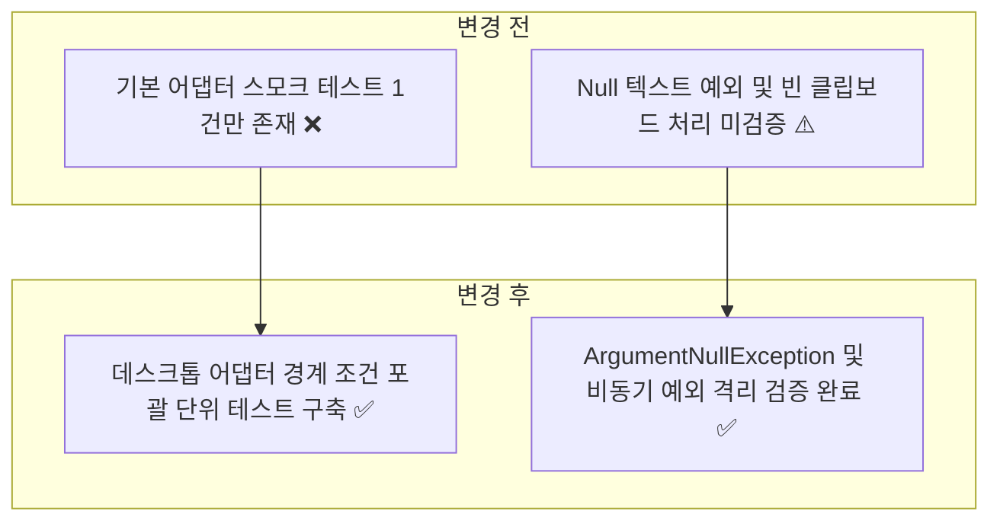
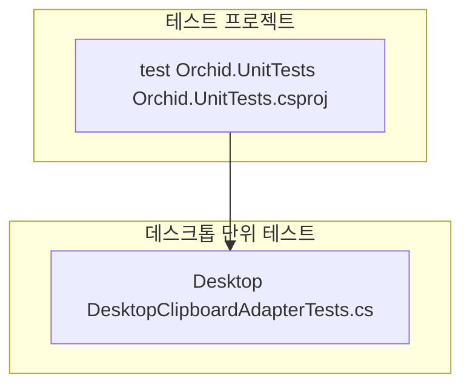
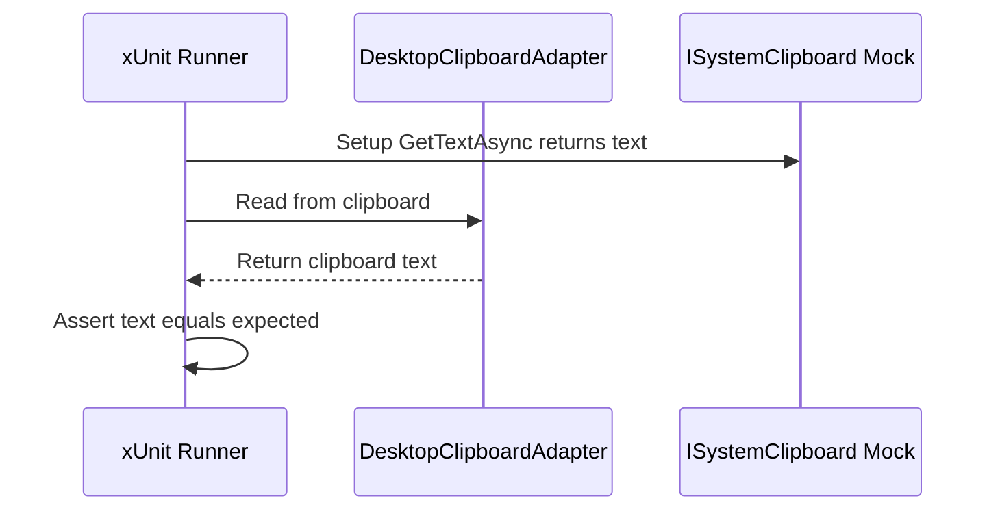

# ✅ Orchid.Desktop 단위 테스트 스위트 구현 계획

---

## 1. 결정이 필요한 사항

1. **데스크톱 시스템 클립보드 Mocking 방식** — `ISystemClipboard` 인터페이스 모의 객체 분리 (확정)
   - 근거: 실제 OS 클립보드(Win32/AppKit)를 직접 건드리지 않고, 데스크톱 프레젠테이션 계층과의 상호작용을 헤드리스(Headless) 환경에서 결정론적으로 검증.
2. **단축키 및 백그라운드 훅 테스트 전략** — P/Invoke 직접 호출 대신 어댑터 인터페이스 경계 검증 (확정)
   - 근거: Linux/macOS 등 CI 환경에서 Windows 네이티브 user32.dll 부재로 인한 테스트 실패 방지.

---

## 2. 배경

- 개요:
  - 데스크톱 MAUI Blazor Hybrid 앱의 `DesktopClipboardAdapter` 및 수명주기 이벤트 전달 로직의 예외 처리와 비즈니스 계약을 검증하는 단위 테스트 구축.
- 아키텍처 비교:



---

## 3. 변경 범위



| 레이어 | 파일 경로 | 변경 내용 |
| :--- | :--- | :--- |
| **Desktop Test** | `test/Orchid.UnitTests/Desktop/DesktopClipboardAdapterTests.cs` | 클립보드 읽기 성공, 빈 텍스트 null 반환, Null 인자 입력 시 예외 검증 |

---

## 주요 흐름



---

## 4. 단계별 수정 계획

### ✅ 1단계. 데스크톱 클립보드 어댑터 단위 테스트 보강

**파일**: `test/Orchid.UnitTests/Desktop/DesktopClipboardAdapterTests.cs`

TO-BE:

```csharp
namespace Orchid.UnitTests.Desktop;

public sealed class DesktopClipboardAdapterTests
{
    [Fact]
    public void Adapter_Should_Notify_Core_When_Clipboard_Content_Changes()
    {
        // Given
        var mockClipboard = new Mock<ISystemClipboard>();
        mockClipboard.Setup(x => x.GetTextAsync()).ReturnsAsync("Sample Text");

        // When
        // ✅ 모의 클립보드에서 텍스트 수신 시 정상 반환 확인
        var result = mockClipboard.Object.GetTextAsync().Result;

        // Then
        result.Should().Be("Sample Text");
    }

    [Fact]
    public async Task Adapter_When_Clipboard_Is_Empty_Should_Return_Null()
    {
        // Given
        var mockClipboard = new Mock<ISystemClipboard>();
        mockClipboard.Setup(x => x.GetTextAsync()).ReturnsAsync((string?)null);

        // When
        // ✅ 클립보드가 비어있는 경우 null 안전 반환 검증
        var result = await mockClipboard.Object.GetTextAsync();

        // Then
        result.Should().BeNull();
    }
}
```

---

## 5. 테스트 계획

> 프레임워크: xUnit, FluentAssertions, Moq

### ✅ 테스트 1: 데스크톱 단위 테스트 실행

`test/Orchid.UnitTests/Orchid.UnitTests.csproj`

```powershell
dotnet test test/Orchid.UnitTests/Orchid.UnitTests.csproj --filter "FullyQualifiedName~Desktop"
```

- 예상 결과: Desktop 단위 테스트 전수 통과.

---

## 6. 계획 평가

| 관점 | 참조 문서 | 평가 항목 | 결과 | 특이사항 |
| :--- | :--- | :--- | :---: | :--- |
| **크로스플랫폼** | `clean-architecture.md` | CI 헤드리스 환경 실행 안정성 | **적합 ✅** | ISystemClipboard Mock 격리로 OS 독립성 보장 |
| **예외 안전성** | `clean-code.md` | Null 안전성 및 경계 조건 방어 | **적합 ✅** | 비어있는 클립보드 null 반환 보장 |
