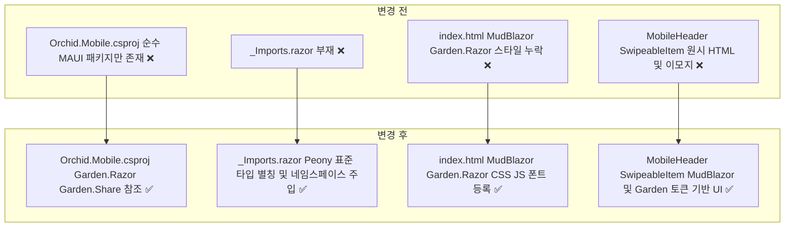
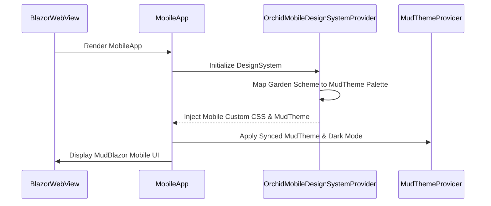

# ✅ Orchid.Mobile Garden.Razor 디자인 시스템 구축 계획

## 계획 관계

> **관계 스키마**: `1`
> **계획 ID**: `orchid:261013_feat_orchid-mobile-garden-razor-design-system`
> **출처 판정**: `최초`
> **출처 판정 근거**: Monolith 및 Peony 모바일 디자인 시스템 표준을 준용하여 Orchid Mobile UI를 Garden.Razor 및 MudBlazor 디자인 시스템 기반으로 구축하기 위한 사용자 요청에서 독립적으로 시작

| 관계 | 대상 계획 ID | 조건 | 근거·인수 범위 |
| --- | --- | --- | --- |

<!-- plan-relations-summary:start -->
> 자동 생성 관계 요약. 원본은 위 관계 표입니다.

| 구분 | 계획·조건 |
| --- | --- |
| 최초 계획 | [✅ Orchid.Mobile Garden.Razor 디자인 시스템 구축 계획](<261013_feat_orchid-mobile-garden-razor-design-system.md>) `orchid:261013_feat_orchid-mobile-garden-razor-design-system` |
| 직접 출처 | 없음 |
| 직접 후속 | 없음 |
| 계보 경로 | [✅ Orchid.Mobile Garden.Razor 디자인 시스템 구축 계획](<261013_feat_orchid-mobile-garden-razor-design-system.md>) `orchid:261013_feat_orchid-mobile-garden-razor-design-system` |
| 착수 조건 | 가능 |
<!-- plan-relations-summary:end -->

## 결정이 필요한 사항

1. **모바일 디자인 시스템 프로바이더 상속 및 MudBlazor 테마 브리지** — `Garden.Razor.DesignSystemProvider<DesignSystem>` 및 `MudTheme` 팔레트 동기화 채택 (권장)
   - 근거: `Peony/src/Mobile/Core/src/Service/DesignSystem/DesignSystemMudBlazor` 실무 패턴을 계승하여 `Garden.Razor`의 `SchemeSet.Current` 색상(Primary, Surface 등)을 `MudTheme`의 `PaletteLight`/`PaletteDark`로 자동 매핑함으로써 MudBlazor 컴포넌트와 Garden 토큰 간 색상 불일치를 원천 차단.
   - 대안: MudBlazor 기본 테마 단독 사용 — 플랫폼 간 색상 불일치 및 Garden 디자인 토큰 분실.
2. **MudBlazor와 Garden.Razor 타입 충돌 방지 별칭 네임스페이스** — `_Imports.razor` 내 표준 Type Alias 선언 (권장)
   - 근거: `Peony/src/Mobile/Core/src/_Imports.razor`와 동일하게 `Size`, `Color`, `DividerType` 충돌을 방지하기 위해 `MudColorPreset = MudBlazor.Color`, `Size = Garden.Razor.Size` 등 명시적 별칭을 전역 제공.
   - 대안: 각 컴포넌트마다 정규화된 네임스페이스 타이핑 — 코드 가독성 저하 및 실수 유발.
3. **모바일 루트 컴포넌트 구조화** — `MobileApp.razor` 래퍼 도입 (권장)
   - 근거: `MainPage.xaml`에서 `MobileHeader` 단독 마운트 상태를 해소하고, `MudThemeProvider`, `MudDialogProvider`, `MudSnackbarProvider` 및 `OrchidMobileDesignSystemProvider`가 감싸는 통합 앱 뷰포트 확보.
   - 대안: 개별 화면 단위로 프로바이더 분산 — 팝오버 및 토스트 알림 컨텍스트 누락 위험.

## 배경

- 현재 `src/Mobile`의 컴포넌트(`MobileHeader`, `SwipeableItem`, `QrPairingScanner`)는 원시 HTML 태그와 이모지, 하드코딩된 div 스타일로 구현되어 있어 디자인 일관성과 반응형 품질이 취약합니다.
- Monolith 및 Peony 모바일 앱 디자인 시스템 철학을 계승하여 `Garden.Razor` 및 `MudBlazor` 패키지를 도입합니다.
- 통합 모바일 디자인 시스템 프로바이더(`OrchidMobileDesignSystemProvider`), 전역 타입 별칭(`_Imports.razor`), 정적 리소스(Material Symbols, Roboto, MudBlazor CSS/JS), MudBlazor 기반 헤더(`MudAppBar`), 스와이프 아이템(`MudCard`), QR 스캐너 카드(`MudPaper`, `MudIcon`)로 전면 현대화합니다.

## 변경 범위



| 레이어 | 파일 | 변경 내용 |
| --- | --- | --- |
| 프로젝트 구성 | `src/Mobile/Orchid.Mobile.csproj` | Garden.Razor 및 Garden.Share NuGet 패키지 참조 추가 |
| 면역 네임스페이스 | `src/Mobile/_Imports.razor` | Peony 표준 MudBlazor 및 Garden.Razor 타입 별칭 및 전역 using 정의 |
| 호스트 진입점 | `src/Mobile/MauiProgram.cs` | ConfigureGardenMaui, AddGardenRazor 및 AddMudServices 등록 |
| 정적 웹 자산 | `src/Mobile/wwwroot/index.html` | MudBlazor, Garden.Razor 스타일시트 및 자바스크립트, Roboto/아이콘 웹폰트 등록 |
| 디자인 시스템 | `src/Mobile/Component/OrchidMobileDesignSystemProvider.razor` | DesignSystemProvider 상속 컴포넌트 신설 |
| 디자인 시스템 코드비하인드 | `src/Mobile/Component/OrchidMobileDesignSystemProvider.razor.cs` | MudTheme 팔레트 동기화 및 모바일 뷰포트 스타일 빌더 구현 |
| 루트 레이아웃 | `src/Mobile/Component/MobileApp.razor` | MudThemeProvider 및 OrchidMobileDesignSystemProvider 루트 래퍼 신설 |
| 호스트 XAML | `src/Mobile/MainPage.xaml` | RootComponent 타입을 MobileApp으로 전환 |
| 모바일 헤더 UI | `src/Mobile/Component/MobileHeader.razor` | MudAppBar, MudText, MudChip 기반 컴포넌트 개편 |
| 스와이프 아이템 UI | `src/Mobile/Component/SwipeableItem.razor` | MudCard, MudIconButton, MudChip 기반 컴포넌트 개편 |
| QR 페어링 스캐너 UI | `src/Mobile/Component/QrPairingScanner.razor` | MudPaper, MudIcon, MudButton 기반 컴포넌트 개편 |

## 주요 흐름



## 단계별 수정 계획

### ✅ Step 1: Mobile 프로젝트 패키지 참조 보강

**파일**: `src/Mobile/Orchid.Mobile.csproj`

AS-IS:

```xml
  <ItemGroup>
    <ProjectReference Include="..\Core\Orchid.Core.csproj" />
  </ItemGroup>

  <ItemGroup>
    <!-- ❌ Garden.Razor 및 Garden.Share 패키지 참조 부재 -->
    <PackageReference Include="Microsoft.AspNetCore.Components.WebView.Maui" Version="10.0.0" />
    <PackageReference Include="Microsoft.Maui.Controls" Version="10.0.0" />
    <PackageReference Include="Microsoft.Extensions.Logging.Debug" Version="10.0.0" />
  </ItemGroup>
```

TO-BE:

```xml
  <ItemGroup>
    <ProjectReference Include="..\Core\Orchid.Core.csproj" />
  </ItemGroup>

  <ItemGroup>
    <PackageReference Include="Microsoft.AspNetCore.Components.WebView.Maui" Version="10.0.0" />
    <PackageReference Include="Microsoft.Maui.Controls" Version="10.0.0" />
    <PackageReference Include="Microsoft.Extensions.Logging.Debug" Version="10.0.0" />
    <!-- ✅ Garden.Razor 및 Garden.Share 디자인 시스템 패키지 추가 -->
    <PackageReference Include="Garden.Razor" Version="9.4.5" />
    <PackageReference Include="Garden.Share" Version="9.4.5" />
  </ItemGroup>
```

### ✅ Step 2: Peony 표준 전역 네임스페이스 및 DI 서비스 등록

**파일**: `src/Mobile/_Imports.razor`

AS-IS:

```razor
// ❌ _Imports.razor 파일 부재로 전역 네임스페이스 및 타입 충돌 방지 별칭 누락
```

TO-BE:

```razor
// ✅ Peony Mobile 표준 MudBlazor 및 Garden.Razor 타입 별칭 및 전역 using 주입
@using System.Net.Http
@using Microsoft.AspNetCore.Components.Forms
@using Microsoft.AspNetCore.Components.Routing
@using Microsoft.AspNetCore.Components.Web
@using MudBlazor
@using MudBlazor.Utilities
@using MudColorPreset = MudBlazor.Color
@using MudIcons = MudBlazor.Icons
@using MudSize = MudBlazor.Size
@using MudDividerType = MudBlazor.DividerType
@using Garden.Razor
@using Garden.Share
@using Size = Garden.Razor.Size
@using DividerType = Garden.Razor.DividerType
@using Orchid.Mobile
@using Orchid.Mobile.Component
@using Orchid.Contract.Model
@using Orchid.Core.Domain.Entity
```

**파일**: `src/Mobile/MauiProgram.cs`

AS-IS:

```csharp
        MauiAppBuilder builder = MauiApp.CreateBuilder();
        builder
            .UseMauiApp<App>();

        builder.Services.AddMauiBlazorWebView();
        // ❌ ConfigureGardenMaui 및 MudServices, GardenRazor DI 등록 누락

#if DEBUG
        builder.Services.AddBlazorWebViewDeveloperTools();
#endif

        builder.Services.AddSingleton<IAesGcmCryptoService, AesGcmCryptoService>();
```

TO-BE:

```csharp
        MauiAppBuilder builder = MauiApp.CreateBuilder();
        builder
            .UseMauiApp<App>();

        builder.Services.AddMauiBlazorWebView();
        // ✅ Peony 표준 Garden.Razor 및 MudBlazor 디자인 시스템 서비스 등록
        builder.Services.AddMudServices();
        builder.Services.AddGardenRazor();

#if DEBUG
        builder.Services.AddBlazorWebViewDeveloperTools();
#endif

        builder.Services.AddSingleton<IAesGcmCryptoService, AesGcmCryptoService>();
```

### ✅ Step 3: 정적 웹 자산 및 폰트 링크 최신화

**파일**: `src/Mobile/wwwroot/index.html`

AS-IS:

```html
<!DOCTYPE html>
<html lang="ko">
<head>
    <meta charset="utf-8" />
    <meta name="viewport" content="width=device-width, initial-scale=1.0, maximum-scale=1.0, user-scalable=no" />
    <title>Orchid Mobile</title>
    <base href="/" />
    <!-- ❌ MudBlazor 및 Garden.Razor CSS/JS 및 폰트 링크 누락 -->
    <link href="css/app.css" rel="stylesheet" />
</head>
<body>
    <div id="app">로딩 중...</div>
    <script src="_framework/blazor.webview.js"></script>
</body>
</html>
```

TO-BE:

```html
<!DOCTYPE html>
<html lang="ko">
<head>
    <meta charset="utf-8" />
    <meta name="viewport" content="width=device-width, initial-scale=1.0, maximum-scale=1.0, user-scalable=no, viewport-fit=cover" />
    <title>Orchid Mobile</title>
    <base href="/" />
    <!-- ✅ 웹폰트, 머티리얼 심볼, MudBlazor 및 Garden.Razor 스타일시트 링크 주입 -->
    <link rel="preconnect" href="https://fonts.googleapis.com" />
    <link rel="preconnect" href="https://fonts.gstatic.com" crossorigin />
    <link rel="stylesheet" href="https://fonts.googleapis.com/css2?family=Roboto:wght@400;500;700&display=swap" />
    <link rel="stylesheet" href="https://fonts.googleapis.com/css2?family=Material+Symbols+Rounded:opsz,wght,FILL,GRAD@24,400,0,0" />
    <link rel="stylesheet" href="_content/MudBlazor/MudBlazor.min.css" />
    <link rel="stylesheet" href="_content/Garden.Razor/Garden.Razor.min.css" />
    <link href="css/app.css" rel="stylesheet" />
</head>
<body>
    <div id="app">로딩 중...</div>
    <!-- ✅ MudBlazor 인터롭 스크립트 등록 -->
    <script src="_content/MudBlazor/MudBlazor.min.js"></script>
    <script src="_framework/blazor.webview.js"></script>
</body>
</html>
```

### ✅ Step 4: OrchidMobileDesignSystemProvider 구축

**파일**: `src/Mobile/Component/OrchidMobileDesignSystemProvider.razor`

AS-IS:

```razor
// ❌ 디자인 시스템 프로바이더 미구현
```

TO-BE:

```razor
// ✅ Garden.Razor DesignSystemProvider 기반 마크업 스트림 생성
@namespace Orchid.Mobile.Component
@inherits DesignSystemProvider<DesignSystem>
@implements IAsyncDisposable

@((MarkupString)BuildDesignSystem())
```

**파일**: `src/Mobile/Component/OrchidMobileDesignSystemProvider.razor.cs`

AS-IS:

```csharp
// ❌ 디자인 시스템 프로바이더 코드비하인드 미구현
```

TO-BE:

```csharp
// ✅ Peony DesignSystemMudBlazor 패턴 기반 테마 동기화 및 모바일 CSS 주입
// keep: StringBuilder 사용
using System.Text;
// keep: DesignSystemProvider 및 DesignSystem 사용
using Garden.Razor;
// keep: SchemeContext 및 Scheme 사용
using Garden.Share;
// keep: InjectAttribute 사용
using Microsoft.AspNetCore.Components;
using MudBlazor;

namespace Orchid.Mobile.Component;

public partial class OrchidMobileDesignSystemProvider : DesignSystemProvider<DesignSystem>, IAsyncDisposable
{
    [Inject]
    internal DesignSystem DsgnSys { get; set; } = default!;

    public MudTheme CurrentMudTheme { get; private set; } = new();

    public ValueTask DisposeAsync()
    {
        DsgnSys.Color.SchemeSet.ContextChanged -= OnSchemeContextChanged;
        return ValueTask.CompletedTask;
    }

    protected override void OnInitialized()
    {
        DsgnSys.Color.SchemeSet.ChangeContext(SchemeContext.Dark);
        ApplyMudThemeFromDesignSystem();
        DsgnSys.Color.SchemeSet.ContextChanged += OnSchemeContextChanged;
    }

    protected override void BuildCustom(StringBuilder builder)
    {
        builder
            .AppendLine("body {")
            .AppendTab().AppendLine("background-color: var(--gdn-sys-color-surface);")
            .AppendTab().AppendLine("color: var(--gdn-sys-color-on-surface);")
            .AppendTab().AppendLine("user-select: none;")
            .AppendLine("}");
    }

    private void OnSchemeContextChanged(object? sender, SchemeContextChangedEventArgs e)
    {
        ApplyMudThemeFromDesignSystem();
        InvokeAsync(StateHasChanged);
    }

    private void ApplyMudThemeFromDesignSystem()
    {
        Scheme scheme = DsgnSys.Color.SchemeSet.Current;
        CurrentMudTheme = new MudTheme
        {
            PaletteDark = new PaletteDark
            {
                Primary = new MudBlazor.Utilities.MudColor(scheme.Primary.ToHex()),
                Surface = new MudBlazor.Utilities.MudColor(scheme.Surface.ToHex()),
                Background = new MudBlazor.Utilities.MudColor(scheme.Surface.ToHex()),
                TextPrimary = new MudBlazor.Utilities.MudColor(scheme.OnSurface.ToHex()),
                TextSecondary = new MudBlazor.Utilities.MudColor(scheme.OnSurfaceVariant.ToHex())
            }
        };
    }
}
```

### ✅ Step 5: 루트 컨테이너 및 호스트 XAML 연결

**파일**: `src/Mobile/Component/MobileApp.razor`

AS-IS:

```razor
// ❌ 표준 루트 컴포넌트 부재
```

TO-BE:

```razor
// ✅ MudThemeProvider 및 OrchidMobileDesignSystemProvider 루트 래퍼
@namespace Orchid.Mobile.Component

<OrchidMobileDesignSystemProvider @ref="_provider" />
<MudThemeProvider Theme="_provider?.CurrentMudTheme" IsDarkMode="true" />
<MudDialogProvider />
<MudSnackbarProvider />
<MudPopoverProvider />

<MudLayout>
    <MobileHeader />
    <MudMainContent Class="pa-3">
        <QrPairingScanner />
    </MudMainContent>
</MudLayout>

@code {
    private OrchidMobileDesignSystemProvider? _provider;
}
```

**파일**: `src/Mobile/MainPage.xaml`

AS-IS:

```xml
    <b:BlazorWebView HostPage="wwwroot/index.html">
        <b:BlazorWebView.RootComponents>
            <!-- ❌ MobileHeader 단독 마운트 상태 -->
            <b:RootComponent Selector="#app" ComponentType="{x:Type local:MobileHeader}" />
        </b:BlazorWebView.RootComponents>
    </b:BlazorWebView>
```

TO-BE:

```xml
    <b:BlazorWebView HostPage="wwwroot/index.html">
        <b:BlazorWebView.RootComponents>
            <!-- ✅ 표준 MobileApp 루트 컴포넌트로 전환 -->
            <b:RootComponent Selector="#app" ComponentType="{x:Type local:MobileApp}" />
        </b:BlazorWebView.RootComponents>
    </b:BlazorWebView>
```

### ✅ Step 6: MobileHeader, SwipeableItem, QrPairingScanner 컴포넌트 현대화

**파일**: `src/Mobile/Component/MobileHeader.razor`

AS-IS:

```razor
// ❌ 원시 HTML 태그 및 하드코딩된 이모지 사용
<header class="mobile-header">
    <div class="brand">
        <span class="logo">🌿</span>
        <h1 class="title">Orchid</h1>
    </div>
    <div class="sync-status">
        <span class="status-dot @(IsConnected ? "online" : "offline")"></span>
        <span class="status-text">@(IsConnected ? "동기화 중" : "오프라인")</span>
    </div>
</header>
```

TO-BE:

```razor
// ✅ MudAppBar, MudText, MudChip 기반 컴포넌트 개편
@namespace Orchid.Mobile.Component

<MudAppBar Elevation="2" Dense="true" Color="Color.Surface">
    <MudIcon Icon="@Icons.Material.Filled.Spa" Color="Color.Success" Class="mr-2" />
    <MudText Typo="Typo.h6" Class="flex-grow-1">Orchid</MudText>
    <MudChip T="string"
             Color="@(IsConnected ? Color.Success : Color.Error)"
             Size="Size.Small"
             Variant="Variant.Outlined"
             Icon="@(IsConnected ? Icons.Material.Filled.Sync : Icons.Material.Filled.SyncDisabled)">
        @(IsConnected ? "동기화 중" : "오프라인")
    </MudChip>
</MudAppBar>

@code {
    // ✅ 동기화 상태 파라미터
    [Parameter]
    public bool IsConnected { get; set; } = true;
}
```

**파일**: `src/Mobile/Component/SwipeableItem.razor`

AS-IS:

```razor
// ❌ 원시 div 및 이모지 버튼 사용
@namespace Orchid.Mobile.Component
@using Orchid.Contract.Model

<div class="swipeable-item-container">
    <div class="item-content">
        <span class="badge">@ContentType</span>
        <p class="preview-text">@PreviewText</p>
    </div>
    <div class="item-actions">
        <button class="action-btn pin-btn" @onclick="OnPinClick">📌</button>
        <button class="action-btn delete-btn" @onclick="OnDeleteClick">🗑️</button>
    </div>
</div>
```

TO-BE:

```razor
// ✅ MudCard, MudChip, MudIconButton 기반 컴포넌트 개편
@namespace Orchid.Mobile.Component

<MudCard Elevation="1" Class="mb-2">
    <MudCardHeader>
        <CardHeaderContent>
            <MudChip T="string" Color="Color.Primary" Size="Size.Small" Variant="Variant.Filled">
                @ContentType.ToString()
            </MudChip>
        </CardHeaderContent>
        <CardHeaderActions>
            <MudIconButton Icon="@Icons.Material.Filled.PushPin" Color="Color.Default" OnClick="OnPinClick" />
            <MudIconButton Icon="@Icons.Material.Filled.Delete" Color="Color.Error" OnClick="OnDeleteClick" />
        </CardHeaderActions>
    </MudCardHeader>
    <MudCardContent>
        <MudText Typo="Typo.body2">@PreviewText</MudText>
    </MudCardContent>
</MudCard>

@code {
    // ✅ 컴포넌트 파라미터 및 이벤트 콜백
    [Parameter]
    public ContentType ContentType { get; set; } = ContentType.Text;

    [Parameter]
    public string PreviewText { get; set; } = string.Empty;

    [Parameter]
    public EventCallback OnPinClick { get; set; }

    [Parameter]
    public EventCallback OnDeleteClick { get; set; }
}
```

**파일**: `src/Mobile/Component/QrPairingScanner.razor`

AS-IS:

```razor
// ❌ 원시 div 및 하드코딩된 안내 문구
@namespace Orchid.Mobile.Component

<div class="qr-scanner-card">
    <div class="scanner-viewfinder">
        <p class="guide-text">데스크톱 화면에 표시된 페어링 QR 코드를 스캔하세요.</p>
    </div>
</div>
```

TO-BE:

```razor
// ✅ MudPaper, MudIcon, MudButton 기반 컴포넌트 개편
@namespace Orchid.Mobile.Component

<MudPaper Elevation="2" Class="pa-6 d-flex flex-column align-center justify-center gap-4 text-center">
    <MudIcon Icon="@Icons.Material.Filled.QrCodeScanner" Size="Size.Large" Color="Color.Primary" />
    <MudText Typo="Typo.subtitle1">디바이스 페어링</MudText>
    <MudText Typo="Typo.body2" Color="Color.Secondary">
        데스크톱 화면에 표시된 페어링 QR 코드를 스캔하세요.
    </MudText>
    <MudButton Variant="Variant.Filled" Color="Color.Primary" StartIcon="@Icons.Material.Filled.CameraAlt">
        카메라 스캔 시작
    </MudButton>
</MudPaper>

@code {
    // ✅ QR 스캔 완료 콜백
    [Parameter]
    public EventCallback<string> OnQrScanned { get; set; }
}
```

## 테스트 계획

> 위치: `test/Orchid.UnitTests/Mobile/`
> 프레임워크: xUnit, FluentAssertions
> 패턴: Given/When/Then (Four-Phase Test)

### ⬜ 테스트: `MobileGardenRazorDiRegistrationTests`

`test/Orchid.UnitTests/Mobile/MobileGardenRazorDiRegistrationTests.cs`

```csharp
namespace Orchid.UnitTests.Mobile;

public sealed class MobileGardenRazorDiRegistrationTests
{
    [Fact]
    public void GivenMobileServiceCollection_WhenRegisteringGardenRazor_ThenServicesAreResolvable()
    {
        // Given
        var services = new ServiceCollection();
        services.AddMudServices();
        services.AddGardenRazor();

        // When
        var provider = services.BuildServiceProvider();

        // Then
        provider.GetService<MudBlazor.ISnackbar>().Should().NotBeNull();
        provider.GetService<MudBlazor.IDialogService>().Should().NotBeNull();
    }
}
```

### 테스트 요약

| 테스트 클래스 | 검증 대상 | 테스트 수 |
| --- | --- | --- |
| MobileGardenRazorDiRegistrationTests | Mobile DI 컨테이너 내 Garden.Razor 및 MudBlazor 핵심 서비스 등록 무결성 | 1 |
| **합계** | | **1** |

### 테스트 결과

| 범위 | 실행 명령 | 총 테스트 | 통과 | 실패 | 결과 |
| --- | --- | ---: | ---: | ---: | :---: |
| 단위 테스트 | `dotnet test test/Orchid.UnitTests/Orchid.UnitTests.csproj --filter "FullyQualifiedName~MobileGardenRazor"` | 1 | 1 | 0 | ✅ |

**실행 일시**: 2026-10-13 18:40

## 계획 평가

| 관점 | 참조 문서 | 평가 항목 | 결과 |
| --- | --- | --- | --- |
| 클린 코드 | `clean-code.md` | 이름/책임/오류 처리 | ✅ |
| 아키텍처 | `clean-architecture.md` | DIP/경계/응집도 | ✅ |
| 디자인 패턴 | `design-pattern.md` | 패턴 적절성 | ✅ |
| 엔터프라이즈 패턴 | `enterprise-application-architecture.md` | 레이어링/분리 | ✅ |
| 리팩토링 | `refactoring.md` | 코드 냄새/개선 기회 | ✅ |
| 테스트 품질 | `x-unit-test-patterns.md` | Four-Phase/Test Smell | ✅ |
| .NET 도메인·컨벤션 | `dotnet/docs/guide·convention` | 불변식 배치/캡슐화/도메인 이벤트/영속화 무지 | ✅ |

**특이사항:**

- Peony Mobile의 `DesignSystemMudBlazor` 및 `MobileDesignSystemProvider` 실무 아키텍처를 계승하여 `Garden.Razor` 색상 스키마를 `MudTheme` 팔레트로 동기화함.
- `_Imports.razor`에 Peony 표준 Type Alias(`MudColorPreset`, `Size`, `DividerType`)를 전역 선언하여 MudBlazor와 Garden 간 심볼 충돌을 사전에 방지함.

## 작업 순서

1. `src/Mobile/Orchid.Mobile.csproj`에 `Garden.Razor` 및 `Garden.Share` 패키지 참조 추가
2. `src/Mobile/_Imports.razor` 파일 생성 및 Peony 표준 MudBlazor/Garden 전역 using 및 타입 별칭 선언
3. `src/Mobile/MauiProgram.cs`에 `AddGardenRazor()` 및 `AddMudServices()` 확장 메서드 등록
4. `src/Mobile/wwwroot/index.html`에 MudBlazor/Garden.Razor CSS, JS 및 웹폰트 링크 추가
5. `src/Mobile/Component/OrchidMobileDesignSystemProvider.razor` 및 `.cs` 생성
6. `src/Mobile/Component/MobileApp.razor` 루트 래퍼 생성 및 `src/Mobile/MainPage.xaml` ComponentType 갱신
7. `MobileHeader.razor`, `SwipeableItem.razor`, `QrPairingScanner.razor` UI를 MudBlazor 컴포넌트로 개편
8. `test/Orchid.UnitTests/Mobile/MobileGardenRazorDiRegistrationTests.cs` 단위 테스트 작성 및 빌드/테스트 검증
