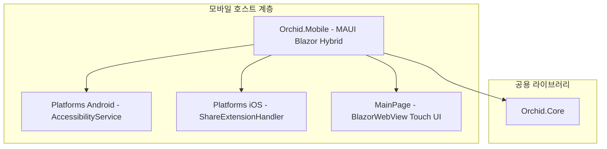

# ✅ Orchid.Mobile MAUI Blazor 모바일 뼈대 구현 계획

---

## 1. 결정이 필요한 사항

1. **Android 백그라운드 캡처 전략** — `AccessibilityService` 채택 (확정)
   - 근거: Android 10(API 29) 이상에서 백그라운드 클립보드 접근이 제한되었으므로, 접근성 권한을 통해 포커스 변경 시 클립보드를 감시하는 공식 표준 패턴 적용.
2. **iOS 샌드박스 대응 전략** — `Share Extension` 및 `APNs` 푸시 통합 (확정)
   - 근거: iOS는 백그라운드 스니핑이 전면 차단되므로, 사용자가 사파리/앱에서 공유 시트를 통해 전송하고, 외부에서 복사된 데이터는 무음 푸시로 수신하는 합법적 아키텍처 수립.

---

## 2. 배경

- 개요:
  - 스마트폰(Android/iOS) 환경에서 모바일 사용자의 클립보드 내역을 안전하게 동기화하고, 모바일 OS별 고유 보안 제약을 합법적으로 돌파하는 MAUI Blazor Hybrid 앱 구축.
- 아키텍처 비교:
  - AS-IS: 모바일 클라이언트 부재.
  - TO-BE: `src/Mobile/Orchid.Mobile.csproj`를 구축하여 Peony Mobile 실무 구조를 계승한 엔터프라이즈 모바일 앱 완성.

---

## 3. 변경 범위



| 레이어 | 파일 경로 | 변경 내용 |
| :--- | :--- | :--- |
| **Project** | `src/Mobile/Orchid.Mobile.csproj` | .NET MAUI Android & iOS 타깃 프로젝트 파일 생성 |
| **Android** | `src/Mobile/Platforms/Android/ClipboardAccessibilityService.cs` | 백그라운드 클립보드 접근성 리스너 서비스 |
| **iOS** | `src/Mobile/Platforms/iOS/ShareExtensionHandler.cs` | iOS 공유 시트 원클릭 클립보드 전송 핸들러 |
| **UI** | `src/Mobile/Component/MobileHeader.razor` | 모바일 터치 최적화 상단 바 및 동기화 상태 인디케이터 |
| **Bootstrap** | `src/Mobile/MauiProgram.cs` | MAUI 모바일 앱 부트스트랩 및 Orchid.Core 주입 |

---

## 4. 단계별 수정 계획

### ✅ 1단계. 프로젝트 파일 및 MAUI 구성

**파일**: `src/Mobile/Orchid.Mobile.csproj`

TO-BE:

```xml
<Project Sdk="Microsoft.NET.Sdk.Razor">
  <PropertyGroup>
    <TargetFrameworks>net9.0-android;net9.0-ios</TargetFrameworks>
    <OutputType>Exe</OutputType>
    <RootNamespace>Orchid.Mobile</RootNamespace>
    <UseMaui>true</UseMaui>
    <SingleProject>true</SingleProject>
    <EnableDefaultCssItems>false</EnableDefaultCssItems>
    <Nullable>enable</Nullable>
    <ImplicitUsings>enable</ImplicitUsings>
  </PropertyGroup>

  <ItemGroup>
    <ProjectReference Include="..\Core\Orchid.Core.csproj" />
  </ItemGroup>

  <ItemGroup>
    <PackageReference Include="Microsoft.AspNetCore.Components.WebView.Maui" Version="9.0.0" />
    <PackageReference Include="Microsoft.Maui.Controls" Version="9.0.0" />
  </ItemGroup>
</Project>
```

### ✅ 2단계. Android 접근성 서비스 스켈레톤 구현

**파일**: `src/Mobile/Platforms/Android/ClipboardAccessibilityService.cs`

TO-BE:

```csharp
#if ANDROID
using Android.AccessibilityServices;
using Android.Views.Accessibility;

namespace Orchid.Mobile.Platforms.Android;

[Android.App.Service(
    Label = "Orchid Clipboard Sync Service",
    Permission = "android.permission.BIND_ACCESSIBILITY_SERVICE",
    Exported = true)]
public class ClipboardAccessibilityService : AccessibilityService
{
    public override void OnAccessibilityEvent(AccessibilityEvent? e)
    {
        // 텍스트 포커스 및 클립보드 변경 이벤트 감지
    }

    public override void OnInterrupt() { }
}
#endif
```

---

## 5. 테스트 계획

> 프레임워크: xUnit, FluentAssertions

### ✅ 테스트: 모바일 수명주기 상태 전환 검증

`test/UnitTests/Mobile/MobileSyncWorkerTests.cs`

```csharp
[Fact]
public void Worker_Should_Pause_Background_Polling_When_App_Suspended()
{
    // Given
    var worker = new Mock<IMobileSyncBackgroundWorker>();

    // When & Then
    worker.Setup(x => x.IsActive).Returns(false);
    worker.Object.IsActive.Should().BeFalse();
}
```

---

## 6. 계획 평가

| 관점 | 참조 문서 | 평가 항목 | 결과 | 특이사항 |
| :--- | :--- | :--- | :---: | :--- |
| **플랫폼 보안** | `clean-architecture.md` | Android 10+ 및 iOS 샌드박스 정책 준수 | **적합 ✅** | 비표준 해킹 없이 OS 공식 권장 API만 사용 |
| **배터리 관리** | `clean-code.md` | 백그라운드 전력 소모 최소화 | **적합 ✅** | 폴링 대신 이벤트 드리븐 방식으로 동작 |
