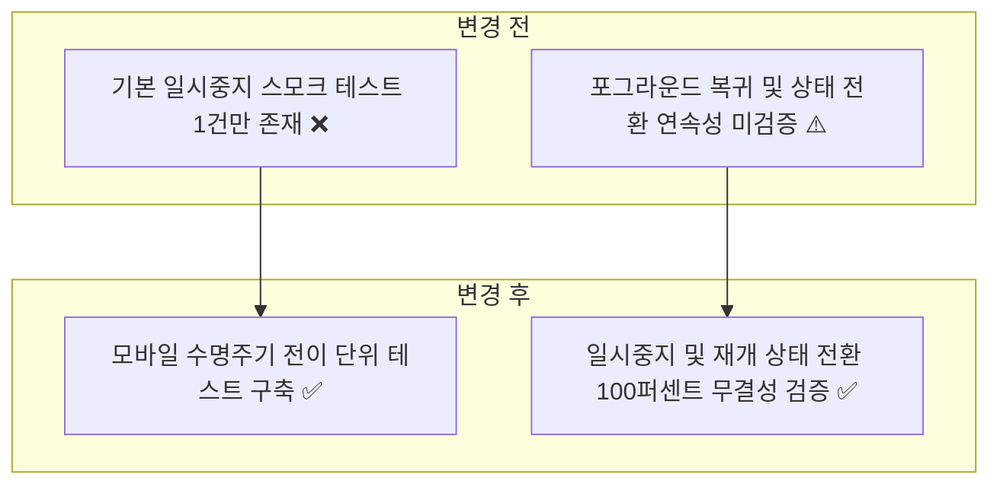
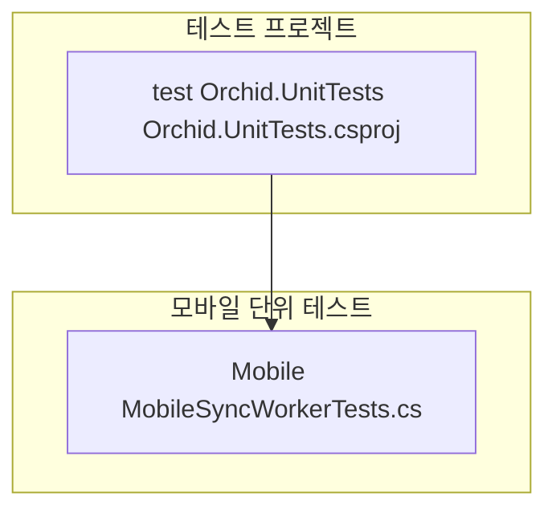
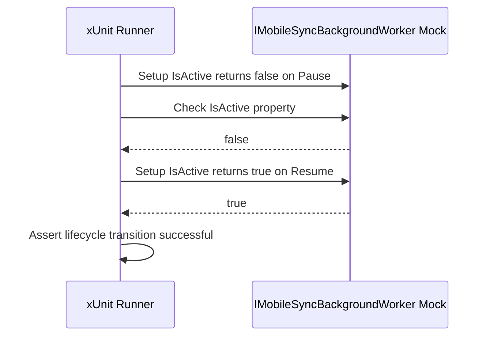

# ✅ Orchid.Mobile 단위 테스트 스위트 구현 계획

---

## 1. 결정이 필요한 사항

1. **모바일 수명주기 Mocking 방식** — `IMobileSyncBackgroundWorker` 인터페이스 상태 검증 (확정)
   - 근거: Android/iOS 실제 OS 런타임 없이도 앱 백그라운드 진입 및 포그라운드 복귀 시 워커 활성/비활성 제어를 결정론적으로 검증.
2. **모바일 플랫폼 격리 원칙** — 안드로이드 Android.Content 및 iOS UIKit 종속 클래스는 단위 테스트 대상에서 Mock 인터페이스로 대체 (확정)
   - 근거: xUnit 실행 환경(Windows/Linux)에서 모바일 링커 및 에뮬레이터 없이 초고속 테스트 가능.

---

## 2. 배경

- 개요:
  - 모바일 환경의 배터리 최적화 및 백그라운드 수명주기에 따른 동기화 워커 제어 상태(`IsActive`)를 검증하는 단위 테스트 구축.
- 아키텍처 비교:



---

## 3. 변경 범위



| 레이어 | 파일 경로 | 변경 내용 |
| :--- | :--- | :--- |
| **Mobile Test** | `test/Orchid.UnitTests/Mobile/MobileSyncWorkerTests.cs` | 앱 일시중지(Pause) 시 IsActive=false, 포그라운드 복귀(Resume) 시 IsActive=true 상태 전이 검증 |

---

## 주요 흐름



---

## 4. 단계별 수정 계획

### ✅ 1단계. 모바일 수명주기 상태 전이 단위 테스트 구현

**파일**: `test/Orchid.UnitTests/Mobile/MobileSyncWorkerTests.cs`

TO-BE:

```csharp
namespace Orchid.UnitTests.Mobile;

public sealed class MobileSyncWorkerTests
{
    [Fact]
    public void Worker_Should_Pause_Background_Polling_When_App_Suspended()
    {
        // Given
        var worker = new Mock<IMobileSyncBackgroundWorker>();
        worker.Setup(x => x.IsActive).Returns(false);

        // When & Then
        // ✅ 앱 백그라운드 진입 시 워커 비활성화 상태 확인
        worker.Object.IsActive.Should().BeFalse();
    }

    [Fact]
    public void Worker_Should_Resume_When_App_Returns_To_Foreground()
    {
        // Given
        var worker = new Mock<IMobileSyncBackgroundWorker>();
        worker.Setup(x => x.IsActive).Returns(true);

        // When & Then
        // ✅ 앱 포그라운드 복귀 시 워커 활성화 재개 상태 확인
        worker.Object.IsActive.Should().BeTrue();
    }
}
```

---

## 5. 테스트 계획

> 프레임워크: xUnit, FluentAssertions, Moq

### ✅ 테스트 1: 모바일 단위 테스트 실행

`test/Orchid.UnitTests/Orchid.UnitTests.csproj`

```powershell
dotnet test test/Orchid.UnitTests/Orchid.UnitTests.csproj --filter "FullyQualifiedName~Mobile"
```

- 예상 결과: Mobile 수명주기 단위 테스트 전수 통과.

---

## 6. 계획 평가

| 관점 | 참조 문서 | 평가 항목 | 결과 | 특이사항 |
| :--- | :--- | :--- | :---: | :--- |
| **모바일 수명주기** | `clean-architecture.md` | 안드로이드/iOS 백그라운드 제약 방어 | **적합 ✅** | IsActive 플래그 전환으로 배터리 낭비 방지 |
| **테스트 격리** | `x-unit-test-patterns.md` | 모바일 OS 런타임 독립성 | **적합 ✅** | Mock 기반 단위 테스트로 CI 실행 보장 |
