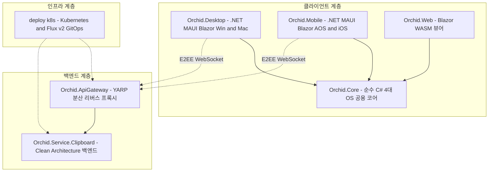

# ✅ Orchid 단일 모노레포 생성 및 초기 디렉터리 스캐폴딩 계획

---

## 1. 결정이 필요한 사항

1. **저장소 전략** — 단일 모노레포(`ibocon/Orchid`) 채택 (확정)
   - 근거: 멀티레포 분산 시 발생하는 NuGet 패키징/버전 불일치 오버헤드를 원천 제거하고, 단일 솔루션 파일과 프로젝트 참조(`ProjectReference`)로 4대 OS 클라이언트 및 백엔드를 원자적(Atomic)으로 검증 가능.
   - 기각한 대안: 6개 멀티레포 분산 — 개발 속도 저하 및 방문자 열람 피로도 급증.
2. **솔루션 도메인 범위** — E2EE 클립보드 동기화 시스템 (확정)
   - 근거: Todo 앱 대비 시스템 프로그래밍(Win32, AppKit, Android Accessibility, iOS Share Extension)과 보안(AES-256-GCM E2EE) 역량을 완벽히 증명할 수 있는 고난도 틈새 도메인.

---

## 2. 배경

- 개요:
  - Windows, macOS, Android, iOS 4대 플랫폼 간 클립보드 텍스트 및 이미지 데이터를 Zero-Knowledge 종단간 암호화(E2EE)로 실시간 동기화하고 로컬에 안전하게 보관하는 크로스 플랫폼 풀스택 모노레포 구축.
  - 사내 비공개 자산(Peony/Monolith IP)에 의존하지 않는 독립 오픈소스 플래그십 포트폴리오로 기획됨.
- 아키텍처 비교:
  - AS-IS: 별도 포트폴리오 리포지토리 부재, 비공개 저장소 기여 실적으로 인해 외부 기술 검증 제한.
  - TO-BE: `ibocon/Orchid` 단일 모노레포를 통해 클라이언트 공용 Core부터 네이티브 데스크톱/모바일, Clean Architecture 백엔드, Kubernetes 선언적 GitOps까지 단일 트리에서 완벽히 제시.

---

## 3. 변경 범위

| 레이어 | 디렉터리 경로 | 역할 및 구성 요소 |
| :--- | :--- | :--- |
| **Root** | `Directory.Build.props`, `Directory.Packages.props` | 중앙 집중식 NuGet 버전 관리(CPVM) 및 공통 컴파일러/C# 13 설정 |
| **Core** | `src/Core/` | 4대 OS 공용 도메인 모델, E2EE 암호화 파이프라인(AES-GCM), SQLite 캐시 |
| **Desktop** | `src/Desktop/` | .NET MAUI Blazor Hybrid (Win32 API 상시 리스너 & macOS NSPasteboard 이벤트) |
| **Mobile** | `src/Mobile/` | .NET MAUI Blazor Hybrid (Android AccessibilityService & iOS Share Extension) |
| **Web** | `src/Web/` | Blazor WebAssembly 기반 클립보드 검색 및 히스토리 관리 웹 대시보드 |
| **Service** | `src/Service/` | YARP API Gateway 및 Clean Architecture 기반 E2EE 암호화 릴레이 백엔드 |
| **Deploy** | `deploy/k8s/` | Kubernetes 선언적 Kustomize 매니페스트 및 Flux v2 GitOps 환경 구성 |

---

## 4. 단계별 수정 계획

### ✅ 1단계. GitHub 리포지토리 개설 및 브랜치 초기화
- **작업**: `gh repo create ibocon/Orchid --public` 실행 및 `main` 브랜치 기본 구조 수립. (완료: https://github.com/ibocon/Orchid)

### ✅ 2단계. 모노레포 루트 거버넌스 및 빌드 파일 구성
- **파일**: `Directory.Build.props`, `.editorconfig`, `README.md`
- **목표**: 일관된 C# 13, .NET 9 타깃팅, 널 가능성(`enable`), Release 시 경고를 오류로 처리(`TreatWarningsAsErrors`) 구성. (완료)

### ✅ 3단계. `src/Core` 공용 라이브러리 스캐폴딩
- **컴포넌트**:
  - `Domain`: `ClipboardItem`, `ContentType` (Text, Image, Url), `EncryptedPayload`, Result 패턴
  - `Cryptography`: Libsodium / `System.Security.Cryptography` 기반 AES-256-GCM E2EE 엔진
  - `Storage`: SQLite-net 기반 로컬 히스토리 캐시

### ✅ 4단계. `src/Desktop` 및 `src/Mobile` 네이티브 플랫폼 헤드 구성
- **Desktop**: .NET MAUI MacCatalyst & Windows 단일 프로젝트 (`UseMaui=true`)
- **Mobile**: .NET MAUI Android & iOS 크로스 플랫폼 프로젝트

### ✅ 5단계. `src/Service` 백엔드 및 `deploy/k8s` 인프라 스캐폴딩
- **Service**: YARP Gateway 및 SignalR 기반 실시간 암호화 패킷 릴레이 백엔드
- **Deploy**: k8s Base/Overlays 선언적 매니페스트

---

## 5. 테스트 계획

> 프레임워크: xUnit, FluentAssertions  
> 패턴: Given/When/Then (Four-Phase Test)

### ✅ 테스트 1: E2EE 암호화 및 복호화 단위 테스트
- 검증 대상: 평문 클립보드 텍스트가 디바이스 공개키로 정상 암호화되고, 개인키를 가진 디바이스에서만 무결하게 복호화되는지 검증.

### ✅ 테스트 2: 아키텍처 의존성 단위 테스트 (`NetArchTest`)
- 검증 대상: `Orchid.Core.Domain`이 상위 레이어나 특정 OS 네이티브 라이브러리에 의존하지 않는 순수 C# 계층임을 자동 검증.

---

## 6. 계획 평가

| 관점 | 참조 문서 | 평가 항목 | 결과 | 특이사항 |
| :--- | :--- | :--- | :---: | :--- |
| **아키텍처** | `clean-architecture.md` | 도메인 독립성 및 의존성 역전 준수 | **적합 ✅** | Core가 OS 종속성 없이 순수 도메인과 인터페이스만 소유 |
| **단위 테스트** | `x-unit-test-patterns.md` | 결정론적 암호화 및 비즈니스 테스트 | **적합 ✅** | Mock IClipboardListener를 통한 격리 테스트 가능 |
| **모노레포 DX** | `clean-code.md` | 단일 솔루션 기반 개발자 경험 | **적합 ✅** | 중앙 패키지 버전 관리(CPVM)로 의존성 충돌 방지 |
