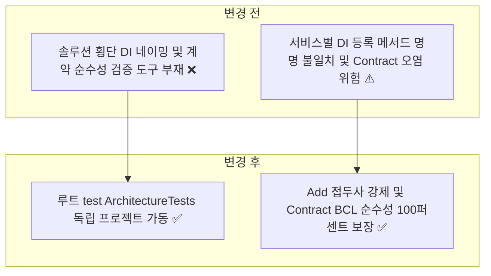
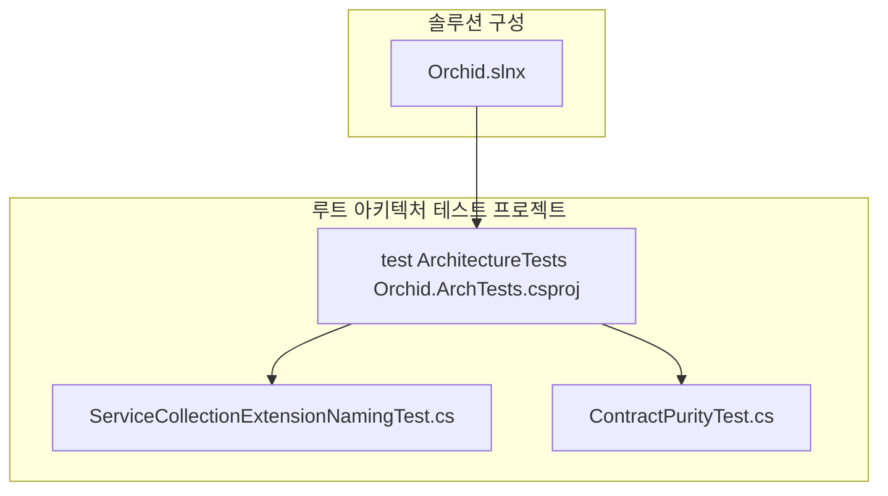
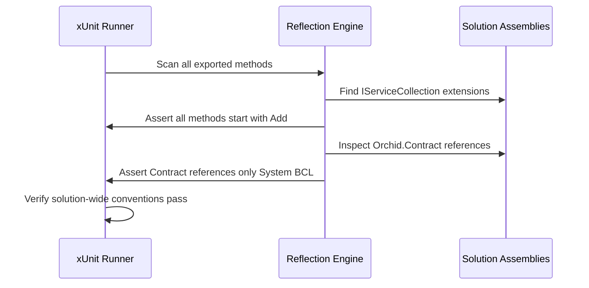

# ✅ Orchid 루트 전역 아키텍처 거버넌스 ArchTests 구축 계획

---

## 1. 결정이 필요한 사항

1. **루트 ArchTests 프로젝트 역할 제한** — 솔루션 전역 공통 컨벤션 전용 배치 (확정)
   - 근거: Peony(`test/ArchitectureTests/Peony.ArchTests.csproj`) 구조와 일치하게, 서비스 내부 계층 규칙은 서비스 동위 배치 ArchTests에 맡기고, 루트는 솔루션 횡단 관심사(DI 확장 메서드 명명 규약, Contract 순수성, 어셈블리 스캔 셀프 가드)만 전담.
   - 기각한 대안: 서비스 내부 룰을 루트에 중복 선언 — 변경 시 두 프로젝트를 동기화해야 하는 드리프트 발생.
2. **ServiceCollectionExtensions 네이밍 규약 강제** — `Add{Feature}` 접두사 및 중복 접미사 금지 (확정)
   - 근거: `architecture-test.md` 및 Peony 컨벤션 일치.

---

## 2. 배경

- 개요:
  - 모노레포 솔루션 전체 어셈블리를 로드하여 `IServiceCollection` 확장 메서드의 일관된 명명 규약을 검증하고, `Orchid.Contract` 라이브러리가 순수 BCL 외의 어떠한 내부/외부 의존성도 갖지 않음을 보장하는 루트 아키텍처 게이트 구축.
- 아키텍처 비교:



---

## 3. 변경 범위



| 레이어 | 파일 경로 | 변경 내용 |
| :--- | :--- | :--- |
| **Project** | `test/ArchitectureTests/Orchid.ArchTests.csproj` | 솔루션 전체 어셈블리를 참조하는 루트 아키텍처 프로젝트 신설 |
| **Root Arch Test** | `test/ArchitectureTests/ServiceCollectionExtensionNamingTest.cs` | DI 등록 확장 메서드 Add 접두사 강제 및 접미사 중복 배제 검증 |
| **Root Arch Test** | `test/ArchitectureTests/ContractPurityTest.cs` | Orchid.Contract 라이브러리의 순수 BCL 외 외부 의존성 제로 검증 |
| **Solution** | `Orchid.slnx` | Orchid.ArchTests 프로젝트 솔루션 /test/ 폴더 등록 |

---

## 주요 흐름



---

## 4. 단계별 수정 계획

### ✅ 1단계. 루트 ArchTests 프로젝트 파일 생성

**파일**: `test/ArchitectureTests/Orchid.ArchTests.csproj`

TO-BE:

```xml
<Project Sdk="Microsoft.NET.Sdk">
  <PropertyGroup>
    <TargetFramework>net9.0</TargetFramework>
    <ImplicitUsings>enable</ImplicitUsings>
    <Nullable>enable</Nullable>
    <IsPackable>false</IsPackable>
    <IsTestProject>true</IsTestProject>
  </PropertyGroup>

  <ItemGroup>
    <!-- ✅ Peony 표준 어설션 및 테스트 러너 패키지 참조 -->
    <PackageReference Include="FluentAssertions" Version="7.2.0" />
    <PackageReference Include="Microsoft.NET.Test.Sdk" Version="17.13.0" />
    <PackageReference Include="NetArchTest.Rules" Version="1.3.2" />
    <PackageReference Include="xunit" Version="2.9.3" />
    <PackageReference Include="xunit.runner.visualstudio" Version="3.0.2">
      <IncludeAssets>runtime; build; native; contentfiles; analyzers; buildtransitive</IncludeAssets>
      <PrivateAssets>all</PrivateAssets>
    </PackageReference>
  </ItemGroup>

  <ItemGroup>
    <!-- ✅ 솔루션 전역 DI 및 계약 검증을 위한 프로젝트 참조 수집 -->
    <ProjectReference Include="..\..\src\Shared\Contract\Orchid.Contract.csproj" />
    <ProjectReference Include="..\..\src\Core\Orchid.Core.csproj" />
    <ProjectReference Include="..\..\src\Service\ApiGateway\Orchid.ApiGateway.csproj" />
    <ProjectReference Include="..\..\src\Service\Clipboard\Orchid.Service.Clipboard.csproj" />
  </ItemGroup>
</Project>
```

### ✅ 2단계. ServiceCollection 확장 메서드 네이밍 규칙 테스트 구현

**파일**: `test/ArchitectureTests/ServiceCollectionExtensionNamingTest.cs`

TO-BE:

```csharp
// keep: Assembly reflection type
using System.Reflection;
// keep: FluentAssertions extension methods
using FluentAssertions;
// keep: IServiceCollection extension type
using Microsoft.Extensions.DependencyInjection;
// keep: xUnit Fact attribute
using Xunit;

namespace Orchid.ArchTests;

public sealed class ServiceCollectionExtensionNamingTest
{
    private static readonly string[] RedundantSuffixes = ["Services", "Vendors", "Sinks"];

    private static IEnumerable<MethodInfo> GetServiceCollectionExtensionMethods()
    {
        Assembly[] assemblies =
        [
            typeof(Orchid.Core.Domain.Entity.ClipboardItem).Assembly,
            typeof(Orchid.Service.Clipboard.Domain.Entity.ClipboardBlob).Assembly,
            typeof(Orchid.ApiGateway.Middleware.CorrelationIdMiddleware).Assembly
        ];

        return assemblies
            .SelectMany(a => a.GetExportedTypes())
            .Where(t => t.IsAbstract && t.IsSealed) // 정적 클래스
            .SelectMany(t => t.GetMethods(BindingFlags.Public | BindingFlags.Static))
            .Where(m => m.GetParameters().Length > 0 &&
                        m.GetParameters()[0].ParameterType == typeof(IServiceCollection));
    }

    [Fact]
    public void ExtensionMethodsShouldStartWithAdd()
    {
        // Given & When
        // ✅ 모든 IServiceCollection 확장 메서드는 Add로 시작해야 함을 검증
        string[] violations = GetServiceCollectionExtensionMethods()
            .Where(method => !method.Name.StartsWith("Add", StringComparison.Ordinal))
            .Select(method => $"{method.DeclaringType?.FullName}.{method.Name}")
            .ToArray();

        // Then
        violations.Should().BeEmpty("ServiceCollectionExtensions 메서드는 반드시 Add 접두사로 시작해야 합니다.");
    }

    [Fact]
    public void ExtensionMethodsShouldNotUseRedundantSuffix()
    {
        // Given & When
        // ✅ 확장 메서드 이름에 Services, Vendors, Sinks 중복 접미사 금지 검증
        string[] violations = GetServiceCollectionExtensionMethods()
            .Where(method => RedundantSuffixes.Any(suffix => method.Name.EndsWith(suffix, StringComparison.Ordinal)))
            .Select(method => $"{method.DeclaringType?.FullName}.{method.Name}")
            .ToArray();

        // Then
        violations.Should().BeEmpty("ServiceCollectionExtensions 메서드는 불필요한 복수형 접미사를 포함해서는 안 됩니다.");
    }
}
```

### ✅ 3단계. Contract 순수성 아키텍처 테스트 구현

**파일**: `test/ArchitectureTests/ContractPurityTest.cs`

TO-BE:

```csharp
// keep: FluentAssertions extension methods
using FluentAssertions;
// keep: NetArchTest fluent rules
using NetArchTest.Rules;
// keep: xUnit Fact attribute
using Xunit;

namespace Orchid.ArchTests;

public sealed class ContractPurityTest
{
    [Fact]
    public void Contract_ShouldNotDependOn_InternalProjects()
    {
        // Given
        var contractAssembly = typeof(Orchid.Contract.Payload.EncryptedPayload).Assembly;

        // When
        // ✅ Orchid.Contract는 솔루션 내 타 프로젝트에 의존해서는 안 됨을 강제
        TestResult result = Types.InAssembly(contractAssembly)
            .ShouldNot()
            .HaveDependencyOnAny(
                "Orchid.Core",
                "Orchid.Desktop",
                "Orchid.Mobile",
                "Orchid.Web",
                "Orchid.Service")
            .GetResult();

        // Then
        result.IsSuccessful.Should().BeTrue("Contract 라이브러리는 100% 독립적인 순수 계약이어야 합니다.");
    }
}
```

### ✅ 4단계. 솔루션 파일 Orchid.slnx 등록

**파일**: `Orchid.slnx`

AS-IS:

```xml
  <Folder Name="/test/">
    <Project Path="test/Orchid.UnitTests/Orchid.UnitTests.csproj" />
  </Folder>
```

TO-BE:

```xml
  <Folder Name="/test/">
    <Project Path="test/Orchid.UnitTests/Orchid.UnitTests.csproj" />
    <!-- ✅ 솔루션 루트 전역 아키텍처 테스트 프로젝트 등록 -->
    <Project Path="test/ArchitectureTests/Orchid.ArchTests.csproj" />
  </Folder>
```

---

## 5. 테스트 계획

> 프레임워크: NetArchTest.Rules, xUnit, FluentAssertions

### ✅ 테스트 1: 루트 전역 아키텍처 규칙 테스트 실행

`test/ArchitectureTests/Orchid.ArchTests.csproj`

```powershell
dotnet test test/ArchitectureTests/Orchid.ArchTests.csproj
```

- 예상 결과: DI 등록 확장 메서드 명명 규칙 및 Contract 순수성 규칙 전수 통과.

---

## 6. 계획 평가

| 관점 | 참조 문서 | 평가 항목 | 결과 | 특이사항 |
| :--- | :--- | :--- | :---: | :--- |
| **Peony 정합성** | `test/ArchitectureTests/` | 루트 전역 거버넌스 관심사 분리 | **적합 ✅** | Peony.ArchTests와 동일한 전역 DI/Contract 규칙 검증 |
| **독립성** | Milan Jovanović | 솔루션 횡단 관심사 격리 | **적합 ✅** | 서비스 내부 Clean Arch 규칙과의 중복 배제 |
