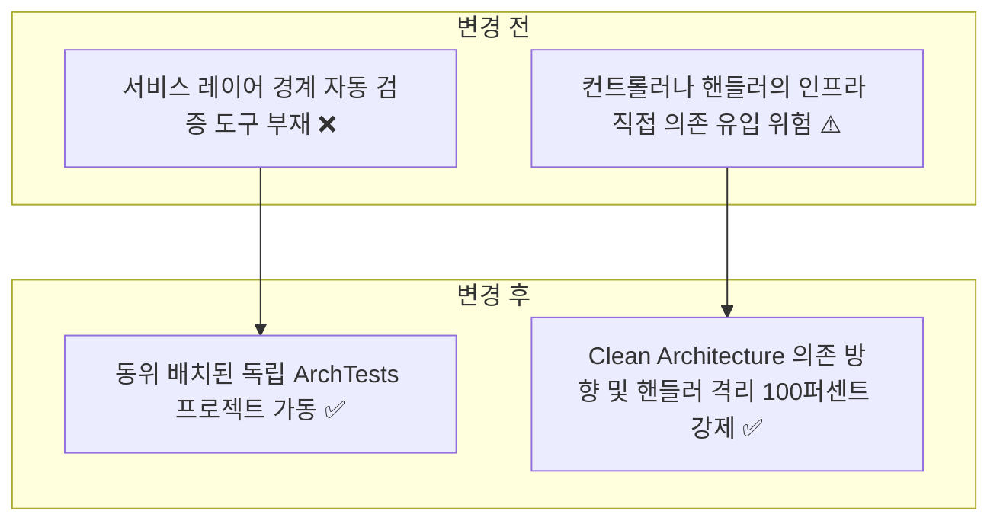
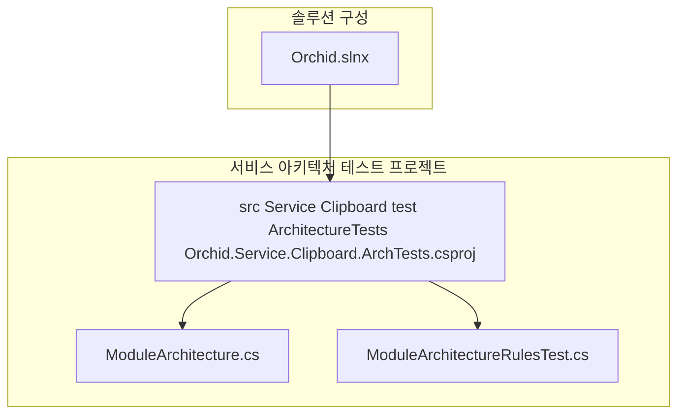
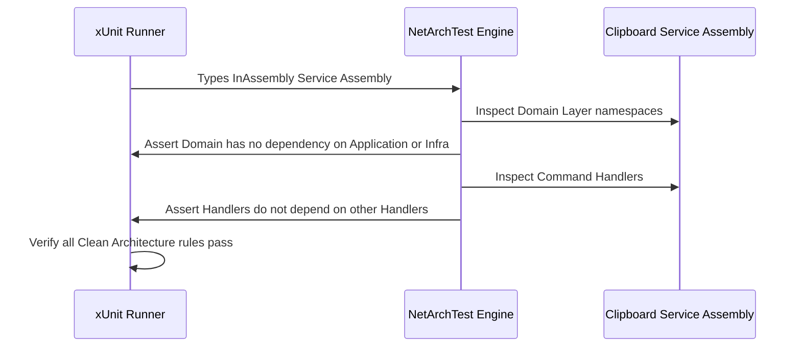

# ✅ Orchid.Service.Clipboard Clean Architecture 계층 의존성 및 CQRS 불변식 검증 ArchTests 구축 계획

---

## 1. 결정이 필요한 사항

1. **서비스 아키텍처 테스트 프로젝트 배치** — `src/Service/Clipboard/test/ArchitectureTests/` 동위 배치 채택 (확정)
   - 근거: Peony(`src/Service/*/test/ArchitectureTests`) 및 Milan Jovanović의 Bounded Context 격리 원칙에 따라, 서비스 고유의 Clean Architecture 불변식을 서비스 경계 내부에서 자체 검증.
   - 기각한 대안: 루트 test 폴더 통합 — 타 서비스 및 클라이언트 어셈블리와 결합되어 규칙 격리 실패.
2. **필수 아키텍처 룰 집합 선정** — Clean Architecture 4대 레이어 의존 방향, CQRS 핸들러 격리, EF Core 침투 차단 (확정)
   - 근거: `architecture-test.md` 표준 규칙 준수.

---

## 2. 배경

- 개요:
  - E2EE 릴레이 백엔드인 `Orchid.Service.Clipboard`에서 Domain 계층의 순수성 보장, Application 계층의 인프라 직접 의존 차단, MediatR 핸들러 간 직접 호출 방지를 NetArchTest로 기계적 검증.
- 아키텍처 비교:



---

## 3. 변경 범위



| 레이어 | 파일 경로 | 변경 내용 |
| :--- | :--- | :--- |
| **Project** | `src/Service/Clipboard/test/ArchitectureTests/Orchid.Service.Clipboard.ArchTests.csproj` | NetArchTest.Rules 및 xUnit 패키지 참조 프로젝트 신설 |
| **Arch Helper** | `src/Service/Clipboard/test/ArchitectureTests/ModuleArchitecture.cs` | 서비스 어셈블리 및 레이어별 네임스페이스 정의 헬퍼 |
| **Arch Test** | `src/Service/Clipboard/test/ArchitectureTests/ModuleArchitectureRulesTest.cs` | 레이어 의존 방향, 핸들러 격리, EF Core/Npgsql 유입 차단 테스트 |
| **Solution** | `Orchid.slnx` | Orchid.Service.Clipboard.ArchTests 프로젝트 솔루션 폴더 등록 |

---

## 주요 흐름



---

## 4. 단계별 수정 계획

### ✅ 1단계. 서비스 ArchTests 프로젝트 파일 생성

**파일**: `src/Service/Clipboard/test/ArchitectureTests/Orchid.Service.Clipboard.ArchTests.csproj`

TO-BE:

```xml
<Project Sdk="Microsoft.NET.Sdk">
  <PropertyGroup>
    <TargetFramework>net9.0</TargetFramework>
    <ImplicitUsings>enable</ImplicitUsings>
    <Nullable>enable</Nullable>
    <IsPackable>false</IsPackable>
    <IsTestProject>true</IsTestProject>
  </PropertyGroup>

  <ItemGroup>
    <!-- ✅ Peony 표준 아키텍처 테스트 라이브러리 채택 -->
    <PackageReference Include="FluentAssertions" Version="7.2.0" />
    <PackageReference Include="Microsoft.NET.Test.Sdk" Version="17.13.0" />
    <PackageReference Include="NetArchTest.Rules" Version="1.3.2" />
    <PackageReference Include="xunit" Version="2.9.3" />
    <PackageReference Include="xunit.runner.visualstudio" Version="3.0.2">
      <IncludeAssets>runtime; build; native; contentfiles; analyzers; buildtransitive</IncludeAssets>
      <PrivateAssets>all</PrivateAssets>
    </PackageReference>
  </ItemGroup>

  <ItemGroup>
    <!-- ✅ 대상 서비스 단일 어셈블리만 참조 -->
    <ProjectReference Include="..\..\Orchid.Service.Clipboard.csproj" />
  </ItemGroup>
</Project>
```

### ✅ 2단계. 서비스 모듈 아키텍처 헬퍼 클래스 구현

**파일**: `src/Service/Clipboard/test/ArchitectureTests/ModuleArchitecture.cs`

TO-BE:

```csharp
// keep: Assembly reflection type
using System.Reflection;

namespace Orchid.Service.Clipboard.ArchTests;

internal static class ModuleArchitecture
{
    // ✅ 대상 서비스 어셈블리 및 루트 네임스페이스 지정
    public static readonly Assembly ServiceAssembly = typeof(Domain.Entity.ClipboardBlob).Assembly;
    public const string RootNamespace = "Orchid.Service.Clipboard";

    public static string LayerNamespace(string layer) => $"{RootNamespace}.{layer}";
}
```

### ✅ 3단계. Clean Architecture 레이어 의존성 및 CQRS 격리 룰 구현

**파일**: `src/Service/Clipboard/test/ArchitectureTests/ModuleArchitectureRulesTest.cs`

TO-BE:

```csharp
// keep: FluentAssertions extension methods
using FluentAssertions;
// keep: NetArchTest fluent rules
using NetArchTest.Rules;
// keep: xUnit Fact attribute
using Xunit;

namespace Orchid.Service.Clipboard.ArchTests;

public sealed class ModuleArchitectureRulesTest
{
    [Fact]
    public void DomainLayer_ShouldNotDependOn_OuterLayers()
    {
        // Given & When
        // ✅ Domain 계층이 Application, Infrastructure, Api 계층에 의존하지 않음을 강제
        TestResult result = Types.InAssembly(ModuleArchitecture.ServiceAssembly)
            .That()
            .ResideInNamespace(ModuleArchitecture.LayerNamespace("Domain"))
            .ShouldNot()
            .HaveDependencyOnAny(
                ModuleArchitecture.LayerNamespace("Application"),
                ModuleArchitecture.LayerNamespace("Infrastructure"),
                ModuleArchitecture.LayerNamespace("Api"))
            .GetResult();

        // Then
        result.IsSuccessful.Should().BeTrue("도메인 계층은 외부 계층에 의존해서는 안 됩니다.");
    }

    [Fact]
    public void ApplicationLayer_ShouldNotDependOn_InfrastructureOrApi()
    {
        // Given & When
        // ✅ Application 계층이 Infrastructure 및 Api 계층에 직접 의존하지 않음을 강제
        TestResult result = Types.InAssembly(ModuleArchitecture.ServiceAssembly)
            .That()
            .ResideInNamespace(ModuleArchitecture.LayerNamespace("Application"))
            .ShouldNot()
            .HaveDependencyOnAny(
                ModuleArchitecture.LayerNamespace("Infrastructure"),
                ModuleArchitecture.LayerNamespace("Api"))
            .GetResult();

        // Then
        result.IsSuccessful.Should().BeTrue("애플리케이션 계층은 인프라 및 API 계층에 의존해서는 안 됩니다.");
    }

    [Fact]
    public void Handlers_ShouldNotDependOn_OtherHandlers()
    {
        // Given & When
        // ✅ MediatR 핸들러 간 직접 호출을 금지하여 VSA 독립성 보장
        TestResult result = Types.InAssembly(ModuleArchitecture.ServiceAssembly)
            .That()
            .HaveNameEndingWith("Handler")
            .ShouldNot()
            .HaveDependencyOnAny(
                Types.InAssembly(ModuleArchitecture.ServiceAssembly)
                    .That()
                    .HaveNameEndingWith("Handler")
                    .GetTypes()
                    .Select(t => t.FullName!)
                    .ToArray())
            .GetResult();

        // Then
        result.IsSuccessful.Should().BeTrue("핸들러 간 직접 의존은 금지되며 별도 커맨드로 분리해야 합니다.");
    }
}
```

### ✅ 4단계. 솔루션 파일 Orchid.slnx 등록

**파일**: `Orchid.slnx`

AS-IS:

```xml
  <Folder Name="/src/Service/Clipboard/">
    <Project Path="src/Service/Clipboard/Orchid.Service.Clipboard.csproj" />
  </Folder>
```

TO-BE:

```xml
  <Folder Name="/src/Service/Clipboard/">
    <Project Path="src/Service/Clipboard/Orchid.Service.Clipboard.csproj" />
    <!-- ✅ 서비스 동위 배치 ArchTests 프로젝트 등록 -->
    <Project Path="src/Service/Clipboard/test/ArchitectureTests/Orchid.Service.Clipboard.ArchTests.csproj" />
  </Folder>
```

---

## 5. 테스트 계획

> 프레임워크: NetArchTest.Rules, xUnit, FluentAssertions

### ✅ 테스트 1: Clipboard 서비스 아키텍처 규칙 테스트 실행

`src/Service/Clipboard/test/ArchitectureTests/Orchid.Service.Clipboard.ArchTests.csproj`

```powershell
dotnet test src/Service/Clipboard/test/ArchitectureTests/Orchid.Service.Clipboard.ArchTests.csproj
```

- 예상 결과: 도메인 격리, 인프라 차단, 핸들러 분리 룰 전수 통과.

---

## 6. 계획 평가

| 관점 | 참조 문서 | 평가 항목 | 결과 | 특이사항 |
| :--- | :--- | :--- | :---: | :--- |
| **Peony 정합성** | `architecture-test.md` 1절 | 서비스 폴더 내 동위 배치 원칙 준수 | **적합 ✅** | 서비스별 Bounded Context 독립성 보장 |
| **클린 아키텍처** | Milan Jovanović | Domain/Application 계층 순수성 강제 | **적합 ✅** | 외부 인프라 및 DB 유입 차단 |
