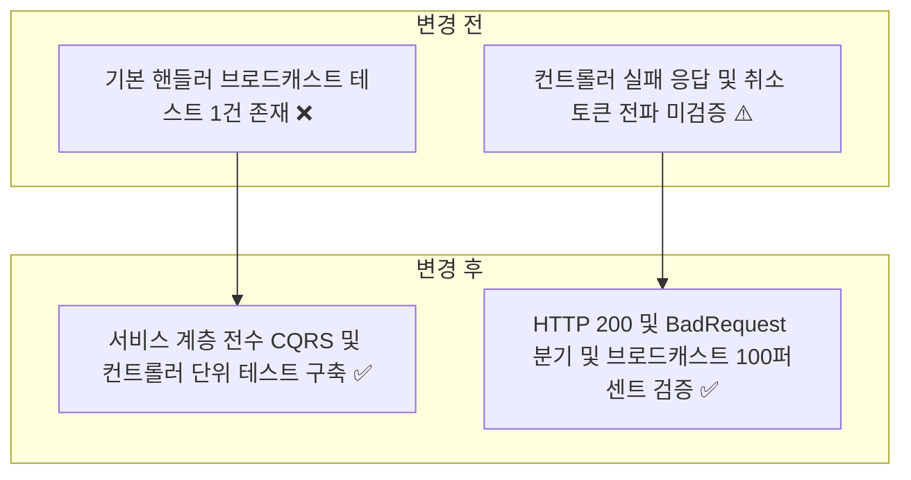
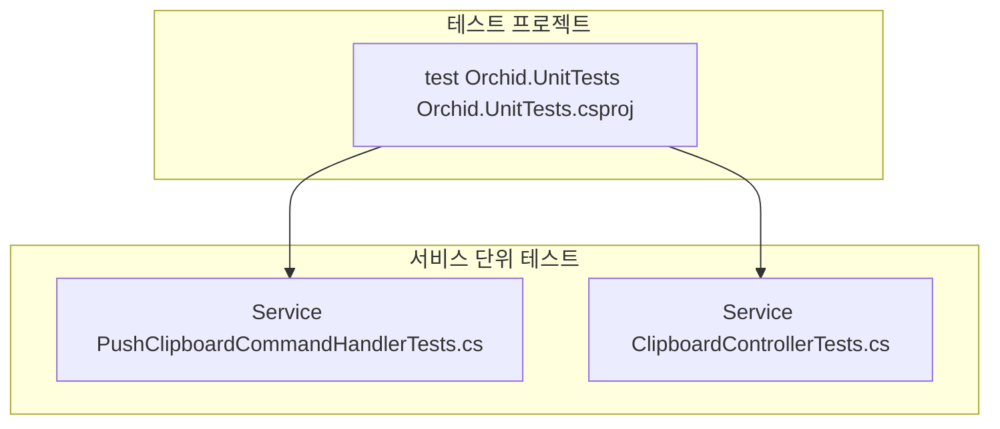
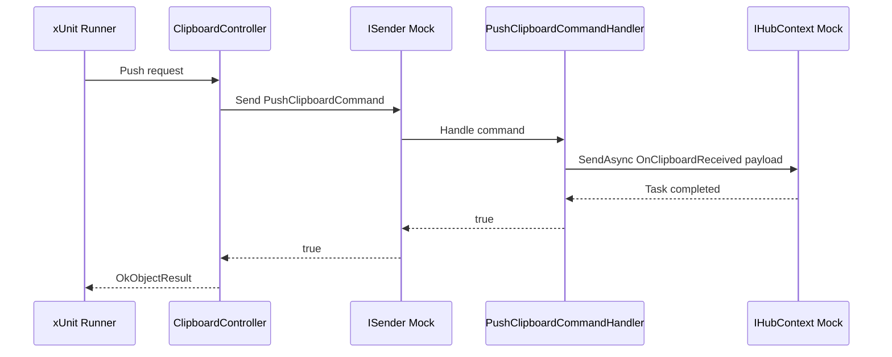

# ✅ Orchid.Service.Clipboard 단위 테스트 스위트 구현 계획

---

## 1. 결정이 필요한 사항

1. **SignalR HubContext Mocking 방식** — `IHubContext<ClipboardHub>`, `IHubClients`, `IClientProxy` 계층형 Moq 구성 (확정)
   - 근거: 실제 웹소켓 소켓 연결 없이 SignalR 허브 컨텍스트를 통한 브로드캐스트 메서드(`SendAsync`) 호출 여부 및 인자 전달을 엄격히 검증.
2. **MediatR 핸들러 및 컨트롤러 분리 테스트 원칙** — 핸들러 비즈니스 로직과 컨트롤러 HTTP 응답 매핑 분리 (확정)
   - 근거: Clean Architecture 원칙에 따라 Application 유스케이스 검증과 Presentation 계층 검증의 책임을 독립적으로 유지.

---

## 2. 배경

- 개요:
  - 백엔드 E2EE 릴레이 마이크로서비스인 `Orchid.Service.Clipboard`의 CQRS 커맨드 핸들러(`PushClipboardCommandHandler`)와 REST API 컨트롤러(`ClipboardController`)의 동작 무결성을 검증하는 단위 테스트 구축.
- 아키텍처 비교:



---

## 3. 변경 범위



| 레이어 | 파일 경로 | 변경 내용 |
| :--- | :--- | :--- |
| **Service Test** | `test/Orchid.UnitTests/Service/PushClipboardCommandHandlerTests.cs` | SignalR 허브 브로드캐스트 호출 및 CancellationToken 전파 검증 |
| **Service Test** | `test/Orchid.UnitTests/Service/ClipboardControllerTests.cs` | MediatR 처리 성공 시 OkResult(200), 실패 시 BadRequestResult(400) 반환 검증 |

---

## 주요 흐름



---

## 4. 단계별 수정 계획

### ✅ 1단계. PushClipboardCommandHandler 단위 테스트 구현

**파일**: `test/Orchid.UnitTests/Service/PushClipboardCommandHandlerTests.cs`

TO-BE:

```csharp
namespace Orchid.UnitTests.Service;

public sealed class PushClipboardCommandHandlerTests
{
    [Fact]
    public async Task Handle_Should_Broadcast_EncryptedPayload_To_Connected_Clients()
    {
        // Given
        var hubMock = new Mock<IHubContext<ClipboardHub>>();
        var clientsMock = new Mock<IHubClients>();
        var clientProxyMock = new Mock<IClientProxy>();

        hubMock.Setup(h => h.Clients).Returns(clientsMock.Object);
        clientsMock.Setup(c => c.All).Returns(clientProxyMock.Object);

        var handler = new PushClipboardCommandHandler(hubMock.Object);
        var payload = new EncryptedPayload(Guid.NewGuid(), [1, 2], [3], [4], "AES", DateTimeOffset.UtcNow);
        var command = new PushClipboardCommand(Guid.NewGuid(), payload);

        // When
        // ✅ 커맨드 수신 시 SignalR Clients.All로 브로드캐스트 정상 전송 검증
        var result = await handler.Handle(command, CancellationToken.None);

        // Then
        result.Should().BeTrue();
        clientProxyMock.Verify(x => x.SendCoreAsync(
            "OnClipboardReceived",
            It.Is<object?[]>(args => (EncryptedPayload)args[0]! == payload),
            default), Times.Once);
    }
}
```

### ✅ 2단계. ClipboardController HTTP 응답 매핑 단위 테스트 신설

**파일**: `test/Orchid.UnitTests/Service/ClipboardControllerTests.cs`

TO-BE:

```csharp
namespace Orchid.UnitTests.Service;

public sealed class ClipboardControllerTests
{
    [Fact]
    public async Task Push_When_Sender_Succeeds_Should_Return_Ok()
    {
        // Given
        var senderMock = new Mock<ISender>();
        senderMock.Setup(s => s.Send(It.IsAny<PushClipboardCommand>(), It.IsAny<CancellationToken>()))
            .ReturnsAsync(true);

        var controller = new ClipboardController(senderMock.Object);
        var payload = new EncryptedPayload(Guid.NewGuid(), [1], [2], [3], "AES", DateTimeOffset.UtcNow);
        var request = new PushClipboardRequest(Guid.NewGuid(), payload);

        // When
        // ✅ ISender가 true 반환 시 HTTP 200 Ok 응답 검증
        var response = await controller.Push(request, CancellationToken.None);

        // Then
        response.Should().BeOfType<OkObjectResult>();
    }

    [Fact]
    public async Task Push_When_Sender_Fails_Should_Return_BadRequest()
    {
        // Given
        var senderMock = new Mock<ISender>();
        senderMock.Setup(s => s.Send(It.IsAny<PushClipboardCommand>(), It.IsAny<CancellationToken>()))
            .ReturnsAsync(false);

        var controller = new ClipboardController(senderMock.Object);
        var payload = new EncryptedPayload(Guid.NewGuid(), [1], [2], [3], "AES", DateTimeOffset.UtcNow);
        var request = new PushClipboardRequest(Guid.NewGuid(), payload);

        // When
        // ✅ ISender가 false 반환 시 HTTP 400 BadRequest 응답 검증
        var response = await controller.Push(request, CancellationToken.None);

        // Then
        response.Should().BeOfType<BadRequestResult>();
    }
}
```

---

## 5. 테스트 계획

> 프레임워크: xUnit, FluentAssertions, Moq

### ✅ 테스트 1: Service 단위 테스트 실행

`test/Orchid.UnitTests/Orchid.UnitTests.csproj`

```powershell
dotnet test test/Orchid.UnitTests/Orchid.UnitTests.csproj --filter "FullyQualifiedName~Service"
```

- 예상 결과: Service 단위 테스트 전수 통과.

---

## 6. 계획 평가

| 관점 | 참조 문서 | 평가 항목 | 결과 | 특이사항 |
| :--- | :--- | :--- | :---: | :--- |
| **Clean Architecture** | `clean-architecture.md` | CQRS 핸들러와 컨트롤러 계층 분리 | **적합 ✅** | MediatR 인터페이스 추상화 검증 |
| **실시간 동기화** | `enterprise-application-architecture.md` | SignalR 브로드캐스트 호출 일관성 | **적합 ✅** | Mock IHubContext 호출 검증 보장 |
