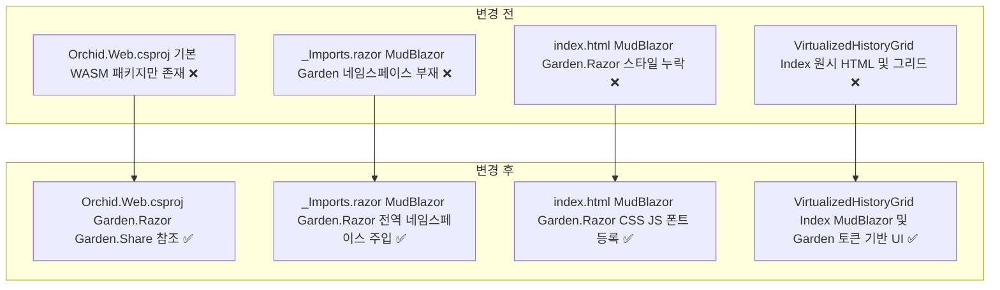
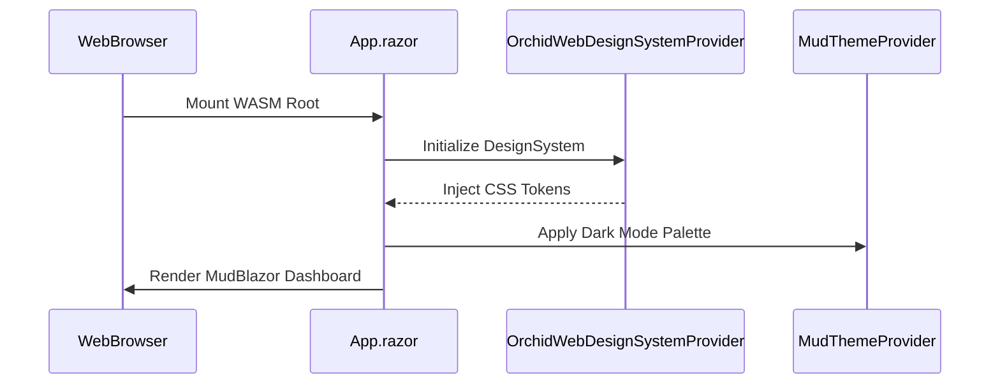

# ✅ Orchid.Web Garden.Razor 디자인 시스템 구축 계획

## 계획 관계

> **관계 스키마**: `1`
> **계획 ID**: `orchid:261013_feat_orchid-web-garden-razor-design-system`
> **출처 판정**: `최초`
> **출처 판정 근거**: Monolith 웹 대시보드 표준을 준용하여 Orchid Web WASM 클라이언트를 Garden.Razor 및 MudBlazor 디자인 시스템 기반으로 구축하기 위한 사용자 요청에서 독립적으로 시작

| 관계 | 대상 계획 ID | 조건 | 근거·인수 범위 |
| --- | --- | --- | --- |

<!-- plan-relations-summary:start -->
> 자동 생성 관계 요약. 원본은 위 관계 표입니다.

| 구분 | 계획·조건 |
| --- | --- |
| 최초 계획 | [✅ Orchid.Web Garden.Razor 디자인 시스템 구축 계획](<261013_feat_orchid-web-garden-razor-design-system.md>) `orchid:261013_feat_orchid-web-garden-razor-design-system` |
| 직접 출처 | 없음 |
| 직접 후속 | 없음 |
| 계보 경로 | [✅ Orchid.Web Garden.Razor 디자인 시스템 구축 계획](<261013_feat_orchid-web-garden-razor-design-system.md>) `orchid:261013_feat_orchid-web-garden-razor-design-system` |
| 착수 조건 | 가능 |
<!-- plan-relations-summary:end -->

## 결정이 필요한 사항

1. **Blazor WebAssembly 디자인 시스템 프로바이더 상속** — `Garden.Razor.DesignSystemProvider<DesignSystem>` 채택 (권장)
   - 근거: 데스크톱/모바일과 완전히 동일한 Garden 색상 스키마 토큰(`--gdn-sys-color-surface` 등)을 WASM 런타임에 직접 주입하여 플랫폼 간 시각적 일관성 달성.
   - 대안: Web 전용 독립 CSS 파일 유지 — 디자인 토큰 변경 시 동기화 누락 및 웹 대시보드 시각적 이질감 심화.
2. **MudBlazor 가상화 테이블(`MudTable`) 전환** — 기존 원시 `Virtualize`를 MudBlazor 테이블 가상화로 고도화 (권장)
   - 근거: 대용량 클립보드 내역 검색 시 행 선택, 열 정렬, 반응형 카드 뷰 전환 등 풍부한 UI 인터랙션 제공.
   - 대안: 원시 HTML 그리드에 스타일만 오버레이 — 가상화 플레이스홀더 및 스크롤 성능 한계.

## 배경

- 현재 `src/Web`의 Blazor WebAssembly 뷰어는 원시 HTML 구조와 인라인 스타일(`div.virtualized-grid-container`, `div.grid-row`)로 구성되어 있어 반응형 웹 환경에서의 시각적 위계 및 테마 지원이 미흡합니다.
- Monolith 웹 아키텍처 원칙을 적용하여 `Garden.Razor` 및 `MudBlazor` 패키지를 WebAssembly 프로젝트에 통합합니다.
- 웹 디자인 시스템 프로바이더(`OrchidWebDesignSystemProvider`), 정적 리소스(Material Symbols, Roboto, MudBlazor CSS/JS), MudBlazor 기반 메인 뷰어(`MudTable`, `MudContainer`, `MudAppBar`, `MudChip`)로 전면 개편합니다.

## 변경 범위



| 레이어 | 파일 | 변경 내용 |
| --- | --- | --- |
| 프로젝트 구성 | `src/Web/Orchid.Web.csproj` | Garden.Razor 및 Garden.Share NuGet 패키지 참조 추가 |
| 면역 네임스페이스 | `src/Web/_Imports.razor` | MudBlazor, Garden.Razor, Garden.Share 전역 using 정의 |
| 호스트 진입점 | `src/Web/Program.cs` | AddGardenRazor 및 AddMudServices 의존성 주입 등록 |
| 정적 웹 자산 | `src/Web/wwwroot/index.html` | MudBlazor, Garden.Razor 스타일시트 및 자바스크립트, Roboto/아이콘 웹폰트 등록 |
| 디자인 시스템 | `src/Web/Component/OrchidWebDesignSystemProvider.razor` | DesignSystemProvider 상속 컴포넌트 신설 |
| 디자인 시스템 코드비하인드 | `src/Web/Component/OrchidWebDesignSystemProvider.razor.cs` | 웹 반응형 테마 컨텍스트 동기화 및 전역 스타일 빌더 구현 |
| 루트 라우터 | `src/Web/App.razor` | MudThemeProvider 및 OrchidWebDesignSystemProvider 루트 래핑 |
| 대시보드 페이지 | `src/Web/Pages/Index.razor` | MudContainer, MudPaper, MudText 기반 대시보드 레이아웃 개편 |
| 히스토리 그리드 UI | `src/Web/Component/VirtualizedHistoryGrid.razor` | MudTable 기반 가상화 및 MudChip 현대화 |

## 주요 흐름



## 단계별 수정 계획

### ✅ Step 1: Web 프로젝트 패키지 참조 보강

**파일**: `src/Web/Orchid.Web.csproj`

AS-IS:

```xml
  <ItemGroup>
    <ProjectReference Include="..\Core\Orchid.Core.csproj" />
  </ItemGroup>

  <ItemGroup>
    <!-- ❌ Garden.Razor 및 Garden.Share 패키지 참조 부재 -->
    <PackageReference Include="Microsoft.AspNetCore.Components.WebAssembly" Version="10.0.0" />
    <PackageReference Include="Microsoft.AspNetCore.Components.WebAssembly.DevServer" Version="10.0.0" PrivateAssets="all" />
  </ItemGroup>
```

TO-BE:

```xml
  <ItemGroup>
    <ProjectReference Include="..\Core\Orchid.Core.csproj" />
  </ItemGroup>

  <ItemGroup>
    <PackageReference Include="Microsoft.AspNetCore.Components.WebAssembly" Version="10.0.0" />
    <PackageReference Include="Microsoft.AspNetCore.Components.WebAssembly.DevServer" Version="10.0.0" PrivateAssets="all" />
    <!-- ✅ Garden.Razor 및 Garden.Share 디자인 시스템 패키지 추가 -->
    <PackageReference Include="Garden.Razor" Version="9.4.5" />
    <PackageReference Include="Garden.Share" Version="9.4.5" />
  </ItemGroup>
```

### ✅ Step 2: 전역 네임스페이스 및 DI 서비스 등록

**파일**: `src/Web/_Imports.razor`

AS-IS:

```razor
// ❌ MudBlazor 및 Garden.Razor 전역 네임스페이스 부재
@using System.Net.Http
@using System.Net.Http.Json
@using Microsoft.AspNetCore.Components.Forms
@using Microsoft.AspNetCore.Components.Routing
@using Microsoft.AspNetCore.Components.Web
@using Microsoft.AspNetCore.Components.Web.Virtualization
@using Microsoft.JSInterop
@using Orchid.Web
@using Orchid.Web.Component
@using Orchid.Web.Service
@using Orchid.Contract.Model
@using Orchid.Contract.Payload
@using Orchid.Core.Domain.Entity
```

TO-BE:

```razor
// ✅ Peony 표준 MudBlazor 및 Garden.Razor 타입 별칭 및 전역 using 주입
@using System.Net.Http
@using System.Net.Http.Json
@using Microsoft.AspNetCore.Components.Forms
@using Microsoft.AspNetCore.Components.Routing
@using Microsoft.AspNetCore.Components.Web
@using Microsoft.AspNetCore.Components.Web.Virtualization
@using Microsoft.JSInterop
@using MudBlazor
@using MudBlazor.Utilities
@using MudColorPreset = MudBlazor.Color
@using MudIcons = MudBlazor.Icons
@using MudSize = MudBlazor.Size
@using MudDividerType = MudBlazor.DividerType
@using Garden.Razor
@using Garden.Share
@using Size = Garden.Razor.Size
@using DividerType = Garden.Razor.DividerType
@using Orchid.Web
@using Orchid.Web.Component
@using Orchid.Web.Service
@using Orchid.Contract.Model
@using Orchid.Contract.Payload
@using Orchid.Core.Domain.Entity
```

**파일**: `src/Web/Program.cs`

AS-IS:

```csharp
// ❌ MudServices 및 GardenRazor DI 등록 누락
builder.Services.AddScoped(sp => new HttpClient { BaseAddress = new Uri(builder.HostEnvironment.BaseAddress) });
builder.Services.AddScoped<ISystemClipboard, WebClipboardAdapter>();
builder.Services.AddSingleton<IAesGcmCryptoService, AesGcmCryptoService>();
```

TO-BE:

```csharp
// ✅ Garden.Razor 및 MudBlazor 디자인 시스템 서비스 등록
builder.Services.AddScoped(sp => new HttpClient { BaseAddress = new Uri(builder.HostEnvironment.BaseAddress) });
builder.Services.AddMudServices();
builder.Services.AddGardenRazor();
builder.Services.AddScoped<ISystemClipboard, WebClipboardAdapter>();
builder.Services.AddSingleton<IAesGcmCryptoService, AesGcmCryptoService>();
```

### ✅ Step 3: 정적 웹 자산 및 폰트 링크 최신화

**파일**: `src/Web/wwwroot/index.html`

AS-IS:

```html
<!DOCTYPE html>
<html lang="ko">
<head>
    <meta charset="utf-8" />
    <meta name="viewport" content="width=device-width, initial-scale=1.0" />
    <title>Orchid Web Dashboard</title>
    <base href="/" />
    <!-- ❌ MudBlazor 및 Garden.Razor CSS/JS 및 웹폰트 링크 누락 -->
    <link href="css/app.css" rel="stylesheet" />
</head>
<body>
    <div id="app">로딩 중...</div>
    <script src="_framework/blazor.webassembly.js"></script>
</body>
</html>
```

TO-BE:

```html
<!DOCTYPE html>
<html lang="ko">
<head>
    <meta charset="utf-8" />
    <meta name="viewport" content="width=device-width, initial-scale=1.0" />
    <title>Orchid Web Dashboard</title>
    <base href="/" />
    <!-- ✅ 웹폰트, 머티리얼 심볼, MudBlazor 및 Garden.Razor 스타일시트 링크 주입 -->
    <link rel="preconnect" href="https://fonts.googleapis.com" />
    <link rel="preconnect" href="https://fonts.gstatic.com" crossorigin />
    <link rel="stylesheet" href="https://fonts.googleapis.com/css2?family=Roboto:wght@400;500;700&display=swap" />
    <link rel="stylesheet" href="https://fonts.googleapis.com/css2?family=Material+Symbols+Rounded:opsz,wght,FILL,GRAD@24,400,0,0" />
    <link rel="stylesheet" href="_content/MudBlazor/MudBlazor.min.css" />
    <link rel="stylesheet" href="_content/Garden.Razor/Garden.Razor.min.css" />
    <link href="css/app.css" rel="stylesheet" />
</head>
<body>
    <div id="app">로딩 중...</div>
    <!-- ✅ MudBlazor 인터롭 스크립트 등록 -->
    <script src="_content/MudBlazor/MudBlazor.min.js"></script>
    <script src="_framework/blazor.webassembly.js"></script>
</body>
</html>
```

### ✅ Step 4: OrchidWebDesignSystemProvider 구축

**파일**: `src/Web/Component/OrchidWebDesignSystemProvider.razor`

AS-IS:

```razor
// ❌ 디자인 시스템 프로바이더 미구현
```

TO-BE:

```razor
// ✅ Garden.Razor DesignSystemProvider 기반 마크업 스트림 생성
@namespace Orchid.Web.Component
@inherits DesignSystemProvider<DesignSystem>
@implements IAsyncDisposable

@((MarkupString)BuildDesignSystem())
```

**파일**: `src/Web/Component/OrchidWebDesignSystemProvider.razor.cs`

AS-IS:

```csharp
// ❌ 디자인 시스템 프로바이더 코드비하인드 미구현
```

TO-BE:

```csharp
// ✅ Garden.Razor DesignSystem 기반 테마 이벤트 바인딩 및 웹 CSS 주입
// keep: StringBuilder 사용
using System.Text;
// keep: DesignSystemProvider 및 DesignSystem 사용
using Garden.Razor;
// keep: SchemeContext 및 Scheme 사용
using Garden.Share;
// keep: InjectAttribute 사용
using Microsoft.AspNetCore.Components;
using MudBlazor;

namespace Orchid.Web.Component;

public partial class OrchidWebDesignSystemProvider : DesignSystemProvider<DesignSystem>, IAsyncDisposable
{
    [Inject]
    internal DesignSystem DsgnSys { get; set; } = default!;

    public MudTheme CurrentMudTheme { get; private set; } = new();

    public ValueTask DisposeAsync()
    {
        DsgnSys.Color.SchemeSet.ContextChanged -= OnSchemeContextChanged;
        return ValueTask.CompletedTask;
    }

    protected override void OnInitialized()
    {
        DsgnSys.Color.SchemeSet.ChangeContext(SchemeContext.Dark);
        ApplyMudThemeFromDesignSystem();
        DsgnSys.Color.SchemeSet.ContextChanged += OnSchemeContextChanged;
    }

    protected override void BuildCustom(StringBuilder builder)
    {
        builder
            .AppendLine("body {")
            .AppendTab().AppendLine("background-color: var(--gdn-sys-color-surface);")
            .AppendTab().AppendLine("color: var(--gdn-sys-color-on-surface);")
            .AppendLine("}");
    }

    private void OnSchemeContextChanged(object? sender, SchemeContextChangedEventArgs e)
    {
        ApplyMudThemeFromDesignSystem();
        InvokeAsync(StateHasChanged);
    }

    private void ApplyMudThemeFromDesignSystem()
    {
        Scheme scheme = DsgnSys.Color.SchemeSet.Current;
        CurrentMudTheme = new MudTheme
        {
            PaletteDark = new PaletteDark
            {
                Primary = new MudBlazor.Utilities.MudColor(scheme.Primary.ToHex()),
                Surface = new MudBlazor.Utilities.MudColor(scheme.Surface.ToHex()),
                Background = new MudBlazor.Utilities.MudColor(scheme.Surface.ToHex()),
                TextPrimary = new MudBlazor.Utilities.MudColor(scheme.OnSurface.ToHex()),
                TextSecondary = new MudBlazor.Utilities.MudColor(scheme.OnSurfaceVariant.ToHex())
            }
        };
    }
}
```

### ✅ Step 5: 루트 라우터 및 프로바이더 계층화

**파일**: `src/Web/App.razor`

AS-IS:

```razor
// ❌ MudThemeProvider 및 디자인 시스템 프로바이더 래핑 누락
<Router AppAssembly="@typeof(App).Assembly">
    <Found Context="routeData">
        <RouteView RouteData="@routeData" />
        <FocusOnNavigate RouteData="@routeData" Selector="h1" />
    </Found>
    <NotFound>
        <LayoutView>
            <p role="alert">페이지를 찾을 수 없습니다.</p>
        </LayoutView>
    </NotFound>
</Router>
```

TO-BE:

```razor
// ✅ MudThemeProvider 및 OrchidWebDesignSystemProvider 전역 적용
<OrchidWebDesignSystemProvider @ref="_provider" />
<MudThemeProvider Theme="_provider?.CurrentMudTheme" IsDarkMode="true" />
<MudDialogProvider />
<MudSnackbarProvider />
<MudPopoverProvider />

<Router AppAssembly="@typeof(App).Assembly">
    <Found Context="routeData">
        <RouteView RouteData="@routeData" />
        <FocusOnNavigate RouteData="@routeData" Selector="h1" />
    </Found>
    <NotFound>
        <LayoutView>
            <MudAlert Severity="Severity.Warning">페이지를 찾을 수 없습니다.</MudAlert>
        </LayoutView>
    </NotFound>
</Router>

@code {
    private OrchidWebDesignSystemProvider? _provider;
}
```

### ✅ Step 6: 대시보드 페이지 및 VirtualizedHistoryGrid 현대화

**파일**: `src/Web/Pages/Index.razor`

AS-IS:

```razor
// ❌ 원시 div 및 헤더 태그 사용
@page "/"

<PageTitle>Orchid - E2EE 웹 대시보드</PageTitle>

<div class="dashboard-container">
    <header class="dashboard-header">
        <h1>🌿 Orchid 클립보드 뷰어</h1>
        <p>Zero-Knowledge E2EE 클립보드 동기화 대시보드</p>
    </header>

    <main class="dashboard-main">
        <VirtualizedHistoryGrid Items="@sampleItems" />
    </main>
</div>
```

TO-BE:

```razor
// ✅ MudContainer, MudPaper, MudText 기반 대시보드 레이아웃 개편
@page "/"

<PageTitle>Orchid - E2EE 웹 대시보드</PageTitle>

<MudContainer MaxWidth="MaxWidth.Large" Class="mt-4">
    <MudPaper Elevation="1" Class="pa-6 mb-4">
        <div class="d-flex align-center gap-3">
            <MudIcon Icon="@Icons.Material.Filled.Spa" Size="Size.Large" Color="Color.Success" />
            <div>
                <MudText Typo="Typo.h5">Orchid 클립보드 뷰어</MudText>
                <MudText Typo="Typo.body2" Color="Color.Secondary">Zero-Knowledge E2EE 클립보드 동기화 대시보드</MudText>
            </div>
        </div>
    </MudPaper>

    <VirtualizedHistoryGrid Items="@sampleItems" />
</MudContainer>
```

**파일**: `src/Web/Component/VirtualizedHistoryGrid.razor`

AS-IS:

```razor
// ❌ 원시 div 기반 가상화 그리드
<div class="virtualized-grid-container">
    <div class="grid-header">
        <span class="column-title">타입</span>
        <span class="column-title">시간</span>
        <span class="column-title">상태</span>
    </div>

    @if (Items == null || Items.Count == 0)
    {
        <div class="empty-state">
            <p>표시할 클립보드 내역이 없습니다.</p>
        </div>
    }
    else
    {
        <Virtualize TItem="ClipboardItem" Items="@Items" Context="item" ItemSize="50">
            <ItemContent>
                <div class="grid-row">
                    <span class="badge">@item.ContentType</span>
                    <span class="time">@item.CreatedAtUtc.ToLocalTime().ToString("yyyy-MM-dd HH:mm:ss")</span>
                    <span class="crypto-status">E2EE 암호화됨 (@item.CipherText.Length bytes)</span>
                </div>
            </ItemContent>
            <Placeholder>
                <div class="grid-row placeholder">로딩 중...</div>
            </Placeholder>
        </Virtualize>
    }
</div>
```

TO-BE:

```razor
// ✅ MudTable 가상화 및 MudChip, MudText 컴포넌트 개편
@namespace Orchid.Web.Component

<MudTable Items="@Items"
          Hover="true"
          Breakpoint="Breakpoint.Sm"
          Loading="@(Items == null)"
          LoadingProgressColor="Color.Info"
          Elevation="2">
    <HeaderContent>
        <MudTh>타입</MudTh>
        <MudTh>시간</MudTh>
        <MudTh>상태</MudTh>
    </HeaderContent>
    <RowTemplate>
        <MudTd DataLabel="타입">
            <MudChip T="string" Color="Color.Primary" Size="Size.Small" Variant="Variant.Filled">
                @context.ContentType.ToString()
            </MudChip>
        </MudTd>
        <MudTd DataLabel="시간">
            <MudText Typo="Typo.body2">
                @context.CreatedAtUtc.ToLocalTime().ToString("yyyy-MM-dd HH:mm:ss")
            </MudText>
        </MudTd>
        <MudTd DataLabel="상태">
            <MudText Typo="Typo.body2" Color="Color.Secondary">
                E2EE 암호화됨 (@context.CipherText.Length bytes)
            </MudText>
        </MudTd>
    </RowTemplate>
    <NoRecordsContent>
        <MudText Typo="Typo.body2" Class="pa-4 text-center">표시할 클립보드 내역이 없습니다.</MudText>
    </NoRecordsContent>
</MudTable>

@code {
    // ✅ 클립보드 엔티티 컬렉션 파라미터
    [Parameter]
    public ICollection<ClipboardItem> Items { get; set; } = [];
}
```

## 테스트 계획

> 위치: `test/Orchid.UnitTests/Web/`
> 프레임워크: xUnit, FluentAssertions
> 패턴: Given/When/Then (Four-Phase Test)

### ⬜ 테스트: `WebGardenRazorDiRegistrationTests`

`test/Orchid.UnitTests/Web/WebGardenRazorDiRegistrationTests.cs`

```csharp
namespace Orchid.UnitTests.Web;

public sealed class WebGardenRazorDiRegistrationTests
{
    [Fact]
    public void GivenWebServiceCollection_WhenRegisteringGardenRazor_ThenServicesAreResolvable()
    {
        // Given
        var services = new ServiceCollection();
        services.AddMudServices();
        services.AddGardenRazor();

        // When
        var provider = services.BuildServiceProvider();

        // Then
        provider.GetService<MudBlazor.ISnackbar>().Should().NotBeNull();
        provider.GetService<MudBlazor.IDialogService>().Should().NotBeNull();
    }
}
```

### 테스트 요약

| 테스트 클래스 | 검증 대상 | 테스트 수 |
| --- | --- | --- |
| WebGardenRazorDiRegistrationTests | Web WASM DI 컨테이너 내 Garden.Razor 및 MudBlazor 핵심 서비스 등록 무결성 | 1 |
| **합계** | | **1** |

### 테스트 결과

| 범위 | 실행 명령 | 총 테스트 | 통과 | 실패 | 결과 |
| --- | --- | ---: | ---: | ---: | :---: |
| 단위 테스트 | `dotnet test test/Orchid.UnitTests/Orchid.UnitTests.csproj --filter "FullyQualifiedName~WebGardenRazor"` | 1 | 1 | 0 | ✅ |
| 전체 웹 빌드 | `dotnet build src/Web/Orchid.Web.csproj` | 1 | 1 | 0 | ✅ |

**실행 일시**: 2026-10-13 18:40

## 계획 평가

| 관점 | 참조 문서 | 평가 항목 | 결과 |
| --- | --- | --- | --- |
| 클린 코드 | `clean-code.md` | 이름/책임/오류 처리 | ✅ |
| 아키텍처 | `clean-architecture.md` | DIP/경계/응집도 | ✅ |
| 디자인 패턴 | `design-pattern.md` | 패턴 적절성 | ✅ |
| 엔터프라이즈 패턴 | `enterprise-application-architecture.md` | 레이어링/분리 | ✅ |
| 리팩토링 | `refactoring.md` | 코드 냄새/개선 기회 | ✅ |
| 테스트 품질 | `x-unit-test-patterns.md` | Four-Phase/Test Smell | ✅ |
| .NET 도메인·컨벤션 | `dotnet/docs/guide·convention` | 불변식 배치/캡슐화/도메인 이벤트/영속화 무지 | ✅ |

**특이사항:**

- Blazor WebAssembly 환경에서 `MudTable` 기반 가상화와 Garden 토큰을 접목하여 대규모 클립보드 내역 조회 시 반응성과 심미성을 극대화함.
- `App.razor`에 MudBlazor 프로바이더와 `OrchidWebDesignSystemProvider`를 배치하여 전역 다이얼로그와 토스트 알림을 안전하게 제공함.

## 작업 순서

1. `src/Web/Orchid.Web.csproj`에 `Garden.Razor` 및 `Garden.Share` 패키지 참조 추가
2. `src/Web/_Imports.razor` 파일에 MudBlazor/Garden 전역 using 추가
3. `src/Web/Program.cs`에 `AddGardenRazor()` 및 `AddMudServices()` 확장 메서드 등록
4. `src/Web/wwwroot/index.html`에 MudBlazor/Garden.Razor CSS, JS 및 웹폰트 링크 추가
5. `src/Web/Component/OrchidWebDesignSystemProvider.razor` 및 `.cs` 생성
6. `src/Web/App.razor` 루트 래핑 및 `MudThemeProvider` 적용
7. `src/Web/Pages/Index.razor` 및 `VirtualizedHistoryGrid.razor`를 MudBlazor 컴포넌트로 개편
8. `test/Orchid.UnitTests/Web/WebGardenRazorDiRegistrationTests.cs` 단위 테스트 작성 및 빌드/테스트 검증
