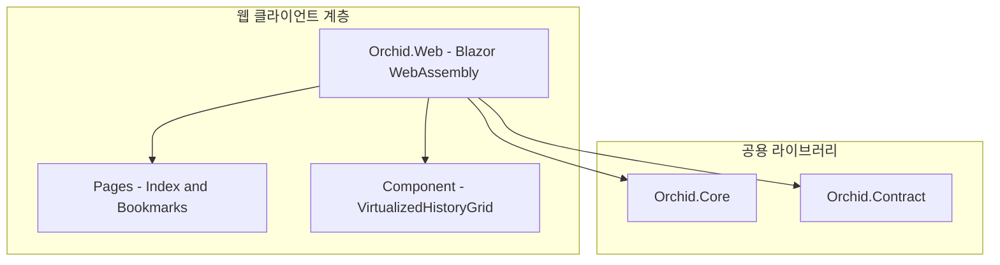

# ✅ Orchid.Web Blazor WASM 웹 대시보드 뼈대 구현 계획

---

## 1. 결정이 필요한 사항

1. **호스팅 모델 선정** — Blazor WebAssembly(WASM) 독립형(Standalone) 채택 (확정)
   - 근거: 클라이언트 브라우저 환경에서 직접 C# E2EE 복호화를 수행할 수 있어, 서버에 평문 키를 넘기지 않는 Zero-Knowledge 원칙을 철저히 유지 가능.
2. **UI 스타일링** — Tailwind CSS 연동 (확정)
   - 근거: 반응형 모바일/데스크톱 뷰어 구현에 최적화되었으며 초경량 번들 사이즈 유지.

---

## 2. 배경

- 개요:
  - 데스크톱/모바일 앱 설치가 불가능한 환경에서도 웹 브라우저를 통해 저장된 클립보드 히스토리를 안전하게 검색하고 활용할 수 있는 웹 전용 클라이언트 구축.
- 아키텍처 비교:
  - AS-IS: 웹 대시보드 부재.
  - TO-BE: `src/Web/Orchid.Web.csproj`를 신설하여 클라이언트 사이드 복호화 기반의 안전한 웹 뷰어 제공.

---

## 3. 변경 범위



| 레이어 | 파일 경로 | 변경 내용 |
| :--- | :--- | :--- |
| **Project** | `src/Web/Orchid.Web.csproj` | Microsoft.NET.Sdk.BlazorWebAssembly 프로젝트 파일 생성 |
| **Pages** | `src/Web/Pages/Index.razor` | 타임라인 클립보드 피드 및 검색 뷰 |
| **Component** | `src/Web/Component/VirtualizedHistoryGrid.razor` | Virtualize 컴포넌트 기반 대용량 목록 렌더링 |
| **Service** | `src/Web/Service/WebClipboardAdapter.cs` | navigator.clipboard JS Interop 바인딩 |
| **Bootstrap** | `src/Web/Program.cs` | WebAssemblyHost 빌더 구성 및 DI 주입 |

---

## 4. 단계별 수정 계획

### ✅ 1단계. 프로젝트 파일 및 WASM 패키지 구성

**파일**: `src/Web/Orchid.Web.csproj`

TO-BE:

```xml
<Project Sdk="Microsoft.NET.Sdk.BlazorWebAssembly">
  <PropertyGroup>
    <TargetFramework>net9.0</TargetFramework>
    <Nullable>enable</Nullable>
    <ImplicitUsings>enable</ImplicitUsings>
    <RootNamespace>Orchid.Web</RootNamespace>
  </PropertyGroup>

  <ItemGroup>
    <ProjectReference Include="..\Core\Orchid.Core.csproj" />
  </ItemGroup>

  <ItemGroup>
    <PackageReference Include="Microsoft.AspNetCore.Components.WebAssembly" Version="9.0.0" />
    <PackageReference Include="Microsoft.AspNetCore.Components.WebAssembly.DevServer" Version="9.0.0" PrivateAssets="all" />
  </ItemGroup>
</Project>
```

### ✅ 2단계. 브라우저 클립보드 JS Interop 구현

**파일**: `src/Web/Service/WebClipboardAdapter.cs`

TO-BE:

```csharp
using Microsoft.JSInterop;
using Orchid.Core.Abstraction;

namespace Orchid.Web.Service;

public sealed class WebClipboardAdapter : ISystemClipboard
{
    private readonly IJSRuntime _js;

    public WebClipboardAdapter(IJSRuntime js) => _js = js;

    public async Task<string?> GetTextAsync()
    {
        return await _js.InvokeAsync<string?>("navigator.clipboard.readText");
    }

    public async Task SetTextAsync(string text)
    {
        await _js.InvokeVoidAsync("navigator.clipboard.writeText", text);
    }
}
```

---

## 5. 테스트 계획

> 프레임워크: bUnit, xUnit, FluentAssertions

### ✅ 테스트: 웹 클립보드 어댑터 JS 상호작용 검증

`test/UnitTests/Web/WebClipboardAdapterTests.cs`

```csharp
[Fact]
public async Task Adapter_Should_Invoke_Navigator_Clipboard_WriteText()
{
    // Given
    var jsMock = new Mock<IJSRuntime>();
    var adapter = new WebClipboardAdapter(jsMock.Object);

    // When
    await adapter.SetTextAsync("Hello Orchid");

    // Then
    jsMock.Verify(x => x.InvokeAsync<object>(
        "navigator.clipboard.writeText",
        It.Is<object[]>(args => (string)args[0] == "Hello Orchid")), Times.Once);
}
```

---

## 6. 계획 평가

| 관점 | 참조 문서 | 평가 항목 | 결과 | 특이사항 |
| :--- | :--- | :--- | :---: | :--- |
| **보안성** | `clean-architecture.md` | Zero-Knowledge 클라이언트 사이드 복호화 | **적합 ✅** | 서버가 아닌 브라우저 메모리 상에서만 복호화 수행 |
| **렌더링 성능** | `clean-code.md` | 대용량 히스토리 가상화 | **적합 ✅** | Blazor Virtualize 컴포넌트로 DOM 노드 수 절감 |
