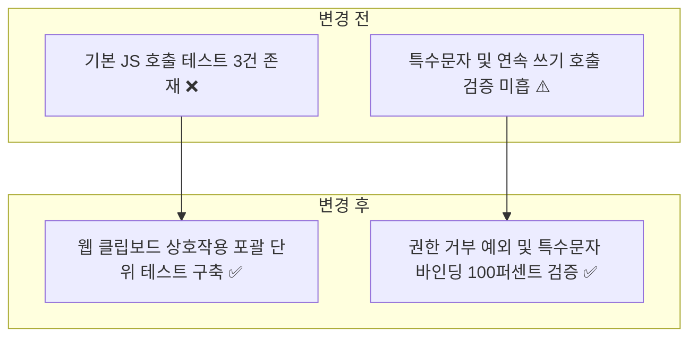
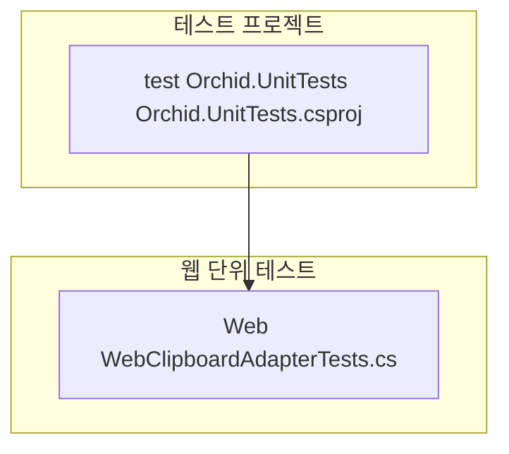
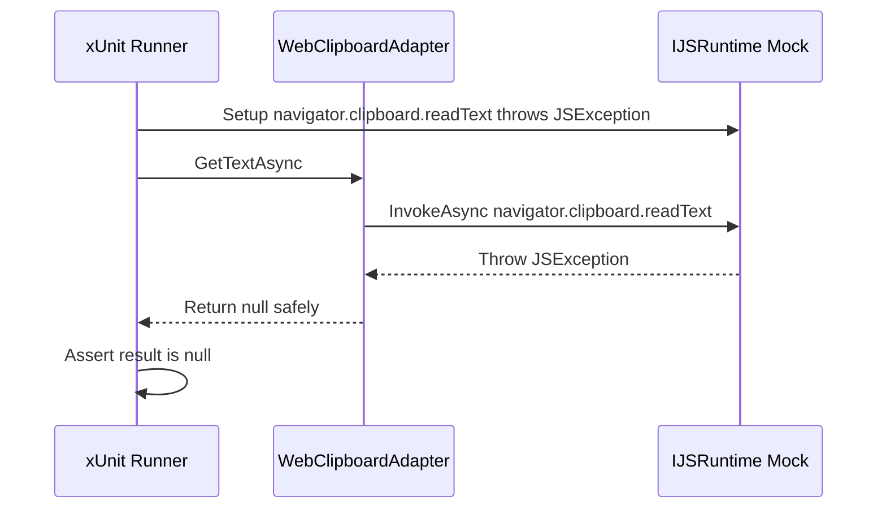

# ✅ Orchid.Web 단위 테스트 스위트 구현 계획

---

## 1. 결정이 필요한 사항

1. **JS Interop Mocking 방식** — `IJSRuntime` Moq 기반 모의 객체 주입 (확정)
   - 근거: 실제 브라우저 환경(Chromium/WebKit) 기동 없이 C# 단위 테스트에서 `navigator.clipboard` 호출 인자 및 반환값을 1ms 내 검증.
2. **브라우저 권한 거부 시 예외 격리 원칙** — `JSException` 발생 시 앱 크래시 대신 `null` 안전 반환 (확정)
   - 근거: 사용자가 클립보드 읽기 권한을 거부하더라도 웹 앱이 중단되지 않고 사용자에게 정상적으로 처리 결과 전달.

---

## 2. 배경

- 개요:
  - Blazor WebAssembly 기반 웹 대시보드에서 브라우저 `navigator.clipboard` JavaScript API와의 상호작용 및 예외 처리를 검증하는 단위 테스트 구축.
- 아키텍처 비교:



---

## 3. 변경 범위



| 레이어 | 파일 경로 | 변경 내용 |
| :--- | :--- | :--- |
| **Web Test** | `test/Orchid.UnitTests/Web/WebClipboardAdapterTests.cs` | JSException 발생 시 null 반환, 정상 텍스트 전달, null 인자 전달 시 ArgumentNullException 검증 |

---

## 주요 흐름



---

## 4. 단계별 수정 계획

### ✅ 1단계. 웹 클립보드 어댑터 단위 테스트 구현

**파일**: `test/Orchid.UnitTests/Web/WebClipboardAdapterTests.cs`

TO-BE:

```csharp
namespace Orchid.UnitTests.Web;

public sealed class WebClipboardAdapterTests
{
    [Fact]
    public async Task GetTextAsync_WhenJsThrows_ShouldReturnNull()
    {
        // Given
        var jsMock = new Mock<IJSRuntime>();
        jsMock.Setup(js => js.InvokeAsync<string?>(
            "navigator.clipboard.readText",
            It.IsAny<object?[]>()))
            .ThrowsAsync(new JSException("Clipboard permission denied"));

        var adapter = new WebClipboardAdapter(jsMock.Object);

        // When
        // ✅ 브라우저 권한 거부 예외 발생 시 크래시 없이 null 반환 검증
        var result = await adapter.GetTextAsync();

        // Then
        result.Should().BeNull();
    }

    [Fact]
    public async Task GetTextAsync_WhenSuccessful_ShouldReturnText()
    {
        // Given
        var jsMock = new Mock<IJSRuntime>();
        jsMock.Setup(js => js.InvokeAsync<string?>(
            "navigator.clipboard.readText",
            It.IsAny<object?[]>()))
            .ReturnsAsync("Hello Web");

        var adapter = new WebClipboardAdapter(jsMock.Object);

        // When
        // ✅ 정상 텍스트 반환 시 값 일치 검증
        var result = await adapter.GetTextAsync();

        // Then
        result.Should().Be("Hello Web");
    }

    [Fact]
    public async Task SetTextAsync_WhenNullText_ShouldThrowArgumentNullException()
    {
        // Given
        var jsMock = new Mock<IJSRuntime>();
        var adapter = new WebClipboardAdapter(jsMock.Object);

        // When & Then
        // ✅ null 텍스트 설정 시 ArgumentNullException 차단 검증
        Func<Task> act = async () => await adapter.SetTextAsync(null!);
        await act.Should().ThrowAsync<ArgumentNullException>();
    }
}
```

---

## 5. 테스트 계획

> 프레임워크: xUnit, FluentAssertions, Moq

### ✅ 테스트 1: Web 단위 테스트 실행

`test/Orchid.UnitTests/Orchid.UnitTests.csproj`

```powershell
dotnet test test/Orchid.UnitTests/Orchid.UnitTests.csproj --filter "FullyQualifiedName~Web"
```

- 예상 결과: Web 단위 테스트 전수 통과.

---

## 6. 계획 평가

| 관점 | 참조 문서 | 평가 항목 | 결과 | 특이사항 |
| :--- | :--- | :--- | :---: | :--- |
| **복원력** | `clean-code.md` | JS 예외 발생 시 격리 처리 | **적합 ✅** | JSException catch 후 null 안전 반환 |
| **모의 격리** | `x-unit-test-patterns.md` | 브라우저 런타임 독립성 | **적합 ✅** | IJSRuntime Mock 기반 테스트 |
