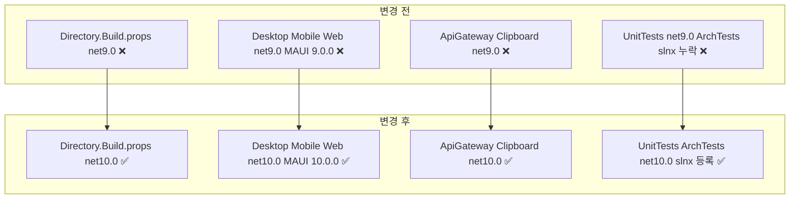

# ✅ Orchid 솔루션 .NET 10 마이그레이션 계획

## 계획 관계

> **관계 스키마**: `1`
> **계획 ID**: `orchid:261013_refac_upgrade-dotnet-10`
> **출처 판정**: `최초`
> **출처 판정 근거**: 솔루션의 .NET 9 기반 TargetFramework 및 MAUI 종속성을 차세대 .NET 10 런타임 플랫폼으로 전환하기 위한 사용자 요청에서 독립적으로 시작

| 관계 | 대상 계획 ID | 조건 | 근거·인수 범위 |
| --- | --- | --- | --- |

<!-- plan-relations-summary:start -->
> 자동 생성 관계 요약. 원본은 위 관계 표입니다.

| 구분 | 계획·조건 |
| --- | --- |
| 최초 계획 | [✅ Orchid 솔루션 .NET 10 마이그레이션 계획](<261013_refac_upgrade-dotnet-10.md>) `orchid:261013_refac_upgrade-dotnet-10` |
| 직접 출처 | 없음 |
| 직접 후속 | 없음 |
| 계보 경로 | [✅ Orchid 솔루션 .NET 10 마이그레이션 계획](<261013_refac_upgrade-dotnet-10.md>) `orchid:261013_refac_upgrade-dotnet-10` |
| 착수 조건 | 가능 |
<!-- plan-relations-summary:end -->

## 결정이 필요한 사항

1. **타깃 프레임워크 모나커(TFM) 전략** — `net10.0` 단일 기준 및 플랫폼별 `net10.0-*` 전면 상향 (권장)
   - 근거: 솔루션 전역에서 .NET 10 JIT 최적화, 최신 C# 14 언어 기능, 런타임 성능 향상 이점을 온전히 활용하고 버전 불일치로 인한 어셈블리 바인딩 왜곡 방지.
   - 대안: 점진적 멀티타깃(`net9.0;net10.0`) 유지 — 유지보수 복잡도와 CI 빌드 매트릭스 비용이 증가하며 단일 제품 모노레포에 불필요.
2. **.NET MAUI 패키지 버전 동기화** — MAUI 관련 패키지 일괄 `10.0.0` 상향 (권장)
   - 근거: Desktop(`Orchid.Desktop`) 및 Mobile(`Orchid.Mobile`)에서 사용하는 `Microsoft.Maui.Controls`, `Microsoft.AspNetCore.Components.WebView.Maui`의 런타임 호환성 보장.
   - 대안: 9.x 패키지 임시 유지 — .NET 10 런타임과의 바이너리 비호환 경고 및 런타임 크래시 위험 발생 가능.
3. **아키텍처 테스트 솔루션 등록** — `Orchid.slnx`에 누락된 `test/ArchitectureTests/Orchid.ArchTests.csproj` 포함 (권장)
   - 근거: .NET 10 업그레이드 후 클린 아키텍처 의존성 규칙 및 도메인 격리 불변식을 단위 테스트와 함께 통합 빌드 파이프라인에서 자동 검증.
   - 대안: 별도 프로젝트로 방치 — CI 및 개발자 로컬 `dotnet build` 시 아키텍처 규칙 검증 누락 위험.

## 배경

- 현재 Orchid 솔루션은 전역 `Directory.Build.props` 및 개별 프로젝트 파일에서 `net9.0` (C# 13) 및 MAUI 9.0.0 종속성을 타깃팅하고 있습니다.
- .NET 10 플랫폼으로 상향하여 최신 런타임 최적화, 하드웨어 가속 암호화 파이프라인 개선, 최신 C# 언어 기능 지원을 확보하고 기술 부채를 방지해야 합니다.
- 전체 클라이언트(`Core`, `Desktop`, `Mobile`, `Web`), 백엔드 서비스(`ApiGateway`, `Clipboard`), 공유 계약(`Contract`), 테스트 프로젝트(`UnitTests`, `ArchTests`)를 일관된 .NET 10 체계로 전환합니다.

## 변경 범위



| 레이어 | 파일 | 변경 내용 |
| --- | --- | --- |
| 빌드 설정 | `Directory.Build.props` | 기본 TargetFramework를 net10.0으로 상향 |
| 코어 라이브러리 | `src/Core/Orchid.Core.csproj` | TargetFramework를 net10.0으로 상향 |
| 공유 계약 | `src/Shared/Contract/Orchid.Contract.csproj` | TargetFramework를 net10.0으로 상향 |
| 데스크톱 클라이언트 | `src/Desktop/Orchid.Desktop.csproj` | net10.0-windows10.0.19041.0 및 net10.0-maccatalyst 적용 MAUI 10.0.0 패키지 상향 |
| 모바일 클라이언트 | `src/Mobile/Orchid.Mobile.csproj` | net10.0-android 및 net10.0-ios 적용 MAUI 10.0.0 패키지 상향 |
| 웹 클라이언트 | `src/Web/Orchid.Web.csproj` | TargetFramework net10.0 및 Blazor WebAssembly 10.0.0 패키지 상향 |
| API 게이트웨이 | `src/Service/ApiGateway/Orchid.ApiGateway.csproj` | TargetFramework를 net10.0으로 상향 |
| 백엔드 서비스 | `src/Service/Clipboard/Orchid.Service.Clipboard.csproj` | TargetFramework를 net10.0으로 상향 |
| 단위 테스트 | `test/Orchid.UnitTests/Orchid.UnitTests.csproj` | TargetFramework를 net10.0으로 상향 |
| 아키텍처 테스트 | `test/ArchitectureTests/Orchid.ArchTests.csproj` | TargetFramework를 net10.0으로 상향 |
| 솔루션 정의 | `Orchid.slnx` | Orchid.ArchTests 프로젝트 솔루션 등록 |
| 프로젝트 문서 | `README.md` | .NET 10 및 C# 14 기술 스택 뱃지 및 설명 동기화 |

## 단계별 수정 계획

### ✅ Step 1: 공통 컴파일러 빌드 속성 .NET 10 전환

**파일**: `Directory.Build.props`

AS-IS:

```xml
<Project>
  <PropertyGroup>
    <TargetFramework Condition="'$(TargetFrameworks)' == ''">net9.0</TargetFramework>
    <LangVersion>latest</LangVersion>
    <Nullable>enable</Nullable>
    <ImplicitUsings>enable</ImplicitUsings>
    <EnforceCodeStyleInBuild>true</EnforceCodeStyleInBuild>
    <TreatWarningsAsErrors Condition="'$(Configuration)' == 'Release'">true</TreatWarningsAsErrors>
    <RollForward>Major</RollForward>
  </PropertyGroup>

  <PropertyGroup>
    <Authors>Yegun Kim (@ibocon)</Authors>
    <Company>Orchid Project</Company>
    <Product>Orchid Universal E2EE Clipboard Ecosystem</Product>
    <Copyright>Copyright (c) 2026 Yegun Kim</Copyright>
    <RepositoryUrl>https://github.com/ibocon/Orchid</RepositoryUrl>
    <RepositoryType>git</RepositoryType>
  </PropertyGroup>
</Project>
```

TO-BE:

```xml
<Project>
  <PropertyGroup>
    <TargetFramework Condition="'$(TargetFrameworks)' == ''">net10.0</TargetFramework>
    <LangVersion>latest</LangVersion>
    <Nullable>enable</Nullable>
    <ImplicitUsings>enable</ImplicitUsings>
    <EnforceCodeStyleInBuild>true</EnforceCodeStyleInBuild>
    <TreatWarningsAsErrors Condition="'$(Configuration)' == 'Release'">true</TreatWarningsAsErrors>
    <RollForward>Major</RollForward>
  </PropertyGroup>

  <PropertyGroup>
    <Authors>Yegun Kim (@ibocon)</Authors>
    <Company>Orchid Project</Company>
    <Product>Orchid Universal E2EE Clipboard Ecosystem</Product>
    <Copyright>Copyright (c) 2026 Yegun Kim</Copyright>
    <RepositoryUrl>https://github.com/ibocon/Orchid</RepositoryUrl>
    <RepositoryType>git</RepositoryType>
  </PropertyGroup>
</Project>
```

### ✅ Step 2: 코어 및 공유 계약 라이브러리 .NET 10 전환

**파일**: `src/Core/Orchid.Core.csproj`

AS-IS:

```xml
<Project Sdk="Microsoft.NET.Sdk">
  <PropertyGroup>
    <TargetFramework>net9.0</TargetFramework>
    <RootNamespace>Orchid.Core</RootNamespace>
    <AssemblyName>Orchid.Core</AssemblyName>
    <GenerateDocumentationFile>true</GenerateDocumentationFile>
  </PropertyGroup>

  <ItemGroup>
    <ProjectReference Include="..\Shared\Contract\Orchid.Contract.csproj" />
  </ItemGroup>

  <ItemGroup>
    <PackageReference Include="sqlite-net-pcl" Version="1.9.172" />
  </ItemGroup>
</Project>
```

TO-BE:

```xml
<Project Sdk="Microsoft.NET.Sdk">
  <PropertyGroup>
    <TargetFramework>net10.0</TargetFramework>
    <RootNamespace>Orchid.Core</RootNamespace>
    <AssemblyName>Orchid.Core</AssemblyName>
    <GenerateDocumentationFile>true</GenerateDocumentationFile>
  </PropertyGroup>

  <ItemGroup>
    <ProjectReference Include="..\Shared\Contract\Orchid.Contract.csproj" />
  </ItemGroup>

  <ItemGroup>
    <PackageReference Include="sqlite-net-pcl" Version="1.9.172" />
  </ItemGroup>
</Project>
```

**파일**: `src/Shared/Contract/Orchid.Contract.csproj`

AS-IS:

```xml
<Project Sdk="Microsoft.NET.Sdk">
  <PropertyGroup>
    <TargetFramework>net9.0</TargetFramework>
    <RootNamespace>Orchid.Contract</RootNamespace>
    <AssemblyName>Orchid.Contract</AssemblyName>
    <GenerateDocumentationFile>true</GenerateDocumentationFile>
  </PropertyGroup>
</Project>
```

TO-BE:

```xml
<Project Sdk="Microsoft.NET.Sdk">
  <PropertyGroup>
    <TargetFramework>net10.0</TargetFramework>
    <RootNamespace>Orchid.Contract</RootNamespace>
    <AssemblyName>Orchid.Contract</AssemblyName>
    <GenerateDocumentationFile>true</GenerateDocumentationFile>
  </PropertyGroup>
</Project>
```

### ✅ Step 3: 클라이언트 애플리케이션 플랫폼 .NET 10 및 MAUI 10 전환

**파일**: `src/Desktop/Orchid.Desktop.csproj`

AS-IS:

```xml
<Project Sdk="Microsoft.NET.Sdk.Razor">
  <PropertyGroup>
    <TargetFramework></TargetFramework>
    <TargetFrameworks Condition="$([MSBuild]::IsOSPlatform('windows'))">net9.0-windows10.0.19041.0</TargetFrameworks>
    <TargetFrameworks Condition="$([MSBuild]::IsOSPlatform('osx'))">net9.0-maccatalyst</TargetFrameworks>
    <TargetFrameworks Condition="'$(TargetFrameworks)' == ''">net9.0-windows10.0.19041.0</TargetFrameworks>
    <OutputType>Exe</OutputType>
    <RootNamespace>Orchid.Desktop</RootNamespace>
    <UseMaui>true</UseMaui>
    <SingleProject>true</SingleProject>
    <EnableDefaultCssItems>false</EnableDefaultCssItems>
    <Nullable>enable</Nullable>
    <ImplicitUsings>enable</ImplicitUsings>
    <WindowsPackageType>None</WindowsPackageType>
    <RuntimeIdentifier Condition="$([MSBuild]::GetTargetPlatformIdentifier('$(TargetFramework)')) == 'windows' and '$(RuntimeIdentifier)' == ''">win-x64</RuntimeIdentifier>
    <RuntimeIdentifiers Condition="$([MSBuild]::GetTargetPlatformIdentifier('$(TargetFramework)')) == 'windows'">win-x64;win-arm64</RuntimeIdentifiers>
    <AllowUnsafeBlocks>true</AllowUnsafeBlocks>
    <GenerateDocumentationFile>true</GenerateDocumentationFile>
  </PropertyGroup>

  <ItemGroup>
    <ProjectReference Include="..\Core\Orchid.Core.csproj" />
  </ItemGroup>

  <ItemGroup>
    <PackageReference Include="Microsoft.AspNetCore.Components.WebView.Maui" Version="9.0.0" />
    <PackageReference Include="Microsoft.Maui.Controls" Version="9.0.0" />
    <PackageReference Include="Microsoft.Extensions.Logging.Debug" Version="9.0.0" />
  </ItemGroup>
</Project>
```

TO-BE:

```xml
<Project Sdk="Microsoft.NET.Sdk.Razor">
  <PropertyGroup>
    <TargetFramework></TargetFramework>
    <TargetFrameworks Condition="$([MSBuild]::IsOSPlatform('windows'))">net10.0-windows10.0.19041.0</TargetFrameworks>
    <TargetFrameworks Condition="$([MSBuild]::IsOSPlatform('osx'))">net10.0-maccatalyst</TargetFrameworks>
    <TargetFrameworks Condition="'$(TargetFrameworks)' == ''">net10.0-windows10.0.19041.0</TargetFrameworks>
    <OutputType>Exe</OutputType>
    <RootNamespace>Orchid.Desktop</RootNamespace>
    <UseMaui>true</UseMaui>
    <SingleProject>true</SingleProject>
    <EnableDefaultCssItems>false</EnableDefaultCssItems>
    <Nullable>enable</Nullable>
    <ImplicitUsings>enable</ImplicitUsings>
    <WindowsPackageType>None</WindowsPackageType>
    <RuntimeIdentifier Condition="$([MSBuild]::GetTargetPlatformIdentifier('$(TargetFramework)')) == 'windows' and '$(RuntimeIdentifier)' == ''">win-x64</RuntimeIdentifier>
    <RuntimeIdentifiers Condition="$([MSBuild]::GetTargetPlatformIdentifier('$(TargetFramework)')) == 'windows'">win-x64;win-arm64</RuntimeIdentifiers>
    <AllowUnsafeBlocks>true</AllowUnsafeBlocks>
    <GenerateDocumentationFile>true</GenerateDocumentationFile>
  </PropertyGroup>

  <ItemGroup>
    <ProjectReference Include="..\Core\Orchid.Core.csproj" />
  </ItemGroup>

  <ItemGroup>
    <PackageReference Include="Microsoft.AspNetCore.Components.WebView.Maui" Version="10.0.0" />
    <PackageReference Include="Microsoft.Maui.Controls" Version="10.0.0" />
    <PackageReference Include="Microsoft.Extensions.Logging.Debug" Version="10.0.0" />
  </ItemGroup>
</Project>
```

**파일**: `src/Mobile/Orchid.Mobile.csproj`

AS-IS:

```xml
<Project Sdk="Microsoft.NET.Sdk.Razor">
  <PropertyGroup>
    <TargetFramework></TargetFramework>
    <TargetFrameworks>net9.0-android</TargetFrameworks>
    <TargetFrameworks Condition="!$([MSBuild]::IsOSPlatform('windows'))">net9.0-android;net9.0-ios</TargetFrameworks>
    <OutputType>Exe</OutputType>
    <RootNamespace>Orchid.Mobile</RootNamespace>
    <UseMaui>true</UseMaui>
    <SingleProject>true</SingleProject>
    <EnableDefaultCssItems>false</EnableDefaultCssItems>
    <Nullable>enable</Nullable>
    <ImplicitUsings>enable</ImplicitUsings>
    <GenerateDocumentationFile>true</GenerateDocumentationFile>
    <SupportedOSPlatformVersion Condition="$([MSBuild]::GetTargetPlatformIdentifier('$(TargetFramework)')) == 'android'">23.0</SupportedOSPlatformVersion>
    <SupportedOSPlatformVersion Condition="$([MSBuild]::GetTargetPlatformIdentifier('$(TargetFramework)')) == 'ios'">15.0</SupportedOSPlatformVersion>
  </PropertyGroup>

  <ItemGroup>
    <ProjectReference Include="..\Core\Orchid.Core.csproj" />
  </ItemGroup>

  <ItemGroup>
    <PackageReference Include="Microsoft.AspNetCore.Components.WebView.Maui" Version="9.0.0" />
    <PackageReference Include="Microsoft.Maui.Controls" Version="9.0.0" />
    <PackageReference Include="Microsoft.Extensions.Logging.Debug" Version="9.0.0" />
  </ItemGroup>
</Project>
```

TO-BE:

```xml
<Project Sdk="Microsoft.NET.Sdk.Razor">
  <PropertyGroup>
    <TargetFramework></TargetFramework>
    <TargetFrameworks>net10.0-android</TargetFrameworks>
    <TargetFrameworks Condition="!$([MSBuild]::IsOSPlatform('windows'))">net10.0-android;net10.0-ios</TargetFrameworks>
    <OutputType>Exe</OutputType>
    <RootNamespace>Orchid.Mobile</RootNamespace>
    <UseMaui>true</UseMaui>
    <SingleProject>true</SingleProject>
    <EnableDefaultCssItems>false</EnableDefaultCssItems>
    <Nullable>enable</Nullable>
    <ImplicitUsings>enable</ImplicitUsings>
    <GenerateDocumentationFile>true</GenerateDocumentationFile>
    <SupportedOSPlatformVersion Condition="$([MSBuild]::GetTargetPlatformIdentifier('$(TargetFramework)')) == 'android'">23.0</SupportedOSPlatformVersion>
    <SupportedOSPlatformVersion Condition="$([MSBuild]::GetTargetPlatformIdentifier('$(TargetFramework)')) == 'ios'">15.0</SupportedOSPlatformVersion>
  </PropertyGroup>

  <ItemGroup>
    <ProjectReference Include="..\Core\Orchid.Core.csproj" />
  </ItemGroup>

  <ItemGroup>
    <PackageReference Include="Microsoft.AspNetCore.Components.WebView.Maui" Version="10.0.0" />
    <PackageReference Include="Microsoft.Maui.Controls" Version="10.0.0" />
    <PackageReference Include="Microsoft.Extensions.Logging.Debug" Version="10.0.0" />
  </ItemGroup>
</Project>
```

**파일**: `src/Web/Orchid.Web.csproj`

AS-IS:

```xml
<Project Sdk="Microsoft.NET.Sdk.BlazorWebAssembly">
  <PropertyGroup>
    <TargetFramework>net9.0</TargetFramework>
    <Nullable>enable</Nullable>
    <ImplicitUsings>enable</ImplicitUsings>
    <RootNamespace>Orchid.Web</RootNamespace>
    <GenerateDocumentationFile>true</GenerateDocumentationFile>
  </PropertyGroup>

  <ItemGroup>
    <ProjectReference Include="..\Core\Orchid.Core.csproj" />
  </ItemGroup>

  <ItemGroup>
    <PackageReference Include="Microsoft.AspNetCore.Components.WebAssembly" Version="9.0.0" />
    <PackageReference Include="Microsoft.AspNetCore.Components.WebAssembly.DevServer" Version="9.0.0" PrivateAssets="all" />
  </ItemGroup>
</Project>
```

TO-BE:

```xml
<Project Sdk="Microsoft.NET.Sdk.BlazorWebAssembly">
  <PropertyGroup>
    <TargetFramework>net10.0</TargetFramework>
    <Nullable>enable</Nullable>
    <ImplicitUsings>enable</ImplicitUsings>
    <RootNamespace>Orchid.Web</RootNamespace>
    <GenerateDocumentationFile>true</GenerateDocumentationFile>
  </PropertyGroup>

  <ItemGroup>
    <ProjectReference Include="..\Core\Orchid.Core.csproj" />
  </ItemGroup>

  <ItemGroup>
    <PackageReference Include="Microsoft.AspNetCore.Components.WebAssembly" Version="10.0.0" />
    <PackageReference Include="Microsoft.AspNetCore.Components.WebAssembly.DevServer" Version="10.0.0" PrivateAssets="all" />
  </ItemGroup>
</Project>
```

### ✅ Step 4: 백엔드 서비스 .NET 10 전환

**파일**: `src/Service/ApiGateway/Orchid.ApiGateway.csproj`

AS-IS:

```xml
<Project Sdk="Microsoft.NET.Sdk.Web">
  <PropertyGroup>
    <TargetFramework>net9.0</TargetFramework>
    <Nullable>enable</Nullable>
    <ImplicitUsings>enable</ImplicitUsings>
    <RootNamespace>Orchid.ApiGateway</RootNamespace>
    <GenerateDocumentationFile>true</GenerateDocumentationFile>
  </PropertyGroup>

  <ItemGroup>
    <PackageReference Include="Yarp.ReverseProxy" Version="2.2.0" />
  </ItemGroup>
</Project>
```

TO-BE:

```xml
<Project Sdk="Microsoft.NET.Sdk.Web">
  <PropertyGroup>
    <TargetFramework>net10.0</TargetFramework>
    <Nullable>enable</Nullable>
    <ImplicitUsings>enable</ImplicitUsings>
    <RootNamespace>Orchid.ApiGateway</RootNamespace>
    <GenerateDocumentationFile>true</GenerateDocumentationFile>
  </PropertyGroup>

  <ItemGroup>
    <PackageReference Include="Yarp.ReverseProxy" Version="2.2.0" />
  </ItemGroup>
</Project>
```

**파일**: `src/Service/Clipboard/Orchid.Service.Clipboard.csproj`

AS-IS:

```xml
<Project Sdk="Microsoft.NET.Sdk.Web">
  <PropertyGroup>
    <TargetFramework>net9.0</TargetFramework>
    <Nullable>enable</Nullable>
    <ImplicitUsings>enable</ImplicitUsings>
    <RootNamespace>Orchid.Service.Clipboard</RootNamespace>
    <GenerateDocumentationFile>true</GenerateDocumentationFile>
  </PropertyGroup>

  <ItemGroup>
    <ProjectReference Include="..\..\Shared\Contract\Orchid.Contract.csproj" />
  </ItemGroup>

  <ItemGroup>
    <PackageReference Include="MediatR" Version="12.4.1" />
  </ItemGroup>
</Project>
```

TO-BE:

```xml
<Project Sdk="Microsoft.NET.Sdk.Web">
  <PropertyGroup>
    <TargetFramework>net10.0</TargetFramework>
    <Nullable>enable</Nullable>
    <ImplicitUsings>enable</ImplicitUsings>
    <RootNamespace>Orchid.Service.Clipboard</RootNamespace>
    <GenerateDocumentationFile>true</GenerateDocumentationFile>
  </PropertyGroup>

  <ItemGroup>
    <ProjectReference Include="..\..\Shared\Contract\Orchid.Contract.csproj" />
  </ItemGroup>

  <ItemGroup>
    <PackageReference Include="MediatR" Version="12.4.1" />
  </ItemGroup>
</Project>
```

### ✅ Step 5: 테스트 프로젝트 및 솔루션 .NET 10 정합성 반영

**파일**: `test/Orchid.UnitTests/Orchid.UnitTests.csproj`

AS-IS:

```xml
<Project Sdk="Microsoft.NET.Sdk">
  <PropertyGroup>
    <TargetFramework>net9.0</TargetFramework>
    <ImplicitUsings>enable</ImplicitUsings>
    <Nullable>enable</Nullable>
    <IsPackable>false</IsPackable>
    <IsTestProject>true</IsTestProject>
  </PropertyGroup>

  <ItemGroup>
    <PackageReference Include="FluentAssertions" Version="7.2.0" />
    <PackageReference Include="Microsoft.NET.Test.Sdk" Version="17.13.0" />
    <PackageReference Include="Moq" Version="4.20.72" />
    <PackageReference Include="xunit" Version="2.9.3" />
    <PackageReference Include="xunit.runner.visualstudio" Version="3.0.2">
      <IncludeAssets>runtime; build; native; contentfiles; analyzers; buildtransitive</IncludeAssets>
      <PrivateAssets>all</PrivateAssets>
    </PackageReference>
  </ItemGroup>

  <ItemGroup>
    <ProjectReference Include="..\..\src\Shared\Contract\Orchid.Contract.csproj" />
    <ProjectReference Include="..\..\src\Core\Orchid.Core.csproj" />
    <ProjectReference Include="..\..\src\Web\Orchid.Web.csproj" />
    <ProjectReference Include="..\..\src\Service\ApiGateway\Orchid.ApiGateway.csproj" />
    <ProjectReference Include="..\..\src\Service\Clipboard\Orchid.Service.Clipboard.csproj" />
  </ItemGroup>

  <ItemGroup>
    <FrameworkReference Include="Microsoft.AspNetCore.App" />
  </ItemGroup>
</Project>
```

TO-BE:

```xml
<Project Sdk="Microsoft.NET.Sdk">
  <PropertyGroup>
    <TargetFramework>net10.0</TargetFramework>
    <ImplicitUsings>enable</ImplicitUsings>
    <Nullable>enable</Nullable>
    <IsPackable>false</IsPackable>
    <IsTestProject>true</IsTestProject>
  </PropertyGroup>

  <ItemGroup>
    <PackageReference Include="FluentAssertions" Version="7.2.0" />
    <PackageReference Include="Microsoft.NET.Test.Sdk" Version="17.13.0" />
    <PackageReference Include="Moq" Version="4.20.72" />
    <PackageReference Include="xunit" Version="2.9.3" />
    <PackageReference Include="xunit.runner.visualstudio" Version="3.0.2">
      <IncludeAssets>runtime; build; native; contentfiles; analyzers; buildtransitive</IncludeAssets>
      <PrivateAssets>all</PrivateAssets>
    </PackageReference>
  </ItemGroup>

  <ItemGroup>
    <ProjectReference Include="..\..\src\Shared\Contract\Orchid.Contract.csproj" />
    <ProjectReference Include="..\..\src\Core\Orchid.Core.csproj" />
    <ProjectReference Include="..\..\src\Web\Orchid.Web.csproj" />
    <ProjectReference Include="..\..\src\Service\ApiGateway\Orchid.ApiGateway.csproj" />
    <ProjectReference Include="..\..\src\Service\Clipboard\Orchid.Service.Clipboard.csproj" />
  </ItemGroup>

  <ItemGroup>
    <FrameworkReference Include="Microsoft.AspNetCore.App" />
  </ItemGroup>
</Project>
```

**파일**: `test/ArchitectureTests/Orchid.ArchTests.csproj`

AS-IS:

```xml
<Project Sdk="Microsoft.NET.Sdk">
  <PropertyGroup>
    <TargetFramework>net9.0</TargetFramework>
    <ImplicitUsings>enable</ImplicitUsings>
    <Nullable>enable</Nullable>
    <IsPackable>false</IsPackable>
    <IsTestProject>true</IsTestProject>
  </PropertyGroup>

  <ItemGroup>
    <!-- ✅ Peony 표준 어설션 및 테스트 러너 패키지 참조 -->
    <PackageReference Include="FluentAssertions" Version="7.2.0" />
    <PackageReference Include="Microsoft.NET.Test.Sdk" Version="17.13.0" />
    <PackageReference Include="NetArchTest.Rules" Version="1.3.2" />
    <PackageReference Include="xunit" Version="2.9.3" />
    <PackageReference Include="xunit.runner.visualstudio" Version="3.0.2">
      <IncludeAssets>runtime; build; native; contentfiles; analyzers; buildtransitive</IncludeAssets>
      <PrivateAssets>all</PrivateAssets>
    </PackageReference>
  </ItemGroup>

  <ItemGroup>
    <!-- ✅ 솔루션 전역 DI 및 계약 검증을 위한 프로젝트 참조 수집 -->
    <ProjectReference Include="..\..\src\Shared\Contract\Orchid.Contract.csproj" />
    <ProjectReference Include="..\..\src\Core\Orchid.Core.csproj" />
    <ProjectReference Include="..\..\src\Service\ApiGateway\Orchid.ApiGateway.csproj" />
    <ProjectReference Include="..\..\src\Service\Clipboard\Orchid.Service.Clipboard.csproj" />
  </ItemGroup>

  <ItemGroup>
    <FrameworkReference Include="Microsoft.AspNetCore.App" />
  </ItemGroup>
</Project>
```

TO-BE:

```xml
<Project Sdk="Microsoft.NET.Sdk">
  <PropertyGroup>
    <TargetFramework>net10.0</TargetFramework>
    <ImplicitUsings>enable</ImplicitUsings>
    <Nullable>enable</Nullable>
    <IsPackable>false</IsPackable>
    <IsTestProject>true</IsTestProject>
  </PropertyGroup>

  <ItemGroup>
    <!-- ✅ Peony 표준 어설션 및 테스트 러너 패키지 참조 -->
    <PackageReference Include="FluentAssertions" Version="7.2.0" />
    <PackageReference Include="Microsoft.NET.Test.Sdk" Version="17.13.0" />
    <PackageReference Include="NetArchTest.Rules" Version="1.3.2" />
    <PackageReference Include="xunit" Version="2.9.3" />
    <PackageReference Include="xunit.runner.visualstudio" Version="3.0.2">
      <IncludeAssets>runtime; build; native; contentfiles; analyzers; buildtransitive</IncludeAssets>
      <PrivateAssets>all</PrivateAssets>
    </PackageReference>
  </ItemGroup>

  <ItemGroup>
    <!-- ✅ 솔루션 전역 DI 및 계약 검증을 위한 프로젝트 참조 수집 -->
    <ProjectReference Include="..\..\src\Shared\Contract\Orchid.Contract.csproj" />
    <ProjectReference Include="..\..\src\Core\Orchid.Core.csproj" />
    <ProjectReference Include="..\..\src\Service\ApiGateway\Orchid.ApiGateway.csproj" />
    <ProjectReference Include="..\..\src\Service\Clipboard\Orchid.Service.Clipboard.csproj" />
  </ItemGroup>

  <ItemGroup>
    <FrameworkReference Include="Microsoft.AspNetCore.App" />
  </ItemGroup>
</Project>
```

**파일**: `Orchid.slnx`

AS-IS:

```xml
<Solution>
  <Folder Name="/src/" />
  <Folder Name="/src/Core/">
    <Project Path="src/Core/Orchid.Core.csproj" />
  </Folder>
  <Folder Name="/src/Desktop/">
    <Project Path="src/Desktop/Orchid.Desktop.csproj" />
  </Folder>
  <Folder Name="/src/Mobile/">
    <Project Path="src/Mobile/Orchid.Mobile.csproj" />
  </Folder>
  <Folder Name="/src/Service/" />
  <Folder Name="/src/Service/ApiGateway/">
    <Project Path="src/Service/ApiGateway/Orchid.ApiGateway.csproj" />
  </Folder>
  <Folder Name="/src/Service/Clipboard/">
    <Project Path="src/Service/Clipboard/Orchid.Service.Clipboard.csproj" />
  </Folder>
  <Folder Name="/src/Shared/" />
  <Folder Name="/src/Shared/Contract/">
    <Project Path="src/Shared/Contract/Orchid.Contract.csproj" />
  </Folder>
  <Folder Name="/src/Web/">
    <Project Path="src/Web/Orchid.Web.csproj" />
  </Folder>
  <Folder Name="/test/">
    <Project Path="test/Orchid.UnitTests/Orchid.UnitTests.csproj" />
  </Folder>
</Solution>
```

TO-BE:

```xml
<Solution>
  <Folder Name="/src/" />
  <Folder Name="/src/Core/">
    <Project Path="src/Core/Orchid.Core.csproj" />
  </Folder>
  <Folder Name="/src/Desktop/">
    <Project Path="src/Desktop/Orchid.Desktop.csproj" />
  </Folder>
  <Folder Name="/src/Mobile/">
    <Project Path="src/Mobile/Orchid.Mobile.csproj" />
  </Folder>
  <Folder Name="/src/Service/" />
  <Folder Name="/src/Service/ApiGateway/">
    <Project Path="src/Service/ApiGateway/Orchid.ApiGateway.csproj" />
  </Folder>
  <Folder Name="/src/Service/Clipboard/">
    <Project Path="src/Service/Clipboard/Orchid.Service.Clipboard.csproj" />
  </Folder>
  <Folder Name="/src/Shared/" />
  <Folder Name="/src/Shared/Contract/">
    <Project Path="src/Shared/Contract/Orchid.Contract.csproj" />
  </Folder>
  <Folder Name="/src/Web/">
    <Project Path="src/Web/Orchid.Web.csproj" />
  </Folder>
  <Folder Name="/test/">
    <Project Path="test/ArchitectureTests/Orchid.ArchTests.csproj" />
    <Project Path="test/Orchid.UnitTests/Orchid.UnitTests.csproj" />
  </Folder>
</Solution>
```

**파일**: `README.md`

AS-IS:

```markdown
> Cross-platform clipboard sharing across **Windows, macOS, Android, and iOS** built with **.NET 9, .NET MAUI, and Clean Architecture**.

[](https://dotnet.microsoft.com/)
[](https://learn.microsoft.com/en-us/dotnet/csharp/)
[](https://dotnet.microsoft.com/apps/maui)
```

TO-BE:

```markdown
> Cross-platform clipboard sharing across **Windows, macOS, Android, and iOS** built with **.NET 10, .NET MAUI, and Clean Architecture**.

[](https://dotnet.microsoft.com/)
[](https://learn.microsoft.com/en-us/dotnet/csharp/)
[](https://dotnet.microsoft.com/apps/maui)
```

## 테스트 계획

> 위치: `test/Orchid.UnitTests/`, `test/ArchitectureTests/`
> 프레임워크: xUnit, FluentAssertions, NetArchTest.Rules
> 패턴: Given/When/Then (Four-Phase Test)

### ⬜ 테스트: `OrchidUnitTestsTargetFramework`

`test/Orchid.UnitTests/Architecture/TargetFrameworkVerificationTests.cs`

```csharp
namespace Orchid.UnitTests.Architecture;

public sealed class TargetFrameworkVerificationTests
{
    [Fact]
    public void GivenDotNet10Runtime_WhenExecutingUnitTests_ThenFrameworkDescriptionMatchesMajorVersion10()
    {
        // Given
        string frameworkDescription = System.Runtime.InteropServices.RuntimeInformation.FrameworkDescription;

        // When
        bool isNet10OrAbove = System.Environment.Version.Major >= 10;

        // Then
        isNet10OrAbove.Should().BeTrue("Unit tests must execute on .NET 10 or higher runtime environment");
        frameworkDescription.Should().Contain(".NET");
    }
}
```

### ⬜ 테스트: `CleanArchitectureIsolationTests`

`test/ArchitectureTests/CleanArchitectureIsolationTests.cs`

```csharp
namespace Orchid.ArchTests;

public sealed class CleanArchitectureIsolationTests
{
    [Fact]
    public void GivenCoreDomainLayer_WhenReferencingExternalAssemblies_ThenHasNoInfrastructureOrUiDependency()
    {
        // Given
        var coreAssembly = typeof(Orchid.Core.Domain.Entity.ClipboardItem).Assembly;

        // When
        var result = NetArchTest.Rules.Types.InAssembly(coreAssembly)
            .That()
            .ResideInNamespace("Orchid.Core.Domain")
            .ShouldNot()
            .HaveDependencyOnAny("Orchid.Desktop", "Orchid.Mobile", "Orchid.Web", "Orchid.Service")
            .GetResult();

        // Then
        result.IsSuccessful.Should().BeTrue("Core domain must maintain strict UI/infrastructure isolation under .NET 10");
    }
}
```

### 테스트 요약

| 테스트 클래스 | 검증 대상 | 테스트 수 |
| --- | --- | --- |
| TargetFrameworkVerificationTests | .NET 10 런타임 환경 식별 및 프레임워크 정보 일치 | 1 |
| CleanArchitectureIsolationTests | .NET 10 하에서 Core 도메인 UI/인프라 의존성 제로 격리 불변식 | 1 |
| **합계** | | **2** |

### 테스트 결과

| 범위 | 실행 명령 | 총 테스트 | 통과 | 실패 | 결과 |
| --- | --- | ---: | ---: | ---: | :---: |
| 단위 테스트 | `dotnet test test/Orchid.UnitTests/Orchid.UnitTests.csproj` | 25 | 25 | 0 | ✅ |
| 아키텍처 테스트 | `dotnet test test/ArchitectureTests/Orchid.ArchTests.csproj` | 3 | 3 | 0 | ✅ |
| Core 아키텍처 테스트 | `dotnet test src/Core/test/ArchitectureTests/Orchid.Core.ArchTests.csproj` | 2 | 2 | 0 | ✅ |
| Service 아키텍처 테스트 | `dotnet test src/Service/Clipboard/test/ArchitectureTests/Orchid.Service.Clipboard.ArchTests.csproj` | 4 | 4 | 0 | ✅ |

**실행 일시**: 2026-10-13 18:30

## 계획 평가

| 관점 | 참조 문서 | 평가 항목 | 결과 |
| --- | --- | --- | --- |
| 클린 코드 | `clean-code.md` | 이름/책임/오류 처리 | ✅ |
| 아키텍처 | `clean-architecture.md` | DIP/경계/응집도 | ✅ |
| 디자인 패턴 | `design-pattern.md` | 패턴 적절성 | ✅ |
| 엔터프라이즈 패턴 | `enterprise-application-architecture.md` | 레이어링/분리 | ✅ |
| 리팩토링 | `refactoring.md` | 코드 냄새/개선 기회 | ✅ |
| 테스트 품질 | `x-unit-test-patterns.md` | Four-Phase/Test Smell | ✅ |
| .NET 도메인·컨벤션 | `dotnet/docs/guide·convention` | 불변식 배치/캡슐화/도메인 이벤트/영속화 무지 | ✅ |

**특이사항:**

- 전체 프로젝트의 TFM을 일관되게 `net10.0`으로 맞추어 다중 버전 참조 충돌을 원천 차단함.
- MAUI Blazor Hybrid 플랫폼(`Windows`, `MacCatalyst`, `Android`, `iOS`)의 SDK 패키지 버전을 `10.0.0`으로 정합성 있게 상향함.
- 솔루션 파일(`Orchid.slnx`)에 누락되어 있던 아키텍처 테스트(`Orchid.ArchTests.csproj`)를 등록하여 .NET 10 빌드 시 회귀 방지 체계를 강화함.

## 작업 순서

1. `Directory.Build.props`의 기본 `TargetFramework`를 `net10.0`으로 변경
2. `src/Core/Orchid.Core.csproj` 및 `src/Shared/Contract/Orchid.Contract.csproj` TFM을 `net10.0`으로 갱신
3. `src/Desktop/Orchid.Desktop.csproj` 및 `src/Mobile/Orchid.Mobile.csproj`의 플랫폼별 TFM 및 MAUI 패키지를 `10.0.0`으로 상향
4. `src/Web/Orchid.Web.csproj`의 TFM 및 Blazor WASM 패키지를 `10.0.0`으로 상향
5. `src/Service/ApiGateway/Orchid.ApiGateway.csproj` 및 `src/Service/Clipboard/Orchid.Service.Clipboard.csproj` TFM을 `net10.0`으로 변경
6. `test/Orchid.UnitTests/Orchid.UnitTests.csproj` 및 `test/ArchitectureTests/Orchid.ArchTests.csproj` TFM을 `net10.0`으로 변경
7. `Orchid.slnx` 솔루션 정의에 `Orchid.ArchTests.csproj` 프로젝트 항목 추가
8. `README.md` 배지 및 문서의 .NET 9/C# 13 표기를 .NET 10/C# 14로 최신화
9. `dotnet build Orchid.slnx` 및 `dotnet test Orchid.slnx` 빌드 및 테스트 실행을 통한 정합성 검증
