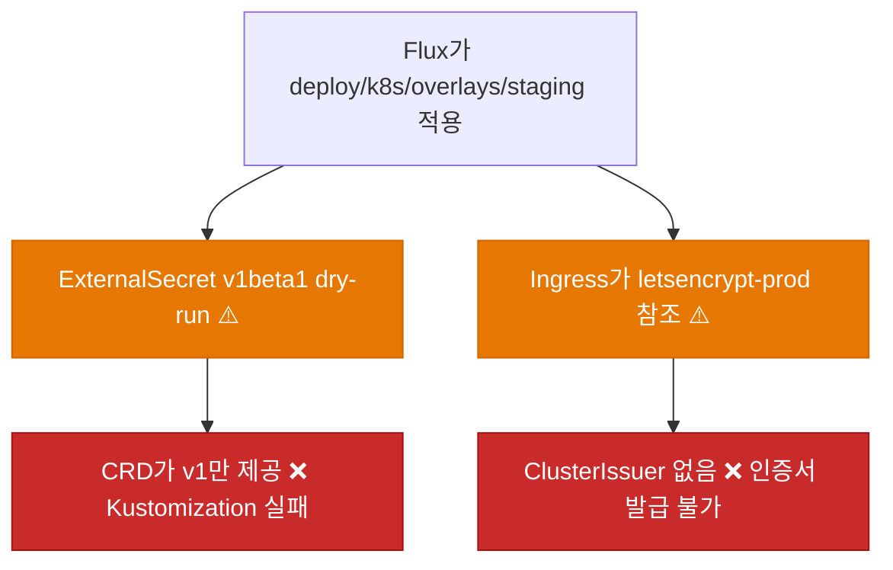
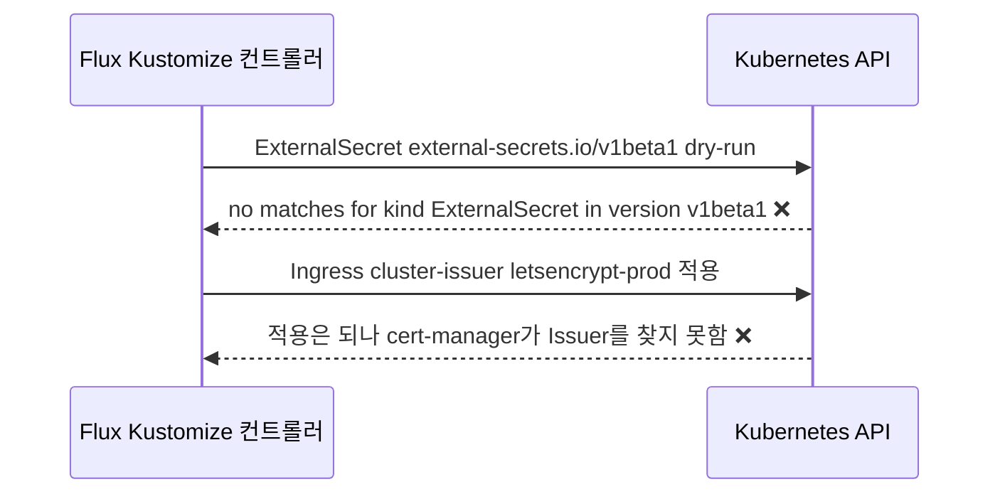
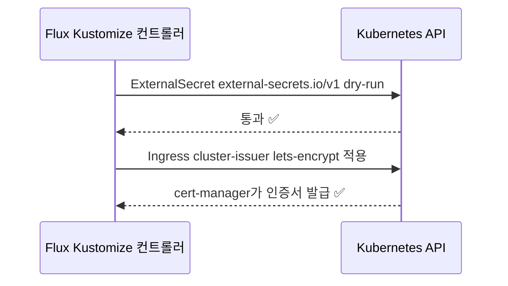
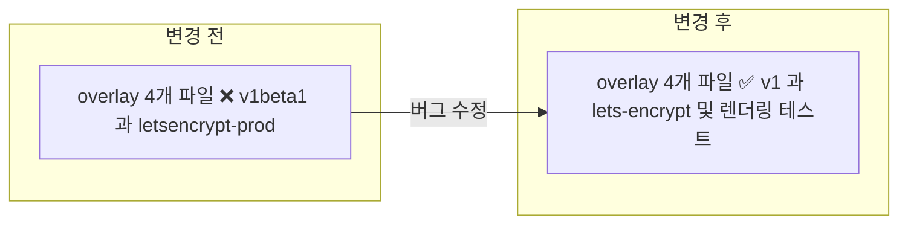

# ✅ Orchid GitOps 매니페스트가 Hanul 클러스터 API와 맞지 않아 배포가 실패하는 문제 수정

## 계획 관계

> **관계 스키마**: `1`
> **계획 ID**: `orchid:261014_fix_orchid-gitops-manifest-cluster-compat`
> **출처 판정**: `연결`

| 관계 | 대상 계획 ID | 조건 | 근거·인수 범위 |
| --- | --- | --- | --- |
| 파생 | `orchid:261014_verify_orchid-hanul-gitops-deployment` | 해당 없음 | V1 FAIL에서 분리한 작업. ExternalSecret apiVersion 불일치와 cert-manager ClusterIssuer 이름 불일치 수정을 인수한다 |

<!-- plan-relations-summary:start -->
> 자동 생성 관계 요약. 원본은 위 관계 표입니다.

| 구분 | 계획·조건 |
| --- | --- |
| 최초 계획 | [✅ Orchid 서비스 독립 GitOps 배포 매니페스트 구축 및 Hanul 온보딩 계획](<261014_ops_orchid-service-gitops-manifest-onboarding.md>) `orchid:261014_ops_orchid-service-gitops-manifest-onboarding` |
| 직접 출처 | [✅ Orchid 서비스 Hanul GitOps 배포 사용자 실행 검증](<261014_verify_orchid-hanul-gitops-deployment.md>) `orchid:261014_verify_orchid-hanul-gitops-deployment` |
| 직접 후속 | 없음 |
| 계보 경로 | [✅ Orchid 서비스 독립 GitOps 배포 매니페스트 구축 및 Hanul 온보딩 계획](<261014_ops_orchid-service-gitops-manifest-onboarding.md>) `orchid:261014_ops_orchid-service-gitops-manifest-onboarding` → [✅ Orchid 서비스 Hanul GitOps 배포 사용자 실행 검증](<261014_verify_orchid-hanul-gitops-deployment.md>) `orchid:261014_verify_orchid-hanul-gitops-deployment` → [✅ Orchid GitOps 매니페스트가 Hanul 클러스터 API와 맞지 않아 배포가 실패하는 문제 수정](<261014_fix_orchid-gitops-manifest-cluster-compat.md>) `orchid:261014_fix_orchid-gitops-manifest-cluster-compat` |
| 파생 | [✅ Orchid 서비스 Hanul GitOps 배포 사용자 실행 검증](<261014_verify_orchid-hanul-gitops-deployment.md>) `orchid:261014_verify_orchid-hanul-gitops-deployment` — 해당 없음 |
| 착수 조건 | 가능 |
<!-- plan-relations-summary:end -->

## 결정이 필요한 사항

1. **수정 범위** — staging과 production overlay의 두 결함(ExternalSecret apiVersion, ClusterIssuer 이름)을 함께 고친다 (권장)
- 근거: 두 overlay가 같은 파일 구조와 같은 오류를 갖는다. staging만 고치면 production Kustomization이 같은 이유로 계속 실패한다.
- 대안: staging만 고친다. 변경은 작지만 production은 별도 계획이 필요하다.

2. **OpenBao 앱 시크릿 `app/stag/orchid/*`** — 이 계획 범위에서 제외하고 사용자가 값을 입력한다 (사용자 판단 필요)
- 근거: 2026-10-14 `bao kv list secret/app/stag`에 `infra/`, `peony/`만 있고 `orchid/`가 없다. 값은 코드로 만들 수 없고 필수 key 목록도 앱 설정 기준으로 확인해야 한다. 이 계획의 apiVersion 수정만으로는 V1이 `SecretSyncedError`로 한 번 더 막힌다.
- 대안: 이 계획에 포함한다. 값 입력은 사용자 몫이라 계획 완료 조건이 외부 입력에 묶인다.

3. **production overlay 네임스페이스 `orchid`** — 이 계획 범위에서 제외한다 (권장)
- 근거: production Kustomization은 `namespaces "orchid" not found`로 실패한다. 네임스페이스는 Garden.Cluster `bootstrap/namespaces/`가 소유하고 이름 정책(`orchid` 또는 `orchid-production`)은 별도 결정이 필요하다.
- 대안: 이 계획에서 overlay 네임스페이스를 `orchid-production`으로 바꾼다. Garden.Cluster 변경이 함께 필요해 소유 루트가 갈라진다.

## 배경

### 현상

Orchid 사용자 실행 검증(`orchid:261014_verify_orchid-hanul-gitops-deployment`)의 V1이 FAIL이다.

| 항목 | 확인 결과 (2026-10-14, Hanul `agents-mcp`) |
| --- | --- |
| `orchid-application` | READY True, `ibocon/Orchid` `main@1856e950` |
| `orchid-staging` 네임스페이스 | 생성됨 (Garden.Cluster `1b60f677`) |
| `orchid-staging-controller` | READY False: `ExternalSecret/orchid-staging/orchid-api-gateway-external-secret dry-run failed: no matches for kind "ExternalSecret" in version "external-secrets.io/v1beta1"` |
| ExternalSecret CRD 제공 버전 | `external-secrets.io/v1`만 제공. Garden.Cluster는 68곳에서 `v1`을 사용 |
| cert-manager ClusterIssuer | `lets-encrypt`, `lets-encrypt-stag`, `olmv1-ca`. Orchid Ingress가 쓰는 `letsencrypt-prod`는 없음 |

### 원인 분석





### 핵심 원인

1. Orchid 매니페스트가 이 클러스터에서 제공하지 않는 `external-secrets.io/v1beta1`로 작성돼 있다. 클러스터의 ESO는 `v1`만 제공한다.
2. Ingress가 클러스터에 없는 ClusterIssuer 이름 `letsencrypt-prod`를 쓴다. Peony 운영 Ingress는 `lets-encrypt`를 쓴다.
3. 작성 시점에 렌더링 검증만 있고 클러스터 API와 이름 대조가 없어 두 불일치가 배포 단계에서야 드러났다.

### 수정 방안

두 overlay의 ExternalSecret `apiVersion`을 `external-secrets.io/v1`로, Ingress의 ClusterIssuer를 `lets-encrypt`로 바꾼다. `v1`은 `v1beta1`과 이 매니페스트가 쓰는 필드(`secretStoreRef`, `target`, `dataFrom.extract`)가 같아 스키마 변경이 없다. 재발을 막기 위해 렌더링 결과를 검사하는 테스트를 추가한다.




## 변경 범위



| 레이어 | 파일 | 변경 내용 |
| --- | --- | --- |
| staging 시크릿 | `deploy/k8s/overlays/staging/external-secret.yaml` | `apiVersion`을 `external-secrets.io/v1`로 변경 (2개 문서) |
| production 시크릿 | `deploy/k8s/overlays/production/external-secret.yaml` | `apiVersion`을 `external-secrets.io/v1`로 변경 (2개 문서) |
| staging Ingress | `deploy/k8s/overlays/staging/ingress.yaml` | `cluster-issuer`를 `lets-encrypt`로 변경 |
| production Ingress | `deploy/k8s/overlays/production/ingress.yaml` | `cluster-issuer`를 `lets-encrypt`로 변경 |
| 테스트 | `test/Deploy/OrchidManifestClusterCompat.Tests.ps1` | 두 overlay를 렌더링해 apiVersion과 ClusterIssuer 이름을 검증 |

## 단계별 수정 계획

### ✅ Step 1: ExternalSecret apiVersion을 클러스터 제공 버전으로 변경

**파일**: `deploy/k8s/overlays/staging/external-secret.yaml`

AS-IS:

```yaml
# ❌ 클러스터 CRD가 제공하지 않는 버전
apiVersion: external-secrets.io/v1beta1
kind: ExternalSecret
metadata:
  name: orchid-api-gateway-external-secret
```

TO-BE:

```yaml
# ✅ 클러스터가 제공하는 버전. 나머지 필드는 변경하지 않는다
apiVersion: external-secrets.io/v1
kind: ExternalSecret
metadata:
  name: orchid-api-gateway-external-secret
```

**파일**: `deploy/k8s/overlays/production/external-secret.yaml`

AS-IS:

```yaml
# ❌ 두 번째 문서(orchid-clipboard-external-secret)도 동일하게 v1beta1
apiVersion: external-secrets.io/v1beta1
kind: ExternalSecret
metadata:
  name: orchid-api-gateway-external-secret
```

TO-BE:

```yaml
# ✅ 두 문서 모두 v1
apiVersion: external-secrets.io/v1
kind: ExternalSecret
metadata:
  name: orchid-api-gateway-external-secret
```

### ✅ Step 2: Ingress ClusterIssuer 이름을 클러스터 기준으로 변경

**파일**: `deploy/k8s/overlays/staging/ingress.yaml`

AS-IS:

```yaml
# ❌ 클러스터에 없는 ClusterIssuer
metadata:
  annotations:
    cert-manager.io/cluster-issuer: letsencrypt-prod
```

TO-BE:

```yaml
# ✅ Peony Ingress와 같은 ClusterIssuer
metadata:
  annotations:
    cert-manager.io/cluster-issuer: lets-encrypt
```

**파일**: `deploy/k8s/overlays/production/ingress.yaml`

AS-IS:

```yaml
# ❌ 클러스터에 없는 ClusterIssuer
metadata:
  annotations:
    cert-manager.io/cluster-issuer: letsencrypt-prod
```

TO-BE:

```yaml
# ✅ Peony Ingress와 같은 ClusterIssuer
metadata:
  annotations:
    cert-manager.io/cluster-issuer: lets-encrypt
```

## 테스트 계획

> 위치: `test/Deploy/`
> 프레임워크: Pester 5
> 패턴: Given/When/Then (Four-Phase Test). 클러스터 접속 없이 `kubectl kustomize` 렌더링 결과만 사용한다.

### ✅ 테스트용 Stub 정의

**파일**: `test/Deploy/OrchidManifestClusterCompat.Tests.ps1`

```powershell
BeforeAll {
    $script:RepositoryRoot = (Resolve-Path -Path (Join-Path -Path $PSScriptRoot -ChildPath '../..')).Path
    $script:ClusterIssuers = @('lets-encrypt', 'lets-encrypt-stag')

    function Get-RenderedManifest {
        [CmdletBinding()]
        param(
            [Parameter(Mandatory)]
            [string] $Overlay
        )

        $Path = Join-Path -Path $script:RepositoryRoot -ChildPath "deploy/k8s/overlays/$Overlay"
        return (kubectl kustomize $Path) -join "`n"
    }
}
```

### ✅ 테스트: `OrchidManifestClusterCompat.Tests.ps1`

**파일**: `test/Deploy/OrchidManifestClusterCompat.Tests.ps1`

```powershell
Describe 'Orchid overlay 클러스터 호환성' -ForEach @('staging', 'production') {
    It 'Given <_> overlay, When 렌더링, Then ExternalSecret 은 external-secrets.io/v1 만 사용한다' {
        # Given
        $Manifest = Get-RenderedManifest -Overlay $_

        # When
        $Versions = [regex]::Matches($Manifest, '(?m)^apiVersion: (external-secrets\.io/\S+)\r?\n(?=kind: ExternalSecret)') |
            ForEach-Object { $_.Groups[1].Value } |
            Sort-Object -Unique

        # Then
        $Versions | Should -Be @('external-secrets.io/v1')
    }

    It 'Given <_> overlay, When 렌더링, Then Ingress ClusterIssuer 는 클러스터에 존재하는 이름이다' {
        # Given
        $Manifest = Get-RenderedManifest -Overlay $_

        # When
        $Issuer = [regex]::Match($Manifest, 'cert-manager\.io/cluster-issuer: (\S+)').Groups[1].Value

        # Then
        $script:ClusterIssuers | Should -Contain $Issuer
    }
}
```

### 테스트 요약

| 테스트 클래스 | 검증 대상 | 테스트 수 |
| --- | --- | --- |
| `OrchidManifestClusterCompat.Tests.ps1` | overlay별 ExternalSecret apiVersion, ClusterIssuer 이름 | 4 |
| **합계** | | **4** |

### 테스트 결과

| 범위 | 실행 명령 | 총 테스트 | 통과 | 실패 | 결과 |
| --- | --- | ---: | ---: | ---: | :---: |
| 수정 전 (Red) | `pwsh -NoProfile -Command "Invoke-Pester test/Deploy/OrchidManifestClusterCompat.Tests.ps1"` | 4 | 0 | 4 | ✅ 의도한 실패 |
| 변경 범위 | `pwsh -NoProfile -Command "Invoke-Pester test/Deploy/OrchidManifestClusterCompat.Tests.ps1"` | 4 | 4 | 0 | ✅ |
| 전체 | `Test-KustomizationBuild.ps1 -KustomizationPath @('deploy/k8s/overlays/staging/kustomization.yaml','deploy/k8s/overlays/production/kustomization.yaml')` | — | — | — | ✅ exit 0 |

**실행 일시**: 2026-10-14

<!-- NOTE: 실기기(Android/iOS 디바이스) 조작이나 Staging 수동 검증은 여기에 작성할 수 없습니다. 필요한 경우 별도의 후속 verify 계획서(YYMMDD_verify_*.md)로 분리하십시오. -->

## 후속 검증

| 항목 | 내용 | 상태 |
| --- | --- | --- |
| Flux 적용 | 푸시 후 `orchid-staging-controller`가 READY True가 되는지 확인한다. 클러스터 검증은 `orchid:261014_verify_orchid-hanul-gitops-deployment`의 V1~V3로 이관한다 | 확인(2026-10-14): READY True, `main@b2e8faaf`. ExternalSecret 2건, Deployment 2건, Service 2건, Ingress 생성됨 |
| 인증서 발급 | Ingress `lets-encrypt`로 `orchid-stag-tls`가 발급되는지 확인한다 | 확인(2026-10-14): Certificate READY True, ISSUER `lets-encrypt`, HTTP-01 검증 통과 |
| OpenBao 시크릿 | `app/stag/orchid/api-gateway`, `app/stag/orchid/clipboard`가 등록돼야 V1이 `SecretSynced`가 된다. 결정 2에 따라 사용자 입력 | 미충족 확인: ExternalSecret `Secret does not exist`. 이관: 검증 계획 V1 |
| 이미지 | Harbor 이미지 pull이 가능한지 확인한다 | 별도 결함: `401 Unauthorized`, Deployment에 `imagePullSecrets` 없음. 이 계획 범위 밖이며 별도 `fix` 계획이 필요하다 |

## 계획 평가

| 관점 | 참조 문서 | 평가 항목 | 결과 |
| --- | --- | --- | --- |
| 클린 코드 | `clean-code.md` | 이름/책임/오류 처리 | ✅ |
| 아키텍처 | `clean-architecture.md` | DIP/경계/응집도 | ✅ |
| 디자인 패턴 | `design-pattern.md` | 패턴 적절성 | 해당 없음 |
| 엔터프라이즈 패턴 | `enterprise-application-architecture.md` | 레이어링/분리 | 해당 없음 |
| 리팩토링 | `refactoring.md` | 코드 냄새/개선 기회 | ⚠️ |
| 테스트 품질 | `x-unit-test-patterns.md` | Four-Phase/Test Smell | ⚠️ |
| .NET 도메인·컨벤션 | `dotnet/docs/guide·convention` | 불변식 배치/캡슐화/도메인 이벤트/영속화 무지 | 해당 없음 |

**특이사항:**

- 리팩토링 ⚠️: 두 overlay가 같은 ExternalSecret과 Ingress를 중복 보유한다. base로 올리는 정리는 별도 `refac` 계획에서 다룬다.
- 테스트 품질 ⚠️: ClusterIssuer 허용 목록(`lets-encrypt`, `lets-encrypt-stag`)을 테스트에 고정했다. 클러스터 값이 바뀌면 테스트를 함께 갱신해야 한다. 클러스터 접속 없이 도는 것을 우선했다.
- .NET 도메인·컨벤션 해당 없음: C# 산출물이 없고 YAML과 PowerShell 테스트만 포함한다.

## 작업 순서

1. ✅ `test/Deploy/OrchidManifestClusterCompat.Tests.ps1`을 먼저 작성하고 실패(Red)를 확인한다.
2. ✅ Step 1: 두 overlay의 ExternalSecret `apiVersion`을 변경한다.
3. ✅ Step 2: 두 overlay의 Ingress ClusterIssuer를 변경한다.
4. ✅ Pester와 `Test-KustomizationBuild.ps1`을 통과시킨다.
5. ✅ 푸시 후 `orchid-staging-controller` READY를 확인하고 `orchid:261014_verify_orchid-hanul-gitops-deployment` V1 재검증으로 이관한다.
