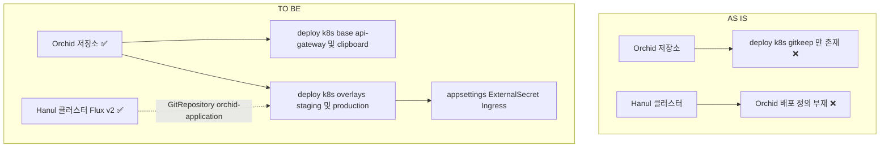
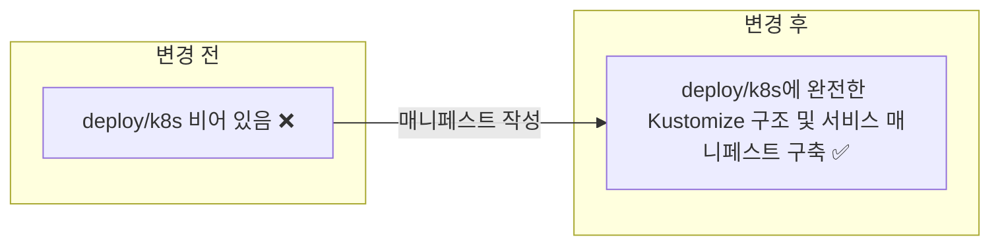
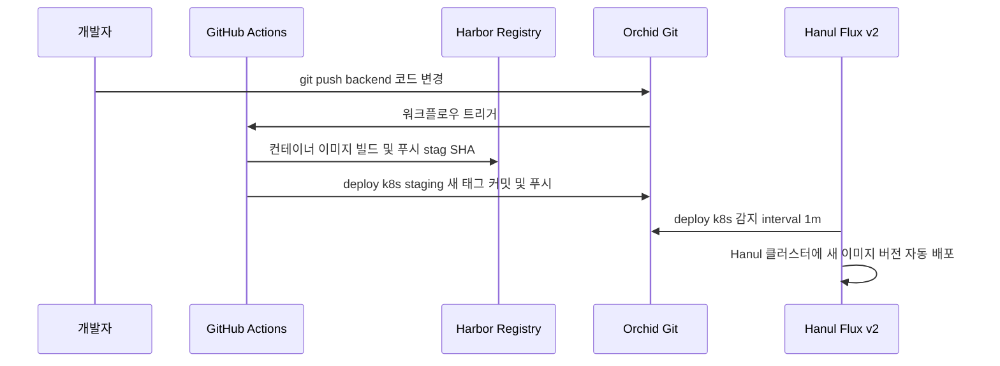

# ✅ Orchid 서비스 독립 GitOps 배포 매니페스트 구축 및 Hanul 온보딩 계획

## 계획 관계

> **관계 스키마**: `1`
> **계획 ID**: `orchid:261014_ops_orchid-service-gitops-manifest-onboarding`
> **출처 판정**: `최초`
> **출처 판정 근거**: Orchid 백엔드 서비스(ApiGateway, Clipboard)를 Hanul Kubernetes 클러스터에 배포하기 위해 Multi-Repository GitOps 매니페스트를 저장소 내에 직접 구축하는 사용자 요청에서 시작

| 관계 | 대상 계획 ID | 조건 | 근거·인수 범위 |
| --- | --- | --- | --- |

<!-- plan-relations-summary:start -->
> 자동 생성 관계 요약. 원본은 위 관계 표입니다.

| 구분 | 계획·조건 |
| --- | --- |
| 최초 계획 | [✅ Orchid 서비스 독립 GitOps 배포 매니페스트 구축 및 Hanul 온보딩 계획](<261014_ops_orchid-service-gitops-manifest-onboarding.md>) `orchid:261014_ops_orchid-service-gitops-manifest-onboarding` |
| 직접 출처 | 없음 |
| 직접 후속 | 없음 |
| 계보 경로 | [✅ Orchid 서비스 독립 GitOps 배포 매니페스트 구축 및 Hanul 온보딩 계획](<261014_ops_orchid-service-gitops-manifest-onboarding.md>) `orchid:261014_ops_orchid-service-gitops-manifest-onboarding` |
| 착수 조건 | 가능 |
<!-- plan-relations-summary:end -->

## 결정이 필요한 사항

1. **매니페스트 디렉터리 레이아웃** — `deploy/k8s/{base,overlays}` 표준 Kustomize 구조 채택 (권장)
   - 근거: `README.md` 및 상위 아키텍처 다이어그램에서 선언된 `deploy/k8s` 경로를 유지하고, 환경 중립적인 `base/`와 환경별 `overlays/staging/`, `overlays/production/`으로 분리.
   - 대안: 최상위에 `k8s/` 또는 `helm/` 배치 — 솔루션 디렉터리 규약과 불일치.
2. **배포 대상 백엔드 워크로드 단위** — `api-gateway`와 `clipboard` 2개 서비스로 분리 (권장)
   - 근거: YARP 리버스 프록시인 `Orchid.ApiGateway`와 핵심 암호화/동기화 릴레이인 `Orchid.Service.Clipboard`의 스케일링 특성과 수명주기를 분리.
   - 대안: 단일 모놀리스 Pod로 통합 배포 — YARP의 경량 라우팅/SSL 종료와 릴레이 서버의 리소스 격리 실패.
3. **이미지 태그 갱신 자동화 방식** — GitHub Actions CI 파이프라인에서 staging overlay 직접 갱신 (권장)
   - 근거: Multi-repository 환경에서 저장소 내 배포 매니페스트의 이미지 태그를 Actions가 빌드/푸시 직후 commit/push하는 방식이 가장 투명하고 디버깅이 용이함.
   - 대안: 클러스터 내부 Flux ImageUpdateAutomation에 Orchid 쓰기 권한 부여 — Flux 배포 키에 Write 권한을 열어주어야 하므로 보안 리스크 증가.

## 배경

- Orchid는 크로스 플랫폼 E2EE 클립보드 동기화 시스템으로, 백엔드에는 **YARP 기반 `Orchid.ApiGateway`**와 **Clean Architecture 기반 `Orchid.Service.Clipboard`**가 존재합니다.
- 현재 Orchid 저장소의 `deploy/k8s/` 디렉터리에는 `.gitkeep`만 존재하며 구체적인 Kubernetes 매니페스트가 작성되어 있지 않습니다.
- Hanul 클러스터의 Multi-Repository GitOps 아키텍처에 맞춰, Orchid 저장소 내부에서 완전 자립적인 Kustomize 기반 배포 매니페스트를 구축하고, OpenBao 시크릿 및 Ingress와 연동하여 자동 배포 파이프라인을 확립해야 합니다.

### 전체 아키텍처 비교



## 변경 범위



| 레이어 | 파일 | 변경 내용 |
| --- | --- | --- |
| K8s Base | `deploy/k8s/base/api-gateway/` | `deployment.yaml`, `service.yaml`, `config-map.yaml` 등 작성 |
| K8s Base | `deploy/k8s/base/clipboard/` | `deployment.yaml`, `service.yaml`, `config-map.yaml` 등 작성 |
| K8s Base | `deploy/k8s/base/kustomization.yaml` | Base 리소스 묶음 정의 |
| K8s Overlay | `deploy/k8s/overlays/staging/` | staging 네임스페이스(`orchid-staging`), Ingress, ExternalSecret, patch 구성 |
| K8s Overlay | `deploy/k8s/overlays/production/` | production 네임스페이스(`orchid`), Ingress, ExternalSecret, patch 구성 |
| CI 파이프라인 | `.github/workflows/publish-backend-images.yml` | 컨테이너 이미지 빌드/푸시 및 GitOps staging 태그 자동 갱신 워크플로우 신설 |

## 단계별 수정 계획

### ✅ 1단계. Base 서비스 매니페스트 정의 (`api-gateway`, `clipboard`)

**파일**: `deploy/k8s/base/api-gateway/deployment.yaml`

AS-IS:
```yaml
# ❌ 파일 부재
```

TO-BE:
```yaml
# ✅ Orchid API Gateway Deployment
apiVersion: apps/v1
kind: Deployment
metadata:
  name: orchid-api-gateway
  labels:
    app.kubernetes.io/name: orchid-api-gateway
    app.kubernetes.io/part-of: orchid
spec:
  replicas: 1
  selector:
    matchLabels:
      app.kubernetes.io/name: orchid-api-gateway
  template:
    metadata:
      labels:
        app.kubernetes.io/name: orchid-api-gateway
    spec:
      containers:
        - name: api-gateway
          image: harbor.hanul.botanicsoft.com/orchid/api-gateway:latest
          ports:
            - containerPort: 8080
              name: http
          envFrom:
            - secretRef:
                name: orchid-api-gateway-secret
          resources:
            requests:
              cpu: 100m
              memory: 128Mi
            limits:
              cpu: 500m
              memory: 256Mi
```

### ✅ 2단계. Staging Overlay 및 OpenBao ExternalSecret 연동

**파일**: `deploy/k8s/overlays/staging/external-secret.yaml`

AS-IS:
```yaml
# ❌ 파일 부재
```

TO-BE:
```yaml
# ✅ OpenBao ClusterSecretStore 연동 ExternalSecret
apiVersion: external-secrets.io/v1beta1
kind: ExternalSecret
metadata:
  name: orchid-api-gateway-external-secret
spec:
  refreshInterval: 1h
  secretStoreRef:
    kind: ClusterSecretStore
    name: openbao
  target:
    name: orchid-api-gateway-secret
    creationPolicy: Owner
  dataFrom:
    - extract:
        key: app/stag/orchid/api-gateway
```

### ✅ 3단계. Staging Ingress 및 Kustomization 진입점 정의

**파일**: `deploy/k8s/overlays/staging/kustomization.yaml`

AS-IS:
```yaml
# ❌ 파일 부재
```

TO-BE:
```yaml
# ✅ Staging 배포 진입점 Kustomization
apiVersion: kustomize.config.k8s.io/v1beta1
kind: Kustomization
namespace: orchid-staging
resources:
  - ../../base
  - external-secret.yaml
  - ingress.yaml
images:
  - name: harbor.hanul.botanicsoft.com/orchid/api-gateway
    newTag: stag-dev
  - name: harbor.hanul.botanicsoft.com/orchid/clipboard
    newTag: stag-dev
```

## 주요 흐름



## 테스트 계획

> 검증 도구: `kubectl kustomize`, `docker buildx bake`

### ⬜ Kustomize 렌더 테스트
```powershell
# Staging Overlay 렌더 검증
kubectl kustomize deploy/k8s/overlays/staging

# Production Overlay 렌더 검증
kubectl kustomize deploy/k8s/overlays/production
```

### 테스트 결과

| 범위 | 실행 명령 | 총 항목 | 통과 | 실패 | 결과 |
| --- | --- | ---: | ---: | ---: | :---: |
| Base 렌더 | `kubectl kustomize deploy/k8s/base` | 1 | 1 | 0 | ✅ |
| Staging 렌더 | `kubectl kustomize deploy/k8s/overlays/staging` | 1 | 1 | 0 | ✅ |
| Prod 렌더 | `kubectl kustomize deploy/k8s/overlays/production` | 1 | 1 | 0 | ✅ |

## 후속 검증

| 항목 | 확인 내용 | 상태 |
| --- | --- | --- |
| Ingress 접속 | `https://orchid.stag.botanicsoft.com/health` 정상 응답(200 OK) 확인 | 미확인 |
| E2EE 웹소켓 | Desktop/Mobile 클라이언트가 Gateway 경유 릴레이 접속 성공 여부 | 미확인 |

## 계획 평가

| 관점 | 참조 문서 | 평가 항목 | 결과 |
| --- | --- | --- | --- |
| 아키텍처 | `clean-architecture.md` | 저장소 내부에서 배포 구성을 완결하는 Self-Contained GitOps 달성 | ✅ |
| 보안성 | `openbao-secret-operations.md` | OpenBao 앱 runtime secret(`app/stag/orchid/*`) 경로 준수 | ✅ |
| 운영성 | `image-tagging-policy.md` | Harbor stag 태그 생명주기 및 불변 digest 승격 규칙 준수 | ✅ |

**특이사항:**
- 네임스페이스는 기존 `garden-staging`과 충돌하지 않도록 독립된 `orchid-staging` 및 `orchid`를 사용하도록 구성합니다.
