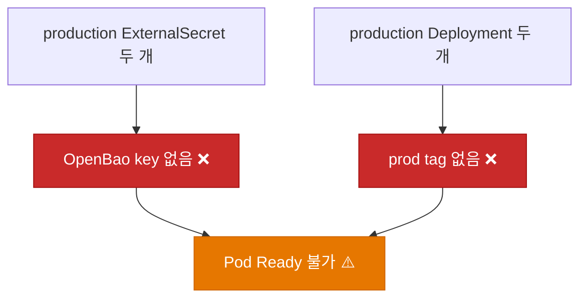
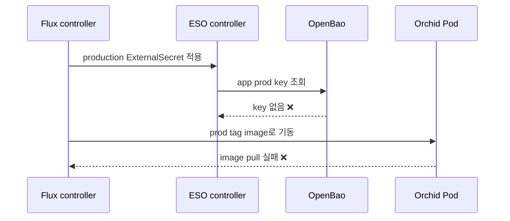
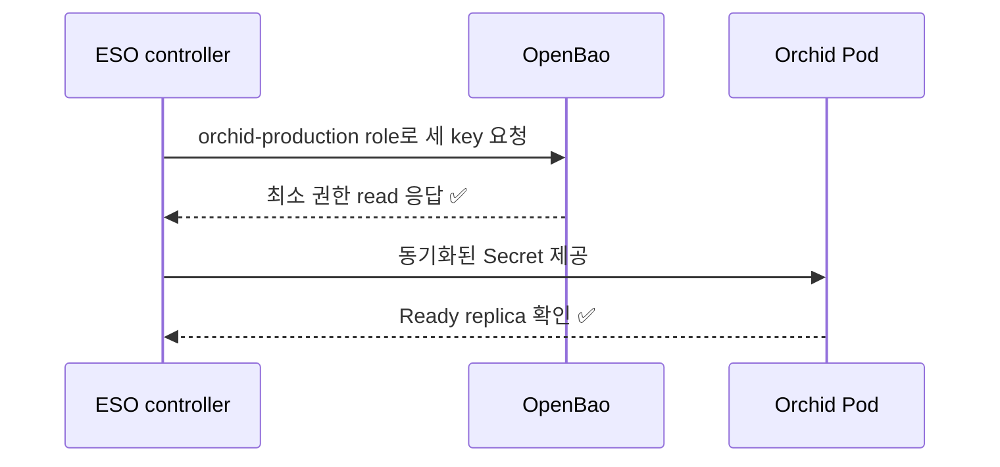

# ✅ Orchid production 배포의 누락된 OpenBao 시크릿과 존재하지 않는 이미지 태그 수정

## 계획 관계

> **관계 스키마**: `1`
> **계획 ID**: `orchid:261015_fix_orchid-production-release-prerequisites`
> **출처 판정**: `연결`
> **출처 판정 근거**: `orchid:261014_fix_orchid-production-namespace-name`가 범위 밖으로 남긴 production 이미지와 OpenBao 시크릿이 실제 `ExternalSecretSyncFailing` 및 `ImagePullBackOff`로 관측되어 분리한다.

| 관계 | 대상 계획 ID | 조건 | 근거·인수 범위 |
| --- | --- | --- | --- |
| 파생 | `orchid:261014_fix_orchid-production-namespace-name` | 해당 없음 | production namespace 적용 뒤 발생한 두 배포 선행 조건을 인수한다 |
| 실행 의존 | `orchid:261014_fix_orchid-secret-store-scope` | plan-complete | production에도 namespace 전용 SecretStore를 적용할 때의 보안 경계 기준으로 사용한다 |

<!-- plan-relations-summary:start -->
> 자동 생성 관계 요약. 원본은 위 관계 표입니다.

| 구분 | 계획·조건 |
| --- | --- |
| 최초 계획 | [✅ Orchid 서비스 독립 GitOps 배포 매니페스트 구축 및 Hanul 온보딩 계획](<../261014/261014_ops_orchid-service-gitops-manifest-onboarding.md>) `orchid:261014_ops_orchid-service-gitops-manifest-onboarding` |
| 직접 출처 | [🔄 Orchid production overlay 네임스페이스가 클러스터에 없고 staging 이름 규칙과 달라 적용되지 않는 문제 수정](<../../../../planning/261014_fix_orchid-production-namespace-name.md>) `orchid:261014_fix_orchid-production-namespace-name` |
| 직접 후속 | 없음 |
| 계보 경로 | [✅ Orchid 서비스 독립 GitOps 배포 매니페스트 구축 및 Hanul 온보딩 계획](<../261014/261014_ops_orchid-service-gitops-manifest-onboarding.md>) `orchid:261014_ops_orchid-service-gitops-manifest-onboarding` → [✅ Orchid 서비스 Hanul GitOps 배포 사용자 실행 검증](<../261014/261014_verify_orchid-hanul-gitops-deployment.md>) `orchid:261014_verify_orchid-hanul-gitops-deployment` → [🔄 Orchid production overlay 네임스페이스가 클러스터에 없고 staging 이름 규칙과 달라 적용되지 않는 문제 수정](<../../../../planning/261014_fix_orchid-production-namespace-name.md>) `orchid:261014_fix_orchid-production-namespace-name` → [✅ Orchid production 배포의 누락된 OpenBao 시크릿과 존재하지 않는 이미지 태그 수정](<261015_fix_orchid-production-release-prerequisites.md>) `orchid:261015_fix_orchid-production-release-prerequisites` |
| 실행 의존 | [✅ Orchid ExternalSecret이 공용 ClusterSecretStore로 OpenBao 전체를 읽을 수 있는 과권한 수정](<../261014/261014_fix_orchid-secret-store-scope.md>) `orchid:261014_fix_orchid-secret-store-scope` — plan-complete |
| 파생 | [🔄 Orchid production overlay 네임스페이스가 클러스터에 없고 staging 이름 규칙과 달라 적용되지 않는 문제 수정](<../../../../planning/261014_fix_orchid-production-namespace-name.md>) `orchid:261014_fix_orchid-production-namespace-name` — 해당 없음 |
| 착수 조건 | 가능 |
<!-- plan-relations-summary:end -->

## 결정이 필요한 사항

1. **승격할 production 이미지** — Harbor에 존재하는 검증 완료 digest를 명시적으로 선택한다. `prod-v1.0.0`을 새로 만드는지, 기존 staging 검증 digest를 immutable production tag 또는 digest pin으로 승격할지 결정이 필요하다.
2. **OpenBao 값의 소유자와 입력 경로** — `app/prod/orchid/api-gateway`와 `app/prod/orchid/clipboard`의 필수 속성은 비밀값을 대화나 Git에 노출하지 않고 OpenBao 운영 절차로만 생성·검증한다.

## 배경

### 현상

2026-10-15 KST read-only 클러스터 조회에서 다음을 확인했다.

| 범위 | 신호 | 심각도 | 증거 | 영향 |
| --- | --- | --- | --- | --- |
| `orchid-production` ExternalSecret | `Ready=False` | warning | API Gateway와 Clipboard가 각각 `app/prod/orchid/api-gateway`, `app/prod/orchid/clipboard`를 읽다가 `SecretSyncedError` | 대상 Kubernetes Secret 두 개가 생성되지 않음 |
| ESO controller log | provider read 실패 | warning | 16:04 KST부터 두 리소스에 `Secret does not exist`가 반복됨 | Alertmanager의 `ExternalSecretSyncFailing` 경보 발생 |
| production Pod | `ImagePullBackOff` | warning | 두 Pod 모두 `harbor.hanul.botanicsoft.com/orchid/*:prod-v1.0.0` 조회에서 `not found` | API Gateway와 Clipboard가 기동하지 못함 |
| Harbor pull credential | `Ready=True` | info | `ExternalSecret/harbor-registry`는 `SecretSynced` | 이미지 pull 실패 원인은 registry 자격이 아니라 태그 부재 |

`namespace=external-secrets`는 Alertmanager 규칙에서 붙은 ESO controller namespace 라벨이다. 실패한 ExternalSecret 리소스의 실제 namespace는 `orchid-production`이다.

### 원인 분석





### 핵심 원인

1. production ExternalSecret이 가리키는 두 OpenBao 키가 존재하지 않는다.
2. production overlay가 가리키는 `prod-v1.0.0` 이미지 두 개가 Harbor에 없다.
3. 두 결함은 독립적이다. Secret을 복구해도 이미지가 없으면 Pod는 기동하지 않으며, 이미지를 올려도 Secret 없이는 runtime 구성이 완성되지 않는다.

### 수정 방안

두 production OpenBao key는 값 비노출 방식으로 생성했고, 검증된 staging digest 두 개를 immutable pin으로 변경했다. 이후 Garden.Cluster가 제공한 production 전용 role·policy·RBAC를 사용하도록 Orchid production의 ServiceAccount, `SecretStore/orchid-openbao`, 세 ExternalSecret ref를 전환했다.




## 변경 범위

| 레이어 | 파일 | 변경 내용 |
| --- | --- | --- |
| OpenBao production runtime | `app/prod/orchid/api-gateway` | 비노출 방식으로 필수 `PLACEHOLDER` schema를 생성하고 ESO 동기화를 검증한다 |
| OpenBao production runtime | `app/prod/orchid/clipboard` | 비노출 방식으로 필수 `PLACEHOLDER` schema를 생성하고 ESO 동기화를 검증한다 |
| Harbor | `deploy/k8s/overlays/production/kustomization.yaml` | 검증된 동일 source revision digest 두 개를 immutable pin으로 선언한다 |
| GitOps manifest | `deploy/k8s/overlays/production/kustomization.yaml` | 선택한 이미지 식별자와 실제 Harbor artifact가 정확히 일치하도록 갱신한다 |
| SecretStore security | `deploy/k8s/overlays/production/service-account.yaml` | production 전용 OpenBao 로그인 ServiceAccount를 선언한다 |
| SecretStore security | `deploy/k8s/overlays/production/secret-store.yaml` | `orchid-production` role을 쓰는 `SecretStore/orchid-openbao`를 선언한다 |
| SecretStore security | `deploy/k8s/overlays/production/external-secret.yaml` | 앱 두 ExternalSecret을 전용 SecretStore로 전환한다 |
| SecretStore security | `deploy/k8s/overlays/production/harbor-registry-external-secret.yaml` | Harbor pull ExternalSecret을 전용 SecretStore로 전환한다 |

## 단계별 수정 계획

### ✅ Step 1: production release 후보를 고정한다

**파일**: `deploy/k8s/overlays/production/kustomization.yaml`

AS-IS:

```yaml
# source-snapshot: true
images:
  - name: harbor.hanul.botanicsoft.com/orchid/api-gateway
    newTag: prod-v1.0.0
  - name: harbor.hanul.botanicsoft.com/orchid/clipboard
    newTag: prod-v1.0.0
```

TO-BE:

```yaml
# 승인된 Harbor digest 또는 존재가 read-only로 확인된 production tag만 사용한다.
images:
  - name: harbor.hanul.botanicsoft.com/orchid/api-gateway
    digest: sha256:<approved-api-gateway-digest>
  - name: harbor.hanul.botanicsoft.com/orchid/clipboard
    digest: sha256:<approved-clipboard-digest>
```

1. Harbor에서 두 후보의 repository, digest, SBOM/서명 및 staging 검증 영수증을 read-only로 확인한다.
2. 동일 소스 revision의 두 digest를 production release로 승인받는다.
3. digest pin 또는 실제 생성한 production tag 중 하나만 선택해 overlay와 Harbor 상태를 일치시킨다.

### ✅ Step 2: production OpenBao runtime key를 생성한다

**운영 대상**: `app/prod/orchid/api-gateway`, `app/prod/orchid/clipboard`

**파일**: `app/prod/orchid/api-gateway`

**파일**: `app/prod/orchid/clipboard`

AS-IS:

```text
ESO extract(app/prod/orchid/api-gateway) -> Secret does not exist
ESO extract(app/prod/orchid/clipboard)  -> Secret does not exist
```

TO-BE:

```text
OpenBao key exists with the approved non-secret property schema
ESO Ready=True / Reason=SecretSynced for both ExternalSecret resources
```

1. 각 runtime consumer가 요구하는 key 이름을 source manifest와 application configuration에서 확인한다.
2. 승인된 비밀 material을 OpenBao 운영자 세션에서만 기록한다. 값, token, kubeconfig는 로그·계획서·Git에 남기지 않는다.
3. key 생성 후 OpenBao metadata와 ESO `Ready=True`만 read-only로 확인한다.

### ✅ Step 3: production SecretStore 권한 경계를 완성한다

**파일**: `deploy/k8s/overlays/production/external-secret.yaml`

**파일**: `deploy/k8s/overlays/production/harbor-registry-external-secret.yaml`

**파일**: `deploy/k8s/overlays/production/service-account.yaml`

**파일**: `deploy/k8s/overlays/production/secret-store.yaml`

AS-IS:

```yaml
# source-snapshot: true
secretStoreRef:
  kind: ClusterSecretStore
  name: openbao
```

TO-BE:

```yaml
secretStoreRef:
  kind: SecretStore
  name: orchid-openbao
```

`service-account.yaml`과 `secret-store.yaml`을 production kustomization resources에 등록하고, 앱 두 ExternalSecret과 Harbor pull ExternalSecret 모두 `SecretStore/orchid-openbao`를 참조하도록 전환했다. Garden.Cluster의 `orchid-production` role은 `orchid-eso/orchid-production`에만 바인딩되고 policy는 앱 두 key와 Harbor pull key만 읽는다. Flux 적용 revision은 `d8ad263`이다.

## 테스트 계획

| 범위 | 검증 | 통과 기준 |
| --- | --- | --- |
| manifest | production kustomize 렌더링 | 이미지 식별자와 ExternalSecret key가 의도한 production 값으로 렌더링됨 |
| Harbor | repository manifest read-only 조회 | 두 선택 digest가 존재하고 동일 release 기준을 충족함 |
| OpenBao/ESO | ExternalSecret status metadata 조회 | 두 리소스 모두 `Ready=True`, `Reason=SecretSynced`, target Secret 존재 |
| workload | Pod status와 event 조회 | 두 workload가 `ImagePullBackOff` 없이 Ready replica 수를 충족함 |

**실행 결과**: 2026-10-16 KST production SecretStore scope와 immutable image pin Pester 11건이 통과했다. durable verification run `2a009be69e3a44ffad6c0bbb2a808dd9`는 완료 exit code 0으로 하네스 Figma·Penpot UnitTests를 통과했다. 이는 manifest 범위와 직접 연관되지 않은 기본 선택 검증이며, production 변경 판정은 앞선 Pester와 live Flux·ESO·Deployment read-back을 근거로 한다. Flux `orchid-production-controller`는 `main@sha1:d8ad2631897f69d6537a9fbdfcf8fe633f214f34`을 `Ready=True/ReconciliationSucceeded`로 적용했고, 세 ExternalSecret은 `SecretSynced`, 두 Deployment는 각각 `available=1`이다.

## 계획 평가

| 관점 | 참조 문서 | 평가 항목 | 결과 |
| --- | --- | --- | --- |
| 클린 코드 | `clean-code.md` | SecretStore·role 이름이 namespace와 책임을 명확히 드러내는가 | ✅ |
| 아키텍처 | `clean-architecture.md` | Orchid manifest와 Garden.Cluster RBAC·OpenBao 소유권이 분리되는가 | ✅ |
| 디자인 패턴 | `design-pattern.md` | staging에서 검증된 scoped-store 패턴을 production에 일관되게 적용하는가 | ✅ |
| 엔터프라이즈 패턴 | `enterprise-application-architecture.md` | GitOps 선언과 OpenBao 운영 control plane의 gate를 분리하는가 | ✅ |
| 리팩토링 | `refactoring.md` | staging·production overlay 중복은 이후 공통화 후보로 남기는가 | ⚠️ |
| 테스트 품질 | `x-unit-test-patterns.md` | Kustomize 렌더 Pester가 role·store·key 범위를 고정하는가 | ✅ |
| .NET 도메인·컨벤션 | 해당 없음 | C# TO-BE와 도메인 모델 변경이 없다 | 해당 없음 |

**특이사항:** Alertmanager UI 상태와 public readiness endpoint의 별도 smoke는 이번 자동 완료 판정에 포함하지 않았다. 원인 자원인 ExternalSecret과 Deployment의 live 상태를 직접 확인했으며, image·OpenBao secret 값은 기록하지 않는다.

## 작업 순서

1. ✅ 후보 이미지 digest와 OpenBao production values의 소유자를 확정했다. staging 검증 digest를 overlay에 pin하고 커밋 `0858c09`으로 반영했다.
2. ✅ Harbor artifact와 OpenBao key를 생성했다. production ExternalSecret 세 개가 `SecretSynced`이고 두 Pod가 Running 1/1임을 확인했다.
3. ✅ Garden.Cluster의 production 최소권한 RBAC·policy·role 적용을 확인하고, Orchid production ServiceAccount·SecretStore·세 ExternalSecret ref를 커밋 `d8ad263`으로 반영했다.
4. ✅ Flux, ESO, Deployment와 OpenBao role·policy read-back을 확인했다. Alertmanager UI와 public readiness smoke는 완료 판정 범위 밖의 별도 관측으로 남긴다.
