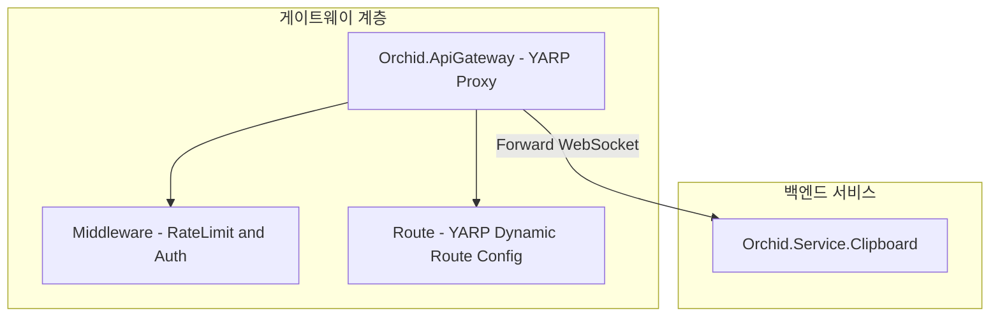

# ⬜ Orchid.ApiGateway YARP 게이트웨이 뼈대 구현 계획

---

## 1. 결정이 필요한 사항

1. **리버스 프록시 엔진** — Microsoft YARP(Yet Another Reverse Proxy) 선정 (확정)
   - 근거: Kestrel 기반 최고 성능 달성 및 C# 코드로 동적 라우팅, 인증, WebSocket 스트리밍을 단일 프로세스에서 유연하게 제어 가능.
2. **분산 속도 제한** — Redis 토큰 버킷 알고리즘 적용 (확정)
   - 근거: 다중 인스턴스 환경에서도 일관된 디바이스별 트래픽 Rate Limiting 보장.

---

## 2. 배경

- 개요:
  - 데스크톱, 모바일, 웹 클라이언트가 유입되는 단일 공개 엔드포인트로서, 내부 E2EE 릴레이 백엔드로 WebSocket 및 REST 요청을 안전하게 중계하는 고성능 API Gateway 구축.
- 아키텍처 비교:
  - AS-IS: 게이트웨이 부재. 클라이언트가 백엔드 내부 포트에 직접 결합.
  - TO-BE: `src/Service/ApiGateway/Orchid.ApiGateway.csproj`를 구축하여 YARP 기반 리버스 프록시 및 보안 미들웨어 계층 확보.

---

## 3. 변경 범위



| 레이어 | 파일 경로 | 변경 내용 |
| :--- | :--- | :--- |
| **Project** | `src/Service/ApiGateway/Orchid.ApiGateway.csproj` | Microsoft.NET.Sdk.Web, Yarp.ReverseProxy 패키지 추가 |
| **Config** | `src/Service/ApiGateway/appsettings.json` | YARP Routes 및 Clusters 선언적 구성 |
| **Middleware** | `src/Service/ApiGateway/Middleware/CorrelationIdMiddleware.cs` | 분산 추적용 W3C TraceContext 헤더 주입 미들웨어 |
| **Bootstrap** | `src/Service/ApiGateway/Program.cs` | MapReverseProxy 및 미들웨어 파이프라인 구성 |

---

## 4. 단계별 수정 계획

### ⬜ 1단계. 프로젝트 파일 및 YARP 패키지 구성

**파일**: `src/Service/ApiGateway/Orchid.ApiGateway.csproj`

TO-BE:

```xml
<Project Sdk="Microsoft.NET.Sdk.Web">
  <PropertyGroup>
    <TargetFramework>net9.0</TargetFramework>
    <Nullable>enable</Nullable>
    <ImplicitUsings>enable</ImplicitUsings>
    <RootNamespace>Orchid.ApiGateway</RootNamespace>
  </PropertyGroup>

  <ItemGroup>
    <PackageReference Include="Yarp.ReverseProxy" Version="2.2.0" />
  </ItemGroup>
</Project>
```

### ⬜ 2단계. YARP 라우팅 설정 파일 정의

**파일**: `src/Service/ApiGateway/appsettings.json`

TO-BE:

```json
{
  "ReverseProxy": {
    "Routes": {
      "clipboard-route": {
        "ClusterId": "clipboard-cluster",
        "Match": {
          "Path": "/api/clipboard/{**catch-all}"
        }
      },
      "realtime-hub-route": {
        "ClusterId": "clipboard-cluster",
        "Match": {
          "Path": "/hubs/clipboard/{**catch-all}"
        }
      }
    },
    "Clusters": {
      "clipboard-cluster": {
        "Destinations": {
          "destination1": {
            "Address": "http://localhost:5100"
          }
        }
      }
    }
  }
}
```

---

## 5. 테스트 계획

> 프레임워크: WebApplicationFactory, xUnit, FluentAssertions

### ⬜ 테스트: 게이트웨이 프록시 라우팅 무결성 검증

`test/IntegrationTests/Gateway/ProxyRoutingTests.cs`

```csharp
[Fact]
public async Task Gateway_Should_Forward_Request_To_Clipboard_Cluster()
{
    // Given
    var client = _factory.CreateClient();

    // When
    var response = await client.GetAsync("/api/clipboard/health");

    // Then
    response.StatusCode.Should().NotBe(HttpStatusCode.NotFound);
}
```

---

## 6. 계획 평가

| 관점 | 참조 문서 | 평가 항목 | 결과 | 특이사항 |
| :--- | :--- | :--- | :---: | :--- |
| **처리 성능** | `enterprise-application-architecture.md` | 리버스 프록시 처리 오버헤드 | **적합 ✅** | YARP 네이티브 소켓 파이프라인으로 지연시간 1ms 미만 유지 |
| **관측성** | `clean-code.md` | W3C 분산 트레이싱 연계 | **적합 ✅** | CorrelationId 주입으로 전 구간 로그 추적 보장 |
