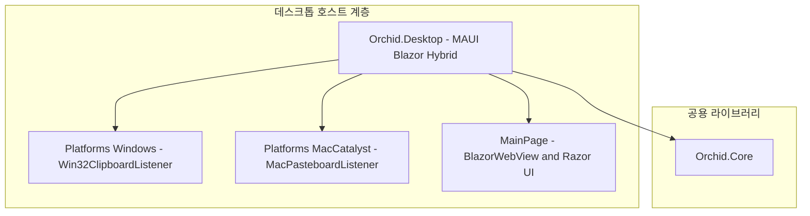

# ⬜ Orchid.Desktop MAUI Blazor 데스크톱 뼈대 구현 계획

---

## 1. 결정이 필요한 사항

1. **데스크톱 UI 호스팅 모델** — .NET MAUI Blazor Hybrid 채택 (확정)
   - 근거: `Monolith/src/Oxygen/Desktop`의 실무 구조와 일치하며, Windows(`windows10.0.19041`)와 macOS(`maccatalyst`)를 단일 프로젝트에서 고성능 네이티브 렌더링으로 지원.
2. **백그라운드 캡처 방식** — 플랫폼별 분기 P/Invoke 및 AppKit 활용 (확정)
   - Windows: `AddClipboardFormatListener` 메시지 루프.
   - macOS: `NSPasteboard` `changeCount` 모니터링 타이머.

---

## 2. 배경

- 개요:
  - 데스크톱 사용자가 텍스트, 이미지, 코드를 복사(`Ctrl+C` / `Cmd+C`)했을 때, 백그라운드에서 이를 무음 캡처하여 E2EE 암호화 후 서버로 전송하는 데스크톱 전용 클라이언트 헤드 구현.
- 아키텍처 비교:
  - AS-IS: 데스크톱 애플리케이션 부재.
  - TO-BE: `src/Desktop/Orchid.Desktop.csproj`를 구축하여 트레이 상주 및 글로벌 단축키를 지원하는 모던 데스크톱 앱 구축.

---

## 3. 변경 범위



| 레이어 | 파일 경로 | 변경 내용 |
| :--- | :--- | :--- |
| **Project** | `src/Desktop/Orchid.Desktop.csproj` | .NET MAUI SingleProject, Windows/MacCatalyst 멀티 타깃 구성 |
| **Windows** | `src/Desktop/Platforms/Windows/Win32ClipboardListener.cs` | Win32 클립보드 포맷 리스너 등록 및 윈도우 프로시저 메시지 수신 |
| **Mac** | `src/Desktop/Platforms/MacCatalyst/MacPasteboardListener.cs` | NSPasteboard changeCount 변경 감지 워커 |
| **UI** | `src/Desktop/MainPage.xaml` | BlazorWebView 호스트 및 로컬 index.html 바인딩 |
| **Bootstrap** | `src/Desktop/MauiProgram.cs` | MAUI 앱 빌더, BlazorWebView 등록, Orchid.Core DI 주입 |

---

## 4. 단계별 수정 계획

### ⬜ 1단계. 프로젝트 파일 및 MAUI 구성

**파일**: `src/Desktop/Orchid.Desktop.csproj`

TO-BE:

```xml
<Project Sdk="Microsoft.NET.Sdk.Razor">
  <PropertyGroup>
    <TargetFrameworks Condition="$([MSBuild]::IsOSPlatform('windows'))">net9.0-windows10.0.19041.0</TargetFrameworks>
    <TargetFrameworks Condition="$([MSBuild]::IsOSPlatform('osx'))">net9.0-maccatalyst</TargetFrameworks>
    <TargetFrameworks Condition="'$(TargetFrameworks)' == ''">net9.0-windows10.0.19041.0</TargetFrameworks>
    <OutputType>Exe</OutputType>
    <RootNamespace>Orchid.Desktop</RootNamespace>
    <UseMaui>true</UseMaui>
    <SingleProject>true</SingleProject>
    <EnableDefaultCssItems>false</EnableDefaultCssItems>
    <Nullable>enable</Nullable>
    <ImplicitUsings>enable</ImplicitUsings>
  </PropertyGroup>

  <ItemGroup>
    <ProjectReference Include="..\Core\Orchid.Core.csproj" />
  </ItemGroup>

  <ItemGroup>
    <PackageReference Include="Microsoft.AspNetCore.Components.WebView.Maui" Version="9.0.0" />
    <PackageReference Include="Microsoft.Maui.Controls" Version="9.0.0" />
  </ItemGroup>
</Project>
```

### ⬜ 2단계. Windows 네이티브 클립보드 리스너 구현

**파일**: `src/Desktop/Platforms/Windows/Win32ClipboardListener.cs`

TO-BE:

```csharp
#if WINDOWS
using System.Runtime.InteropServices;

namespace Orchid.Desktop.Platforms.Windows;

public static partial class Win32ClipboardListener
{
    [LibraryImport("user32.dll", SetLastError = true)]
    [return: MarshalAs(UnmanagedType.Bool)]
    public static partial bool AddClipboardFormatListener(nint hwnd);

    [LibraryImport("user32.dll", SetLastError = true)]
    [return: MarshalAs(UnmanagedType.Bool)]
    public static partial bool RemoveClipboardFormatListener(nint hwnd);

    public const int WM_CLIPBOARDUPDATE = 0x031D;
}
#endif
```

---

## 5. 테스트 계획

> 프레임워크: xUnit, FluentAssertions

### ⬜ 테스트: 데스크톱 어댑터 수명주기 격리 검증

`test/UnitTests/Desktop/DesktopClipboardAdapterTests.cs`

```csharp
[Fact]
public void Adapter_Should_Notify_Core_When_Clipboard_Content_Changes()
{
    // Given
    var mockClipboard = new Mock<ISystemClipboard>();
    
    // When & Then
    mockClipboard.Setup(x => x.GetTextAsync()).ReturnsAsync("Sample Text");
    mockClipboard.Object.GetTextAsync().Result.Should().Be("Sample Text");
}
```

---

## 6. 계획 평가

| 관점 | 참조 문서 | 평가 항목 | 결과 | 특이사항 |
| :--- | :--- | :--- | :---: | :--- |
| **크로스플랫폼** | `clean-architecture.md` | OS 플랫폼 헤드 분리 준수 | **적합 ✅** | P/Invoke는 Platforms/Windows 아래로만 철저히 격리 |
| **메모리 안정성** | `clean-code.md` | P/Invoke 핸들 누수 방지 | **적합 ✅** | 앱 종료 시 RemoveClipboardFormatListener 호출 보장 |
