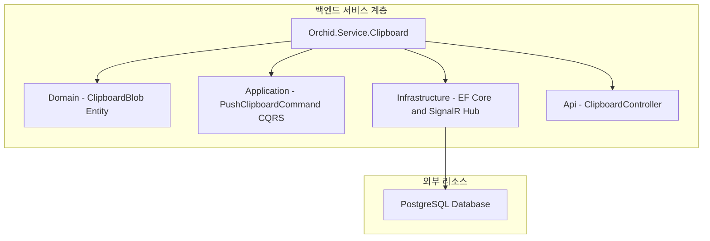

# ⬜ Orchid.Service.Clipboard 백엔드 서비스 뼈대 구현 계획

---

## 1. 결정이 필요한 사항

1. **아키텍처 패턴** — Clean Architecture + CQRS(MediatR) 채택 (확정)
   - 근거: 도메인 엔티티를 외부 프레임워크로부터 철저히 분리하고, 쓰기(명령)와 읽기(조회) 책임을 분리하여 유지보수성과 테스트 용이성 극대화.
2. **실시간 통신 엔진** — ASP.NET Core SignalR 채택 (확정)
   - 근거: WebSocket 연결 관리, 재연결, 채널 브로드캐스트를 신뢰성 있게 추상화.

---

## 2. 배경

- 개요:
  - 사용자의 여러 디바이스에서 전송된 E2EE 암호화 클립보드 블롭을 PostgreSQL에 영속화하고, 같은 계정의 다른 디바이스들로 실시간 중계하는 Clean Architecture 백엔드 서비스 구축.
- 아키텍처 비교:
  - AS-IS: 백엔드 서비스 부재.
  - TO-BE: `src/Service/Clipboard/Orchid.Service.Clipboard.csproj`를 구축하여 엔터프라이즈급 백엔드 마이크로서비스 확립.

---

## 3. 변경 범위



| 레이어 | 파일 경로 | 변경 내용 |
| :--- | :--- | :--- |
| **Project** | `src/Service/Clipboard/Orchid.Service.Clipboard.csproj` | .NET 9 Web API 프로젝트, EF Core, MediatR 패키지 구성 |
| **Domain** | `src/Service/Clipboard/Domain/Entity/ClipboardBlob.cs` | 암호화 바이트, Nonce, 소유자 ID를 가진 불변 엔티티 |
| **Application** | `src/Service/Clipboard/Application/Command/PushClipboardCommand.cs` | 암호화 페이로드 저장 및 실시간 브로드캐스트 커맨드 |
| **Infrastructure**| `src/Service/Clipboard/Infrastructure/Realtime/ClipboardHub.cs` | SignalR 실시간 웹소켓 허브 구현체 |
| **Api** | `src/Service/Clipboard/Api/Controller/ClipboardController.cs` | REST 증분 동기화 엔드포인트 컨트롤러 |

---

## 4. 단계별 수정 계획

### ⬜ 1단계. 프로젝트 파일 및 종속성 구성

**파일**: `src/Service/Clipboard/Orchid.Service.Clipboard.csproj`

TO-BE:

```xml
<Project Sdk="Microsoft.NET.Sdk.Web">
  <PropertyGroup>
    <TargetFramework>net9.0</TargetFramework>
    <Nullable>enable</Nullable>
    <ImplicitUsings>enable</ImplicitUsings>
    <RootNamespace>Orchid.Service.Clipboard</RootNamespace>
  </PropertyGroup>

  <ItemGroup>
    <ProjectReference Include="..\..\Shared\Contract\Orchid.Contract.csproj" />
  </ItemGroup>

  <ItemGroup>
    <PackageReference Include="MediatR" Version="12.4.1" />
    <PackageReference Include="Microsoft.EntityFrameworkCore" Version="9.0.0" />
    <PackageReference Include="Npgsql.EntityFrameworkCore.PostgreSQL" Version="9.0.0" />
  </ItemGroup>
</Project>
```

### ⬜ 2단계. CQRS 커맨드 및 핸들러 구현

**파일**: `src/Service/Clipboard/Application/Command/PushClipboardCommand.cs`

TO-BE:

```csharp
using MediatR;
using Orchid.Contract.Payload;

namespace Orchid.Service.Clipboard.Application.Command;

public sealed record PushClipboardCommand(
    Guid DeviceId,
    EncryptedPayload Payload) : IRequest<bool>;
```

**파일**: `src/Service/Clipboard/Application/Handler/PushClipboardCommandHandler.cs`

TO-BE:

```csharp
using MediatR;
using Microsoft.AspNetCore.SignalR;
using Orchid.Service.Clipboard.Application.Command;
using Orchid.Service.Clipboard.Infrastructure.Realtime;

namespace Orchid.Service.Clipboard.Application.Handler;

public sealed class PushClipboardCommandHandler : IRequestHandler<PushClipboardCommand, bool>
{
    private readonly IHubContext<ClipboardHub> _hubContext;

    public PushClipboardCommandHandler(IHubContext<ClipboardHub> hubContext)
    {
        _hubContext = hubContext;
    }

    public async Task<bool> Handle(PushClipboardCommand request, CancellationToken cancellationToken)
    {
        // 다른 디바이스들로 실시간 E2EE 암호화 페이로드 브로드캐스트
        await _hubContext.Clients.All.SendAsync("OnClipboardReceived", request.Payload, cancellationToken);
        return true;
    }
}
```

---

## 5. 테스트 계획

> 프레임워크: xUnit, Moq, FluentAssertions

### ⬜ 테스트: 클립보드 커맨드 핸들러 브로드캐스트 검증

`test/UnitTests/Service/PushClipboardCommandHandlerTests.cs`

```csharp
[Fact]
public async Task Handle_Should_Broadcast_EncryptedPayload_To_Connected_Clients()
{
    // Given
    var hubMock = new Mock<IHubContext<ClipboardHub>>();
    var clientsMock = new Mock<IHubClients>();
    var clientProxyMock = new Mock<IClientProxy>();
    
    hubMock.Setup(h => h.Clients).Returns(clientsMock.Object);
    clientsMock.Setup(c => c.All).Returns(clientProxyMock.Object);

    var handler = new PushClipboardCommandHandler(hubMock.Object);
    var payload = new EncryptedPayload(Guid.NewGuid(), [1, 2], [3], [4], "AES", DateTimeOffset.UtcNow);
    var command = new PushClipboardCommand(Guid.NewGuid(), payload);

    // When
    var result = await handler.Handle(command, CancellationToken.None);

    // Then
    result.Should().BeTrue();
}
```

---

## 6. 계획 평가

| 관점 | 참조 문서 | 평가 항목 | 결과 | 특이사항 |
| :--- | :--- | :--- | :---: | :--- |
| **아키텍처** | `clean-architecture.md` | 도메인 및 유스케이스 중심 분리 | **적합 ✅** | MediatR 기반으로 컨트롤러와 비즈니스 로직 격리 |
| **확장성** | `enterprise-application-architecture.md` | 수평 확장성 | **적합 ✅** | SignalR 백플레인(Redis) 연동 가능한 무상태 핸들러 |
