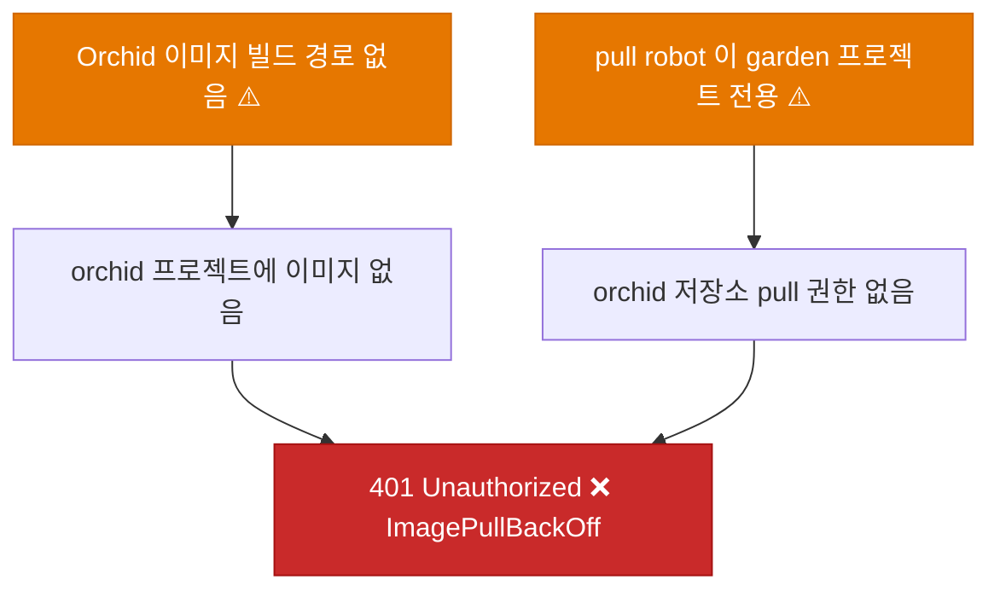
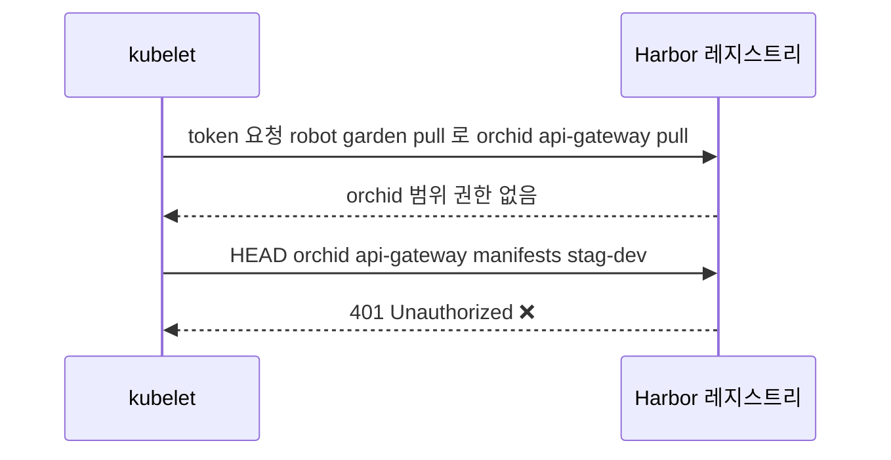
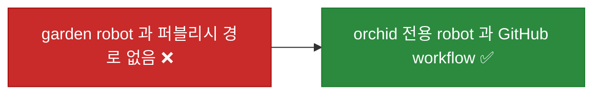
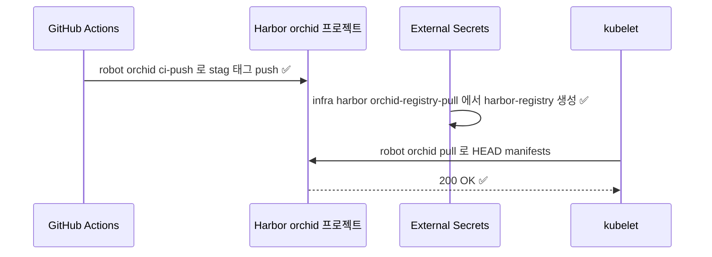
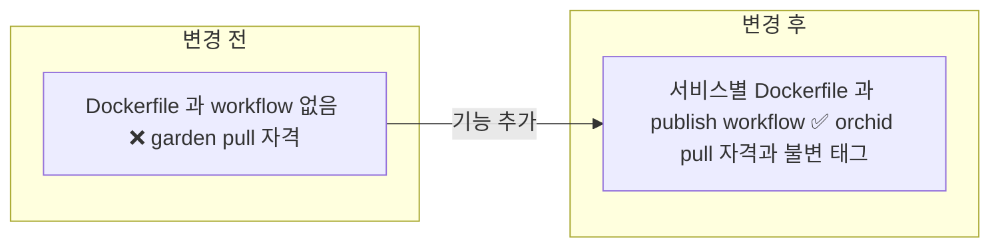
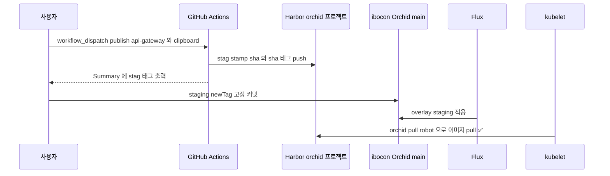

# ⬜ Orchid 서비스 이미지를 Harbor orchid 프로젝트로 퍼블리시하는 경로 구축

## 계획 관계

> **관계 스키마**: `1`
> **계획 ID**: `orchid:261014_feat_orchid-harbor-image-publish`
> **출처 판정**: `연결`

| 관계 | 대상 계획 ID | 조건 | 근거·인수 범위 |
| --- | --- | --- | --- |
| 파생 | `orchid:261014_fix_orchid-harbor-image-pull-secret` | 해당 없음 | 후속 검증 "이미지 존재", "경보 해소"를 인수한다. Harbor `orchid` 프로젝트 전용 robot, Dockerfile, GitHub workflow, overlay pull 자격 교체 |

## 결정이 필요한 사항

1. **Harbor 프로젝트** — 전용 `orchid` 프로젝트와 프로젝트 범위 robot 2개를 쓴다 (사용자 결정)
- 근거: Harbor에서 RBAC·quota·retention·스캔 정책의 경계는 프로젝트다. robot 계정은 프로젝트 범위 최소 권한으로 발급한다. `garden` 프로젝트를 같이 쓰면 Orchid CI가 Peony 이미지에 push할 수 있고, Garden pull robot이 Orchid 이미지를 읽게 된다. 매니페스트 이미지 이름(`harbor.hanul.botanicsoft.com/orchid/*`)도 이미 이 구조를 전제한다.
- 대안: `garden/orchid-*`로 퍼블리시한다. Harbor 변경은 없지만 소유권 경계가 섞여 채택하지 않았다.

2. **퍼블리시 경로** — `ibocon/Orchid` GitHub workflow로 퍼블리시한다 (사용자 결정)
- 근거: Peony와 같은 `workflow_dispatch` 방식이라 `dispatch-workflow` skill(`Invoke-WorkflowDispatch.ps1`)을 그대로 쓴다.
- 대안: 로컬 docker publish. push 자격이 개발 머신에 남아 채택하지 않았다.

3. **runner** — GitHub-hosted `ubuntu-latest`를 쓴다 (권장)
- 근거: Peony의 `hanul-linux`는 Hanul ARC runner(`arc-runners/arc-github-app`)로 BotanicSoft 조직용이다. `ibocon` 소유 저장소에 붙이려면 Garden.Cluster에 runner scale set을 추가해야 하는데, 이는 앱 전용 리소스를 Garden.Cluster에 두지 않는다는 원칙(`garden-harness:261014_harness_cluster-app-ownership-guard`)과 충돌한다. Harbor는 공인 IP(`harbor.hanul.botanicsoft.com` → `112.168.170.85`)로 응답하므로 GitHub-hosted runner에서 push할 수 있다.
- 대안: `hanul-linux` self-hosted runner. 빌드 캐시와 내부망 접근은 낫지만 위 이유로 채택하지 않는다.

4. **staging 이미지 태그** — workflow가 불변 태그 `stag-{yyyyMMddHHmmss}-{sha7}`와 `sha-{sha7}`를 push하고, overlay `newTag`를 그 불변 태그로 고정한다 (권장)
- 근거: 현재 overlay의 `stag-dev`는 움직이는 태그다. Deployment가 `imagePullPolicy: IfNotPresent`라 같은 태그로 다시 push해도 노드가 새 이미지를 받지 않는다. Peony도 `stag-{stamp}-{sha}` 불변 태그를 쓴다. 최초 반영은 수동 커밋으로 하고, Flux image automation 연결은 별도 계획으로 둔다.
- 대안: `stag-dev`를 유지하고 `imagePullPolicy: Always`로 바꾼다. 롤백 지점이 사라져 채택하지 않는다.

5. **Harbor 관리 작업 수행 주체** — 사용자가 수행한다 (사용자 판단 필요)
- 근거: 프로젝트·robot 생성에는 Harbor 관리자 인증이 필요하다. robot 토큰 등록은 OpenBao와 GitHub secret 등록을 거친다. 에이전트는 자격 증명을 입력하지 않는다. 사용자 절차는 Step 1에 적는다.

## 배경

### 현상

| 항목 | 확인 결과 (2026-10-14, Hanul `agents-mcp`) |
| --- | --- |
| Pod | `orchid-api-gateway`, `orchid-clipboard` 4개 Pod `ImagePullBackOff`, `401 Unauthorized` (pull secret 반영 후에도 동일) |
| pull 자격 | OpenBao `infra/harbor/registry-pull` = `robot$garden+garden-pull-flux-20260912153851` (`garden` 프로젝트 범위) |
| robot 가시 범위 | Harbor API `projects` → `garden`, `library`만 보임. `projects/orchid` → 403 |
| Orchid 퍼블리시 경로 | `.github/workflows` 없음, Dockerfile 없음, `.dockerignore` 없음 |
| 서비스 프로젝트 | `src/Service/ApiGateway/Orchid.ApiGateway.csproj`(Yarp), `src/Service/Clipboard/Orchid.Service.Clipboard.csproj`(→ `src/Shared/Contract`). 둘 다 `net10.0`, `/health` 노출, 포트 8080 |
| 앱 시크릿 | `app/stag/orchid/*` 등록 완료, ExternalSecret 2건 `Ready` |
| 경보 | `KubePodNotReady` ×2, `KubeDeploymentReplicasMismatch` ×2 firing |
| 병행 초안 | 같은 날 다른 세션이 작성한 미커밋 초안 `261014_feat_orchid-image-publish-pipeline`(로컬 PowerShell 퍼블리시)은 사용자 결정으로 이 계획이 정본이 되면서 철회됐다. 커밋·history 이력은 없다. 불변 태그 정책과 Harbor 작업 사용자 수행 결정은 이 계획과 같다 |

### 원인 분석





### 핵심 원인

1. 온보딩 계획이 매니페스트만 만들고 이미지 빌드·퍼블리시 경로를 만들지 않았다.
2. Harbor `orchid` 프로젝트용 robot이 없어 클러스터가 쓸 pull 자격이 `garden` 범위 robot뿐이다.
3. overlay 태그 `stag-dev`가 실제로 퍼블리시된 적 없는 움직이는 태그다.

### 수정 방안

Harbor `orchid` 프로젝트에 push·pull robot을 분리 발급한다. pull 자격은 OpenBao `infra/harbor/orchid-registry-pull`에 두고, Orchid overlay의 `harbor-registry` ExternalSecret이 이 key를 읽는다. 서비스별 Dockerfile과 `workflow_dispatch` workflow 2개로 불변 태그를 push한다. overlay `newTag`를 퍼블리시된 태그로 고정한다.





## 변경 범위



| 레이어 | 파일 | 변경 내용 |
| --- | --- | --- |
| Harbor·OpenBao·GitHub | (저장소 밖, 사용자 수행) | `orchid` 프로젝트, robot 2개, OpenBao `infra/harbor/orchid-registry-pull`, `ibocon/Orchid` Actions secret 3개 |
| 빌드 | `.dockerignore` | 신규. `bin/`, `obj/`, `.git`, `.env*`, `.secrets/`, `lib/` 제외 |
| 빌드 | `src/Service/ApiGateway/Dockerfile` | 신규. sdk 10.0 build → aspnet 10.0 final |
| 빌드 | `src/Service/Clipboard/Dockerfile` | 신규. `src/Shared/Contract` 포함 |
| CI | `.github/workflows/publish-api-gateway-image.yml` | 신규. `workflow_dispatch`, `ubuntu-latest`, Harbor push |
| CI | `.github/workflows/publish-clipboard-image.yml` | 신규. 동일 구조 |
| 배포 | `deploy/k8s/overlays/staging/harbor-registry-external-secret.yaml` | `remoteRef.key`를 `infra/harbor/orchid-registry-pull`로 교체 |
| 배포 | `deploy/k8s/overlays/production/harbor-registry-external-secret.yaml` | 동일 교체 |
| 배포 | `deploy/k8s/overlays/staging/kustomization.yaml` | `newTag`를 최초 퍼블리시 태그로 고정 |
| 테스트 | `test/Deploy/OrchidImagePublish.Tests.ps1` | 신규. Dockerfile·workflow·overlay 정적 검증 |
| 테스트 | `test/Deploy/OrchidManifestClusterCompat.Tests.ps1` | pull 자격 key 기대값을 `infra/harbor/orchid-registry-pull`로 갱신 |

Garden.Cluster는 변경하지 않는다.

## 주요 흐름



## 단계별 수정 계획

### ⬜ Step 1: Harbor·OpenBao·GitHub 자격 준비 (사용자 수행)

코드 변경 없음. 사용자가 아래 순서로 수행하고, 에이전트가 read-only로 결과를 확인한다.

1. Harbor UI(`https://harbor.hanul.botanicsoft.com`) → Projects → New Project `orchid` (Access Level: Private).
2. `orchid` → Robot Accounts에서 두 계정을 만든다.
   - `ci-push`: Repository `push`, `pull` / Artifact `read` / Tag `create`. GitHub Actions 전용.
   - `orchid-pull-flux`: Repository `pull`. 클러스터 전용.
3. pull robot 자격을 OpenBao에 넣는다. `.dockerconfigjson` 값은 `{"auths":{"harbor.hanul.botanicsoft.com":{"username":"robot$orchid+orchid-pull-flux","password":"<token>","auth":"<base64(username:token)>"}}}` 형식이다.

   ```bash
   bao kv put secret/infra/harbor/orchid-registry-pull .dockerconfigjson=@orchid-dockerconfig.json
   ```

4. `ibocon/Orchid` → Settings → Secrets and variables → Actions에 `HARBOR_REGISTRY`(`harbor.hanul.botanicsoft.com`), `HARBOR_USERNAME`(`robot$orchid+ci-push`), `HARBOR_PASSWORD`(토큰)를 등록한다.

에이전트 확인 (값은 출력하지 않는다):

```powershell
# robot 이름과 auths 호스트만 확인한다
$Json = bao kv get -format=json secret/infra/harbor/orchid-registry-pull | ConvertFrom-Json
($Json.data.data.'.dockerconfigjson' | ConvertFrom-Json).auths.PSObject.Properties.Name
gh secret list --repo ibocon/Orchid
```

### ⬜ Step 2: .dockerignore 추가

**파일**: `.dockerignore`

TO-BE:

```text
# ✅ 빌드 컨텍스트에서 산출물·비밀·서브모듈 제외
**/bin/
**/obj/
.git/
.env
.env.*
.secrets/
lib/
docs/
**/test/
```

### ⬜ Step 3: 서비스별 Dockerfile 추가

**파일**: `src/Service/ApiGateway/Dockerfile`

TO-BE:

```dockerfile
# ✅ Peony Dockerfile 구조를 따르되 Orchid 의존성만 복사한다
ARG DOTNET_VERSION=10.0

FROM mcr.microsoft.com/dotnet/sdk:${DOTNET_VERSION} AS build
ARG BUILD_CONFIGURATION=Release
WORKDIR /src
COPY ["Directory.Build.props", "."]
COPY ["src/Service/ApiGateway/Orchid.ApiGateway.csproj", "src/Service/ApiGateway/"]
RUN dotnet restore "src/Service/ApiGateway/Orchid.ApiGateway.csproj"

COPY ["src/Service/ApiGateway/", "src/Service/ApiGateway/"]
RUN dotnet publish "src/Service/ApiGateway/Orchid.ApiGateway.csproj" -c $BUILD_CONFIGURATION -o /app/publish --no-restore /p:UseAppHost=false

FROM mcr.microsoft.com/dotnet/aspnet:${DOTNET_VERSION} AS final
USER $APP_UID
WORKDIR /app
EXPOSE 8080
COPY --from=build /app/publish .
ENTRYPOINT ["dotnet", "Orchid.ApiGateway.dll"]
```

**파일**: `src/Service/Clipboard/Dockerfile`

TO-BE:

```dockerfile
# ✅ Clipboard 는 Shared/Contract 프로젝트 참조를 함께 복사한다
ARG DOTNET_VERSION=10.0

FROM mcr.microsoft.com/dotnet/sdk:${DOTNET_VERSION} AS build
ARG BUILD_CONFIGURATION=Release
WORKDIR /src
COPY ["Directory.Build.props", "."]
COPY ["src/Shared/Contract/Orchid.Contract.csproj", "src/Shared/Contract/"]
COPY ["src/Service/Clipboard/Orchid.Service.Clipboard.csproj", "src/Service/Clipboard/"]
RUN dotnet restore "src/Service/Clipboard/Orchid.Service.Clipboard.csproj"

COPY ["src/Shared/Contract/", "src/Shared/Contract/"]
COPY ["src/Service/Clipboard/", "src/Service/Clipboard/"]
RUN dotnet publish "src/Service/Clipboard/Orchid.Service.Clipboard.csproj" -c $BUILD_CONFIGURATION -o /app/publish --no-restore /p:UseAppHost=false

FROM mcr.microsoft.com/dotnet/aspnet:${DOTNET_VERSION} AS final
USER $APP_UID
WORKDIR /app
EXPOSE 8080
COPY --from=build /app/publish .
ENTRYPOINT ["dotnet", "Orchid.Service.Clipboard.dll"]
```

### ⬜ Step 4: publish workflow 추가

**파일**: `.github/workflows/publish-api-gateway-image.yml`

TO-BE:

```yaml
# ✅ Peony publish-*-image.yml 과 같은 dispatch 계약. runner 는 GitHub-hosted
name: publish-api-gateway-image

on:
  workflow_dispatch:
    inputs:
      ref:
        description: 'Git ref to build (branch, tag, or full SHA). Defaults to the dispatch ref.'
        required: false
        default: ''

permissions:
  contents: read

concurrency:
  group: publish-api-gateway-${{ github.event.inputs.ref || github.ref }}
  cancel-in-progress: false

jobs:
  publish:
    name: publish api-gateway
    runs-on: ubuntu-latest
    timeout-minutes: 30
    steps:
      - uses: actions/checkout@v5
        with:
          ref: ${{ github.event.inputs.ref || github.ref }}

      - name: Compute tags
        id: tags
        run: |
          SHORT_SHA="$(git rev-parse --short=7 HEAD)"
          BUILD_STAMP="$(date -u +%Y%m%d%H%M%S)"
          IMAGE="${{ secrets.HARBOR_REGISTRY }}/orchid/api-gateway"
          echo "tags=${IMAGE}:sha-${SHORT_SHA},${IMAGE}:stag-${BUILD_STAMP}-${SHORT_SHA}" >> "$GITHUB_OUTPUT"
          echo "stag-tag=stag-${BUILD_STAMP}-${SHORT_SHA}" >> "$GITHUB_OUTPUT"

      - uses: docker/setup-buildx-action@v4

      - name: Login to Harbor
        uses: docker/login-action@v4
        with:
          registry: ${{ secrets.HARBOR_REGISTRY }}
          username: ${{ secrets.HARBOR_USERNAME }}
          password: ${{ secrets.HARBOR_PASSWORD }}

      - name: Build and push
        uses: docker/build-push-action@v7
        with:
          context: .
          file: src/Service/ApiGateway/Dockerfile
          push: true
          tags: ${{ steps.tags.outputs.tags }}
          labels: |
            org.opencontainers.image.source=${{ github.server_url }}/${{ github.repository }}
            org.opencontainers.image.revision=${{ github.sha }}
          cache-from: type=gha,scope=api-gateway
          cache-to: type=gha,scope=api-gateway,mode=min,ignore-error=true
          provenance: false

      - name: Summary
        run: echo "Published staging tag ${{ steps.tags.outputs.stag-tag }}" >> "$GITHUB_STEP_SUMMARY"
```

**파일**: `.github/workflows/publish-clipboard-image.yml`

TO-BE: api-gateway와 같고 다음 값만 다르다.

```yaml
name: publish-clipboard-image
# concurrency.group: publish-clipboard-...
# IMAGE: ${{ secrets.HARBOR_REGISTRY }}/orchid/clipboard
# file: src/Service/Clipboard/Dockerfile
# cache scope: clipboard
```

### ⬜ Step 5: overlay pull 자격 key 교체

**파일**: `deploy/k8s/overlays/staging/harbor-registry-external-secret.yaml`

AS-IS:

```yaml
      remoteRef:
        key: infra/harbor/registry-pull
        property: .dockerconfigjson
```

TO-BE:

```yaml
      # ✅ orchid 프로젝트 전용 pull robot
      remoteRef:
        key: infra/harbor/orchid-registry-pull
        property: .dockerconfigjson
```

**파일**: `deploy/k8s/overlays/production/harbor-registry-external-secret.yaml`

AS-IS·TO-BE는 staging과 같다.

### ⬜ Step 6: staging 태그를 퍼블리시된 불변 태그로 고정

**파일**: `deploy/k8s/overlays/staging/kustomization.yaml`

AS-IS:

```yaml
images:
  - name: harbor.hanul.botanicsoft.com/orchid/api-gateway
    newTag: stag-dev
  - name: harbor.hanul.botanicsoft.com/orchid/clipboard
    newTag: stag-dev
```

TO-BE:

```yaml
# ✅ workflow Summary 의 stag-{stamp}-{sha} 태그. 퍼블리시 후 값을 채운다
images:
  - name: harbor.hanul.botanicsoft.com/orchid/api-gateway
    newTag: stag-<yyyyMMddHHmmss>-<sha7>
  - name: harbor.hanul.botanicsoft.com/orchid/clipboard
    newTag: stag-<yyyyMMddHHmmss>-<sha7>
```

## 테스트 계획

> 위치: `test/Deploy/`
> 프레임워크: Pester 5
> 패턴: Given/When/Then (Four-Phase Test). 정적 검사는 클러스터·네트워크 없이 실행하고, 이미지 빌드 스모크는 로컬 Docker로 push 없이 실행한다.

### ⬜ 테스트용 Stub 정의

**파일**: `test/Deploy/OrchidImagePublish.Tests.ps1`

```powershell
BeforeAll {
    $script:RepositoryRoot = (Resolve-Path -Path (Join-Path -Path $PSScriptRoot -ChildPath '../..')).Path
    $script:Services = @(
        @{ Name = 'api-gateway'; Dockerfile = 'src/Service/ApiGateway/Dockerfile'; Workflow = '.github/workflows/publish-api-gateway-image.yml' }
        @{ Name = 'clipboard'; Dockerfile = 'src/Service/Clipboard/Dockerfile'; Workflow = '.github/workflows/publish-clipboard-image.yml' }
    )

    function Get-RepositoryFile {
        [CmdletBinding()]
        param([Parameter(Mandatory)] [string] $RelativePath)

        return Get-Content -Raw -LiteralPath (Join-Path -Path $script:RepositoryRoot -ChildPath $RelativePath)
    }
}
```

### ⬜ 테스트: `OrchidImagePublish.Tests.ps1`

**파일**: `test/Deploy/OrchidImagePublish.Tests.ps1`

```powershell
Describe 'Orchid 이미지 퍼블리시 경로' {
    It 'Given <Name> 서비스, When workflow 확인, Then orchid 프로젝트로 불변 태그를 push 한다' -ForEach $script:Services {
        # Given
        $Workflow = Get-RepositoryFile -RelativePath $Workflow

        # When / Then
        $Workflow | Should -Match "/orchid/$Name"
        $Workflow | Should -Match 'stag-\$\{BUILD_STAMP\}-\$\{SHORT_SHA\}'
        $Workflow | Should -Match "file: $([regex]::Escape($Dockerfile))"
        $Workflow | Should -Not -Match 'hanul-linux'
    }

    It 'Given <Name> 서비스, When Dockerfile 확인, Then 8080 을 노출하고 비루트로 실행한다' -ForEach $script:Services {
        # Given
        $Content = Get-RepositoryFile -RelativePath $Dockerfile

        # When / Then
        $Content | Should -Match 'EXPOSE 8080'
        $Content | Should -Match 'USER \$APP_UID'
    }

    It 'Given <_> overlay, When 렌더링, Then harbor-registry 는 orchid 전용 pull 자격을 읽는다' -ForEach @('staging', 'production') {
        # Given
        $Manifest = (kubectl kustomize (Join-Path -Path $script:RepositoryRoot -ChildPath "deploy/k8s/overlays/$_")) -join "`n"

        # When / Then
        $Manifest | Should -Match 'key: infra/harbor/orchid-registry-pull'
        $Manifest | Should -Not -Match 'key: infra/harbor/registry-pull'
    }

    It 'Given staging overlay, When 렌더링, Then 움직이는 태그 stag-dev 를 쓰지 않는다' {
        # Given
        $Manifest = (kubectl kustomize (Join-Path -Path $script:RepositoryRoot -ChildPath 'deploy/k8s/overlays/staging')) -join "`n"

        # When
        $Tags = [regex]::Matches($Manifest, 'image: harbor\.hanul\.botanicsoft\.com/orchid/[^:]+:(\S+)') | ForEach-Object { $_.Groups[1].Value }

        # Then
        $Tags | Should -Not -Contain 'stag-dev'
        $Tags | ForEach-Object { $_ | Should -Match '^stag-\d{14}-[0-9a-f]{7}$' }
    }
}
```

**파일**: `test/Deploy/OrchidManifestClusterCompat.Tests.ps1`

AS-IS:

```powershell
        $Manifest | Should -Match 'remoteRef:\s+key: infra/harbor/registry-pull'
```

TO-BE:

```powershell
        # ✅ orchid 프로젝트 전용 pull 자격
        $Manifest | Should -Match 'remoteRef:\s+key: infra/harbor/orchid-registry-pull'
```

### 테스트 요약

| 테스트 클래스 | 검증 대상 | 테스트 수 |
| --- | --- | --- |
| `OrchidImagePublish.Tests.ps1` | workflow 2, Dockerfile 2, overlay pull 자격 2, staging 불변 태그 1 | 7 |
| `OrchidManifestClusterCompat.Tests.ps1` | 기존 8 (pull 자격 key 기대값 갱신) | 8 |
| **합계** | | **15** |

### 테스트 결과

| 범위 | 실행 명령 | 총 테스트 | 통과 | 실패 | 결과 |
| --- | --- | ---: | ---: | ---: | :---: |
| 수정 전 (Red) | `pwsh -NoProfile -Command "Invoke-Pester test/Deploy"` | — | — | — | ⬜ |
| 변경 범위 | `pwsh -NoProfile -Command "Invoke-Pester test/Deploy"` | — | — | — | ⬜ |
| 이미지 빌드 스모크 | `docker build -f src/Service/ApiGateway/Dockerfile .` / `docker build -f src/Service/Clipboard/Dockerfile .` (push 없음) | — | — | — | ⬜ |
| 전체 | `Test-KustomizationBuild.ps1 -KustomizationPath @('deploy/k8s/overlays/staging/kustomization.yaml','deploy/k8s/overlays/production/kustomization.yaml')` | — | — | — | ⬜ |

<!-- NOTE: Staging 수동 검증은 orchid:261014_verify_orchid-hanul-gitops-deployment 의 V2·V3 로 이관한다. -->

## 후속 검증

| 항목 | 내용 | 상태 |
| --- | --- | --- |
| 자격 준비 | Step 1 결과로 OpenBao `infra/harbor/orchid-registry-pull`의 auths 호스트와 `gh secret list`의 `HARBOR_*` 3개를 확인한다 | 미확인 |
| workflow 실행 | `Invoke-WorkflowDispatch.ps1`로 `publish-api-gateway-image.yml`, `publish-clipboard-image.yml`을 `main`에서 실행해 성공과 Summary 태그를 확인한다 | 미확인 |
| pull 자격 동기화 | `orchid-staging/harbor-registry`가 새 key로 `SecretSynced`인지 확인한다 | 미확인 |
| Pod 기동 | Step 6 푸시 후 Pod 2개 `Running 1/1`, `/health` 200을 확인한다. 앱 시크릿 `PLACEHOLDER` 외 필수 key가 있으면 이 단계에서 드러난다 | 미확인 |
| 경보 해소 | `KubePodNotReady`, `KubeDeploymentReplicasMismatch`가 resolved 되는지 Prometheus `ALERTS`로 확인한다. 확인 후 `orchid:261014_fix_orchid-harbor-image-pull-secret`의 "이미지 존재", "경보 해소"를 함께 닫는다 | 미확인 |
| production | production은 `namespaces "orchid" not found`로 아직 적용되지 않는다. 태그 승격은 `promote-environment` 범위 | 범위 밖 |

## 계획 평가

| 관점 | 참조 문서 | 평가 항목 | 결과 |
| --- | --- | --- | --- |
| 클린 코드 | `clean-code.md` | 이름/책임/오류 처리 | ✅ |
| 아키텍처 | `clean-architecture.md` | DIP/경계/응집도 | ✅ |
| 디자인 패턴 | `design-pattern.md` | 패턴 적절성 | 해당 없음 |
| 엔터프라이즈 패턴 | `enterprise-application-architecture.md` | 레이어링/분리 | 해당 없음 |
| 리팩토링 | `refactoring.md` | 코드 냄새/개선 기회 | ⚠️ |
| 테스트 품질 | `x-unit-test-patterns.md` | Four-Phase/Test Smell | ⚠️ |
| .NET 도메인·컨벤션 | `dotnet/docs/guide·convention` | 불변식 배치/캡슐화/도메인 이벤트/영속화 무지 | 해당 없음 |

**특이사항:**

- 아키텍처 ✅: Harbor 프로젝트·robot·OpenBao key가 모두 Orchid 전용이라 Garden 자산과 권한이 섞이지 않는다. Garden.Cluster 변경이 없다.
- 리팩토링 ⚠️: workflow 2개가 서비스 이름만 다르다. reusable workflow(`workflow_call`) 통합은 서비스가 늘 때 별도 `refac`으로 다룬다.
- 테스트 품질 ⚠️: workflow·Dockerfile 검증이 문자열 매칭이라 의미가 같은 다른 표기를 실패로 볼 수 있다. 실제 빌드는 이미지 빌드 스모크와 workflow 실행으로 보완한다.
- 보안: 에이전트는 robot 토큰을 보거나 입력하지 않는다. Step 1 확인 명령은 auths 호스트와 secret 이름만 출력한다.
- .NET 도메인·컨벤션 해당 없음: C# 코드 변경이 없다.

## 작업 순서

1. ⬜ Step 1: 사용자가 Harbor·OpenBao·GitHub 자격을 준비하고, 에이전트가 read-only로 확인한다.
2. ⬜ `OrchidImagePublish.Tests.ps1`을 작성하고 기존 테스트 기대값을 갱신해 실패(Red)를 확인한다.
3. ⬜ Step 2~4: `.dockerignore`, Dockerfile 2개, workflow 2개를 추가하고 로컬 `docker build` 스모크를 통과시킨다.
4. ⬜ Step 5: overlay pull 자격 key를 교체한다.
5. ⬜ 커밋·푸시 후 workflow 2개를 dispatch해 불변 태그를 얻는다.
6. ⬜ Step 6: staging `newTag`를 고정하고 Pester·`Test-KustomizationBuild.ps1`을 통과시킨 뒤 푸시한다.
7. ⬜ 후속 검증을 수행하고 `orchid:261014_fix_orchid-harbor-image-pull-secret`을 닫는다.
