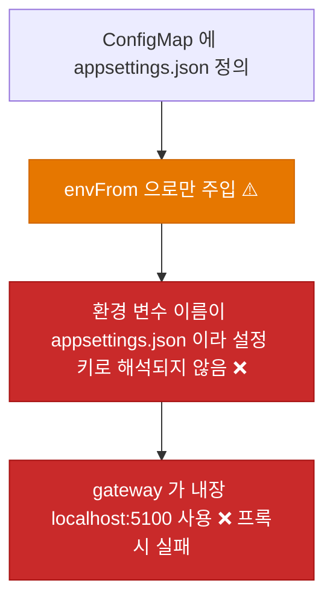
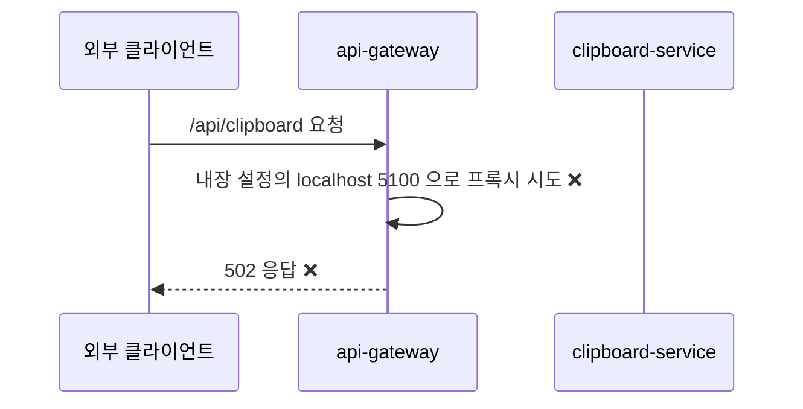
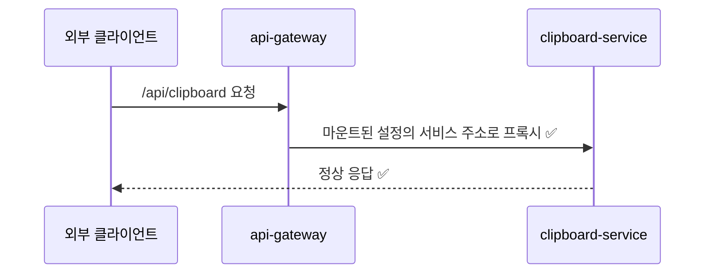
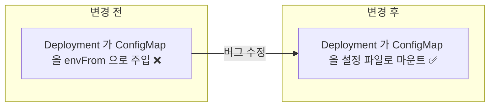

# ⬜ Orchid ConfigMap의 appsettings.json이 컨테이너에 적용되지 않아 gateway 프록시가 동작하지 않는 문제 수정

## 계획 관계

> **관계 스키마**: `1`
> **계획 ID**: `orchid:261014_fix_orchid-configmap-not-mounted`
> **출처 판정**: `연결`

| 관계 | 대상 계획 ID | 조건 | 근거·인수 범위 |
| --- | --- | --- | --- |
| 파생 | `orchid:261014_verify_orchid-hanul-gitops-deployment` | 해당 없음 | 이미지 pull 조사 중 발견한 설정 미적용 결함에서 분리한 작업. ConfigMap `appsettings.json`을 컨테이너 설정 파일로 적용하는 수정을 인수한다 |

<!-- plan-relations-summary:start -->
<!-- plan-relations-summary:end -->

## 결정이 필요한 사항

1. **적용 방식** — ConfigMap을 `/app/appsettings.json`에 파일로 마운트(subPath)해 이미지 내장 파일을 대체한다 (권장)
- 근거: ConfigMap이 설정의 단일 원본이 된다. 파일 경로가 고정돼 환경 이름(`ASPNETCORE_ENVIRONMENT`)에 의존하지 않는다. `ReverseProxy` 전체가 ConfigMap에 이미 정의돼 있어 대체해도 누락되는 키가 없다.
- 대안: 환경 변수 `ReverseProxy__Clusters__clipboard-cluster__Destinations__destination1__Address`로 한 값만 덮어쓴다. 매니페스트는 짧지만 ConfigMap의 나머지 내용(Logging, Routes)은 계속 사용되지 않아 원본이 둘로 갈라진다.

2. **적용 대상 서비스** — `api-gateway`와 `clipboard` 둘 다 적용한다 (권장)
- 근거: `clipboard`의 ConfigMap은 내용이 이미지 내장 설정과 같아 지금은 동작이 같다. 그러나 `envFrom.configMapRef`가 두 서비스에 똑같이 잘못 쓰이고 있어 함께 고치는 편이 일관된다.
- 대안: `api-gateway`만 고친다. 동작에는 충분하지만 `clipboard`에 무의미한 `envFrom`이 남는다.

3. **컨테이너 작업 디렉터리 전제** — 이미지의 `WORKDIR`가 `/app`이다 (확인 필요)
- 근거: 마운트 경로 `/app/appsettings.json`은 `orchid:261014_feat_orchid-harbor-image-publish`의 Dockerfile(`WORKDIR /app`)을 전제로 한다. 해당 계획서의 Dockerfile TO-BE가 `WORKDIR /app`이며, 이 이미지는 아직 만들어지지 않았다.
- 대안: 이미지 계획(`orchid:261014_feat_orchid-harbor-image-publish`)이 `WORKDIR`를 바꾸면 이 계획의 경로도 함께 바꾼다.

## 배경

### 현상

| 항목 | 확인 결과 (2026-10-14) |
| --- | --- |
| Deployment | `envFrom.configMapRef`로 ConfigMap을 주입하고 `volumeMounts`·`volumes`는 없음 |
| ConfigMap 키 | `appsettings.json`(JSON 문서). `envFrom`은 이 키를 이름이 `appsettings.json`인 환경 변수 하나로 만든다 |
| gateway 설정 | ConfigMap의 `clipboard-cluster` 주소는 `http://orchid-clipboard-service:8080` |
| 이미지 내장 설정 | `src/Service/ApiGateway/appsettings.json`의 같은 주소는 `http://localhost:5100` |
| 코드 | `ApiGateway/Program.cs`가 `builder.Configuration.GetSection("ReverseProxy")`로 프록시 설정을 읽는다 |

### 원인 분석





### 핵심 원인

1. `envFrom.configMapRef`는 ConfigMap의 각 키를 환경 변수로 만든다. `appsettings.json`은 JSON 파일 내용이라 환경 변수로는 ASP.NET 설정 키가 되지 않는다.
2. ConfigMap을 파일로 마운트하는 `volumes`·`volumeMounts`가 없어 앱이 이 파일을 읽을 방법이 없다.
3. 그 결과 gateway는 이미지에 내장된 `localhost:5100` 설정을 쓰고, 클러스터에서는 해당 주소에 서비스가 없다.

### 수정 방안

ConfigMap을 `/app/appsettings.json`에 subPath로 마운트하고 무의미한 `envFrom.configMapRef`를 제거한다. 시크릿(`secretRef`)은 그대로 둔다.




## 변경 범위



| 레이어 | 파일 | 변경 내용 |
| --- | --- | --- |
| base 워크로드 | `deploy/k8s/base/api-gateway/deployment.yaml` | `envFrom.configMapRef` 제거, ConfigMap 볼륨과 `/app/appsettings.json` 마운트 추가 |
| base 워크로드 | `deploy/k8s/base/clipboard/deployment.yaml` | 같은 변경 |
| 테스트 | `test/Deploy/OrchidConfigMount.Tests.ps1` | 렌더링 결과로 마운트와 서비스 주소 정합성을 검증 |

## 단계별 수정 계획

### ⬜ Step 1: api-gateway Deployment에 설정 파일 마운트

**파일**: `deploy/k8s/base/api-gateway/deployment.yaml`

AS-IS:

```yaml
# ❌ ConfigMap 을 환경 변수로만 주입한다. 파일로는 보이지 않는다
          envFrom:
            - configMapRef:
                name: orchid-api-gateway-config-map
            - secretRef:
                name: orchid-api-gateway-secret
```

TO-BE:

```yaml
# ✅ ConfigMap 은 설정 파일로 마운트하고 시크릿만 envFrom 으로 주입한다
          envFrom:
            - secretRef:
                name: orchid-api-gateway-secret
          volumeMounts:
            - name: app-settings
              mountPath: /app/appsettings.json
              subPath: appsettings.json
              readOnly: true
      volumes:
        - name: app-settings
          configMap:
            name: orchid-api-gateway-config-map
```

### ⬜ Step 2: clipboard Deployment에 설정 파일 마운트

**파일**: `deploy/k8s/base/clipboard/deployment.yaml`

AS-IS:

```yaml
# ❌ ConfigMap 을 환경 변수로만 주입한다
          envFrom:
            - configMapRef:
                name: orchid-clipboard-config-map
            - secretRef:
                name: orchid-clipboard-secret
```

TO-BE:

```yaml
# ✅ ConfigMap 은 설정 파일로 마운트하고 시크릿만 envFrom 으로 주입한다
          envFrom:
            - secretRef:
                name: orchid-clipboard-secret
          volumeMounts:
            - name: app-settings
              mountPath: /app/appsettings.json
              subPath: appsettings.json
              readOnly: true
      volumes:
        - name: app-settings
          configMap:
            name: orchid-clipboard-config-map
```

## 테스트 계획

> 위치: `test/Deploy/`
> 프레임워크: Pester 5
> 패턴: Given/When/Then (Four-Phase Test). 클러스터와 이미지 없이 `kubectl kustomize` 렌더링 결과만 사용한다.

### ⬜ 테스트용 Stub 정의

**파일**: `test/Deploy/OrchidConfigMount.Tests.ps1`

```powershell
BeforeAll {
    $script:RepositoryRoot = (Resolve-Path -Path (Join-Path -Path $PSScriptRoot -ChildPath '../..')).Path

    function Get-RenderedManifest {
        [CmdletBinding()]
        param(
            [Parameter(Mandatory)]
            [string] $Overlay
        )

        $Path = Join-Path -Path $script:RepositoryRoot -ChildPath "deploy/k8s/overlays/$Overlay"
        return (kubectl kustomize $Path) -join "`n"
    }
}
```

### ⬜ 테스트: `OrchidConfigMount.Tests.ps1`

**파일**: `test/Deploy/OrchidConfigMount.Tests.ps1`

```powershell
Describe 'Orchid ConfigMap 설정 파일 마운트' -ForEach @('staging', 'production') {
    It 'Given <_> overlay, When 렌더링, Then ConfigMap 을 envFrom 으로 주입하지 않는다' {
        # Given
        $Manifest = Get-RenderedManifest -Overlay $_

        # When
        $Injected = [regex]::Matches($Manifest, '(?m)^\s+- configMapRef:').Count

        # Then
        $Injected | Should -Be 0
    }

    It 'Given <_> overlay, When 렌더링, Then 모든 Deployment 가 /app/appsettings.json 을 subPath 로 마운트한다' {
        # Given
        $Manifest = Get-RenderedManifest -Overlay $_

        # When
        $Deployments = [regex]::Matches($Manifest, '(?m)^kind: Deployment$').Count
        $Mounts = [regex]::Matches($Manifest, '(?m)mountPath: /app/appsettings\.json\r?\n\s+name: app-settings\r?\n\s+readOnly: true\r?\n\s+subPath: appsettings\.json').Count

        # Then
        $Deployments | Should -BeGreaterThan 0
        $Mounts | Should -Be $Deployments
    }

    It 'Given <_> overlay, When 렌더링, Then gateway 의 clipboard 목적지가 렌더링된 Service 이름과 포트와 같다' {
        # Given
        $Manifest = Get-RenderedManifest -Overlay $_

        # When
        $Destination = [regex]::Match($Manifest, 'Address": "http://([a-z0-9-]+):(\d+)"')
        $ServiceName = $Destination.Groups[1].Value
        $ServicePort = $Destination.Groups[2].Value

        # Then
        $Manifest | Should -Match "(?m)^  name: $ServiceName\r?\n"
        $Manifest | Should -Match "port: $ServicePort"
    }
}
```

### 테스트 요약

| 테스트 클래스 | 검증 대상 | 테스트 수 |
| --- | --- | --- |
| `OrchidConfigMount.Tests.ps1` | overlay별 ConfigMap 비주입, 파일 마운트, 목적지 Service 정합성 | 6 |
| **합계** | | **6** |

### 테스트 결과

| 범위 | 실행 명령 | 총 테스트 | 통과 | 실패 | 결과 |
| --- | --- | ---: | ---: | ---: | :---: |
| 변경 범위 | `pwsh -NoProfile -Command "Invoke-Pester test/Deploy/OrchidConfigMount.Tests.ps1"` | — | — | — | ⬜ |
| 전체 | `pwsh -NoProfile -Command "Invoke-Pester test/Deploy"` | — | — | — | ⬜ |

**실행 일시**: 미실행

<!-- NOTE: 실기기(Android/iOS 디바이스) 조작이나 Staging 수동 검증은 여기에 작성할 수 없습니다. 필요한 경우 별도의 후속 verify 계획서(YYMMDD_verify_*.md)로 분리하십시오. -->

## 후속 검증

| 항목 | 내용 | 상태 |
| --- | --- | --- |
| 이미지 전제 | 마운트 경로 `/app/appsettings.json`이 실제 이미지의 `WORKDIR`와 맞는지 확인한다. 이미지는 `orchid:261014_feat_orchid-harbor-image-publish`에서 만들어진다 | 미확인 |
| 프록시 동작 | Pod가 기동한 뒤 gateway가 `/api/clipboard`를 clipboard 서비스로 프록시하는지 확인한다. 이미지와 클러스터가 필요해 사용자 실행 검증(`verify`)으로 분리한다 | 미확인 |

## 계획 평가

| 관점 | 참조 문서 | 평가 항목 | 결과 |
| --- | --- | --- | --- |
| 클린 코드 | `clean-code.md` | 이름/책임/오류 처리 | ✅ |
| 아키텍처 | `clean-architecture.md` | DIP/경계/응집도 | ✅ |
| 디자인 패턴 | `design-pattern.md` | 패턴 적절성 | 해당 없음 |
| 엔터프라이즈 패턴 | `enterprise-application-architecture.md` | 레이어링/분리 | 해당 없음 |
| 리팩토링 | `refactoring.md` | 코드 냄새/개선 기회 | ⚠️ |
| 테스트 품질 | `x-unit-test-patterns.md` | Four-Phase/Test Smell | ⚠️ |
| .NET 도메인·컨벤션 | `dotnet/docs/guide·convention` | 불변식 배치/캡슐화/도메인 이벤트/영속화 무지 | 해당 없음 |

**특이사항:**

- 리팩토링 ⚠️: 두 Deployment의 `volumes`와 `volumeMounts` 블록이 같은 모양으로 반복된다. Kustomize 패치로 줄일 수 있으나 이번에는 변경을 읽기 쉽게 base에 직접 둔다.
- 테스트 품질 ⚠️: 마운트 검증이 `kubectl kustomize` 출력의 키 정렬 순서(`mountPath`, `name`, `readOnly`, `subPath`)에 의존한다. kustomize 버전에 따라 출력 순서가 바뀌면 테스트를 함께 갱신해야 한다.
- 전제: 마운트 경로는 이미지 `WORKDIR /app`을 가정한다(결정 3). 이미지 계획과 어긋나면 경로를 함께 바꿔야 한다.
- .NET 도메인·컨벤션 해당 없음: C# 코드 변경이 없고 YAML과 PowerShell 테스트만 포함한다.

## 작업 순서

1. `test/Deploy/OrchidConfigMount.Tests.ps1`을 먼저 작성하고 실패(Red)를 확인한다.
2. Step 1: api-gateway Deployment를 수정한다.
3. Step 2: clipboard Deployment를 수정한다.
4. Pester와 `Test-KustomizationBuild.ps1`을 통과시킨다.
5. 이미지 퍼블리시 계획이 끝나 Pod가 기동하면 프록시 동작을 사용자 실행 검증으로 확인한다.
