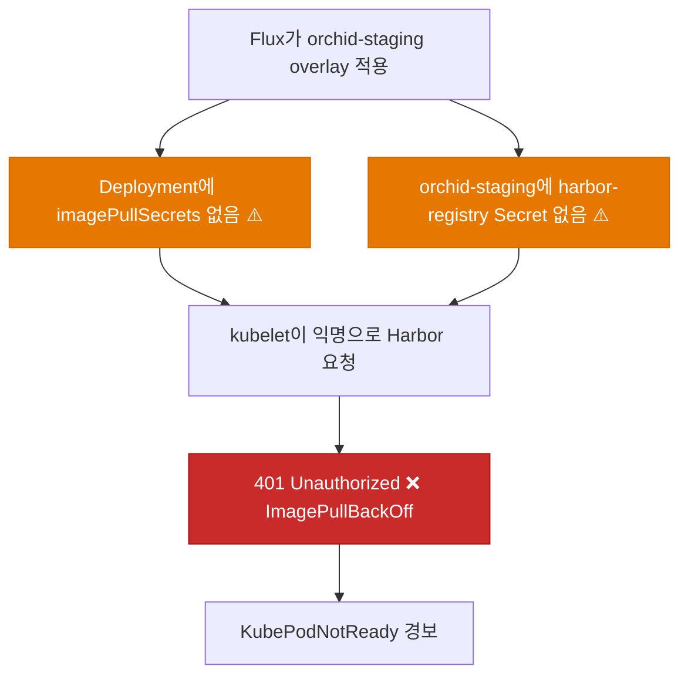
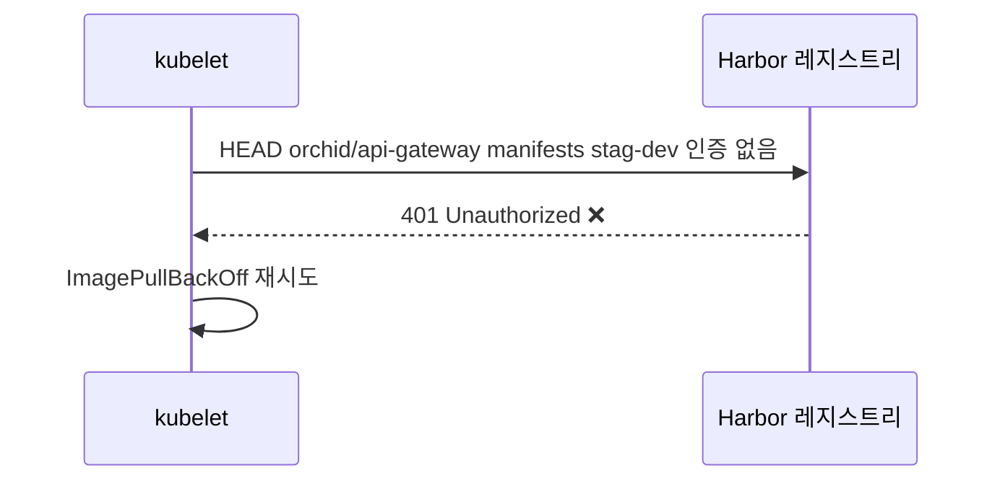
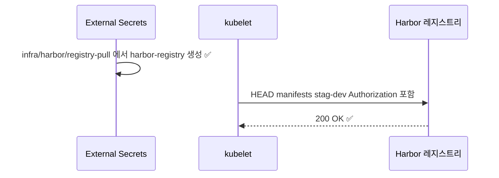
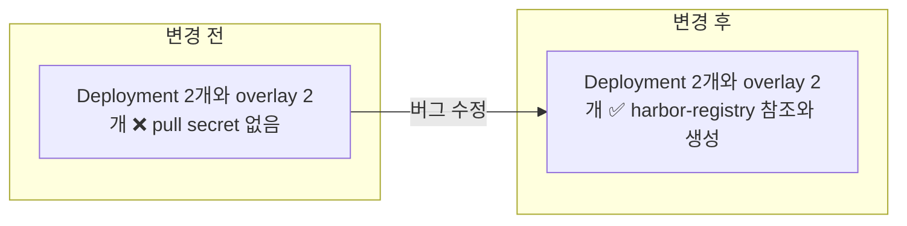

# ⬜ Orchid staging Pod가 Harbor 이미지 pull 인증 없이 ImagePullBackOff로 기동하지 못하는 문제 수정

## 계획 관계

> **관계 스키마**: `1`
> **계획 ID**: `orchid:261014_fix_orchid-harbor-image-pull-secret`
> **출처 판정**: `연결`

| 관계 | 대상 계획 ID | 조건 | 근거·인수 범위 |
| --- | --- | --- | --- |
| 파생 | `orchid:261014_verify_orchid-hanul-gitops-deployment` | 해당 없음 | V2 참고 관찰(Harbor `401 Unauthorized`, `imagePullSecrets` 없음)과 Alertmanager `KubePodNotReady`·`KubeDeploymentReplicasMismatch` 경보에서 분리한 작업. Harbor pull secret 배포와 Deployment 참조를 인수한다 |

## 결정이 필요한 사항

1. **pull secret 소유 위치** — Orchid overlay가 자기 네임스페이스의 `harbor-registry` ExternalSecret을 소유한다 (권장)
- 근거: Garden.Cluster는 `apps/overlays/staging/harbor-registry-external-secret.yaml`로 `garden-staging`에만 `harbor-registry`를 만든다. Orchid는 독립 저장소(`ibocon/Orchid`)에서 `orchid-staging`을 Flux로 적용하므로 같은 패턴을 Orchid overlay에 두면 소유 루트가 하나로 유지된다.
- 대안: Garden.Cluster에 `orchid-staging`용 ExternalSecret을 추가한다. 앱 매니페스트와 pull secret의 소유 저장소가 갈라진다.

2. **production overlay 동시 반영** — staging과 production 모두 반영한다 (권장)
- 근거: base Deployment에 `imagePullSecrets`를 넣으면 두 overlay가 같이 영향을 받는다. production은 `namespaces "orchid" not found`로 이미 실패 중이지만 네임스페이스가 생기면 같은 401로 다시 막힌다.
- 대안: staging만 반영한다. production은 별도 계획에서 다시 다뤄야 한다.

3. **OpenBao 앱 시크릿 `app/stag/orchid/*`** — 이 계획 범위에서 제외하고 사용자가 값을 입력한다 (사용자 판단 필요)
- 근거: pull이 통과해도 Deployment `envFrom.secretRef`(`optional: false`)가 `orchid-api-gateway-secret`, `orchid-clipboard-secret`을 요구한다. ExternalSecret 2건이 `Secret does not exist`로 실패 중이라 Pod는 `CreateContainerConfigError`로 한 번 더 막힌다.
- 대안: 없음. 값은 코드로 만들 수 없다.

## 배경

### 현상

2026-10-14 Alertmanager 경보 두 건을 받았다.

| 경보 | 대상 | 확인 결과 (2026-10-14 18:37 KST, Hanul `agents-mcp`) |
| --- | --- | --- |
| `ExternalSecretSyncFailing` (16:29) | `flux-system/orchid-deploy-key` (메트릭 label `namespace=external-secrets`는 ESO 컨트롤러 네임스페이스, 실제 리소스는 `exported_namespace=flux-system`) | 해소됨. ExternalSecret 리소스가 더 이상 없고 `ALERTS`에서 firing 아님. `orchid-application` GitRepository가 `https://github.com/ibocon/Orchid.git`(공개 HTTPS)로 바뀌어 deploy key가 필요 없어졌다. 조치 불필요 |
| `KubePodNotReady` ×2, `KubeDeploymentReplicasMismatch` ×2 (18:32) | `orchid-staging/orchid-api-gateway`, `orchid-clipboard` | firing 중. Pod 2개 `0/1 ImagePullBackOff` |

| 항목 | 확인 결과 |
| --- | --- |
| Pod 이벤트 | `Failed to pull image "harbor.hanul.botanicsoft.com/orchid/api-gateway:stag-dev": ... HEAD .../manifests/stag-dev: 401 Unauthorized` |
| Pod spec | `Service Account: default`, `imagePullSecrets` 없음 |
| `orchid-staging` ExternalSecret | `orchid-api-gateway-external-secret`, `orchid-clipboard-external-secret` 모두 `SecretSyncedError` (`Secret does not exist`). `harbor-registry` ExternalSecret 없음 |
| 형제 모듈(Peony) | `garden-staging/harbor-registry` ExternalSecret `SecretSynced` (OpenBao `infra/harbor/registry-pull`, `.dockerconfigjson`). Peony base Deployment는 `imagePullSecrets: [{name: harbor-registry}]` |
| 부가 관찰 | `orchid-production-controller` READY False: `namespaces "orchid" not found` (기존 결정, 범위 밖). `peony-application` GitRepository가 `peony-deploy-key` 없음으로 False (Peony 소관, 범위 밖) |

### 원인 분석





### 핵심 원인

1. Orchid base Deployment 2개에 `imagePullSecrets`가 없다. Peony는 모든 Deployment가 `harbor-registry`를 참조한다.
2. `orchid-staging` 네임스페이스에 Harbor pull 자격 Secret을 만드는 리소스가 없다. Garden.Cluster의 `harbor-registry` ExternalSecret은 `garden-*` 네임스페이스에만 적용된다.
3. 온보딩 계획이 Peony 매니페스트를 옮기면서 Garden.Cluster overlay가 소유하던 pull secret을 함께 옮기지 않았다.

### 수정 방안

Peony 패턴을 그대로 따른다. 각 overlay에 OpenBao `infra/harbor/registry-pull`을 읽는 `harbor-registry` ExternalSecret(`kubernetes.io/dockerconfigjson`)을 추가하고, base Deployment 2개에 `imagePullSecrets: harbor-registry`를 넣는다. 렌더링 테스트로 재발을 막는다.




## 변경 범위



| 레이어 | 파일 | 변경 내용 |
| --- | --- | --- |
| base | `deploy/k8s/base/api-gateway/deployment.yaml` | `imagePullSecrets: [{name: harbor-registry}]` 추가 |
| base | `deploy/k8s/base/clipboard/deployment.yaml` | `imagePullSecrets: [{name: harbor-registry}]` 추가 |
| staging | `deploy/k8s/overlays/staging/harbor-registry-external-secret.yaml` | 신규. OpenBao `infra/harbor/registry-pull` → `harbor-registry` |
| staging | `deploy/k8s/overlays/staging/kustomization.yaml` | resources에 신규 파일 추가 |
| production | `deploy/k8s/overlays/production/harbor-registry-external-secret.yaml` | 신규. staging과 동일 |
| production | `deploy/k8s/overlays/production/kustomization.yaml` | resources에 신규 파일 추가 |
| 테스트 | `test/Deploy/OrchidManifestClusterCompat.Tests.ps1` | Deployment `imagePullSecrets`와 `harbor-registry` ExternalSecret 렌더링 검증 추가 |

## 단계별 수정 계획

### ✅ Step 1: base Deployment에 imagePullSecrets 추가

**파일**: `deploy/k8s/base/api-gateway/deployment.yaml`

AS-IS:

```yaml
# ❌ 인증 없이 Harbor 요청
    spec:
      containers:
        - name: api-gateway
```

TO-BE:

```yaml
# ✅ Peony base Deployment와 같은 pull secret 참조
    spec:
      imagePullSecrets:
        - name: harbor-registry
      containers:
        - name: api-gateway
```

**파일**: `deploy/k8s/base/clipboard/deployment.yaml`

AS-IS:

```yaml
# ❌ 인증 없이 Harbor 요청
    spec:
      containers:
        - name: clipboard
```

TO-BE:

```yaml
# ✅ api-gateway 와 같은 pull secret 참조
    spec:
      imagePullSecrets:
        - name: harbor-registry
      containers:
        - name: clipboard
```

### ✅ Step 2: overlay에 harbor-registry ExternalSecret 추가

**파일**: `deploy/k8s/overlays/staging/harbor-registry-external-secret.yaml`

**파일**: `deploy/k8s/overlays/production/harbor-registry-external-secret.yaml` (staging과 동일 내용)

TO-BE:

```yaml
# ✅ Garden.Cluster apps/overlays/staging/harbor-registry-external-secret.yaml 과 같은 정의. namespace 는 overlay 가 지정
apiVersion: external-secrets.io/v1
kind: ExternalSecret
metadata:
  name: harbor-registry
spec:
  refreshInterval: 1h
  secretStoreRef:
    name: openbao
    kind: ClusterSecretStore
  target:
    name: harbor-registry
    creationPolicy: Owner
    template:
      type: kubernetes.io/dockerconfigjson
  data:
    - secretKey: .dockerconfigjson
      remoteRef:
        key: infra/harbor/registry-pull
        property: .dockerconfigjson
```

**파일**: `deploy/k8s/overlays/staging/kustomization.yaml`

**파일**: `deploy/k8s/overlays/production/kustomization.yaml` (staging과 동일 변경)

AS-IS:

```yaml
resources:
  - ../../base
  - external-secret.yaml
  - ingress.yaml
```

TO-BE:

```yaml
resources:
  - ../../base
  - external-secret.yaml
  - harbor-registry-external-secret.yaml
  - ingress.yaml
```

## 테스트 계획

> 위치: `test/Deploy/`
> 프레임워크: Pester 5
> 패턴: Given/When/Then (Four-Phase Test). 클러스터 접속 없이 `kubectl kustomize` 렌더링 결과만 사용한다.

### ✅ 테스트: `OrchidManifestClusterCompat.Tests.ps1`

**파일**: `test/Deploy/OrchidManifestClusterCompat.Tests.ps1` (기존 `Describe`에 추가)

```powershell
    It 'Given <_> overlay, When 렌더링, Then 모든 Deployment 가 harbor-registry 를 imagePullSecrets 로 참조한다' {
        # Given
        $Manifest = Get-RenderedManifest -Overlay $_

        # When
        $DeploymentCount = [regex]::Matches($Manifest, '(?m)^kind: Deployment$').Count
        $PullSecretCount = [regex]::Matches($Manifest, '(?m)^\s+imagePullSecrets:\r?\n\s+- name: harbor-registry$').Count

        # Then
        $PullSecretCount | Should -Be $DeploymentCount
    }

    It 'Given <_> overlay, When 렌더링, Then harbor-registry ExternalSecret 이 dockerconfigjson 으로 생성된다' {
        # Given
        $Manifest = Get-RenderedManifest -Overlay $_

        # When / Then
        $Manifest | Should -Match 'remoteRef:\s+key: infra/harbor/registry-pull'
        $Manifest | Should -Match 'type: kubernetes\.io/dockerconfigjson'
    }
```

### 테스트 요약

| 테스트 클래스 | 검증 대상 | 테스트 수 |
| --- | --- | --- |
| `OrchidManifestClusterCompat.Tests.ps1` | 기존 4 + overlay별 imagePullSecrets, harbor-registry ExternalSecret | 8 |
| **합계** | | **8** |

### 테스트 결과

| 범위 | 실행 명령 | 총 테스트 | 통과 | 실패 | 결과 |
| --- | --- | ---: | ---: | ---: | :---: |
| 수정 전 (Red) | `pwsh -NoProfile -Command "Invoke-Pester test/Deploy/OrchidManifestClusterCompat.Tests.ps1"` | 8 | 4 | 4 | ✅ 의도한 실패 |
| 변경 범위 | `pwsh -NoProfile -Command "Invoke-Pester test/Deploy/OrchidManifestClusterCompat.Tests.ps1"` | 8 | 8 | 0 | ✅ |
| 전체 | `Test-KustomizationBuild.ps1 -KustomizationPath @('deploy/k8s/overlays/staging/kustomization.yaml','deploy/k8s/overlays/production/kustomization.yaml')` | — | — | — | ✅ exit 0 |

**실행 일시**: 2026-10-14

<!-- NOTE: Staging 수동 검증은 orchid:261014_verify_orchid-hanul-gitops-deployment 의 V2 로 이관한다. -->

## 후속 검증

| 항목 | 내용 | 상태 |
| --- | --- | --- |
| pull secret 동기화 | 푸시 후 `orchid-staging/harbor-registry` ExternalSecret이 `SecretSynced`인지 확인한다 | 미확인 |
| 이미지 존재 | `orchid/api-gateway:stag-dev`, `orchid/clipboard:stag-dev`가 Harbor에 퍼블리시돼 있는지 확인한다. 익명 401은 존재 여부를 가리지 않아 현재 미검증이다. 없으면 pull secret 반영 후 `not found`로 바뀐다 | 미확인 |
| 앱 시크릿 | 결정 3에 따라 사용자가 `app/stag/orchid/api-gateway`, `app/stag/orchid/clipboard`를 등록해야 Pod가 `CreateContainerConfigError` 없이 기동한다 | 미충족 |
| 경보 해소 | `KubePodNotReady`, `KubeDeploymentReplicasMismatch`가 resolved 되는지 확인한다. 검증 계획 V2로 이관 | 미확인 |

## 계획 평가

| 관점 | 참조 문서 | 평가 항목 | 결과 |
| --- | --- | --- | --- |
| 클린 코드 | `clean-code.md` | 이름/책임/오류 처리 | ✅ |
| 아키텍처 | `clean-architecture.md` | DIP/경계/응집도 | ✅ |
| 디자인 패턴 | `design-pattern.md` | 패턴 적절성 | 해당 없음 |
| 엔터프라이즈 패턴 | `enterprise-application-architecture.md` | 레이어링/분리 | 해당 없음 |
| 리팩토링 | `refactoring.md` | 코드 냄새/개선 기회 | ⚠️ |
| 테스트 품질 | `x-unit-test-patterns.md` | Four-Phase/Test Smell | ✅ |
| .NET 도메인·컨벤션 | `dotnet/docs/guide·convention` | 불변식 배치/캡슐화/도메인 이벤트/영속화 무지 | 해당 없음 |

**특이사항:**

- 리팩토링 ⚠️: `harbor-registry` ExternalSecret이 두 overlay에 중복된다. 기존 계획과 같이 base 공통화는 별도 `refac` 계획에서 다룬다.
- .NET 도메인·컨벤션 해당 없음: C# 산출물이 없고 YAML과 PowerShell 테스트만 포함한다.

## 작업 순서

1. ✅ 테스트 2건을 먼저 추가하고 실패(Red)를 확인한다.
2. ✅ Step 1: base Deployment 2개에 `imagePullSecrets`를 추가한다.
3. ✅ Step 2: 두 overlay에 `harbor-registry` ExternalSecret을 추가한다.
4. ✅ Pester와 `Test-KustomizationBuild.ps1`을 통과시킨다.
5. ⬜ 푸시 후 `harbor-registry` 동기화와 이미지 pull을 확인하고 `orchid:261014_verify_orchid-hanul-gitops-deployment` V2로 이관한다.
