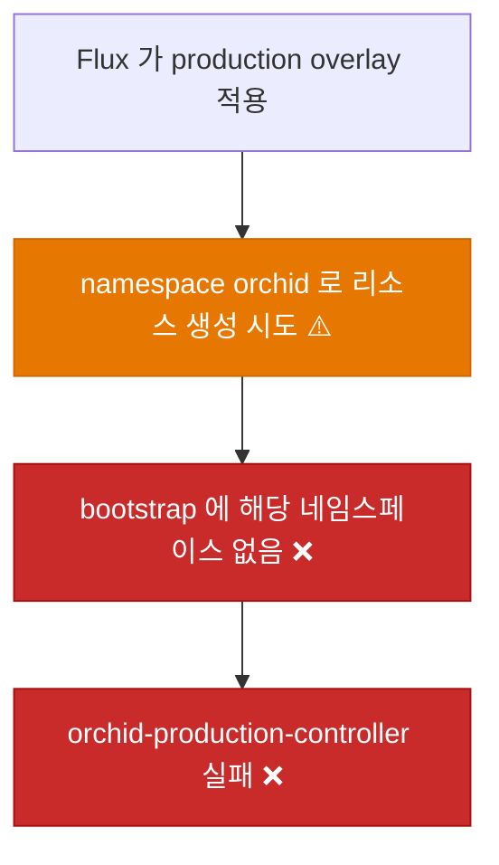
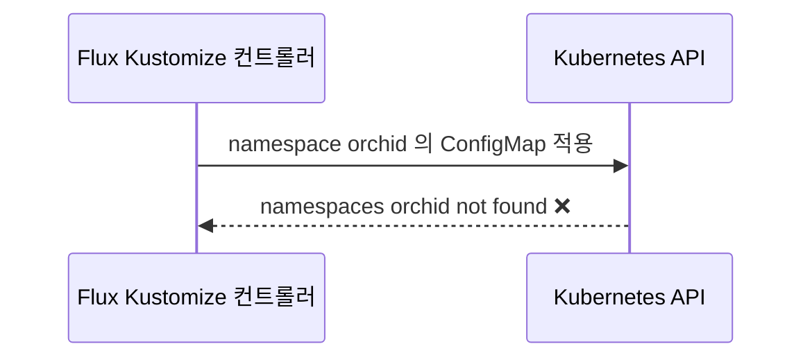
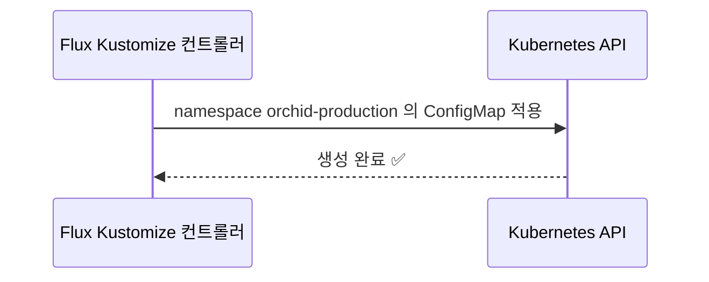
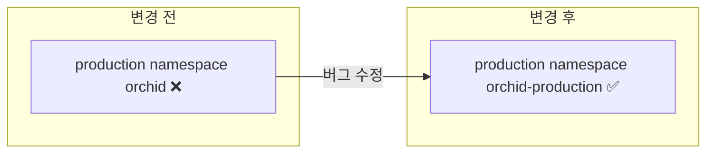

# ⬜ Orchid production overlay 네임스페이스가 클러스터에 없고 staging 이름 규칙과 달라 적용되지 않는 문제 수정

## 계획 관계

> **관계 스키마**: `1`
> **계획 ID**: `orchid:261014_fix_orchid-production-namespace-name`
> **출처 판정**: `연결`

| 관계 | 대상 계획 ID | 조건 | 근거·인수 범위 |
| --- | --- | --- | --- |
| 파생 | `orchid:261014_verify_orchid-hanul-gitops-deployment` | 해당 없음 | 검증 중 관찰한 `orchid-production-controller`의 `namespaces "orchid" not found`에서 분리한 작업. production overlay 네임스페이스 이름 정리를 인수한다 |

<!-- plan-relations-summary:start -->
<!-- plan-relations-summary:end -->

## 결정이 필요한 사항

1. **production 네임스페이스 이름** — `orchid-production`으로 바꾼다 (권장)
- 근거: staging은 `orchid-staging`이다. production만 일반 이름 `orchid`를 쓰면 이름 규칙이 비대칭이다. Garden.Cluster의 기존 앱도 `garden-staging`, `garden-production`으로 환경 접미사를 맞춘다. 네임스페이스는 Garden.Cluster `bootstrap/namespaces/`가 만든다.
- 대안: 이름 `orchid`를 유지하고 Garden.Cluster에만 `orchid` 네임스페이스를 추가한다. Orchid 변경은 없지만 일반 이름이 남고 환경 규칙이 깨진다.

2. **Garden.Cluster 선행 변경** — 이 계획과 별도로 Garden.Cluster에 `orchid-production` 네임스페이스와 ClusterSecretStore 허용을 먼저 추가한다 (필수)
- 근거: 이 계획만 반영하면 overlay가 가리키는 네임스페이스가 없어 계속 `not found`로 실패한다. 소유 저장소가 달라(`ibocon/Orchid`와 `BotanicSoft/Garden.Cluster`) 한 계획에 담지 않고 Garden.Cluster `ops` 계획(`garden-cluster:261014_ops_orchid-production-namespace`)으로 분리했다. 계획 간 관계는 저장소가 달라 관계 표에 연결하지 못하므로 이 문서에 기록한다.
- 대안: 두 변경을 한 계획에 넣는다. 소유 루트가 갈라져 owner-root 가드가 거부한다.

3. **production 이미지 태그와 OpenBao 시크릿** — 이 계획 범위에서 제외한다 (사용자 판단 필요)
- 근거: production overlay의 이미지 태그는 `prod-v1.0.0`이고 이 태그의 이미지는 만든 적이 없다. `app/prod/orchid/*` OpenBao 시크릿도 확인하지 못했다. 이미지 퍼블리시 계획(`orchid:261014_feat_orchid-harbor-image-publish`)은 staging 태그만 다루고 production 태그 승격은 범위 밖으로 둔다. production 승격 절차는 별도 계획이 필요하다.
- 대안: 이 계획에 포함한다. 네임스페이스 이름과 무관한 두 가지 선행 작업이 섞인다.

## 배경

### 현상

| 항목 | 확인 결과 (2026-10-14, Hanul `agents-mcp`) |
| --- | --- |
| `orchid-production-controller` | READY False: `ConfigMap/orchid/orchid-api-gateway-config-map not found: namespaces "orchid" not found` |
| production overlay | `deploy/k8s/overlays/production/kustomization.yaml`의 `namespace: orchid` |
| staging overlay | `namespace: orchid-staging` |
| Garden.Cluster bootstrap | `orchid-staging`은 있고 `orchid`와 `orchid-production`은 없음 |
| ClusterSecretStore 허용 | 목록에 `orchid-staging`만 있음 |

### 원인 분석





### 핵심 원인

1. production overlay가 bootstrap이 만들지 않는 네임스페이스 `orchid`를 쓴다.
2. staging(`orchid-staging`)과 production(`orchid`)의 이름 규칙이 달라, Garden.Cluster의 환경 접미사 관례와도 맞지 않는다.
3. ClusterSecretStore 허용 목록에 production 네임스페이스가 없어 ExternalSecret도 거부된다.

### 수정 방안

overlay 네임스페이스를 `orchid-production`으로 바꾼다. Garden.Cluster에서 같은 이름의 네임스페이스와 허용 항목을 추가하는 `ops` 계획이 선행돼야 효과가 난다.




## 변경 범위



| 레이어 | 파일 | 변경 내용 |
| --- | --- | --- |
| production 집계 | `deploy/k8s/overlays/production/kustomization.yaml` | `namespace`를 `orchid-production`으로 변경 |
| 테스트 | `test/Deploy/OrchidNamespaceConvention.Tests.ps1` | overlay별 네임스페이스 이름 규칙을 렌더링 결과로 검증 |

## 단계별 수정 계획

### ⬜ Step 1: production overlay 네임스페이스 이름 변경

**파일**: `deploy/k8s/overlays/production/kustomization.yaml`

AS-IS:

```yaml
# ❌ bootstrap 이 만들지 않는 일반 이름
apiVersion: kustomize.config.k8s.io/v1beta1
kind: Kustomization
namespace: orchid
```

TO-BE:

```yaml
# ✅ staging 과 같은 환경 접미사 규칙
apiVersion: kustomize.config.k8s.io/v1beta1
kind: Kustomization
namespace: orchid-production
```

## 테스트 계획

> 위치: `test/Deploy/`
> 프레임워크: Pester 5
> 패턴: Given/When/Then (Four-Phase Test). 클러스터 접속 없이 `kubectl kustomize` 렌더링 결과만 사용한다.

### ⬜ 테스트용 Stub 정의

**파일**: `test/Deploy/OrchidNamespaceConvention.Tests.ps1`

```powershell
BeforeAll {
    $script:RepositoryRoot = (Resolve-Path -Path (Join-Path -Path $PSScriptRoot -ChildPath '../..')).Path

    function Get-RenderedManifest {
        [CmdletBinding()]
        param(
            [Parameter(Mandatory)]
            [string] $Overlay
        )

        $Path = Join-Path -Path $script:RepositoryRoot -ChildPath "deploy/k8s/overlays/$Overlay"
        return (kubectl kustomize $Path) -join "`n"
    }
}
```

### ⬜ 테스트: `OrchidNamespaceConvention.Tests.ps1`

**파일**: `test/Deploy/OrchidNamespaceConvention.Tests.ps1`

```powershell
Describe 'Orchid overlay 네임스페이스 규칙' -ForEach @('staging', 'production') {
    It 'Given <_> overlay, When 렌더링, Then 모든 리소스 네임스페이스가 orchid-<환경> 하나다' {
        # Given
        $Manifest = Get-RenderedManifest -Overlay $_

        # When
        $Namespaces = [regex]::Matches($Manifest, '(?m)^  namespace: (\S+)$') |
            ForEach-Object { $_.Groups[1].Value } |
            Sort-Object -Unique

        # Then
        $Namespaces | Should -Be @("orchid-$_")
    }
}
```

### 테스트 요약

| 테스트 클래스 | 검증 대상 | 테스트 수 |
| --- | --- | --- |
| `OrchidNamespaceConvention.Tests.ps1` | overlay별 네임스페이스 이름 규칙 | 2 |
| **합계** | | **2** |

### 테스트 결과

| 범위 | 실행 명령 | 총 테스트 | 통과 | 실패 | 결과 |
| --- | --- | ---: | ---: | ---: | :---: |
| 변경 범위 | `pwsh -NoProfile -Command "Invoke-Pester test/Deploy/OrchidNamespaceConvention.Tests.ps1"` | — | — | — | ⬜ |
| 전체 | `pwsh -NoProfile -Command "Invoke-Pester test/Deploy"` | — | — | — | ⬜ |

**실행 일시**: 미실행

<!-- NOTE: 실기기(Android/iOS 디바이스) 조작이나 Staging 수동 검증은 여기에 작성할 수 없습니다. 필요한 경우 별도의 후속 verify 계획서(YYMMDD_verify_*.md)로 분리하십시오. -->

## 후속 검증

| 항목 | 내용 | 상태 |
| --- | --- | --- |
| Garden.Cluster 선행 | `garden-cluster:261014_ops_orchid-production-namespace`가 먼저 반영돼 `orchid-production` 네임스페이스와 ClusterSecretStore 허용이 있어야 한다 | 미확인 |
| Flux 적용 | 두 계획 반영 후 `orchid-production-controller`가 네임스페이스 오류 없이 다음 단계로 넘어가는지 확인한다 | 미확인 |
| production 이미지와 시크릿 | 결정 3에 따라 `prod-v1.0.0` 이미지와 `app/prod/orchid/*` 시크릿은 별도 계획에서 다룬다 | 미확인 |

## 계획 평가

| 관점 | 참조 문서 | 평가 항목 | 결과 |
| --- | --- | --- | --- |
| 클린 코드 | `clean-code.md` | 이름/책임/오류 처리 | ✅ |
| 아키텍처 | `clean-architecture.md` | DIP/경계/응집도 | ✅ |
| 디자인 패턴 | `design-pattern.md` | 패턴 적절성 | 해당 없음 |
| 엔터프라이즈 패턴 | `enterprise-application-architecture.md` | 레이어링/분리 | 해당 없음 |
| 리팩토링 | `refactoring.md` | 코드 냄새/개선 기회 | 해당 없음 |
| 테스트 품질 | `x-unit-test-patterns.md` | Four-Phase/Test Smell | ⚠️ |
| .NET 도메인·컨벤션 | `dotnet/docs/guide·convention` | 불변식 배치/캡슐화/도메인 이벤트/영속화 무지 | 해당 없음 |

**특이사항:**

- 테스트 품질 ⚠️: 테스트가 `kubectl kustomize` 출력의 `  namespace:` 들여쓰기 형식에 의존한다. 출력 형식이 바뀌면 테스트를 함께 갱신해야 한다.
- 계획 분리: 소유 저장소가 달라 Garden.Cluster 변경은 별도 `ops` 계획으로 분리했다. 그 계획이 먼저 반영돼야 이 계획의 효과가 난다.
- .NET 도메인·컨벤션 해당 없음: C# 산출물이 없고 YAML과 PowerShell 테스트만 포함한다.

## 작업 순서

1. `test/Deploy/OrchidNamespaceConvention.Tests.ps1`을 먼저 작성하고 실패(Red)를 확인한다.
2. Step 1: production overlay 네임스페이스를 변경한다.
3. Pester를 통과시킨다.
4. Garden.Cluster `ops` 계획 반영 후 푸시하고 `orchid-production-controller` 상태를 확인한다.
