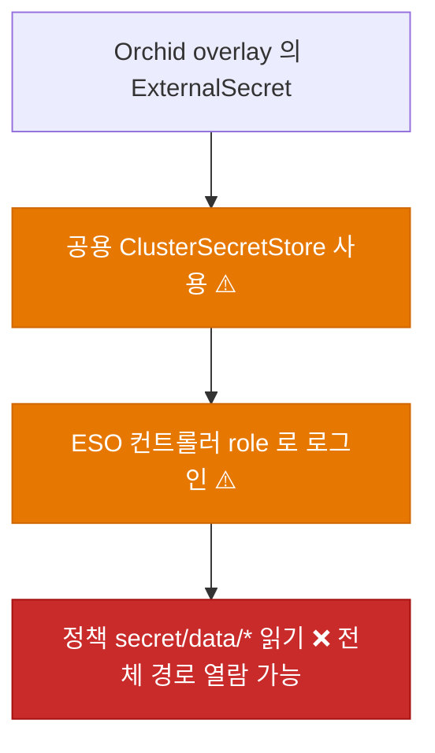
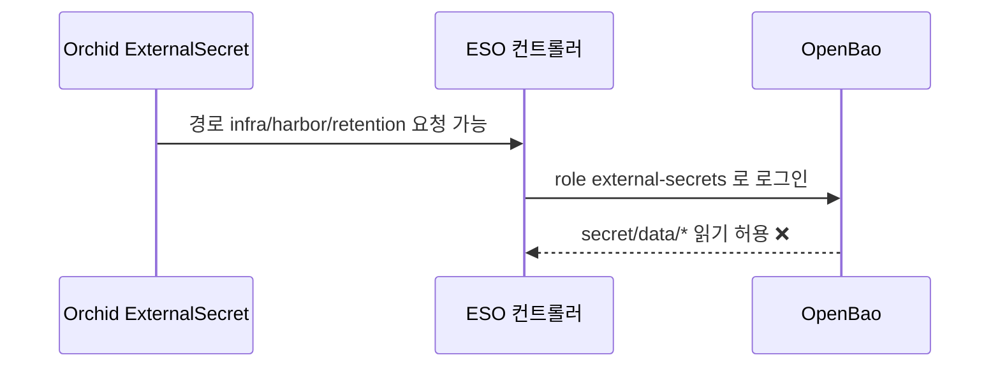
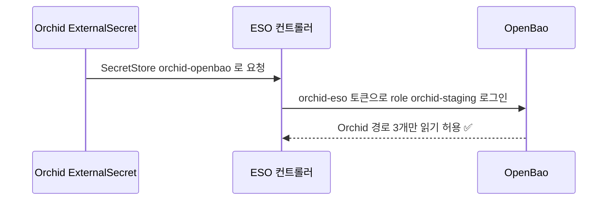
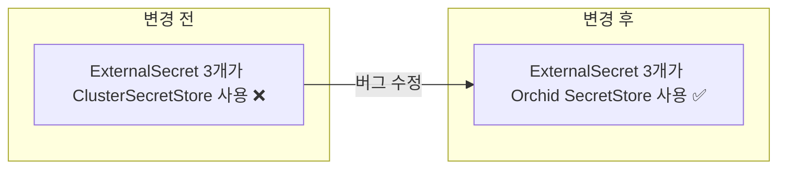

# ⬜ Orchid ExternalSecret이 공용 ClusterSecretStore로 OpenBao 전체를 읽을 수 있는 과권한 수정

## 계획 관계

> **관계 스키마**: `1`
> **계획 ID**: `orchid:261014_fix_orchid-secret-store-scope`
> **출처 판정**: `최초`
> **출처 판정 근거**: OpenBao `infra/harbor/` 구조 개선 논의 중 공용 ClusterSecretStore의 읽기 정책이 `secret/data/*` 전체이고 `orchid-staging`이 허용 네임스페이스에 들어 있음을 확인한 요청에서 독립적으로 시작했다. 같은 범위의 기존 Orchid 계획 파일은 확인되지 않았다.

| 관계 | 대상 계획 ID | 조건 | 근거·인수 범위 |
| --- | --- | --- | --- |
| 실행 의존 | `orchid:261014_feat_orchid-harbor-image-publish` | `plan-complete` | 두 계획이 같은 파일(`harbor-registry-external-secret.yaml`)의 `secretStoreRef`와 `key`를 바꾼다. 이미지 퍼블리시 계획의 Step 5가 끝난 뒤에 착수해 충돌을 피한다 |

<!-- plan-relations-summary:start -->
> 자동 생성 관계 요약. 원본은 위 관계 표입니다.

| 구분 | 계획·조건 |
| --- | --- |
| 최초 계획 | [⬜ Orchid ExternalSecret이 공용 ClusterSecretStore로 OpenBao 전체를 읽을 수 있는 과권한 수정](<261014_fix_orchid-secret-store-scope.md>) `orchid:261014_fix_orchid-secret-store-scope` |
| 직접 출처 | 없음 |
| 직접 후속 | 없음 |
| 계보 경로 | [⬜ Orchid ExternalSecret이 공용 ClusterSecretStore로 OpenBao 전체를 읽을 수 있는 과권한 수정](<261014_fix_orchid-secret-store-scope.md>) `orchid:261014_fix_orchid-secret-store-scope` |
| 실행 의존 | [✅ Orchid 서비스 이미지를 Harbor orchid 프로젝트로 퍼블리시하는 경로 구축](<../history/2610/W3/261014/261014_feat_orchid-harbor-image-publish.md>) `orchid:261014_feat_orchid-harbor-image-publish` — plan-complete |
| 착수 조건 | 가능 |
<!-- plan-relations-summary:end -->

## 결정이 필요한 사항

1. **읽기 범위를 줄이는 방식** — Orchid 네임스페이스 전용 `SecretStore`와 전용 OpenBao role·정책을 쓴다 (권장)
- 근거: 공용 `ClusterSecretStore/openbao`는 ESO 컨트롤러 ServiceAccount로 로그인하고 정책 `external-secrets`는 `secret/data/*` 읽기 한 줄이다. 허용 네임스페이스에 배포되는 ExternalSecret은 경로만 쓰면 어떤 키든(예: Harbor 관리자 자격 `infra/harbor/retention`) 읽을 수 있다. 개인 공개 저장소(`ibocon/Orchid`)가 소유한 매니페스트가 이 권한을 쓰는 구조다. 네임스페이스 전용 store는 그 네임스페이스의 ServiceAccount로 로그인하고, 그 role에 묶인 좁은 정책만 적용된다.
- 대안: 공용 store에서 `orchid-staging`만 빼고 Orchid가 OpenBao를 쓰지 않게 한다. 보안은 가장 단순하지만 Orchid가 필요한 시크릿 2종(앱 시크릿, Harbor pull)을 못 읽는다.

2. **클러스터 범위 권한의 소유** — `system:auth-delegator` 바인딩과 TokenRequest 권한은 Garden.Cluster `ops` 계획이 소유한다 (권장, 필수)
- 근거: OpenBao Kubernetes auth는 `token_reviewer_jwt`를 저장하지 않고 로그인하는 ServiceAccount의 JWT로 TokenReview를 수행하므로, 그 ServiceAccount에 `system:auth-delegator`(ClusterRoleBinding)가 필요하다. ESO 컨트롤러도 그 ServiceAccount의 토큰을 발급할 권한이 필요하다. 클러스터 범위 RBAC를 Orchid overlay가 스스로 만들면 개인 저장소가 자기 권한을 키울 수 있다. 따라서 이 계획은 ServiceAccount와 `SecretStore`만 만들고 RBAC와 OpenBao 정책·role은 `garden-cluster:261014_ops_orchid-eso-scoped-access`(Garden.Cluster)가 만든다. 두 저장소가 달라 계획 관계 표로 연결하지 못하므로 이 문서에 기록한다.
- 대안: Orchid overlay에 ClusterRoleBinding을 포함한다. 소유 저장소는 하나로 줄지만 위 권한 상승 문제로 채택하지 않는다.

3. **적용 범위** — staging overlay만 수정한다 (권장)
- 근거: production overlay는 네임스페이스(`orchid` 대 `orchid-production`)가 아직 정해지지 않았고 `app/prod/orchid/*`도 준비되지 않았다. production은 `orchid:261014_fix_orchid-production-namespace-name` 이후 같은 패턴으로 별도 적용한다.
- 대안: production까지 함께 수정한다. 네임스페이스가 없어 적용되지 않는 overlay를 미리 바꾸는 셈이 된다.

## 배경

### 현상

| 항목 | 확인 결과 (2026-10-14) |
| --- | --- |
| 공용 store | `ClusterSecretStore/openbao`가 Kubernetes auth role `external-secrets`(ServiceAccount `external-secrets/external-secrets`)로 로그인 |
| role 정책 | 문서(`infra/openbao/README.md`, `docs/openbao-secret-operations.md`)상 `path "secret/data/*" { capabilities = ["read"] }` 한 줄 |
| 허용 네임스페이스 | `platform/secret-distribution/cluster-secret-store.yaml`의 `conditions.namespaces`에 `orchid-staging` 포함 |
| Orchid ExternalSecret | `orchid-api-gateway-external-secret`, `orchid-clipboard-external-secret`, `harbor-registry` 모두 `secretStoreRef: ClusterSecretStore/openbao` |
| 실제 필요한 경로 | `app/stag/orchid/api-gateway`, `app/stag/orchid/clipboard`, `infra/harbor/orchid-registry-pull` 3개뿐 |

이 현상은 문서에 적힌 정책을 근거로 한 판단이며, 실제로 범위 밖 경로를 읽는 ExternalSecret을 만들어 시험하지는 않았다. 이 세션의 계정은 정책 목록 조회 권한이 없어 정책 본문을 직접 확인하지 못했다.

### 원인 분석





### 핵심 원인

1. 모든 허용 네임스페이스가 하나의 공용 store와 하나의 넓은 정책(`secret/data/*`)을 공유해, 네임스페이스별 읽기 범위 구분이 없다.
2. 허용 네임스페이스 목록은 어떤 네임스페이스가 store를 쓸 수 있는지만 정하고 어떤 경로를 읽을 수 있는지는 정하지 않는다.
3. Orchid 매니페스트를 개인 공개 저장소가 소유하므로, 그 저장소의 변경이 곧 OpenBao 전체 읽기 권한으로 이어진다.

### 수정 방안

Orchid 네임스페이스에 전용 ServiceAccount `orchid-eso`와 `SecretStore/orchid-openbao`를 만들고 Orchid의 ExternalSecret 3개가 이 store를 쓰게 한다. store는 OpenBao role `orchid-staging`으로 로그인하고, 그 role의 정책은 필요한 경로 3개에 대한 읽기만 허용한다. role·정책과 RBAC는 Garden.Cluster `ops` 계획이 만든다.




## 변경 범위



| 레이어 | 파일 | 변경 내용 |
| --- | --- | --- |
| 계정 | `deploy/k8s/overlays/staging/service-account.yaml` | ServiceAccount `orchid-eso` 신설 |
| store | `deploy/k8s/overlays/staging/secret-store.yaml` | `SecretStore/orchid-openbao` 신설. Kubernetes auth role `orchid-staging` |
| 앱 시크릿 | `deploy/k8s/overlays/staging/external-secret.yaml` | `secretStoreRef`를 `SecretStore/orchid-openbao`로 변경 (2개 문서) |
| pull 시크릿 | `deploy/k8s/overlays/staging/harbor-registry-external-secret.yaml` | `secretStoreRef`를 `SecretStore/orchid-openbao`로 변경 |
| 집계 | `deploy/k8s/overlays/staging/kustomization.yaml` | 신규 두 파일을 `resources`에 등록 |
| 테스트 | `test/Deploy/OrchidSecretStoreScope.Tests.ps1` | 렌더링 결과로 store 사용과 허용 경로를 검증 |

## 단계별 수정 계획

### ✅ Step 1: Orchid 전용 ServiceAccount와 SecretStore 추가

**파일**: `deploy/k8s/overlays/staging/service-account.yaml`

AS-IS:

```yaml
# ❌ 파일 없음. Orchid 네임스페이스에 OpenBao 로그인용 계정이 없다
```

TO-BE:

```yaml
# ✅ 네임스페이스는 kustomization 의 namespace 값이 채운다
apiVersion: v1
kind: ServiceAccount
metadata:
  name: orchid-eso
```

**파일**: `deploy/k8s/overlays/staging/secret-store.yaml`

AS-IS:

```yaml
# ❌ 파일 없음. 공용 ClusterSecretStore 에 의존한다
```

TO-BE:

```yaml
# ✅ 공용 store 와 같은 서버·경로·버전을 쓰고 role 과 계정만 Orchid 전용으로 바꾼다
apiVersion: external-secrets.io/v1
kind: SecretStore
metadata:
  name: orchid-openbao
spec:
  provider:
    vault:
      server: http://openbao.openbao.svc:8200
      path: secret
      version: v2
      auth:
        kubernetes:
          mountPath: kubernetes
          role: orchid-staging
          serviceAccountRef:
            name: orchid-eso
```

**파일**: `deploy/k8s/overlays/staging/kustomization.yaml`

AS-IS:

```yaml
# ❌ 신규 두 파일이 resources 에 없다
resources:
  - ../../base
  - external-secret.yaml
  - harbor-registry-external-secret.yaml
  - ingress.yaml
```

TO-BE:

```yaml
# ✅ 계정과 store 를 등록한다
resources:
  - ../../base
  - service-account.yaml
  - secret-store.yaml
  - external-secret.yaml
  - harbor-registry-external-secret.yaml
  - ingress.yaml
```

### ✅ Step 2: ExternalSecret이 전용 store를 쓰도록 변경

**파일**: `deploy/k8s/overlays/staging/external-secret.yaml`

AS-IS:

```yaml
# ❌ 두 문서 모두 공용 ClusterSecretStore 를 가리킨다
  secretStoreRef:
    kind: ClusterSecretStore
    name: openbao
```

TO-BE:

```yaml
# ✅ 두 문서 모두 Orchid 전용 store 를 가리킨다
  secretStoreRef:
    kind: SecretStore
    name: orchid-openbao
```

**파일**: `deploy/k8s/overlays/staging/harbor-registry-external-secret.yaml`

AS-IS:

```yaml
# ❌ 공용 ClusterSecretStore 를 가리킨다
  secretStoreRef:
    name: openbao
    kind: ClusterSecretStore
```

TO-BE:

```yaml
# ✅ Orchid 전용 store 를 가리킨다
  secretStoreRef:
    name: orchid-openbao
    kind: SecretStore
```

## 테스트 계획

> 위치: `test/Deploy/`
> 프레임워크: Pester 5
> 패턴: Given/When/Then (Four-Phase Test). 클러스터 접속 없이 `kubectl kustomize` 렌더링 결과만 사용한다.

### ⬜ 테스트용 Stub 정의

**파일**: `test/Deploy/OrchidSecretStoreScope.Tests.ps1`

```powershell
BeforeAll {
    $script:RepositoryRoot = (Resolve-Path -Path (Join-Path -Path $PSScriptRoot -ChildPath '../..')).Path
    # OpenBao 정책(garden-cluster:261014_ops_orchid-eso-scoped-access)이 허용하는 경로와 같은 목록이다
    $script:AllowedKeys = @(
        'app/stag/orchid/api-gateway'
        'app/stag/orchid/clipboard'
        'infra/harbor/orchid-registry-pull'
    )

    function Get-RenderedManifest {
        [CmdletBinding()]
        param(
            [Parameter(Mandatory)]
            [string] $Overlay
        )

        $Path = Join-Path -Path $script:RepositoryRoot -ChildPath "deploy/k8s/overlays/$Overlay"
        return (kubectl kustomize $Path) -join "`n"
    }
}
```

### ⬜ 테스트: `OrchidSecretStoreScope.Tests.ps1`

**파일**: `test/Deploy/OrchidSecretStoreScope.Tests.ps1`

```powershell
Describe 'Orchid staging 시크릿 읽기 범위' {
    It 'Given staging overlay, When 렌더링, Then ExternalSecret 은 ClusterSecretStore 를 쓰지 않는다' {
        # Given
        $Manifest = Get-RenderedManifest -Overlay 'staging'

        # When
        $Cluster = [regex]::Matches($Manifest, 'kind: ClusterSecretStore').Count

        # Then
        $Cluster | Should -Be 0
    }

    It 'Given staging overlay, When 렌더링, Then 모든 ExternalSecret 이 SecretStore orchid-openbao 를 가리킨다' {
        # Given
        $Manifest = Get-RenderedManifest -Overlay 'staging'

        # When
        $ExternalSecrets = [regex]::Matches($Manifest, '(?m)^kind: ExternalSecret$').Count
        $Scoped = [regex]::Matches($Manifest, '(?s)secretStoreRef:\s+kind: SecretStore\s+name: orchid-openbao|secretStoreRef:\s+name: orchid-openbao\s+kind: SecretStore').Count

        # Then
        $ExternalSecrets | Should -BeGreaterThan 0
        $Scoped | Should -Be $ExternalSecrets
    }

    It 'Given staging overlay, When 렌더링, Then SecretStore 는 Orchid 전용 role 과 ServiceAccount 를 쓴다' {
        # Given
        $Manifest = Get-RenderedManifest -Overlay 'staging'

        # When / Then
        $Manifest | Should -Match 'role: orchid-staging'
        $Manifest | Should -Match '(?s)serviceAccountRef:\s+name: orchid-eso'
        $Manifest | Should -Match '(?m)^kind: ServiceAccount\r?\nmetadata:\r?\n  name: orchid-eso'
    }

    It 'Given staging overlay, When 렌더링, Then 참조하는 OpenBao key 가 허용 경로 안에 있다' {
        # Given
        $Manifest = Get-RenderedManifest -Overlay 'staging'

        # When
        $Keys = [regex]::Matches($Manifest, '(?m)^\s+key: (\S+)$') |
            ForEach-Object { $_.Groups[1].Value } |
            Sort-Object -Unique

        # Then
        foreach ($Key in $Keys) {
            $script:AllowedKeys | Should -Contain $Key
        }
    }
}
```

### 테스트 요약

| 테스트 클래스 | 검증 대상 | 테스트 수 |
| --- | --- | --- |
| `OrchidSecretStoreScope.Tests.ps1` | ClusterSecretStore 미사용, 전용 store 참조, role과 ServiceAccount, 허용 key 경로 | 4 |
| **합계** | | **4** |

### 테스트 결과

| 범위 | 실행 명령 | 총 테스트 | 통과 | 실패 | 결과 |
| --- | --- | ---: | ---: | ---: | :---: |
| 변경 범위 | `pwsh -NoProfile -NonInteractive -Command "Invoke-Pester -Path 'test/Deploy/OrchidSecretStoreScope.Tests.ps1' -CI"` | 4 | 4 | 0 | ✅ |
| Kustomize 렌더링 | `pwsh -NoProfile -NonInteractive -File lib/Garden.Harness/src/kubernetes/guards/Test-KustomizationBuild.ps1 -RepositoryRoot . -ChangedPath deploy/k8s/overlays/staging` | — | — | 0 | ✅ |
| 기본 UnitTests | durable run `e9faac97b1bf436795bf050e6f02036b`: FigmaSync·PenpotSync (`Cost!=Expensive`) | 2 projects | 2 | 0 | ✅ |
| 전체 | `pwsh -NoProfile -NonInteractive -Command "Invoke-Pester -Path 'test/Deploy' -CI"` | 28 | 28 | 0 | ✅ |

**실행 일시**: 2026-10-15. 변경 범위 테스트와 Kustomize 렌더링은 통과했다. durable UnitTests run `e9faac97b1bf436795bf050e6f02036b`는 2026-10-15 16:11 KST에 exit 0으로 완료됐다. 전체 Pester(`test/Deploy`)는 2026-10-15 재실행해 28건 모두 통과했다.

<!-- NOTE: 실기기(Android/iOS 디바이스) 조작이나 Staging 수동 검증은 여기에 작성할 수 없습니다. 필요한 경우 별도의 후속 verify 계획서(YYMMDD_verify_*.md)로 분리하십시오. -->

## 후속 검증

| 항목 | 내용 | 상태 |
| --- | --- | --- |
| Garden.Cluster 선행 | `garden-cluster:261014_ops_orchid-eso-scoped-access`의 RBAC와 OpenBao role·정책이 먼저 반영돼야 한다. 순서는 (1) OpenBao 정책·role 생성(사용자), (2) RBAC 반영, (3) 이 계획 푸시, (4) 공용 store 허용 목록에서 `orchid-staging` 제거 | 부분 해소: Garden.Cluster에 RBAC(`bootstrap/secret-operator/orchid-staging-eso-rbac.yaml`) 선언은 반영됐다(커밋 `fc5f3010`). OpenBao 정책·role은 운영자 관리자 토큰이 필요한 사용자 작업이며 반영 여부 미확인 |
| 동기화 | 푸시 후 `SecretStore/orchid-openbao`가 `Valid`이고 ExternalSecret 3건이 `SecretSynced`인지 확인한다 | 선행 차단 |
| 범위 제한 | 전용 store로 허용 목록 밖 경로(예: `infra/harbor/retention`)를 읽으려는 ExternalSecret이 `permission denied`로 실패하는지 임시 ExternalSecret으로 확인한다. 확인 후 삭제한다 | 선행 차단 |
| ESO 지원 | 이 클러스터의 ESO가 네임스페이스 `SecretStore`와 `serviceAccountRef`를 허용하는지 확인한다. 막혀 있으면 이 계획의 전제가 달라진다 | 선행 차단 |

## 계획 평가

| 관점 | 참조 문서 | 평가 항목 | 결과 |
| --- | --- | --- | --- |
| 클린 코드 | `clean-code.md` | 이름/책임/오류 처리 | ✅ |
| 아키텍처 | `clean-architecture.md` | DIP/경계/응집도 | ✅ |
| 디자인 패턴 | `design-pattern.md` | 패턴 적절성 | 해당 없음 |
| 엔터프라이즈 패턴 | `enterprise-application-architecture.md` | 레이어링/분리 | 해당 없음 |
| 리팩토링 | `refactoring.md` | 코드 냄새/개선 기회 | ⚠️ |
| 테스트 품질 | `x-unit-test-patterns.md` | Four-Phase/Test Smell | ⚠️ |
| .NET 도메인·컨벤션 | `dotnet/docs/guide·convention` | 불변식 배치/캡슐화/도메인 이벤트/영속화 무지 | 해당 없음 |

**특이사항:**

- 보안 ✅: 읽기 범위가 `secret/data/*`에서 경로 3개로 줄고, 클러스터 범위 RBAC는 앱 저장소가 아니라 클러스터 소유 계획이 갖는다.
- 리팩토링 ⚠️: production overlay에도 같은 파일 4개가 필요하다. 네임스페이스가 확정되면 base로 올릴지 overlay별로 둘지 정한다.
- 테스트 품질 ⚠️: 허용 key 목록이 테스트와 OpenBao 정책 두 곳에 있어 한쪽만 바뀌면 어긋난다. 후속 개명(`orchid-registry-pull` 등) 때 두 곳을 함께 갱신해야 한다.
- 위험: store 전환 후 role·정책이 잘못되면 ExternalSecret이 `permission denied`로 멈춰 Pod가 시크릿을 못 받는다. 되돌리는 방법은 `secretStoreRef`를 `ClusterSecretStore/openbao`로 복원하는 것이며, 허용 목록 제거(마지막 단계) 전까지는 즉시 가능하다.
- .NET 도메인·컨벤션 해당 없음: C# 산출물이 없고 YAML과 PowerShell 테스트만 포함한다.

## 작업 순서

1. ✅ `test/Deploy/OrchidSecretStoreScope.Tests.ps1`을 먼저 작성하고 실패(Red)를 확인한다 (3건 실패).
2. ✅ Step 1: ServiceAccount와 `SecretStore`를 추가하고 집계에 등록한다.
3. ✅ Step 2: ExternalSecret 3개의 `secretStoreRef`를 바꾼다.
4. ✅ 변경 범위 Pester 4건, `Test-KustomizationBuild.ps1`, durable 기본 UnitTests run `e9faac97b1bf436795bf050e6f02036b`, 전체 Pester 28건이 모두 통과했다.
5. ✅ Garden.Cluster 선행 변경(RBAC 반영, OpenBao 정책·role 사용자 적용 완료 보고)을 확인했다. Orchid 변경은 커밋 `9be8c8e`로 `origin/main`에 이미 푸시돼 있다(2026-10-16 확인).
6. ⬜ 동기화와 범위 제한을 확인한 뒤 Garden.Cluster 허용 목록에서 `orchid-staging`을 제거한다.
