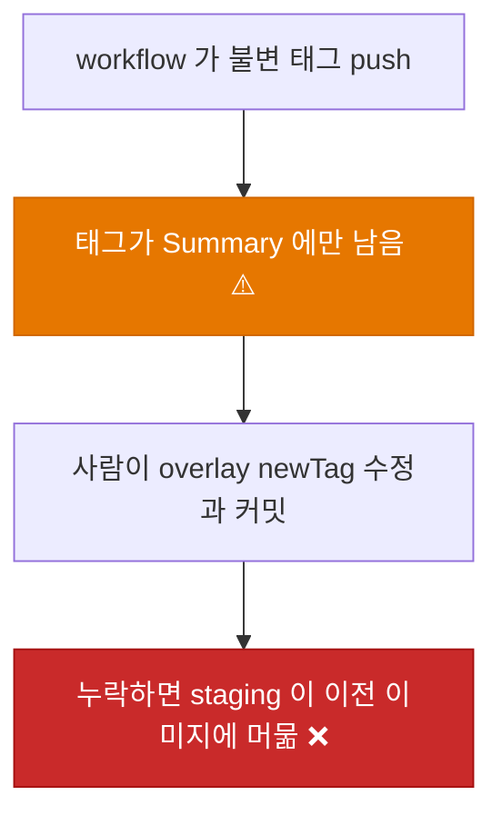
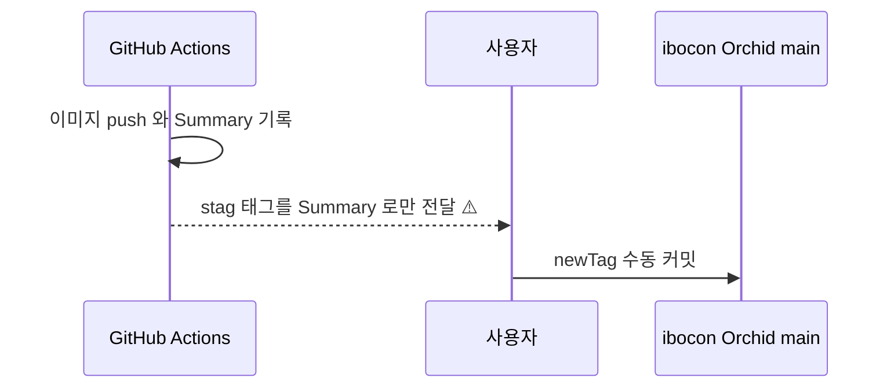
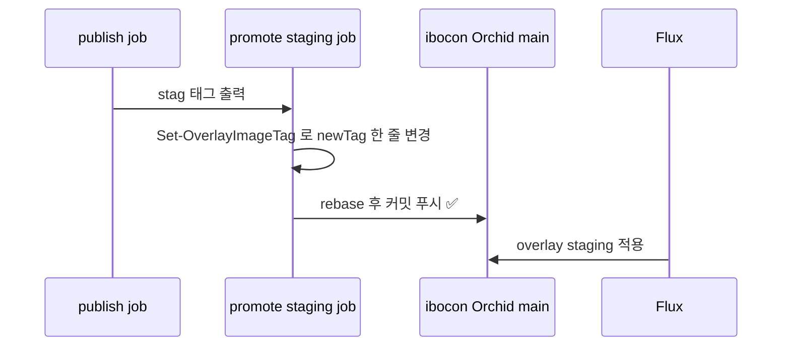
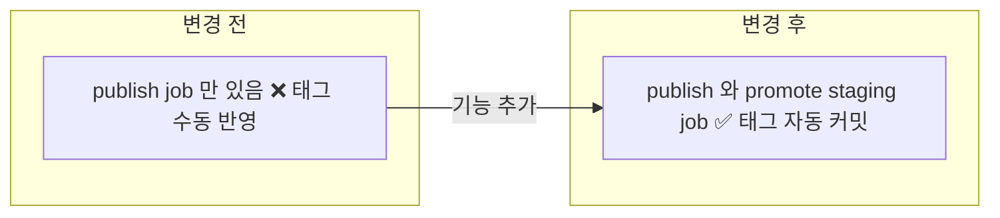
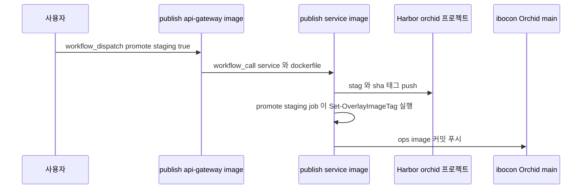

# ⬜ Orchid 이미지 퍼블리시 후 staging overlay 태그를 CI가 자동으로 갱신하는 경로 구축

## 계획 관계

> **관계 스키마**: `1`
> **계획 ID**: `orchid:261015_feat_orchid-staging-image-tag-automation`
> **출처 판정**: `연결`

| 관계 | 대상 계획 ID | 조건 | 근거·인수 범위 |
| --- | --- | --- | --- |
| 파생 | `orchid:261014_feat_orchid-harbor-image-publish` | 해당 없음 | 결정 4 "최초 반영은 수동 커밋, 자동화 연결은 별도 계획"을 인수한다. 퍼블리시마다 staging `newTag`를 손으로 고치는 작업을 없앤다 |
| 실행 의존 | `orchid:261015_refac_orchid-deploy-duplication` | `plan-complete` | 태그 갱신 job을 재사용 workflow `publish-service-image.yml` 하나에 추가한다. 재사용 workflow가 생긴 뒤에 착수한다 |

<!-- plan-relations-summary:start -->
> 자동 생성 관계 요약. 원본은 위 관계 표입니다.

| 구분 | 계획·조건 |
| --- | --- |
| 최초 계획 | [✅ Orchid 서비스 독립 GitOps 배포 매니페스트 구축 및 Hanul 온보딩 계획](<../history/2610/W3/261014/261014_ops_orchid-service-gitops-manifest-onboarding.md>) `orchid:261014_ops_orchid-service-gitops-manifest-onboarding` |
| 직접 출처 | [✅ Orchid 서비스 이미지를 Harbor orchid 프로젝트로 퍼블리시하는 경로 구축](<../history/2610/W3/261014/261014_feat_orchid-harbor-image-publish.md>) `orchid:261014_feat_orchid-harbor-image-publish` |
| 직접 후속 | [⬜ Orchid 재사용 publish workflow와 staging 태그 자동 갱신 사용자 실행 검증](<261015_verify_orchid-publish-workflow-and-tag-automation.md>) `orchid:261015_verify_orchid-publish-workflow-and-tag-automation` |
| 계보 경로 | [✅ Orchid 서비스 독립 GitOps 배포 매니페스트 구축 및 Hanul 온보딩 계획](<../history/2610/W3/261014/261014_ops_orchid-service-gitops-manifest-onboarding.md>) `orchid:261014_ops_orchid-service-gitops-manifest-onboarding` → [✅ Orchid 서비스 Hanul GitOps 배포 사용자 실행 검증](<../history/2610/W3/261014/261014_verify_orchid-hanul-gitops-deployment.md>) `orchid:261014_verify_orchid-hanul-gitops-deployment` → [✅ Orchid staging Pod가 Harbor 이미지 pull 인증 없이 ImagePullBackOff로 기동하지 못하는 문제 수정](<../history/2610/W3/261014/261014_fix_orchid-harbor-image-pull-secret.md>) `orchid:261014_fix_orchid-harbor-image-pull-secret` → [✅ Orchid 서비스 이미지를 Harbor orchid 프로젝트로 퍼블리시하는 경로 구축](<../history/2610/W3/261014/261014_feat_orchid-harbor-image-publish.md>) `orchid:261014_feat_orchid-harbor-image-publish` → [⬜ Orchid 이미지 퍼블리시 후 staging overlay 태그를 CI가 자동으로 갱신하는 경로 구축](<261015_feat_orchid-staging-image-tag-automation.md>) `orchid:261015_feat_orchid-staging-image-tag-automation` |
| 실행 의존 | [⬜ Orchid 배포 자산의 harbor-registry ExternalSecret 중복과 publish workflow 중복을 공통 정의로 정리](<261015_refac_orchid-deploy-duplication.md>) `orchid:261015_refac_orchid-deploy-duplication` — plan-complete |
| 파생 | [✅ Orchid 서비스 이미지를 Harbor orchid 프로젝트로 퍼블리시하는 경로 구축](<../history/2610/W3/261014/261014_feat_orchid-harbor-image-publish.md>) `orchid:261014_feat_orchid-harbor-image-publish` — 해당 없음 |
| 착수 조건 | 대기 |
<!-- plan-relations-summary:end -->

## 결정이 필요한 사항

1. **자동화 방식** — publish workflow가 퍼블리시 직후 staging overlay `newTag`를 `ibocon/Orchid` main에 커밋한다 (권장)
- 근거: Flux image automation(`ImageRepository`·`ImagePolicy`·`ImageUpdateAutomation`)은 클러스터가 Orchid 저장소에 쓰기 자격을 가져야 한다. 현재 `orchid-application` GitRepository는 공개 HTTPS 읽기 전용이라 deploy key·쓰기 자격이 새로 필요하다. Peony는 이 자원을 Garden.Cluster `infrastructure/image-automation`에 두지만, Orchid용 자원을 Garden.Cluster에 두는 것은 앱 소유권 원칙(`garden-harness:261014_harness_cluster-app-ownership-guard`)에 어긋난다. CI 방식은 태그를 정한 workflow가 같은 run에서 바로 커밋하므로 추가 자격과 클러스터 변경이 없다.
- 대안: Orchid overlay 안에 Flux image automation 자원을 두고 쓰기용 deploy key를 OpenBao로 배포한다. 레지스트리 polling 지연과 자격 관리가 늘어 채택하지 않는다.

2. **태그 갱신 범위** — staging만 자동 갱신한다. production 태그는 기존처럼 승격 절차로만 바꾼다 (권장)
- 근거: production은 `prod-v*` 고정 태그와 승인 단계(`promote-environment`)가 따로 있다.

3. **dispatch 시 갱신 여부** — 호출 workflow 입력 `promote-staging`(기본 `true`)으로 끌 수 있게 한다 (권장)
- 근거: 브랜치나 임시 ref를 빌드해 확인만 할 때 staging을 움직이지 않게 한다.

## 배경

### 현상

| 항목 | 현재 상태 (2026-10-15) |
| --- | --- |
| 퍼블리시 | `publish-*-image.yml`이 `stag-{yyyyMMddHHmmss}-{sha7}`·`sha-{sha7}`를 Harbor `orchid/*`에 push하고 Summary에 태그를 남긴다 |
| staging 반영 | 사람이 Summary 태그를 읽어 `deploy/k8s/overlays/staging/kustomization.yaml` `newTag`를 고치고 커밋한다(`22ec993`) |
| 저장소 설정 | `ibocon/Orchid` main 보호 규칙 없음. Actions 기본 workflow 권한 `read` |
| 테스트 계약 | `OrchidImagePublish.Tests.ps1`이 staging 태그가 `^stag-\d{14}-[0-9a-f]{7}$`인지 검사한다 |

### 원인 분석





### 핵심 원인

1. publish workflow가 태그를 정하지만 그 값을 배포 정의에 반영하는 단계가 없다.
2. Orchid에는 Flux image automation이 없고, 앱 소유권 원칙상 Garden.Cluster에 둘 수도 없다.

### 수정 방안

재사용 workflow에 `promote-staging` job을 추가한다. publish job의 `stag-tag` 출력을 받아 `deploy/scripts/Set-OverlayImageTag.ps1`로 staging overlay의 해당 이미지 `newTag` 한 줄만 바꾸고 커밋·푸시한다. 두 서비스가 동시에 끝나도 충돌하지 않도록 job concurrency를 하나로 묶고 push 전에 rebase를 재시도한다.




## 변경 범위



| 레이어 | 파일 | 변경 내용 |
| --- | --- | --- |
| 스크립트 | `deploy/scripts/Set-OverlayImageTag.ps1` | 신규. overlay `images[].newTag` 한 줄을 검증 후 변경 |
| CI | `.github/workflows/publish-service-image.yml` | `promote-staging` job과 `promote-staging` 입력 추가 |
| CI | `.github/workflows/publish-api-gateway-image.yml` | `promote-staging` dispatch 입력 전달, `contents: write` 권한 |
| CI | `.github/workflows/publish-clipboard-image.yml` | 동일 |
| 테스트 | `test/Deploy/SetOverlayImageTag.Tests.ps1` | 신규. 스크립트 동작 |
| 테스트 | `test/Deploy/OrchidImagePublish.Tests.ps1` | promote job 계약 검증 추가 |

## 주요 흐름



## 단계별 수정 계획

### ⬜ Step 1: overlay 태그 변경 스크립트

**파일**: `deploy/scripts/Set-OverlayImageTag.ps1`

TO-BE:

```powershell
#!/usr/bin/env pwsh
#requires -Version 7.0

<#
.SYNOPSIS
    Kustomize overlay 의 images 항목 하나의 newTag 를 바꾼다.

.DESCRIPTION
    kustomization.yaml 의 images 목록에서 name 이 Image 와 같은 항목의 newTag 한 줄만 바꾼다.
    Tag 형식이 맞지 않거나 Image 항목이 없으면 파일을 바꾸지 않고 실패한다.
    이미 같은 태그면 파일을 쓰지 않고 Unchanged 를 출력한다.

.PARAMETER KustomizationPath
    대상 kustomization.yaml 경로.

.PARAMETER Image
    images[].name 값.

.PARAMETER Tag
    새 태그. staging 불변 태그 형식만 허용한다.
#>

[CmdletBinding(SupportsShouldProcess)]
param(
    [Parameter(Mandatory)]
    [string] $KustomizationPath,

    [Parameter(Mandatory)]
    [ValidatePattern('^[a-z0-9.-]+/[a-z0-9._/-]+$')]
    [string] $Image,

    [Parameter(Mandatory)]
    [ValidatePattern('^stag-\d{14}-[0-9a-f]{7}$')]
    [string] $Tag
)

Set-StrictMode -Version Latest
$ErrorActionPreference = 'Stop'

try {
    $Path = (Resolve-Path -LiteralPath $KustomizationPath).Path
    $Content = [System.IO.File]::ReadAllText($Path)
    $Pattern = '(?m)^(\s*-\s*name:\s*{0}\s*\r?\n\s*newTag:\s*)(\S+)' -f [regex]::Escape($Image)
    $Match = [regex]::Match($Content, $Pattern)
    if (-not $Match.Success) {
        throw "images 에 $Image 항목이 없다: $KustomizationPath"
    }

    if ($Match.Groups[2].Value -eq $Tag) {
        Write-Output "Unchanged $Image $Tag"
        exit 0
    }

    if ($PSCmdlet.ShouldProcess($KustomizationPath, "Set $Image newTag $Tag")) {
        $Updated = $Content.Substring(0, $Match.Groups[2].Index) + $Tag + $Content.Substring($Match.Groups[2].Index + $Match.Groups[2].Length)
        [System.IO.File]::WriteAllText($Path, $Updated)
    }

    Write-Output "Updated $Image $($Match.Groups[2].Value) -> $Tag"
    exit 0
}
catch {
    Write-Error -Message $_.Exception.Message -ErrorAction Continue
    exit 1
}
```

### ⬜ Step 2: 재사용 workflow에 promote-staging job 추가

**파일**: `.github/workflows/publish-service-image.yml`

AS-IS (refac 계획 완료 후 형태):

```yaml
on:
  workflow_call:
    inputs:
      service:
        required: true
        type: string
      dockerfile:
        required: true
        type: string
      ref:
        required: false
        type: string
        default: ''
```

TO-BE:

```yaml
on:
  workflow_call:
    inputs:
      service:
        required: true
        type: string
      dockerfile:
        required: true
        type: string
      ref:
        required: false
        type: string
        default: ''
      promote-staging:
        required: false
        type: boolean
        default: true

jobs:
  # publish job 은 refac 계획 정의 그대로 둔다

  promote-staging:
    name: promote ${{ inputs.service }} to staging
    needs: publish
    if: ${{ inputs.promote-staging }}
    runs-on: ubuntu-latest
    timeout-minutes: 10
    permissions:
      contents: write
    concurrency:
      group: orchid-staging-tag-promotion
      cancel-in-progress: false
    steps:
      - uses: actions/checkout@v5
        with:
          ref: main
          fetch-depth: 0

      - name: Set staging image tag
        shell: pwsh
        run: |
          $Arguments = @{
              KustomizationPath = 'deploy/k8s/overlays/staging/kustomization.yaml'
              Image = 'harbor.hanul.botanicsoft.com/orchid/${{ inputs.service }}'
              Tag = '${{ needs.publish.outputs.stag-tag }}'
          }
          ./deploy/scripts/Set-OverlayImageTag.ps1 @Arguments

      - name: Commit and push
        run: |
          if git diff --quiet; then
            echo "No tag change"
            exit 0
          fi
          git config user.name "github-actions[bot]"
          git config user.email "41898282+github-actions[bot]@users.noreply.github.com"
          git commit -am "ops(image): update orchid staging ${{ inputs.service }} -> ${{ needs.publish.outputs.stag-tag }}"
          for attempt in 1 2 3; do
            if git push origin HEAD:main; then
              exit 0
            fi
            git pull --rebase origin main
          done
          echo "push failed after 3 attempts" >&2
          exit 1
```

**파일**: `.github/workflows/publish-api-gateway-image.yml`

AS-IS (refac 계획 완료 후 형태):

```yaml
permissions:
  contents: read

jobs:
  publish:
    uses: ./.github/workflows/publish-service-image.yml
    with:
      service: api-gateway
      dockerfile: src/Service/ApiGateway/Dockerfile
      ref: ${{ github.event.inputs.ref }}
    secrets: inherit
```

TO-BE:

```yaml
on:
  workflow_dispatch:
    inputs:
      ref:
        description: 'Git ref to build (branch, tag, or full SHA). Defaults to the dispatch ref.'
        required: false
        default: ''
      promote-staging:
        description: 'Commit the published tag to the staging overlay.'
        required: false
        type: boolean
        default: true

# ✅ 재사용 workflow 의 promote job 이 쓰기 권한을 받으려면 호출자가 부여해야 한다
permissions:
  contents: write

jobs:
  publish:
    uses: ./.github/workflows/publish-service-image.yml
    with:
      service: api-gateway
      dockerfile: src/Service/ApiGateway/Dockerfile
      ref: ${{ github.event.inputs.ref }}
      promote-staging: ${{ github.event.inputs.promote-staging != 'false' }}
    secrets: inherit
```

**파일**: `.github/workflows/publish-clipboard-image.yml`

AS-IS·TO-BE는 api-gateway와 같고 `service: clipboard`, `dockerfile: src/Service/Clipboard/Dockerfile`만 다르다.

재사용 workflow 최상위 `permissions`는 `contents: read`로 두고 `promote-staging` job에서만 `contents: write`를 선언한다.

## 테스트 계획

> 위치: `test/Deploy/`
> 프레임워크: Pester 5
> 패턴: Given/When/Then (Four-Phase Test). 스크립트는 `TestDrive:` fixture로, workflow는 파일 내용으로 검증한다.

### ⬜ 테스트용 Stub 정의

**파일**: `test/Deploy/SetOverlayImageTag.Tests.ps1`

```powershell
BeforeAll {
    $script:ScriptPath = Join-Path -Path $PSScriptRoot -ChildPath '../../deploy/scripts/Set-OverlayImageTag.ps1'

    function New-KustomizationFixture {
        [CmdletBinding()]
        param()

        $Path = Join-Path -Path $TestDrive -ChildPath ([guid]::NewGuid().ToString('N') + '.yaml')
        $Content = @(
            'images:'
            '  - name: harbor.hanul.botanicsoft.com/orchid/api-gateway'
            '    newTag: stag-20261015021051-0a80f65'
            '  - name: harbor.hanul.botanicsoft.com/orchid/clipboard'
            '    newTag: stag-20261015021237-0a80f65'
        ) -join "`n"
        Set-Content -LiteralPath $Path -Value $Content -NoNewline
        return $Path
    }

    function Invoke-SetTag {
        [CmdletBinding()]
        param(
            [Parameter(Mandatory)] [string] $Path,
            [Parameter(Mandatory)] [string] $Image,
            [Parameter(Mandatory)] [string] $Tag
        )

        $Output = pwsh -NoProfile -NonInteractive -File $script:ScriptPath -KustomizationPath $Path -Image $Image -Tag $Tag 2>&1 | Out-String
        return [pscustomobject]@{ ExitCode = $LASTEXITCODE; Output = $Output }
    }
}
```

### ⬜ 테스트: `SetOverlayImageTag.Tests.ps1`

**파일**: `test/Deploy/SetOverlayImageTag.Tests.ps1`

```powershell
Describe 'Set-OverlayImageTag' {
    It 'Given 두 이미지 overlay, When api-gateway 태그 변경, Then api-gateway newTag 만 바뀐다' {
        # Given
        $Path = New-KustomizationFixture

        # When
        $Result = Invoke-SetTag -Path $Path -Image 'harbor.hanul.botanicsoft.com/orchid/api-gateway' -Tag 'stag-20261016000000-abcdef1'

        # Then
        $Result.ExitCode | Should -Be 0
        $Content = Get-Content -Raw -LiteralPath $Path
        $Content | Should -Match 'orchid/api-gateway\s+newTag: stag-20261016000000-abcdef1'
        $Content | Should -Match 'orchid/clipboard\s+newTag: stag-20261015021237-0a80f65'
    }

    It 'Given 같은 태그, When 실행, Then 파일을 쓰지 않고 Unchanged 를 출력한다' {
        # Given
        $Path = New-KustomizationFixture
        $Before = (Get-Item -LiteralPath $Path).LastWriteTimeUtc

        # When
        $Result = Invoke-SetTag -Path $Path -Image 'harbor.hanul.botanicsoft.com/orchid/clipboard' -Tag 'stag-20261015021237-0a80f65'

        # Then
        $Result.ExitCode | Should -Be 0
        $Result.Output | Should -Match 'Unchanged'
        (Get-Item -LiteralPath $Path).LastWriteTimeUtc | Should -Be $Before
    }

    It 'Given 없는 이미지, When 실행, Then 실패하고 파일을 바꾸지 않는다' {
        # Given
        $Path = New-KustomizationFixture
        $Before = Get-Content -Raw -LiteralPath $Path

        # When
        $Result = Invoke-SetTag -Path $Path -Image 'harbor.hanul.botanicsoft.com/orchid/unknown' -Tag 'stag-20261016000000-abcdef1'

        # Then
        $Result.ExitCode | Should -Be 1
        Get-Content -Raw -LiteralPath $Path | Should -Be $Before
    }

    It 'Given 움직이는 태그 stag-dev, When 실행, Then 매개변수 검증으로 실패한다' {
        # Given
        $Path = New-KustomizationFixture

        # When
        $Result = Invoke-SetTag -Path $Path -Image 'harbor.hanul.botanicsoft.com/orchid/api-gateway' -Tag 'stag-dev'

        # Then
        $Result.ExitCode | Should -Not -Be 0
    }
}
```

**파일**: `test/Deploy/OrchidImagePublish.Tests.ps1`

TO-BE (추가):

```powershell
    It 'Given 재사용 workflow, When 내용 확인, Then promote staging job 이 publish 뒤에 쓰기 권한과 단일 concurrency 로 태그를 커밋한다' {
        # Given
        $Shared = Get-RepositoryFile -RelativePath '.github/workflows/publish-service-image.yml'

        # When / Then
        $Shared | Should -Match '(?m)^  promote-staging:'
        $Shared | Should -Match 'needs: publish'
        $Shared | Should -Match 'contents: write'
        $Shared | Should -Match 'group: orchid-staging-tag-promotion'
        $Shared | Should -Match 'deploy/scripts/Set-OverlayImageTag\.ps1'
        $Shared | Should -Match 'deploy/k8s/overlays/staging/kustomization\.yaml'
    }

    It 'Given <Name> 호출 workflow, When 내용 확인, Then promote-staging 입력을 전달하고 contents write 를 부여한다' -ForEach $script:Services {
        # Given
        $Caller = Get-RepositoryFile -RelativePath $Workflow

        # When / Then
        $Caller | Should -Match 'promote-staging:'
        $Caller | Should -Match 'contents: write'
    }
```

### 테스트 요약

| 테스트 클래스 | 검증 대상 | 테스트 수 |
| --- | --- | --- |
| `SetOverlayImageTag.Tests.ps1` | 대상 한 줄 변경, 동일 태그 무변경, 없는 이미지 실패, 움직이는 태그 거부 | 4 |
| `OrchidImagePublish.Tests.ps1` | promote job 계약 1, 호출 workflow 2 | 3 |
| **합계** | | **7** |

### 테스트 결과

| 범위 | 실행 명령 | 총 테스트 | 통과 | 실패 | 결과 |
| --- | --- | ---: | ---: | ---: | :---: |
| 수정 전 (Red) | `pwsh -NoProfile -NonInteractive -Command "Invoke-Pester test/Deploy"` | — | — | — | ⬜ |
| 변경 범위 | `pwsh -NoProfile -NonInteractive -Command "Invoke-Pester test/Deploy"` | — | — | — | ⬜ |

## 후속 검증

| 검증 항목 | 이관한 verify 계획 | 상태 |
| --- | --- | --- |
| dispatch 후 promote job 이 staging newTag 커밋 | [261015_verify_orchid-publish-workflow-and-tag-automation.md](261015_verify_orchid-publish-workflow-and-tag-automation.md) | 이관 |
| 두 서비스 동시 dispatch 시 커밋 충돌 없음 | [261015_verify_orchid-publish-workflow-and-tag-automation.md](261015_verify_orchid-publish-workflow-and-tag-automation.md) | 이관 |
| Flux 반영 후 새 태그 Pod 기동 | [261015_verify_orchid-publish-workflow-and-tag-automation.md](261015_verify_orchid-publish-workflow-and-tag-automation.md) | 이관 |

## 계획 평가

| 관점 | 참조 문서 | 평가 항목 | 결과 |
| --- | --- | --- | --- |
| 클린 코드 | `clean-code.md` | 이름/책임/오류 처리 | ✅ |
| 아키텍처 | `clean-architecture.md` | DIP/경계/응집도 | ✅ |
| 디자인 패턴 | `design-pattern.md` | 패턴 적절성 | 해당 없음 |
| 엔터프라이즈 패턴 | `enterprise-application-architecture.md` | 레이어링/분리 | 해당 없음 |
| 리팩토링 | `refactoring.md` | 코드 냄새/개선 기회 | ✅ |
| 테스트 품질 | `x-unit-test-patterns.md` | Four-Phase/Test Smell | ⚠️ |
| .NET 도메인·컨벤션 | `dotnet/docs/guide·convention` | 불변식 배치/캡슐화/도메인 이벤트/영속화 무지 | 해당 없음 |

**특이사항:**

- 아키텍처 ✅: 태그를 정한 workflow가 반영까지 책임진다. 클러스터 쓰기 자격과 Garden.Cluster 변경이 없다.
- 보안: `contents: write`는 promote job에만 둔다. publish job은 `contents: read`를 유지한다. `GITHUB_TOKEN` push는 다른 workflow를 트리거하지 않아 재귀 실행이 없다.
- 테스트 품질 ⚠️: workflow 계약은 문자열 매칭이다. 실제 커밋·동시성은 verify 계획으로 확인한다.
- .NET 도메인·컨벤션 해당 없음: C# 코드 변경이 없다.

## 작업 순서

1. ⬜ `orchid:261015_refac_orchid-deploy-duplication` 완료(재사용 workflow 존재)를 확인한다.
2. ⬜ `SetOverlayImageTag.Tests.ps1`과 `OrchidImagePublish.Tests.ps1` 추가분을 작성해 실패(Red)를 확인한다.
3. ⬜ Step 1: `Set-OverlayImageTag.ps1`을 작성한다.
4. ⬜ Step 2: 재사용 workflow와 호출 workflow를 바꾼다.
5. ⬜ Pester를 통과시키고 커밋·푸시한 뒤 verify 계획으로 넘긴다.
