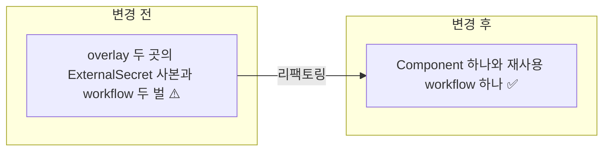

# ⬜ Orchid 배포 자산의 harbor-registry ExternalSecret 중복과 publish workflow 중복을 공통 정의로 정리

## 계획 관계

> **관계 스키마**: `1`
> **계획 ID**: `orchid:261015_refac_orchid-deploy-duplication`
> **출처 판정**: `연결`

| 관계 | 대상 계획 ID | 조건 | 근거·인수 범위 |
| --- | --- | --- | --- |
| 파생 | `orchid:261014_feat_orchid-harbor-image-publish` | 해당 없음 | 계획 평가 리팩토링 ⚠️ 두 항목(overlay별 `harbor-registry` ExternalSecret 중복, 서비스 이름만 다른 publish workflow 2개)을 인수한다 |
| 실행 의존 | `orchid:261014_fix_orchid-secret-store-scope` | `plan-complete` | 같은 파일 `harbor-registry-external-secret.yaml`의 `secretStoreRef`를 `SecretStore/orchid-openbao`로 바꾸는 계획이다. 완료 뒤 staging 정의를 Component 기준으로 삼는다 |
| 실행 의존 | `orchid:261015_fix_orchid-production-release-prerequisites` | `plan-complete` | production이 같은 namespace 전용 SecretStore를 쓰게 되기 전에는 두 overlay 정의가 의도적으로 달라 합칠 수 없다 |

<!-- plan-relations-summary:start -->
> 자동 생성 관계 요약. 원본은 위 관계 표입니다.

| 구분 | 계획·조건 |
| --- | --- |
| 최초 계획 | [✅ Orchid 서비스 독립 GitOps 배포 매니페스트 구축 및 Hanul 온보딩 계획](<../history/2610/W3/261014/261014_ops_orchid-service-gitops-manifest-onboarding.md>) `orchid:261014_ops_orchid-service-gitops-manifest-onboarding` |
| 직접 출처 | [✅ Orchid 서비스 이미지를 Harbor orchid 프로젝트로 퍼블리시하는 경로 구축](<../history/2610/W3/261014/261014_feat_orchid-harbor-image-publish.md>) `orchid:261014_feat_orchid-harbor-image-publish` |
| 직접 후속 | [⬜ Orchid 재사용 publish workflow와 staging 태그 자동 갱신 사용자 실행 검증](<261015_verify_orchid-publish-workflow-and-tag-automation.md>) `orchid:261015_verify_orchid-publish-workflow-and-tag-automation` |
| 계보 경로 | [✅ Orchid 서비스 독립 GitOps 배포 매니페스트 구축 및 Hanul 온보딩 계획](<../history/2610/W3/261014/261014_ops_orchid-service-gitops-manifest-onboarding.md>) `orchid:261014_ops_orchid-service-gitops-manifest-onboarding` → [✅ Orchid 서비스 Hanul GitOps 배포 사용자 실행 검증](<../history/2610/W3/261014/261014_verify_orchid-hanul-gitops-deployment.md>) `orchid:261014_verify_orchid-hanul-gitops-deployment` → [✅ Orchid staging Pod가 Harbor 이미지 pull 인증 없이 ImagePullBackOff로 기동하지 못하는 문제 수정](<../history/2610/W3/261014/261014_fix_orchid-harbor-image-pull-secret.md>) `orchid:261014_fix_orchid-harbor-image-pull-secret` → [✅ Orchid 서비스 이미지를 Harbor orchid 프로젝트로 퍼블리시하는 경로 구축](<../history/2610/W3/261014/261014_feat_orchid-harbor-image-publish.md>) `orchid:261014_feat_orchid-harbor-image-publish` → [⬜ Orchid 배포 자산의 harbor-registry ExternalSecret 중복과 publish workflow 중복을 공통 정의로 정리](<261015_refac_orchid-deploy-duplication.md>) `orchid:261015_refac_orchid-deploy-duplication` |
| 실행 의존 | [✅ Orchid ExternalSecret이 공용 ClusterSecretStore로 OpenBao 전체를 읽을 수 있는 과권한 수정](<../history/2610/W3/261014/261014_fix_orchid-secret-store-scope.md>) `orchid:261014_fix_orchid-secret-store-scope` — plan-complete |
| 실행 의존 | [⬜ Orchid production 배포의 누락된 OpenBao 시크릿과 존재하지 않는 이미지 태그 수정](<261015_fix_orchid-production-release-prerequisites.md>) `orchid:261015_fix_orchid-production-release-prerequisites` — plan-complete |
| 파생 | [✅ Orchid 서비스 이미지를 Harbor orchid 프로젝트로 퍼블리시하는 경로 구축](<../history/2610/W3/261014/261014_feat_orchid-harbor-image-publish.md>) `orchid:261014_feat_orchid-harbor-image-publish` — 해당 없음 |
| 착수 조건 | 대기 |
<!-- plan-relations-summary:end -->

## 결정이 필요한 사항

1. **ExternalSecret 공통화 방식** — Kustomize `Component`(`deploy/k8s/components/harbor-registry/`)로 둔다 (권장)
- 근거: staging·production overlay가 같은 내용의 `harbor-registry-external-secret.yaml`을 각자 가진다. base에 넣으면 base를 직접 렌더링하는 도구가 namespace 없는 ExternalSecret을 만든다. Component는 포함하는 overlay에서만 렌더링되고 namespace도 overlay가 정한다.
- 대안: base `resources`에 넣는다. 파일은 하나가 되지만 위 이유로 채택하지 않는다.

2. **workflow 공통화 방식** — 재사용 workflow `publish-service-image.yml`(`workflow_call`)과 서비스별 얇은 호출 workflow를 둔다 (권장)
- 근거: `publish-api-gateway-image.yml`과 `publish-clipboard-image.yml`은 서비스 이름, Dockerfile 경로, cache scope만 다르다. 서비스별 파일 이름을 유지하면 `Invoke-WorkflowDispatch.ps1 -Workflow publish-api-gateway-image.yml` 진입점과 verify 계획의 명령이 그대로 동작한다.
- 대안: 서비스 이름을 입력으로 받는 단일 dispatch workflow. 진입점 이름이 바뀌어 기존 절차를 함께 바꿔야 한다.

## 배경

| 항목 | 현재 상태 (2026-10-15, `main`) |
| --- | --- |
| overlay ExternalSecret | `deploy/k8s/overlays/staging/harbor-registry-external-secret.yaml`은 `SecretStore/orchid-openbao`, `deploy/k8s/overlays/production/harbor-registry-external-secret.yaml`은 `ClusterSecretStore/openbao`를 쓴다. 나머지 필드(`target`, `template`, `remoteRef.key: infra/harbor/orchid-registry-pull`)는 같다. store 차이는 실행 의존 계획 2건이 끝나면 사라진다 |
| publish workflow | `.github/workflows/publish-api-gateway-image.yml`, `.github/workflows/publish-clipboard-image.yml` 두 파일이 `__SVC__`·Dockerfile 경로만 다르다 |
| 기존 테스트 | `test/Deploy/OrchidManifestClusterCompat.Tests.ps1`(ExternalSecret 렌더링), `test/Deploy/OrchidImagePublish.Tests.ps1`(workflow·Dockerfile 내용) |

중복은 한쪽만 고치고 다른 쪽을 놓치는 drift 위험을 만든다. 2026-10-14 pull 자격 key 교체도 두 파일을 함께 바꿔야 했다.

## 변경 범위



| 레이어 | 파일 | 변경 내용 |
| --- | --- | --- |
| 배포 | `deploy/k8s/components/harbor-registry/kustomization.yaml` | 신규. `kind: Component` |
| 배포 | `deploy/k8s/components/harbor-registry/external-secret.yaml` | 신규. 기존 overlay 사본 내용 이동 |
| 배포 | `deploy/k8s/overlays/staging/kustomization.yaml` | resources에서 사본 제거, `components`에 추가 |
| 배포 | `deploy/k8s/overlays/production/kustomization.yaml` | 동일 |
| 배포 | `deploy/k8s/overlays/staging/harbor-registry-external-secret.yaml` | 삭제 |
| 배포 | `deploy/k8s/overlays/production/harbor-registry-external-secret.yaml` | 삭제 |
| CI | `.github/workflows/publish-service-image.yml` | 신규. `workflow_call` 재사용 workflow |
| CI | `.github/workflows/publish-api-gateway-image.yml` | 재사용 workflow 호출만 남긴다 |
| CI | `.github/workflows/publish-clipboard-image.yml` | 동일 |
| 테스트 | `test/Deploy/OrchidDeployDuplication.Tests.ps1` | 신규. 렌더링 동등성, 사본 부재, 호출 workflow 계약 |
| 테스트 | `test/Deploy/OrchidImagePublish.Tests.ps1` | workflow 내용 검사 대상을 재사용 workflow로 옮긴다 |

## 단계별 수정 계획

### ⬜ Step 1: harbor-registry ExternalSecret을 Component로 옮긴다

**파일**: `deploy/k8s/components/harbor-registry/kustomization.yaml`

TO-BE:

```yaml
apiVersion: kustomize.config.k8s.io/v1alpha1
kind: Component
resources:
  - external-secret.yaml
```

**파일**: `deploy/k8s/components/harbor-registry/external-secret.yaml`

TO-BE:

```yaml
# ✅ 두 overlay 공통 정의. namespace 는 포함하는 overlay 가 지정하고 store 는 namespace 전용 SecretStore 를 쓴다
apiVersion: external-secrets.io/v1
kind: ExternalSecret
metadata:
  name: harbor-registry
spec:
  refreshInterval: 1h
  secretStoreRef:
    name: orchid-openbao
    kind: SecretStore
  target:
    name: harbor-registry
    creationPolicy: Owner
    template:
      type: kubernetes.io/dockerconfigjson
  data:
    - secretKey: .dockerconfigjson
      remoteRef:
        key: infra/harbor/orchid-registry-pull
        property: .dockerconfigjson
```

**파일**: `deploy/k8s/overlays/staging/harbor-registry-external-secret.yaml`

**파일**: `deploy/k8s/overlays/production/harbor-registry-external-secret.yaml`

두 파일을 삭제한다.

**파일**: `deploy/k8s/overlays/staging/kustomization.yaml`

AS-IS:

```yaml
resources:
  - ../../base
  - service-account.yaml
  - secret-store.yaml
  - external-secret.yaml
  - harbor-registry-external-secret.yaml
  - ingress.yaml
```

TO-BE:

```yaml
resources:
  - ../../base
  - service-account.yaml
  - secret-store.yaml
  - external-secret.yaml
  - ingress.yaml
components:
  - ../../components/harbor-registry
```

**파일**: `deploy/k8s/overlays/production/kustomization.yaml`

착수 시점의 production `resources` 목록을 다시 읽고 `harbor-registry-external-secret.yaml` 한 줄만 `components`로 옮긴다. 착수 전에 production 사본의 `secretStoreRef`가 `SecretStore/orchid-openbao`인지 확인하고, 아니면 착수하지 않는다.

### ⬜ Step 2: publish workflow를 재사용 workflow로 합친다

**파일**: `.github/workflows/publish-service-image.yml`

TO-BE:

```yaml
# ✅ 서비스별 차이는 입력으로만 받는다
name: publish-service-image

on:
  workflow_call:
    inputs:
      service:
        required: true
        type: string
      dockerfile:
        required: true
        type: string
      ref:
        required: false
        type: string
        default: ''
    outputs:
      stag-tag:
        value: ${{ jobs.publish.outputs.stag-tag }}

permissions:
  contents: read

jobs:
  publish:
    name: publish ${{ inputs.service }}
    runs-on: ubuntu-latest
    timeout-minutes: 30
    outputs:
      stag-tag: ${{ steps.tags.outputs.stag-tag }}
    steps:
      - uses: actions/checkout@v5
        with:
          ref: ${{ inputs.ref || github.ref }}

      - name: Compute tags
        id: tags
        run: |
          SHORT_SHA="$(git rev-parse --short=7 HEAD)"
          BUILD_STAMP="$(date -u +%Y%m%d%H%M%S)"
          IMAGE="${{ secrets.HARBOR_REGISTRY }}/orchid/${{ inputs.service }}"
          echo "tags=${IMAGE}:sha-${SHORT_SHA},${IMAGE}:stag-${BUILD_STAMP}-${SHORT_SHA}" >> "$GITHUB_OUTPUT"
          echo "stag-tag=stag-${BUILD_STAMP}-${SHORT_SHA}" >> "$GITHUB_OUTPUT"

      - uses: docker/setup-buildx-action@v4

      - name: Login to Harbor
        uses: docker/login-action@v4
        with:
          registry: ${{ secrets.HARBOR_REGISTRY }}
          username: ${{ secrets.HARBOR_USERNAME }}
          password: ${{ secrets.HARBOR_PASSWORD }}

      - name: Build and push
        uses: docker/build-push-action@v7
        with:
          context: .
          file: ${{ inputs.dockerfile }}
          push: true
          tags: ${{ steps.tags.outputs.tags }}
          labels: |
            org.opencontainers.image.source=${{ github.server_url }}/${{ github.repository }}
            org.opencontainers.image.revision=${{ github.sha }}
          cache-from: type=gha,scope=${{ inputs.service }}
          cache-to: type=gha,scope=${{ inputs.service }},mode=min,ignore-error=true
          provenance: false

      - name: Summary
        run: echo "Published staging tag ${{ steps.tags.outputs.stag-tag }}" >> "$GITHUB_STEP_SUMMARY"
```

**파일**: `.github/workflows/publish-api-gateway-image.yml`

AS-IS:

```yaml
# ❌ 재사용 workflow 와 같은 job 정의를 서비스마다 복제
jobs:
  publish:
    name: publish api-gateway
    runs-on: ubuntu-latest
    steps:
      - uses: actions/checkout@v5
      # ... Compute tags, Login, Build and push, Summary
```

TO-BE:

```yaml
# ✅ dispatch 진입점 이름은 유지하고 재사용 workflow 를 호출한다
name: publish-api-gateway-image

on:
  workflow_dispatch:
    inputs:
      ref:
        description: 'Git ref to build (branch, tag, or full SHA). Defaults to the dispatch ref.'
        required: false
        default: ''

permissions:
  contents: read

concurrency:
  group: publish-api-gateway-${{ github.event.inputs.ref || github.ref }}
  cancel-in-progress: false

jobs:
  publish:
    uses: ./.github/workflows/publish-service-image.yml
    with:
      service: api-gateway
      dockerfile: src/Service/ApiGateway/Dockerfile
      ref: ${{ github.event.inputs.ref }}
    secrets: inherit
```

**파일**: `.github/workflows/publish-clipboard-image.yml`

AS-IS·TO-BE는 api-gateway와 같고 `name`, `concurrency.group`, `service: clipboard`, `dockerfile: src/Service/Clipboard/Dockerfile`만 다르다.

## 테스트 계획

> 위치: `test/Deploy/`
> 프레임워크: Pester 5
> 패턴: Given/When/Then (Four-Phase Test). `kubectl kustomize` 렌더링과 파일 내용만 사용한다.

### ⬜ 테스트용 Stub 정의

**파일**: `test/Deploy/OrchidDeployDuplication.Tests.ps1`

```powershell
BeforeAll {
    $script:RepositoryRoot = (Resolve-Path -Path (Join-Path -Path $PSScriptRoot -ChildPath '../..')).Path

    function Get-RenderedManifest {
        [CmdletBinding()]
        param([Parameter(Mandatory)] [string] $Overlay)

        $Path = Join-Path -Path $script:RepositoryRoot -ChildPath "deploy/k8s/overlays/$Overlay"
        return (kubectl kustomize $Path) -join "`n"
    }
}
```

### ⬜ 테스트: `OrchidDeployDuplication.Tests.ps1`

**파일**: `test/Deploy/OrchidDeployDuplication.Tests.ps1`

```powershell
Describe 'Orchid 배포 자산 중복 제거' {
    It 'Given <_> overlay, When 렌더링, Then harbor-registry ExternalSecret 이 overlay namespace 로 정확히 하나 있다' -ForEach @(
        @{ Overlay = 'staging'; Namespace = 'orchid-staging' }
        @{ Overlay = 'production'; Namespace = 'orchid-production' }
    ) {
        # Given
        $Manifest = Get-RenderedManifest -Overlay $Overlay

        # When
        $Count = [regex]::Matches($Manifest, '(?ms)^kind: ExternalSecret\r?\nmetadata:\r?\n  name: harbor-registry\r?\n  namespace: ' + [regex]::Escape($Namespace)).Count

        # Then
        $Count | Should -Be 1
    }

    It 'Given <Overlay> overlay, When 렌더링, Then harbor-registry 는 namespace 전용 SecretStore 를 쓴다' -ForEach @(@{ Overlay = 'staging' }, @{ Overlay = 'production' }) {
        # Given
        $Manifest = Get-RenderedManifest -Overlay $Overlay

        # When / Then
        $Manifest | Should -Match '(?ms)name: harbor-registry.*?secretStoreRef:\s+kind: SecretStore\s+name: orchid-openbao|(?ms)name: harbor-registry.*?secretStoreRef:\s+name: orchid-openbao\s+kind: SecretStore'
    }

    It 'Given <_> overlay 디렉터리, When 파일 확인, Then harbor-registry 사본이 없다' -ForEach @('staging', 'production') {
        # Given
        $Path = Join-Path -Path $script:RepositoryRoot -ChildPath "deploy/k8s/overlays/$_/harbor-registry-external-secret.yaml"

        # When / Then
        Test-Path -LiteralPath $Path | Should -BeFalse
    }

    It 'Given <_> 호출 workflow, When 내용 확인, Then 재사용 workflow 를 secrets inherit 로 호출한다' -ForEach @('api-gateway', 'clipboard') {
        # Given
        $Content = Get-Content -Raw -LiteralPath (Join-Path -Path $script:RepositoryRoot -ChildPath ".github/workflows/publish-$_-image.yml")

        # When / Then
        $Content | Should -Match 'uses: \./\.github/workflows/publish-service-image\.yml'
        $Content | Should -Match "service: $_"
        $Content | Should -Match 'secrets: inherit'
        $Content | Should -Match 'workflow_dispatch:'
    }
}
```

production namespace `orchid-production`은 2026-10-15 `c60369f`에서 overlay `namespace:`로 확정된 값이다.

**파일**: `test/Deploy/OrchidImagePublish.Tests.ps1`

AS-IS:

```powershell
# ❌ 서비스별 workflow 파일에서 build 내용을 찾는다
$Content = Get-RepositoryFile -RelativePath $Workflow
$Content | Should -Match "/orchid/$Name"
```

TO-BE:

```powershell
# ✅ build 내용은 재사용 workflow 하나에서, 서비스 값은 호출 workflow 에서 확인한다
$Shared = Get-RepositoryFile -RelativePath '.github/workflows/publish-service-image.yml'
$Caller = Get-RepositoryFile -RelativePath $Workflow
$Shared | Should -Match '/orchid/\$\{\{ inputs\.service \}\}'
$Caller | Should -Match "dockerfile: $([regex]::Escape($Dockerfile))"
```

### 테스트 요약

| 테스트 클래스 | 검증 대상 | 테스트 수 |
| --- | --- | --- |
| `OrchidDeployDuplication.Tests.ps1` | overlay별 ExternalSecret 1개, 전용 SecretStore 사용, 사본 부재, 호출 workflow 계약 | 8 |
| `OrchidImagePublish.Tests.ps1` | 재사용 workflow 기준으로 갱신 | 기존 수 유지 |
| **합계** | | **8 + 기존** |

### 테스트 결과

| 범위 | 실행 명령 | 총 테스트 | 통과 | 실패 | 결과 |
| --- | --- | ---: | ---: | ---: | :---: |
| 수정 전 (Red) | `pwsh -NoProfile -NonInteractive -Command "Invoke-Pester test/Deploy"` | — | — | — | ⬜ |
| 변경 범위 | `pwsh -NoProfile -NonInteractive -Command "Invoke-Pester test/Deploy"` | — | — | — | ⬜ |
| 전체 | `Test-KustomizationBuild.ps1 -KustomizationPath @('deploy/k8s/overlays/staging/kustomization.yaml','deploy/k8s/overlays/production/kustomization.yaml')` | — | — | — | ⬜ |

## 후속 검증

| 검증 항목 | 이관한 verify 계획 | 상태 |
| --- | --- | --- |
| 재사용 workflow 로 publish 실행 성공 | [261015_verify_orchid-publish-workflow-and-tag-automation.md](261015_verify_orchid-publish-workflow-and-tag-automation.md) | 이관 |
| Component 반영 후 클러스터 harbor-registry 동기화 유지 | [261015_verify_orchid-publish-workflow-and-tag-automation.md](261015_verify_orchid-publish-workflow-and-tag-automation.md) | 이관 |

## 계획 평가

| 관점 | 참조 문서 | 평가 항목 | 결과 |
| --- | --- | --- | --- |
| 클린 코드 | `clean-code.md` | 이름/책임/오류 처리 | ✅ |
| 아키텍처 | `clean-architecture.md` | DIP/경계/응집도 | ✅ |
| 디자인 패턴 | `design-pattern.md` | 패턴 적절성 | 해당 없음 |
| 엔터프라이즈 패턴 | `enterprise-application-architecture.md` | 레이어링/분리 | 해당 없음 |
| 리팩토링 | `refactoring.md` | 코드 냄새/개선 기회 | ✅ |
| 테스트 품질 | `x-unit-test-patterns.md` | Four-Phase/Test Smell | ⚠️ |
| .NET 도메인·컨벤션 | `dotnet/docs/guide·convention` | 불변식 배치/캡슐화/도메인 이벤트/영속화 무지 | 해당 없음 |

**특이사항:**

- 리팩토링 ✅: 중복 코드(Duplicated Code) 두 건을 공통 정의 하나로 모은다. 렌더링 결과와 dispatch 진입점 이름은 바꾸지 않는다.
- 테스트 품질 ⚠️: workflow 검증은 문자열 매칭이다. 재사용 workflow 실제 실행은 verify 계획으로 확인한다.
- 실행 순서: 실행 의존 계획 2건(secret-store-scope, production-release-prerequisites)이 끝난 뒤 착수한다. Step 2(workflow)는 store 와 무관하므로 먼저 진행할 수 있다. `orchid:261015_feat_orchid-staging-image-tag-automation`이 이 계획의 재사용 workflow에 태그 갱신을 추가하므로 이 계획을 먼저 완료한다.
- .NET 도메인·컨벤션 해당 없음: C# 코드 변경이 없다.

## 작업 순서

1. ⬜ `OrchidDeployDuplication.Tests.ps1`을 작성하고 `OrchidImagePublish.Tests.ps1` 기대값을 바꿔 실패(Red)를 확인한다.
2. ⬜ Step 1: Component를 만들고 두 overlay 사본을 지운다.
3. ⬜ Step 2: 재사용 workflow와 호출 workflow 2개로 바꾼다.
4. ⬜ Pester와 `Test-KustomizationBuild.ps1`을 통과시킨다.
5. ⬜ 커밋·푸시 후 verify 계획으로 넘긴다.
